<div align="center">


<sub><i>A computer simulation of a 964 body shell being twisted. Colors show where the stress goes. It is a calculation, not a product.</i></sub>

# porscheparts

**Studying and redesigning parts of the Porsche 911 (964 and 993 generations) on a computer,
with nature-inspired 3D shapes. Nothing is manufactured or sold.**

[](https://github.com/cluster2600/porscheparts/actions/workflows/validate.yml)
[](LICENSE)
[](https://www.python.org/)
[](docs/SAFETY.md)
[](docs/TRANSLATION.md)

</div>

> [!NOTE]
> **In 30 seconds**
> - **What:** a research project that studies parts of two classic Porsche 911
>   generations, the 964 (1989–1994) and the 993 (1994–1998), and designs
>   possible replacements on a computer.
> - **How:** the shapes are generated by software, often organic, "bionic"
>   shapes inspired by bone and plant structures. Then they are tested in
>   simulation.
> - **Rule:** every claim is tied to a source or a calculation anyone can rerun.
>   Claims that stop holding are withdrawn, and the project says so.
> - **Status:** no part is validated, fitted to a car, manufactured or sold.
> - **Technical detail:** [docs/ENGINEERING_OVERVIEW.md](docs/ENGINEERING_OVERVIEW.md).

## Why this project exists

Classic cars outlive their supply chains. Many 964 and 993 parts are no longer
made, or cost a lot when they appear. Metal and polymer 3D printing could, in
principle, reproduce them, and sometimes make them lighter or better cooled.

But a car part is only useful if it fits and if it is safe. A shape on a
screen proves neither. So this project focuses on the evidence first: where
each dimension comes from, what is measured and what is assumed, and what a
calculation does and does not show. Parts that could hurt someone if they
failed, such as brakes, suspension or engine internals, stay blocked until a
qualified engineer reviews them.

## How it works, in plain words

1. **Collect sources.** Workshop manuals, factory part catalogues, supplier
   data sheets and scans. Each source is recorded with where it came from and
   whether it may be reused.
2. **Record each part.** Every part gets a structured record: what it is,
   which car it fits, how risky its failure would be, and how far it has been
   checked.
3. **Generate the geometry.** New shapes are built in code with PicoGK, an
   open-source design engine by LEAP 71. It is known for organic structures
   such as gyroid lattices. Existing CAD drawings are kept where they already
   describe a part well.
4. **Simulate.** The shapes are tested on the computer: how air flows through a
   cooling fan, or where stress builds up in a bracket.
5. **Check independently.** On each change, automated checks validate the
   records, run the tests, regenerate pages and compare file fingerprints. A
   result produced by a model is never allowed to approve itself.
6. **Only then, a prototype.** A physical part would come only after a
   professional engineering review. For now, the project manufactures nothing.
   It only publishes a few print files for non-critical trim tests and
   engraved display mock-ups.

### Glossary

| term | meaning |
|---|---|
| **PicoGK** | Free, open-source software by LEAP 71 that builds 3D shapes from code. It works in small 3D pixels (voxels), which makes organic shapes and lattices easy. |
| **Bionic design / topology optimization** | Letting software decide where material is needed, like bone grows where it is loaded. The result often looks organic. |
| **Gyroid lattice core** | A repeating, sponge-like internal structure. It can make a part light while keeping it stiff. |
| **LPBF metal 3D printing** | Laser powder-bed fusion: a laser melts thin layers of metal powder, one on top of the other, to build a part. |
| **CAD** | Computer-aided design: the digital drawings and 3D models engineers work from. |
| **FE / CFD simulation** | Finite-element analysis computes stress and stiffness. Computational fluid dynamics computes airflow and heat. |
| **Concept model** | A design study. It is not a copy of the original part and not a validated replacement. |

## What the project demonstrates

For readers assessing the work, this is what the repository shows in practice:

- **Computational design.** Parts are described as code and parameters, not
  drawn by hand, so a design change can be regenerated and compared.
- **Engineering simulation.** Structural and airflow studies with open-source
  solvers (CalculiX, OpenFOAM), including mesh checks and comparisons against
  published reference cases.
- **Evidence and data governance.** Every source carries its provenance and
  usage rights. Key files are fingerprinted (SHA-256 digests) so that results
  cannot be changed silently. Withdrawn claims stay on record.
- **Safety-first judgment.** A written [safety policy](docs/SAFETY.md) decides what
  may be published. When in doubt, a part is blocked, not promoted.
- **Local AI model training.** [qwen-picogk](https://github.com/cluster2600/qwen-picogk)
  is a small language model, adapted with MLX on Apple Silicon, that proposes design
  parameters. Its proposals are checked by independent code before any shape
  is built, and model output never counts as engineering approval.
- **Testing and automation.** One command, `make check`, validates the
  catalogue, runs the test suite and verifies that generated pages are up to
  date. Continuous integration runs it on every push and pull request (the
  badge above).
- **Documentation and architecture.** Decisions, requirements and evidence
  are linked in written [architecture records](docs/architecture/README.md).

## The parts

Each picture links to the part's own page, which shows the concept next to
links to the original part.

<!-- BEGIN PART GALLERY -->

> [!CAUTION]
> Every picture below is a computer-generated concept model. It is not the
> original Porsche part, not a validated part and not for sale.

*43 part records; all of them are design studies (status `concept`). 26 are blocked until a professional engineering review (25 prohibited pending engineering, 1 safety-critical). 0 are released.*

<table>
<tr>
<td align="center" valign="top" width="33%"><a href="parts/993-body-front-impact-support-alsi10mg-f0-0001/README.md">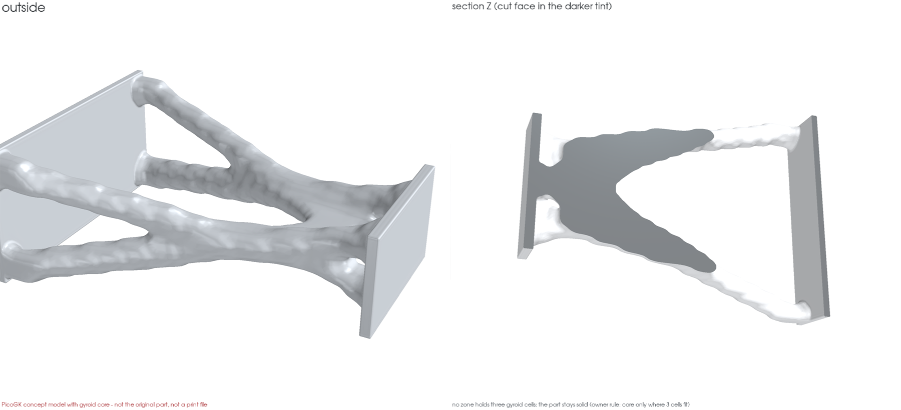</a><br><sub><i>Concept model — not the original part, not a print file</i></sub><br><a href="parts/993-body-front-impact-support-alsi10mg-f0-0001/README.md"><b>993 front impact support</b></a><br><sub>Design study: blocked until a professional engineering review</sub></td>
<td align="center" valign="top" width="33%"><a href="parts/993-body-front-lid-0001/README.md">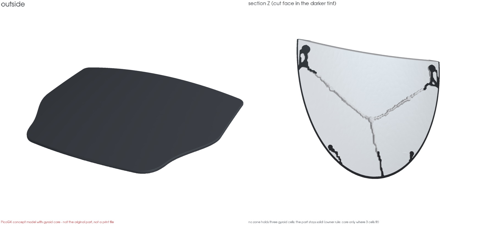</a><br><sub><i>Concept model — not the original part, not a print file</i></sub><br><a href="parts/993-body-front-lid-0001/README.md"><b>Front lid</b></a><br><sub>Design study: functional part, needs documented testing</sub></td>
<td align="center" valign="top" width="33%"><a href="parts/993-ca-charge-pipe-set-pet-0001/README.md">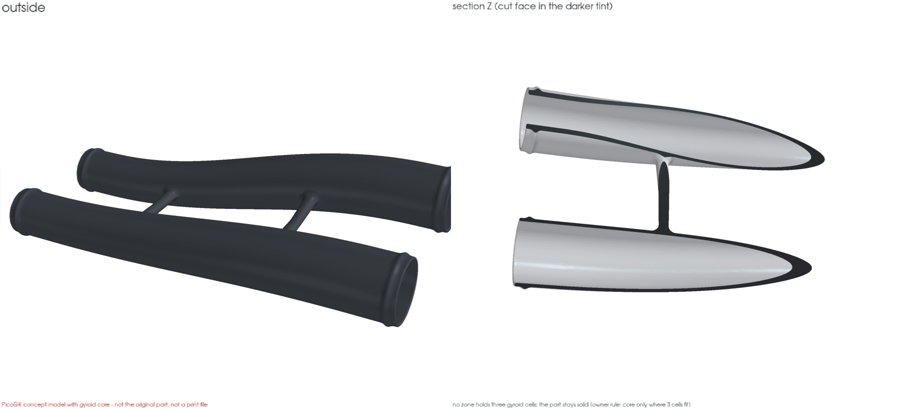</a><br><sub><i>Concept model — not the original part, not a print file</i></sub><br><a href="parts/993-ca-charge-pipe-set-pet-0001/README.md"><b>993 Turbo charge-air tract transcribed parts (group 107-45)</b></a><br><sub>Design study: low-risk part, needs a fit check</sub></td>
</tr>
<tr>
<td align="center" valign="top" width="33%"><a href="parts/993-ca-turbo-intake-manifold-pet-0001/README.md">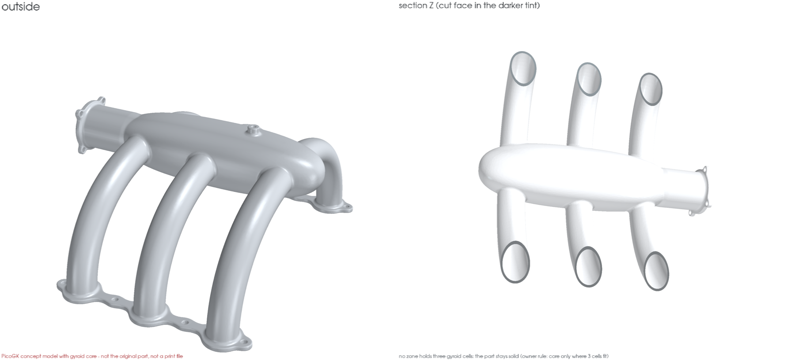</a><br><sub><i>Concept model — not the original part, not a print file</i></sub><br><a href="parts/993-ca-turbo-intake-manifold-pet-0001/README.md"><b>993 Turbo turbocharging intake tract (group 107-20)</b></a><br><sub>Design study: low-risk part, needs a fit check</sub></td>
<td align="center" valign="top" width="33%"><a href="parts/993-elec-headlamp-spring-hook-f0-0001/README.md">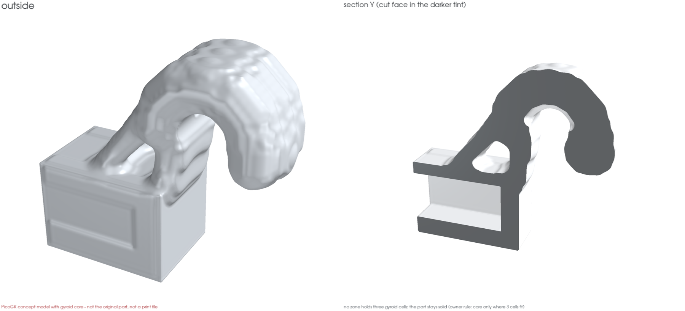</a><br><sub><i>Concept model — not the original part, not a print file</i></sub><br><a href="parts/993-elec-headlamp-spring-hook-f0-0001/README.md"><b>Headlamp spring hook repair</b></a><br><sub>Design study: functional part, needs documented testing</sub></td>
<td align="center" valign="top" width="33%"><a href="parts/993-eng-bracket-0001/README.md">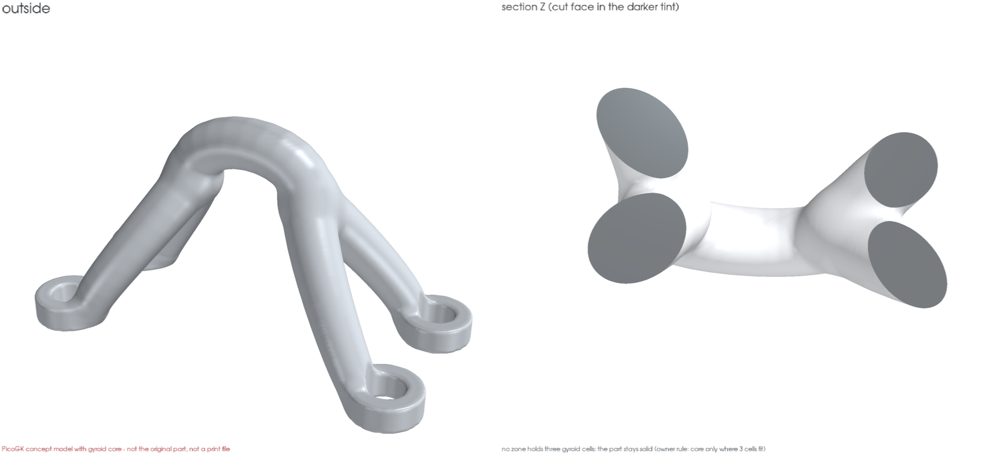</a><br><sub><i>Concept model — not the original part, not a print file</i></sub><br><a href="parts/993-eng-bracket-0001/README.md"><b>Turbo engine center bracket</b></a><br><sub>Design study: blocked until a professional engineering review</sub></td>
</tr>
<tr>
<td align="center" valign="top" width="33%"><a href="parts/993-eng-carrier-0001/README.md">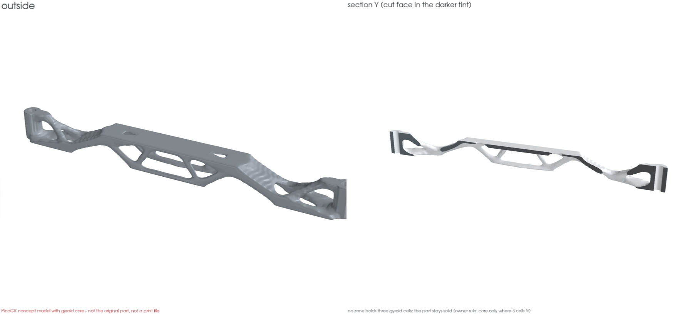</a><br><sub><i>Concept model — not the original part, not a print file</i></sub><br><a href="parts/993-eng-carrier-0001/README.md"><b>Turbo engine carrier (Motortraeger)</b></a><br><sub>Design study: safety-critical, blocked until a formal engineering review</sub></td>
<td align="center" valign="top" width="33%"><a href="parts/993-eng-chain-case-0001/README.md">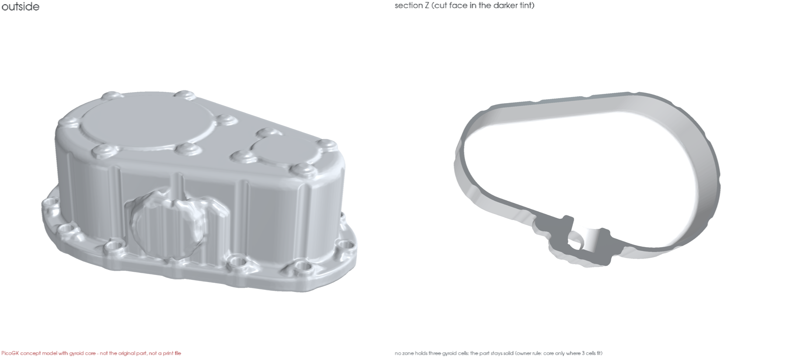</a><br><sub><i>Concept model — not the original part, not a print file</i></sub><br><a href="parts/993-eng-chain-case-0001/README.md"><b>993 timing chain case and its lids</b></a><br><sub>Design study: blocked until a professional engineering review</sub></td>
<td align="center" valign="top" width="33%"><a href="parts/993-eng-chain-case-lid-ti-f0-0001/README.md">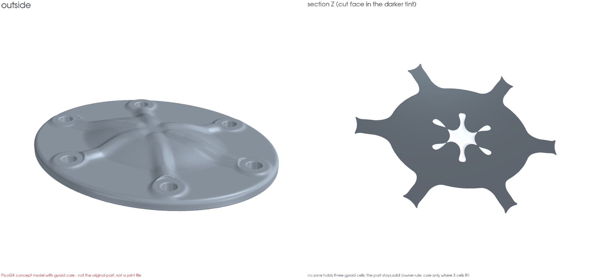</a><br><sub><i>Concept model — not the original part, not a print file</i></sub><br><a href="parts/993-eng-chain-case-lid-ti-f0-0001/README.md"><b>Left chain case lid 964 105 107 01</b></a><br><sub>Design study: functional part, needs documented testing</sub></td>
</tr>
<tr>
<td align="center" valign="top" width="33%"><a href="parts/993-eng-connecting-rod-ti64-f0-0001/README.md">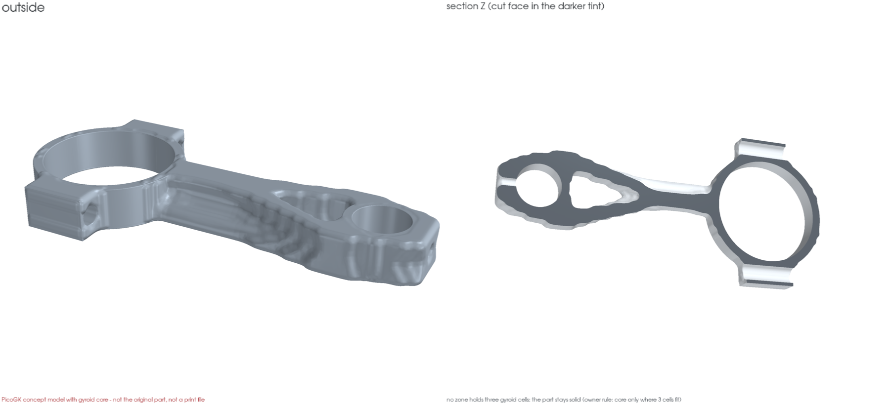</a><br><sub><i>Concept model — not the original part; display mock-up only, never for use</i></sub><br><a href="parts/993-eng-connecting-rod-ti64-f0-0001/README.md"><b>993/993 Turbo connecting rod</b></a><br><sub>Design study: blocked until a professional engineering review</sub></td>
<td align="center" valign="top" width="33%"><a href="parts/993-eng-cooling-impeller-alsi10mg-f0-0001/README.md"></a><br><sub><i>Concept model — not the original part, not a print file</i></sub><br><a href="parts/993-eng-cooling-impeller-alsi10mg-f0-0001/README.md"><b>993 engine cooling fan — archived Carrera F0 concept</b></a><br><sub>Design study: blocked until a professional engineering review</sub></td>
<td align="center" valign="top" width="33%"><a href="parts/993-eng-cooling-impeller-we43-f1-0001/README.md">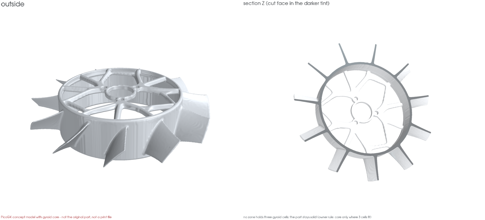</a><br><sub><i>Concept model — not the original part, not a print file</i></sub><br><a href="parts/993-eng-cooling-impeller-we43-f1-0001/README.md"><b>Engine cooling fan impeller</b></a><br><sub>Design study: blocked until a professional engineering review</sub></td>
</tr>
<tr>
<td align="center" valign="top" width="33%"><a href="parts/993-eng-cylinder-head-4v-f0-0001/README.md"></a><br><sub><i>Concept model — not the original part, not a print file</i></sub><br><a href="parts/993-eng-cylinder-head-4v-f0-0001/README.md"><b>M64 four-valve water-cooled cylinder head — creation prepar…</b></a><br><sub>Design study: blocked until a professional engineering review</sub></td>
<td align="center" valign="top" width="33%"><a href="parts/993-eng-exhaust-manifold-in625-f0-0001/README.md">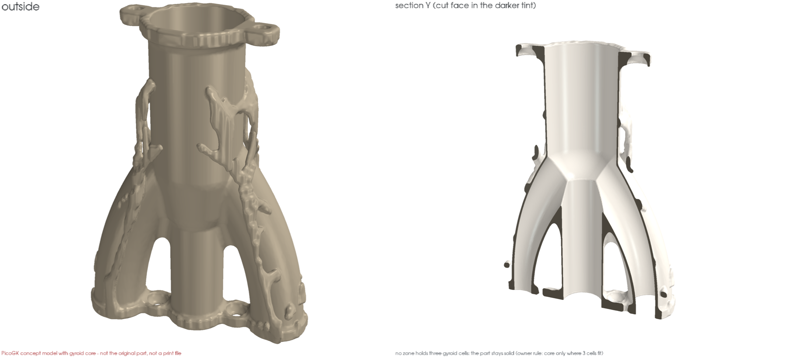</a><br><sub><i>Concept model — not the original part, not a print file</i></sub><br><a href="parts/993-eng-exhaust-manifold-in625-f0-0001/README.md"><b>993 Turbo three-into-one exhaust manifold</b></a><br><sub>Design study: blocked until a professional engineering review</sub></td>
<td align="center" valign="top" width="33%"><a href="parts/993-eng-exhaust-valve-f1-0001/README.md">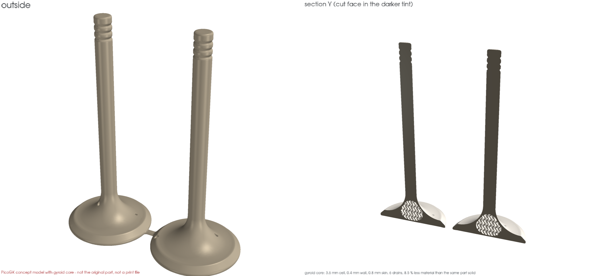</a><br><sub><i>Concept model — not the original part, not a print file</i></sub><br><a href="parts/993-eng-exhaust-valve-f1-0001/README.md"><b>993 exhaust valves</b></a><br><sub>Design study: blocked until a professional engineering review</sub></td>
</tr>
<tr>
<td align="center" valign="top" width="33%"><a href="parts/993-eng-fan-housing-alsi10mg-f0-0001/README.md">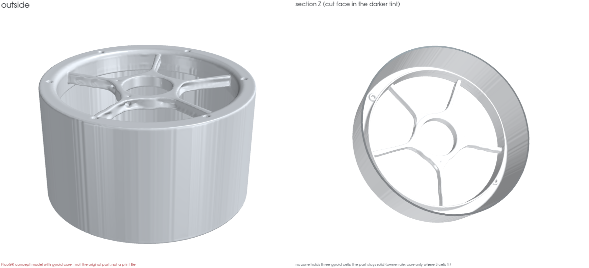</a><br><sub><i>Concept model — not the original part, not a print file</i></sub><br><a href="parts/993-eng-fan-housing-alsi10mg-f0-0001/README.md"><b>Stationary engine fan housing</b></a><br><sub>Design study: blocked until a professional engineering review</sub></td>
<td align="center" valign="top" width="33%"><a href="parts/993-eng-fan-stator-alsi10mg-f1-0001/README.md">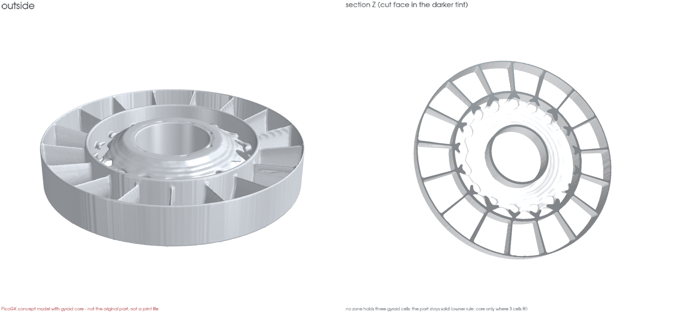</a><br><sub><i>Concept model — not the original part, not a print file</i></sub><br><a href="parts/993-eng-fan-stator-alsi10mg-f1-0001/README.md"><b>Engine cooling fan guide-vane ring (stator)</b></a><br><sub>Design study: blocked until a professional engineering review</sub></td>
<td align="center" valign="top" width="33%"><a href="parts/993-eng-intake-valve-f1-0001/README.md">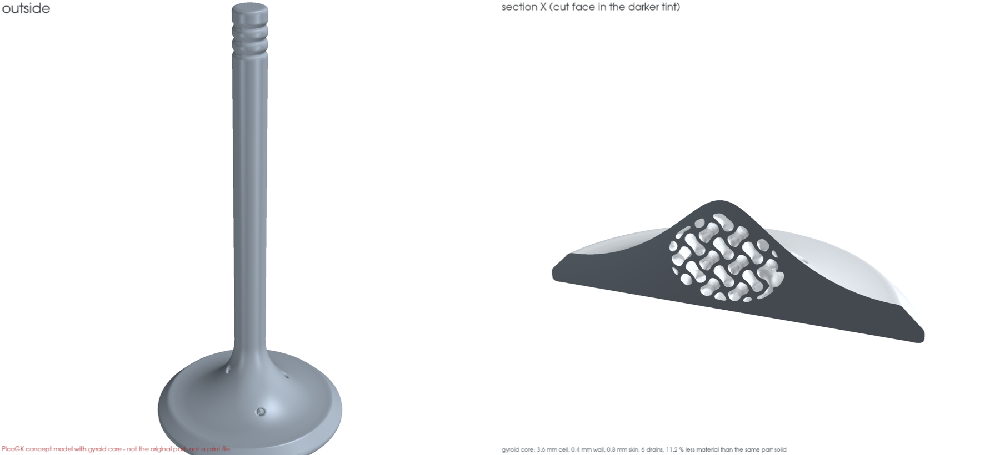</a><br><sub><i>Concept model — not the original part, not a print file</i></sub><br><a href="parts/993-eng-intake-valve-f1-0001/README.md"><b>993 intake valve</b></a><br><sub>Design study: blocked until a professional engineering review</sub></td>
</tr>
<tr>
<td align="center" valign="top" width="33%"><a href="parts/993-eng-intake-valve-ti64-hollow-f0-0001/README.md">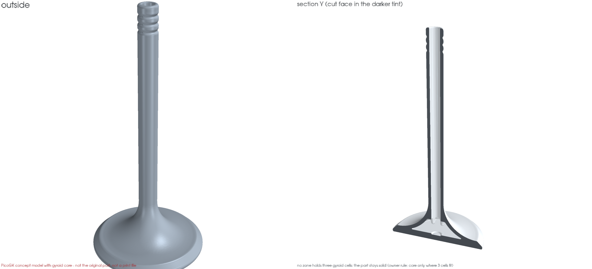</a><br><sub><i>Concept model — not the original part, not a print file</i></sub><br><a href="parts/993-eng-intake-valve-ti64-hollow-f0-0001/README.md"><b>993 hollow Ti64 intake valve</b></a><br><sub>Design study: blocked until a professional engineering review</sub></td>
<td align="center" valign="top" width="33%"><a href="parts/993-eng-intercooler-bracket-ti-f0-0001/README.md">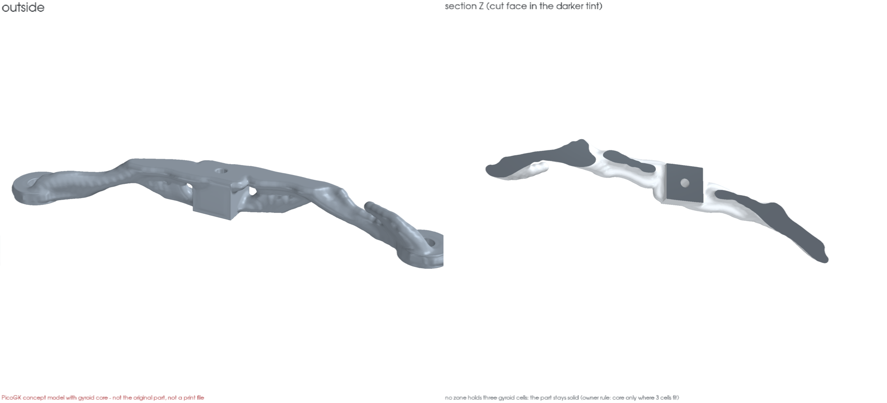</a><br><sub><i>Concept model — not the original part, not a print file</i></sub><br><a href="parts/993-eng-intercooler-bracket-ti-f0-0001/README.md"><b>993 Turbo/GT2 intercooler bracket</b></a><br><sub>Design study: functional part, needs documented testing</sub></td>
<td align="center" valign="top" width="33%"><a href="parts/993-eng-intercooler-end-tank-alsi10mg-f0-0001/README.md">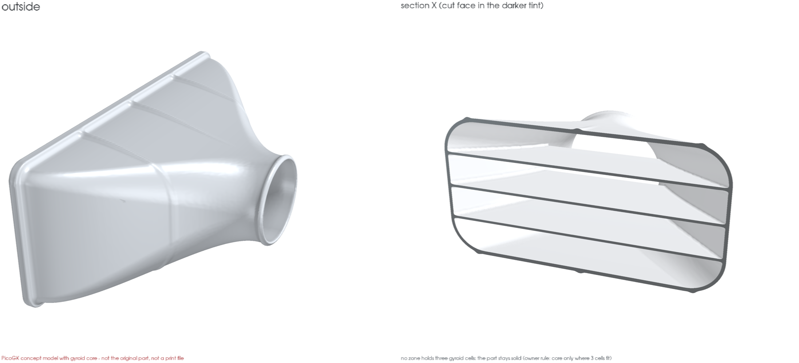</a><br><sub><i>Concept model — not the original part, not a print file</i></sub><br><a href="parts/993-eng-intercooler-end-tank-alsi10mg-f0-0001/README.md"><b>993 Turbo intercooler end tank</b></a><br><sub>Design study: blocked until a professional engineering review</sub></td>
</tr>
<tr>
<td align="center" valign="top" width="33%"><a href="parts/993-eng-k16-compressor-wheel-al2139-f1-0001/README.md">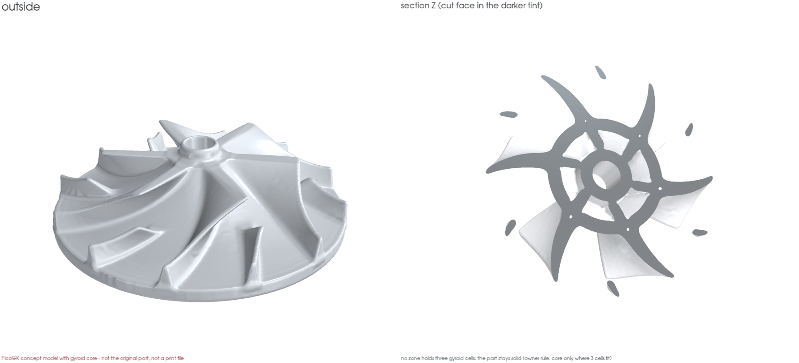</a><br><sub><i>Concept model — not the original part; display mock-up only, never for use</i></sub><br><a href="parts/993-eng-k16-compressor-wheel-al2139-f1-0001/README.md"><b>K16 compressor wheel</b></a><br><sub>Design study: blocked until a professional engineering review</sub></td>
<td align="center" valign="top" width="33%"><a href="parts/993-eng-k16-compressor-wheel-alsi10mg-f0-0001/README.md">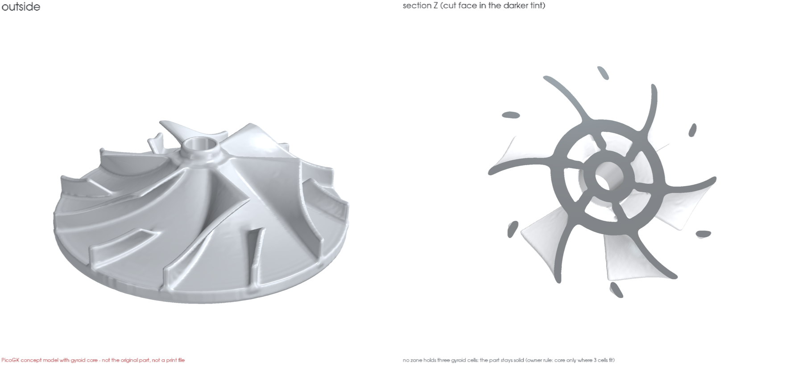</a><br><sub><i>Concept model — not the original part, not a print file</i></sub><br><a href="parts/993-eng-k16-compressor-wheel-alsi10mg-f0-0001/README.md"><b>993 K16 compressor wheel</b></a><br><sub>Design study: blocked until a professional engineering review</sub></td>
<td align="center" valign="top" width="33%"><a href="parts/993-eng-k16-turbine-wheel-in718-f0-0001/README.md">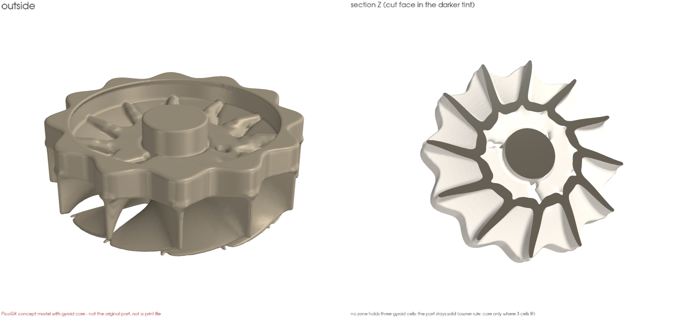</a><br><sub><i>Concept model — not the original part; display mock-up only, never for use</i></sub><br><a href="parts/993-eng-k16-turbine-wheel-in718-f0-0001/README.md"><b>K16 turbine wheel</b></a><br><sub>Design study: blocked until a professional engineering review</sub></td>
</tr>
<tr>
<td align="center" valign="top" width="33%"><a href="parts/993-eng-mounting-0001/README.md">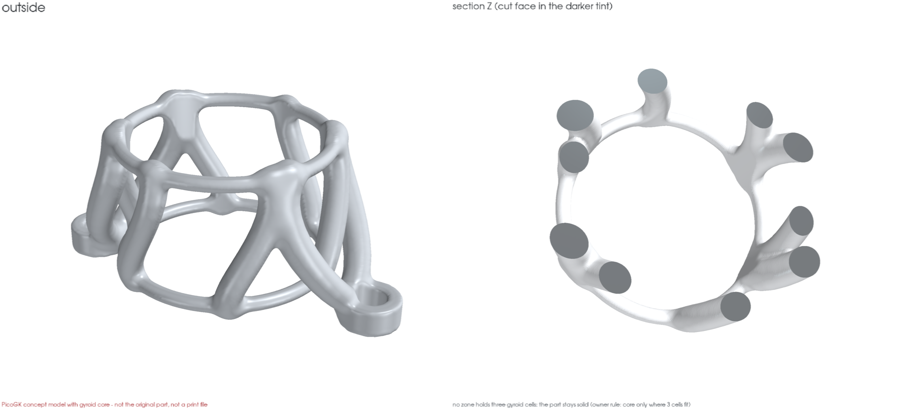</a><br><sub><i>Concept model — not the original part, not a print file</i></sub><br><a href="parts/993-eng-mounting-0001/README.md"><b>Turbo engine mount</b></a><br><sub>Design study: blocked until a professional engineering review</sub></td>
<td align="center" valign="top" width="33%"><a href="parts/993-eng-oil-filter-console-alsi10mg-f0-0001/README.md">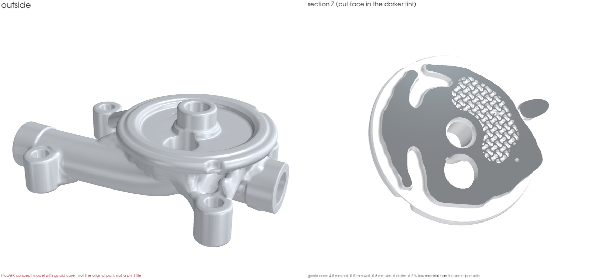</a><br><sub><i>Concept model — not the original part, not a print file</i></sub><br><a href="parts/993-eng-oil-filter-console-alsi10mg-f0-0001/README.md"><b>Engine oil filter console with integrated galleries</b></a><br><sub>Design study: blocked until a professional engineering review</sub></td>
<td align="center" valign="top" width="33%"><a href="parts/993-eng-piston-cp1-gallery-f0-0001/README.md">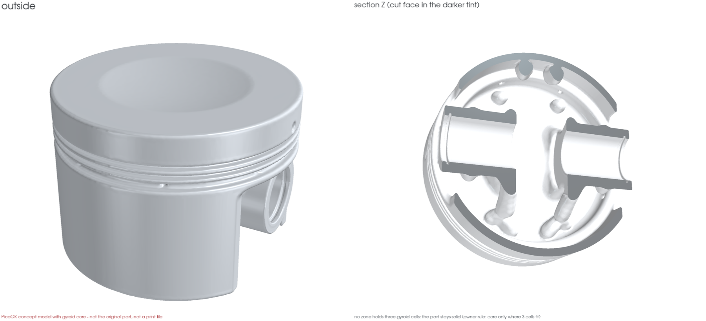</a><br><sub><i>Concept model — not the original part, not a print file</i></sub><br><a href="parts/993-eng-piston-cp1-gallery-f0-0001/README.md"><b>M64/60 piston with cooling gallery</b></a><br><sub>Design study: blocked until a professional engineering review</sub></td>
</tr>
<tr>
<td align="center" valign="top" width="33%"><a href="parts/993-eng-three-runner-intake-alsi10mg-f0-0001/README.md">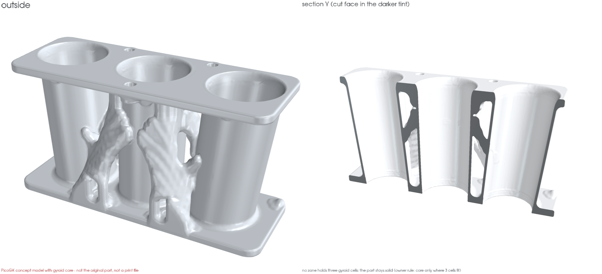</a><br><sub><i>Concept model — not the original part, not a print file</i></sub><br><a href="parts/993-eng-three-runner-intake-alsi10mg-f0-0001/README.md"><b>993 three-runner intake manifold</b></a><br><sub>Design study: functional part, needs documented testing</sub></td>
<td align="center" valign="top" width="33%"><a href="parts/993-eng-turbo-heat-shield-in625-f0-0001/README.md">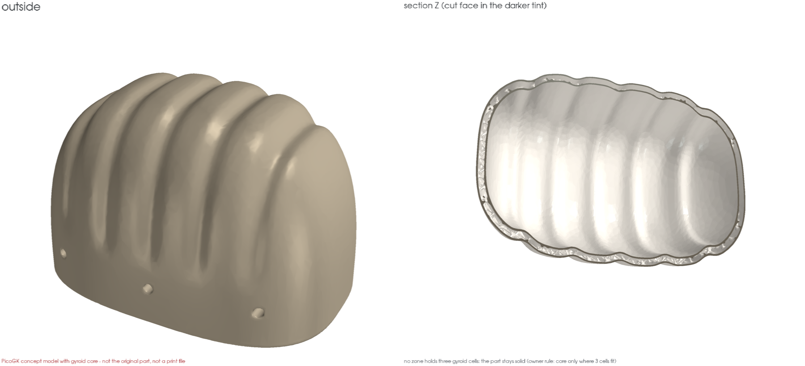</a><br><sub><i>Concept model — not the original part, not a print file</i></sub><br><a href="parts/993-eng-turbo-heat-shield-in625-f0-0001/README.md"><b>993 left turbo heat shield cover</b></a><br><sub>Design study: functional part, needs documented testing</sub></td>
<td align="center" valign="top" width="33%"><a href="parts/993-eng-turbo-oil-return-line-in625-f0-0001/README.md">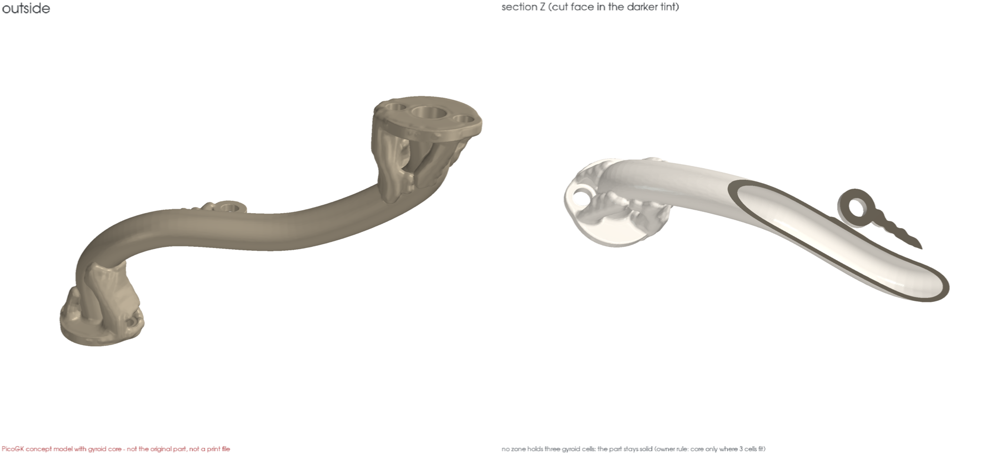</a><br><sub><i>Concept model — not the original part, not a print file</i></sub><br><a href="parts/993-eng-turbo-oil-return-line-in625-f0-0001/README.md"><b>Turbo oil return line</b></a><br><sub>Design study: blocked until a professional engineering review</sub></td>
</tr>
<tr>
<td align="center" valign="top" width="33%"><a href="parts/993-eng-upper-valve-cover-alsi10mg-f0-0001/README.md">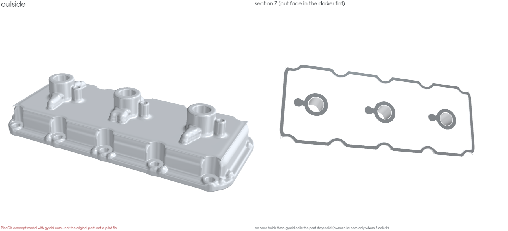</a><br><sub><i>Concept model — not the original part, not a print file</i></sub><br><a href="parts/993-eng-upper-valve-cover-alsi10mg-f0-0001/README.md"><b>Upper valve cover with COP towers</b></a><br><sub>Design study: blocked until a professional engineering review</sub></td>
<td align="center" valign="top" width="33%"><a href="parts/993-exh-cat-converter-pair-pet-0001/README.md">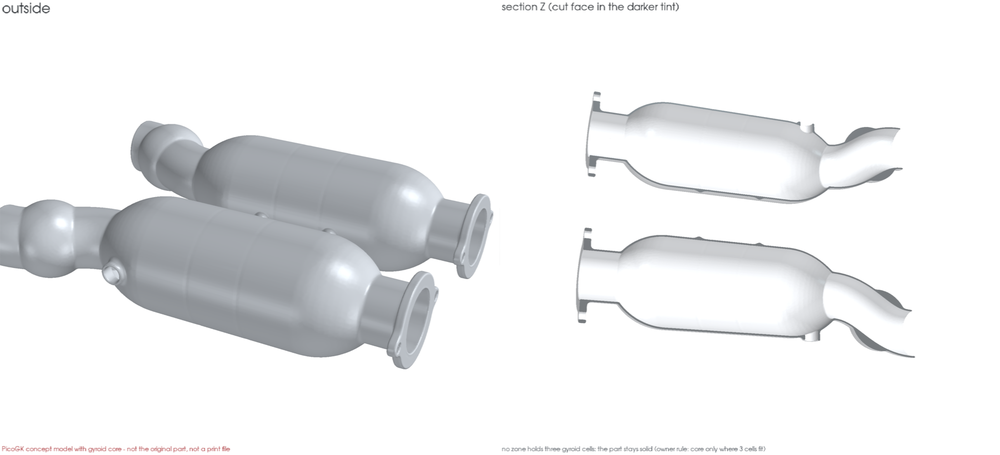</a><br><sub><i>Concept model — not the original part, not a print file</i></sub><br><a href="parts/993-exh-cat-converter-pair-pet-0001/README.md"><b>993 Turbo catalytic converters (front muffler section)</b></a><br><sub>Design study: blocked until a professional engineering review</sub></td>
<td align="center" valign="top" width="33%"><a href="parts/993-exh-heat-exchanger-pair-pet-0001/README.md"></a><br><sub><i>Concept model — not the original part, not a print file</i></sub><br><a href="parts/993-exh-heat-exchanger-pair-pet-0001/README.md"><b>993 Turbo exhaust heat exchangers (manifolds)</b></a><br><sub>Design study: blocked until a professional engineering review</sub></td>
</tr>
<tr>
<td align="center" valign="top" width="33%"><a href="parts/993-exh-oval-tip-in625-f0-0001/README.md">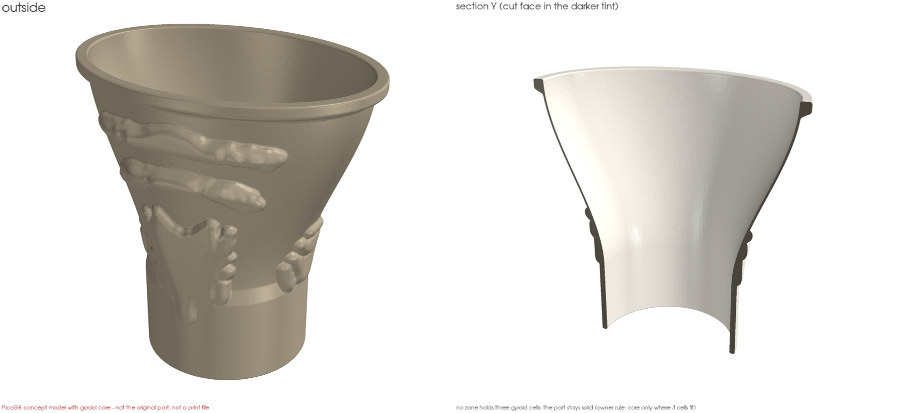</a><br><sub><i>Concept model — not the original part, not a print file</i></sub><br><a href="parts/993-exh-oval-tip-in625-f0-0001/README.md"><b>993 oval exhaust tip</b></a><br><sub>Design study: functional part, needs documented testing</sub></td>
<td align="center" valign="top" width="33%"><a href="parts/993-exh-oval-tip-ti-f1-0001/README.md">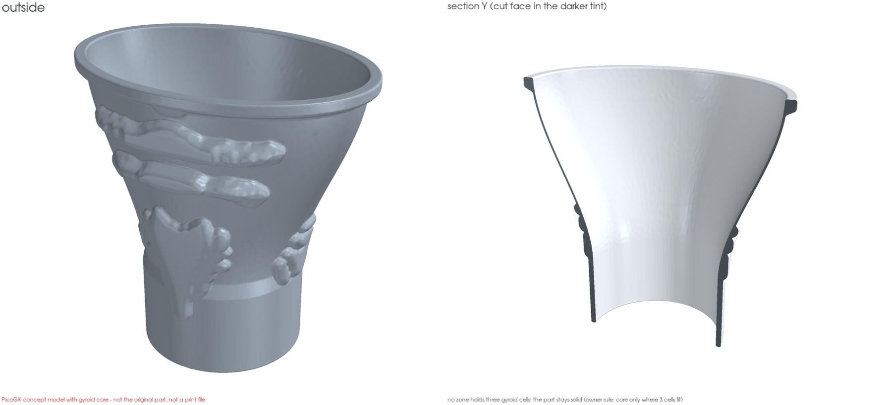</a><br><sub><i>Concept model — not the original part, not a print file</i></sub><br><a href="parts/993-exh-oval-tip-ti-f1-0001/README.md"><b>Oval exhaust tip</b></a><br><sub>Design study: functional part, needs documented testing</sub></td>
<td align="center" valign="top" width="33%"><a href="parts/993-int-dashboard-trim-0001/README.md">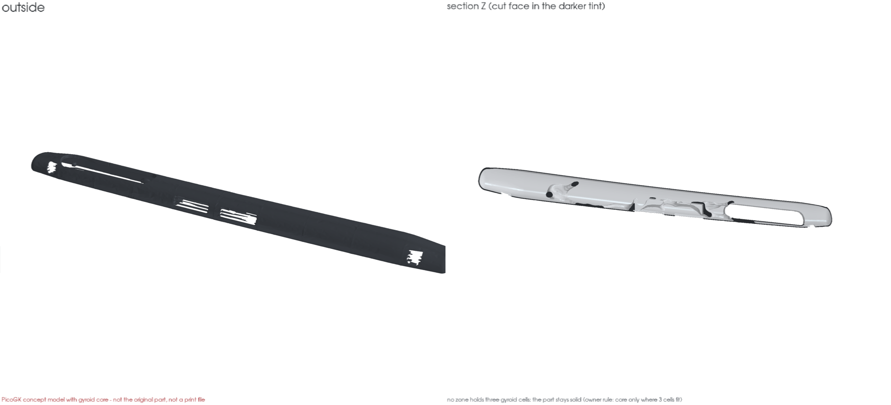</a><br><sub><i>Concept model — not the original part, not a print file</i></sub><br><a href="parts/993-int-dashboard-trim-0001/README.md"><b>Dashboard trim</b></a><br><sub>Design study: functional part, needs documented testing</sub></td>
</tr>
<tr>
<td align="center" valign="top" width="33%"><a href="parts/993-int-door-opener-lever-f0-0001/README.md">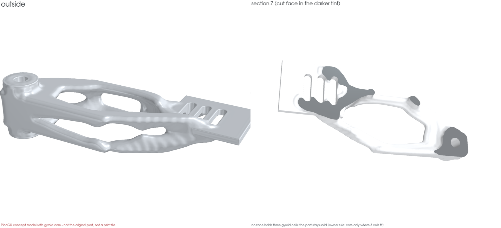</a><br><sub><i>Concept model — not the original part, not a print file</i></sub><br><a href="parts/993-int-door-opener-lever-f0-0001/README.md"><b>993 interior door opener lever</b></a><br><sub>Design study: functional part, needs documented testing</sub></td>
<td align="center" valign="top" width="33%"><a href="parts/993-int-door-pull-0001/README.md">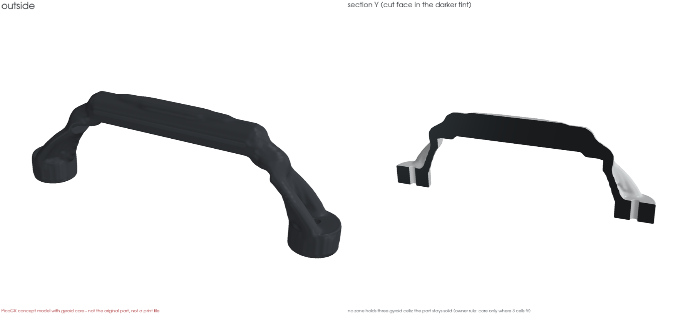</a><br><sub><i>Concept model — not the original part, not a print file</i></sub><br><a href="parts/993-int-door-pull-0001/README.md"><b>Interior door pull handle</b></a><br><sub>Design study: functional part, needs documented testing</sub></td>
<td align="center" valign="top" width="33%"><a href="parts/993-int-seat-rail-cover-0001/README.md">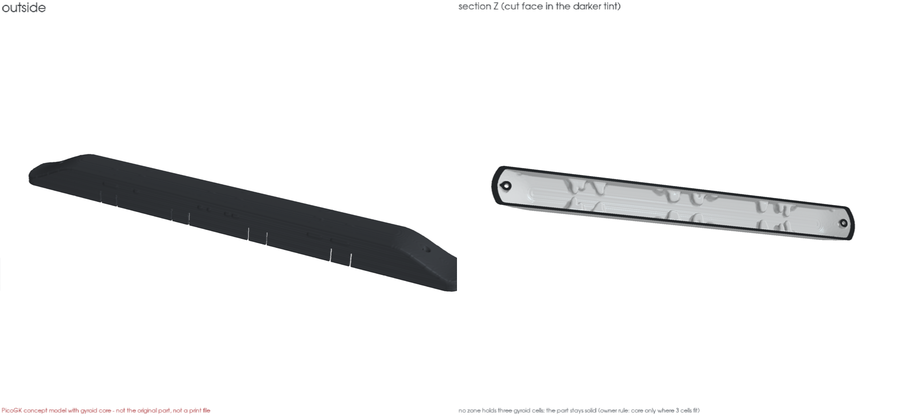</a><br><sub><i>Concept model — not the original part, not a print file</i></sub><br><a href="parts/993-int-seat-rail-cover-0001/README.md"><b>Seat rail cover</b></a><br><sub>Design study: low-risk part, needs a fit check</sub></td>
</tr>
<tr>
<td align="center" valign="top" width="33%"><a href="parts/993-int-switch-blank-0001/README.md">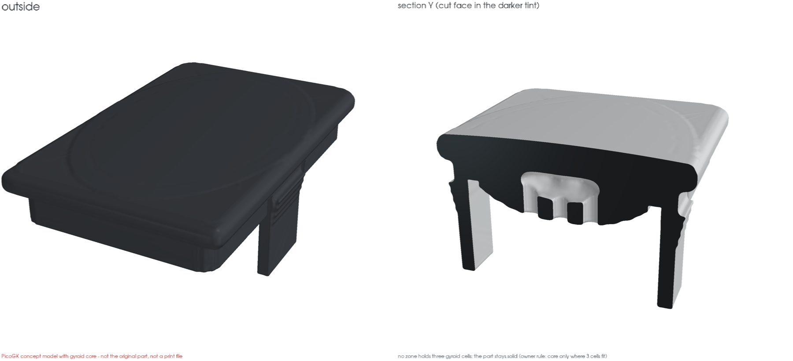</a><br><sub><i>Concept model — not the original part, not a print file</i></sub><br><a href="parts/993-int-switch-blank-0001/README.md"><b>Switch blank</b></a><br><sub>Design study: low-risk part, needs a fit check</sub></td>
<td align="center" valign="top" width="33%"><a href="parts/993-int-switch-trim-ring-f1-0001/README.md">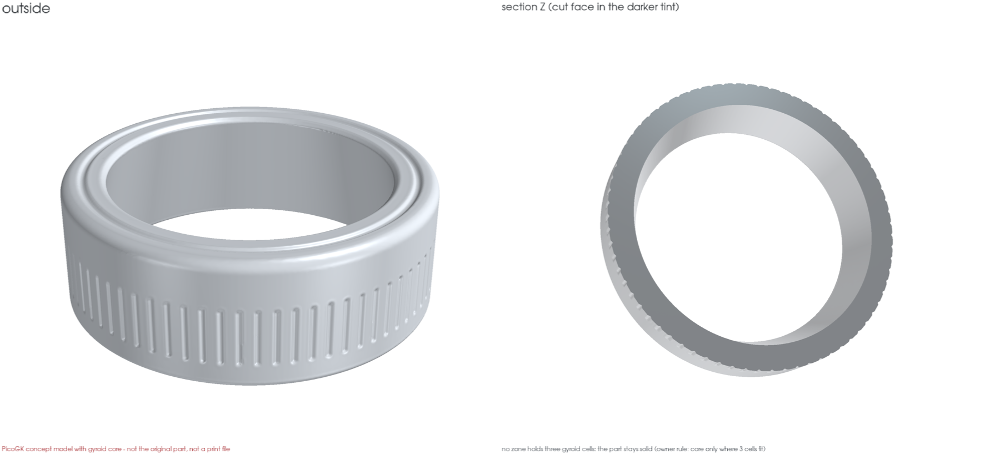</a><br><sub><i>Concept model — not the original part; a print file exists, fit not checked</i></sub><br><a href="parts/993-int-switch-trim-ring-f1-0001/README.md"><b>Aluminum switch trim ring</b></a><br><sub>Design study: low-risk part, needs a fit check</sub></td>
<td align="center" valign="top" width="33%"><a href="parts/993-turbocharger-k16-pair-0001/README.md">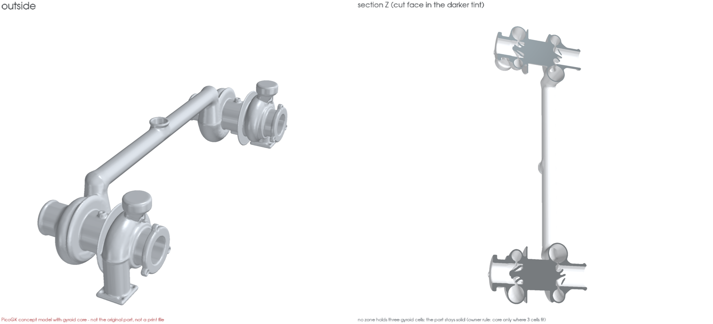</a><br><sub><i>Concept model — not the original part, not a print file</i></sub><br><a href="parts/993-turbocharger-k16-pair-0001/README.md"><b>Pair of K16 turbochargers of the 993 Turbo</b></a><br><sub>Design study: blocked until a professional engineering review</sub></td>
</tr>
<tr>
<td align="center" valign="top" width="33%"><a href="parts/993-whl-center-cap-alsi10mg-f0-0001/README.md">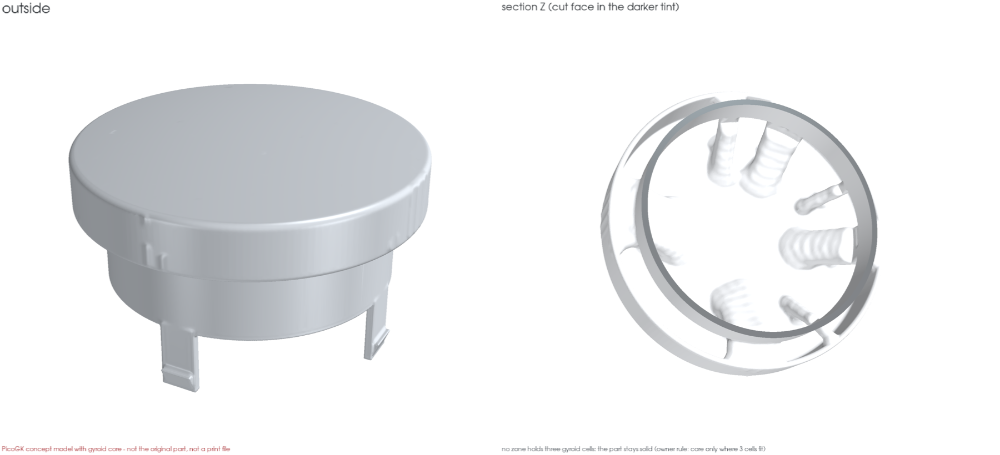</a><br><sub><i>Concept model — not the original part, not a print file</i></sub><br><a href="parts/993-whl-center-cap-alsi10mg-f0-0001/README.md"><b>993 center cap</b></a><br><sub>Design study: functional part, needs documented testing</sub></td>
</tr>
</table>

*Generated from `catalog/parts/*.json` by `scripts/render_readme_gallery.py`; click a part to see it next to the original.*

<!-- END PART GALLERY -->

## Honest status

- **No part is validated.** Every record is still at the first step,
  `concept`. None has been fitted to a car, tested or released.
- **Nothing is manufactured or sold.** The active phase is digital only. A few
  print files for non-critical trim tests, such as a trim ring and a fit-test
  kit, are described with their limits in the
  [technical overview](docs/ENGINEERING_OVERVIEW.md#2-993-parts-for-additive-manufacturing).
- **Safety-critical parts are blocked.** Most engine, turbocharger and
  structural parts are marked as prohibited until a documented professional
  engineering review lifts that status. The counts at the top of the gallery
  are computed from the catalogue.
- **Simulations are not proof.** A picture or a calculation is not evidence
  that a real part would fit, last or perform. Only measurements and physical
  tests can show that.

## Learn more

| if you want… | read |
|---|---|
| the full technical detail | [docs/ENGINEERING_OVERVIEW.md](docs/ENGINEERING_OVERVIEW.md) |
| what may and may not be built | [SAFETY.md](docs/SAFETY.md) |
| every figure and render on one page | [docs/GALLERY.md](docs/GALLERY.md) |
| the project's phases and next steps | [ROADMAP.md](docs/ROADMAP.md) |
| how to contribute a part or a source | [CONTRIBUTING.md](docs/CONTRIBUTING.md) |
| the carbon monocoque programme | [docs/MONOCOQUE_964_993_PROGRAMME.md](docs/MONOCOQUE_964_993_PROGRAMME.md) |
| the engine cooling fan programme | [twins/993-engine-cooling-fan-system-f0/README.md](twins/993-engine-cooling-fan-system-f0/README.md) |
| the horizontal 935 rotor correction and mesh status | [25 October continuation](docs/research/935-horizontal-cooling/ROOT_MESH_RESUME_20261025.md) |
| the corrected 935 rotor analysis surface and new fluid input | [bounded analysis checkpoint](docs/research/935-horizontal-cooling/CORRECTED_ANALYSIS_20261025.md) |
| the original-export-bounded 935 assembly and rotor sweep | [assembly checkpoint](docs/research/935-horizontal-cooling/ORIGINAL_BOUND_ASSEMBLY_20261028.md) |
| the original-export-bounded 935 facet and fluid-volume sweep | [mesh checkpoint](docs/research/935-horizontal-cooling/ORIGINAL_BOUND_FACET_SWEEP_20261028.md) |
| the original-export-bounded 935 volume-node relocation | [relocation checkpoint](docs/research/935-horizontal-cooling/ORIGINAL_BOUND_VOLUME_RELOCATION_20261028.md) |
| the original-export-bounded 935 weak rotor-wall face audit | [wall diagnostic](docs/research/935-horizontal-cooling/ORIGINAL_BOUND_WALL_DIAGNOSTIC_20261028.md) |
| the original-export-bounded 935 near-planar ring-flip trial | [surface and volume checkpoint](docs/research/935-horizontal-cooling/ORIGINAL_BOUND_RING_FLIP_20261028.md) |
| the original-export-bounded 935 annular edge-split rejection | [edge-split checkpoint](docs/research/935-horizontal-cooling/ORIGINAL_BOUND_RING_EDGE_SPLIT_20261028.md) |
| the observed 935 drive lower-flange eight-opening candidate | [flange audit](docs/research/935-horizontal-cooling/DRIVE_LOWER_FLANGE_20261028.md) |
| the observed 935 drive inner-flange eight-opening candidate | [inner flange audit](docs/research/935-horizontal-cooling/DRIVE_INNER_FLANGE_20261028.md) |
| the PicoGK lower-flange witness surfaces and scan overlay | [witness checkpoint](docs/research/935-horizontal-cooling/PICOGK_FLANGE_WITNESS_20261028.md) |
| the 935 inspection USD with eight PicoGK flange witnesses | [USD composition checkpoint](docs/research/935-horizontal-cooling/USD_FLANGE_WITNESS_20261028.md) |
| the 935 inspection USD with a provisional rotor revolution | [kinematic USD checkpoint](docs/research/935-horizontal-cooling/KINEMATIC_USD_20261028.md) |
| the local AI model | [qwen-picogk](https://github.com/cluster2600/qwen-picogk) · [local training evidence](docs/QWEN_TRAINING.md) |
| our Porsche information catalogue | [porschefanatics.com](https://porschefanatics.com/) |
| the license | [LICENSE](LICENSE) · [third-party licenses](docs/LICENSES.md) |

To run the checks yourself (Python 3.11+ and `make`):

```bash
git clone https://github.com/cluster2600/porscheparts.git
cd porscheparts
make check
```

## Disclaimer and license

This repository provides research data without warranty. Printing, fitting and
road use remain the responsibility of whoever makes and installs a part. Read
[SAFETY.md](docs/SAFETY.md) first. Porsche and 911 are trademarks of their
respective owners. This project is independent and not affiliated with
Porsche AG.

**© 2026 Maxime Grenu. All rights reserved.** You may view this repository,
but copying, modifying, manufacturing parts, redistributing, commercial use
and AI training need prior written permission; see the [license](LICENSE).
Third-party sources keep their own license ([LICENSES.md](docs/LICENSES.md)).
Revisions published before 2026-09-25 were under the MIT License.
