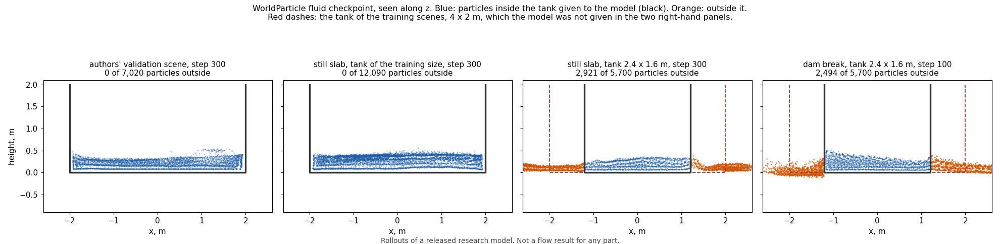

# Learned particle simulator (WorldParticle): evaluation

The owner asked to use [WorldParticle](https://github.com/WorldParticle/WorldParticle)
in this repository, for fluids, gases and carbon plies. It is a transformer
that predicts the motion of particles step by step (SIGGRAPH Asia 2026,
arXiv:2605.15305, MIT licence). This folder records what the released code and
checkpoints do here.

**Verdict: not admitted as a tool.** The released checkpoints reproduce the
authors' own scenes and nothing else. Given another obstacle or another tank,
they replay the training scene: the cloth drapes over a sphere that is not
there, and the fluid flows through the walls of a tank of another size. No
checkpoint covers gases, and no training code is released, so the model
cannot be fitted to this repository's cases.




*Rollouts of a released research model: not a draping or a flow result for
any part of this repository.*

## What was run

| Item | Value |
|---|---|
| Code | commit `b8e37b85`, inference only: no training code is released |
| Checkpoints | `cloth_on_ball` and `fancy_fluid` from the authors' [Hugging Face repository](https://huggingface.co/datasets/wclw1021/WorldParticle) (MIT), 157 million parameters each; hashes in the record |
| Hardware | this host's CPU (about 12 s per step for 4,900 particles), and one rented RTX 3090 for the long fluid rollouts (0.12 s per step) |
| Attention | PyTorch's own, `ATTN_IMPL=sdpa`; the authors' FlashAttention path was not run |
| Safety | a checkpoint is a pickle from outside: it is loaded weights-only ([`load_weights_only.py`](load_weights_only.py)) and the code ran in a sandbox without network on this host |

## Results ([`results-20261115.json`](results-20261115.json))

The pass limits were fixed before the first rollout was read. The control
tank and the dam break were added after the first reading of the still slab
and reuse its limits.

**The authors' own held-out samples.**

| Case | Result | Limit | |
|---|---|---|---|
| Cloth over the sphere, 89 steps | mean error 6.2 mm, 0.36 of a particle spacing | 1 spacing | passes |
| Fluid, dam break, 30 steps | mean error 13 mm, 0.23 spacing, while the fluid travels 290 mm | (information) | |
| Fluid, dam break, 599 steps | mean error 621 mm, 10.9 spacings | 1 spacing | fails |
| Fluid, particles outside the tank | 0 | 0 | passes |

- **Single particles diverge, the bulk does not.** After 599 steps a particle
  is 621 mm from its reference on average, but the centre of mass is
  86 mm away and the surface height differs by 47 mm, less
  than one particle spacing (57 mm). The limit set beforehand was on single
  particles, so the case counts as failed; the bulk figures are information.
- **CPU and GPU agree:** 179 and 180 mm at step 150.

**Cases the checkpoints were not trained on, with answers known without the model.**

| Case | Answer known beforehand | What the model did | |
|---|---|---|---|
| Cloth, ground plane only | the sheet ends flat on the ground | it stands up to 584 mm high, draped over the absent sphere; 95th-percentile edge strain 25% | fails |
| Cloth over a half-cylinder of radius 0.3 m | a symmetric drape on the cylinder, no penetration | the same sphere-shaped drape; 1,200 vertices inside the cylinder, up to 175 mm deep | fails |
| Fluid: a level slab at rest, tank 2.4 × 1.6 m | it stays, level and inside | 2,921 of 5,700 particles leave through the walls, from step 55; mean speed 0.66 m/s at step 300 | fails |
| Control: the same slab, tank of the training size (4 × 2 m) | the same | 2 particles outside for a moment, none at the end; mean speed 0.15 m/s and rising | fails on speed |
| Fluid: dam break in the 2.4 × 1.6 m tank | it ends as the still slab, inside | every particle leaves; having passed the walls they fall, there being no floor outside | fails |

- **The cloth model ignores the obstacle it is given.** With no sphere and
  with a half-cylinder, the sheet ends within about 27 mm of the authors'
  result *with* the sphere. The paper's cloth scenes vary stiffness and
  density, never the obstacle.
- **The fluid model holds its fluid only in a tank of the training size.**
  The same still slab stays inside a 4 × 2 m tank and flows through the walls
  of a 2.4 × 1.6 m one. A fluid at rest does not stay at rest in either.
- **So neither can be put on a part of this repository:** a mould, a port or
  a sump is not the training scene.

## What it does not cover at all

- **Gases.** The paper has no gas case; its fluids are liquids with a free
  surface, from an SPH solver. Port flow and fan flow stay with OpenFOAM.
- **Training.** Only inference is released. Fitting the model to this
  repository's solver results would need the authors' training code or a
  rewrite of it, training data from a solver, and far more GPU time than
  this evaluation (the paper trained on eight 80 GB GPUs).
- **Granular material, elastic solids, non-Newtonian fluids, molecules:** no
  checkpoint is released for them.

For carbon plies the repository uses the kinematic draping tool instead
([`benchmarks/kinematic-draping/`](../kinematic-draping/README.md)).

## Reproduce

```bash
# environment (Python 3.10; versions in requirements.txt, torch from the CPU index)
uv venv --python 3.10 <eval>/venv
git clone https://github.com/WorldParticle/WorldParticle.git <eval>/src
# checkpoints and samples from the Hugging Face repository into <eval>/hf/, then:
python load_weights_only.py <eval>/hf/cloth_on_ball/checkpoint/final.ckpt <eval>/hf/cloth_on_ball/checkpoint/weights-only.pt
python make_cases.py <eval>/hf <eval>/cases
# rollouts with the authors' inference.py (ATTN_IMPL=sdpa), on this host inside
#   bwrap --ro-bind / / --bind <eval> <eval> --dev /dev --proc /proc --tmpfs /tmp --unshare-net
# the long fluid rollouts: gpu_job.sh on a rented GPU (public inputs only)
python witness_worldparticle.py <eval> results-<date>.json
```

The GPU rental was one RTX 3090 for a few minutes (under 0.10 USD), through
the Vast.ai client on this host by the owner's instruction, outside the
OpenBao wrappers that the tool guide prescribes; nothing private was uploaded
and the instance was destroyed after the results came back.

## What this evaluation does not establish

- It judges the checkpoints as released, on five cases. A model trained with
  varied obstacles and tanks could behave differently; none is published.
- The transfer cases are close to the training scenes on purpose (same sheet,
  same fluid, same wall sampling). A part geometry is further away still.
- The acceptance limits are this repository's, not the authors'.
