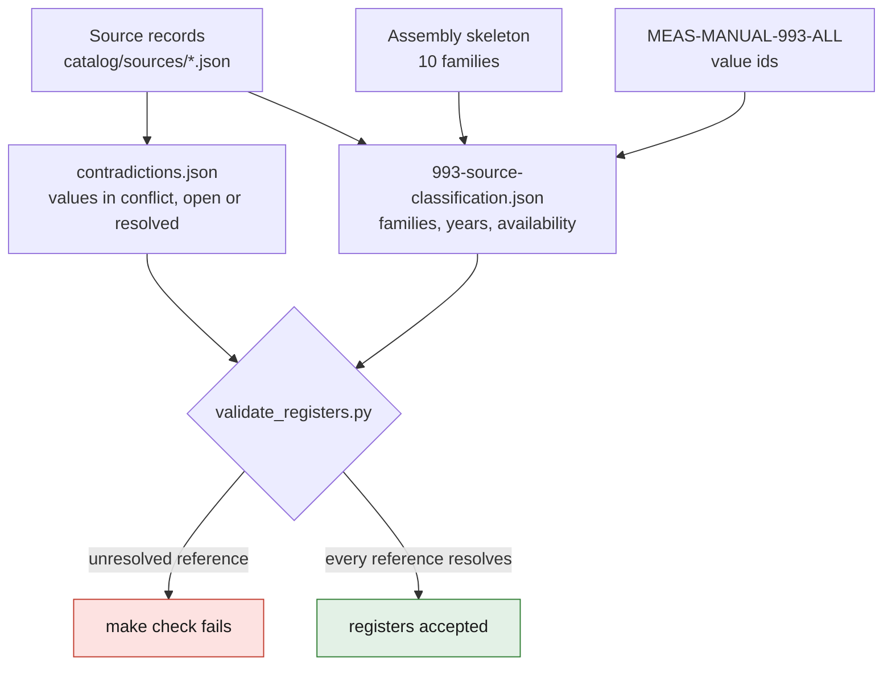

# Cross-record registers

Two registers sit across the source records instead of inside them. Both are
checked by `scripts/validate_registers.py`, which `make check` runs. A third
register records a repository-wide limit rather than a source relation, and is
checked by `scripts/validate_file_sizes.py`.

| file | holds | the validator refuses |
|---|---|---|
| `contradictions.json` | every documentary contradiction: the values in conflict, the registered source and location of each, its status and what would resolve it | a source id that is not registered, an open entry without a next step, a resolved entry without a resolution, a value with no source that does not point to a repository file |
| `993-source-classification.json` | for each family of the 993 assembly skeleton, the qualified official or manufacturer sources and where in them the family is covered; per source, model years and dated availability observations | a family of the skeleton with no qualified source, a community source used as qualification, a manual value id that belongs to another source, a parts-catalogue range that does not start and end where the skeleton family does or states another count, a model-year quote not found verbatim in the record, an observation taken from a record that does not state its date, a discontinuation without the publisher's own statement |
| `large-files.json` | every tracked path allowed to exceed 1 MiB, with its byte size and the reason it is committed rather than kept in the evidence release | any other tracked path above the threshold, and any admitted path whose entry carries no reason |

*Diagram: what feeds the two registers and what the validator checks. It adds
no claim beyond the table above.*

## Why a register and not new fields in the source records

About half of the official and manufacturer 993 records — including the
workshop manual and the parts catalogue — are pinned by SHA-256 digest in
research manifests and cannot be edited. A field added to the source schema
could never be filled for them. A register keyed by `source_id` classifies
pinned and unpinned records alike, leaves every existing record valid, and
keeps one place to read.

## Rules

- **"Qualified" is a classification by source type and evidence level, not a
  check.** A qualified source is one whose record is `official` or
  `manufacturer` and rated A or B. Nothing verifies the copy that was consulted,
  the pages cited or the values read there. The workshop-manual entries rest on
  a copy of undocumented provenance whose values have not been checked against
  an authorised copy; each of them carries a `caveat` saying so.
- Every contradiction stays visible until it is resolved. A resolved entry
  keeps its values and states the resolution.
- Model years are copied only from text already in the record, quoted verbatim.
  A source absent from the classification is **not classified**; that says
  nothing about its years or its availability.
- Every availability observation is dated and names the channel observed. It
  describes that channel on that day.
- **Absence of a part number from the Porsche Classic Parts Finder, or from any
  vendor search, is not proof that the part or the publication is
  discontinued.** It is recorded as `not_listed_on_channel`;
  `discontinued_per_publisher` needs the publisher's own statement.
- A listing is not a purchase. Buying a document, a part or a subscription is an
  owner decision, never a next step taken by a contributor or an agent.
