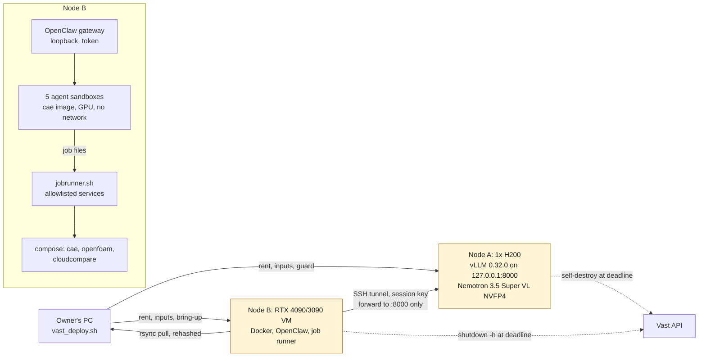

# 935 head twin on two Vast nodes, driven by OpenClaw agents

**State on 2026-11-16: prepared, not run.** Nothing has been rented, the `cae`
image has not been built, and no agent has run. The DOLFINx template's
witnesses and its demo case pass on the CPU in the pinned DOLFINx image; its
CUDA path has not run anywhere.

This folder deploys the twin of
[`twins/935-cylinder-head-cad-twin`](../../../twins/935-cylinder-head-cad-twin/README.md)
on two rented machines: Node A serves NVIDIA Nemotron 3.5 Super VL with vLLM,
and Node B runs the solver images, a job runner and five OpenClaw agents. It
follows the earlier two-node session in [`../engine-twin`](../engine-twin/README.md):
vLLM bound to loopback, an SSH tunnel with a key made for the session, one
guard per role, and results collected before teardown.

## What the repository says about the brief

Read before writing: the twin README (*State*, *Chain and selected tools*,
*Prepared work*, *Phase ledger*, *Limits*), `hypotheses.json` and the `params/`
records named below, the repository's `AGENTS.md`, `docs/AGENT_TOOL_GUIDE.md`,
`docs/TOOLCHAIN.md`, `docs/SAFETY.md`, `source/run_twin.sh`, the existing Vast
deployments under `deploy/vast/` and the OpenBao wrappers.

Several goals of the brief meet a rule or a recorded result of the
repository. Where they do, the repository wins, and the agents' guide says so:

| The brief asked for | What the repository holds | What this folder does |
|---|---|---|
| Valves, seats, guides and closed ducts so that the port domain passes `audit_port_domain.py` | Gate 3 reads only H05's status; gates 1 and 2 need closed sections along the centreline and 95 % of the wall on acquired facets (77 % and 92 % today). They need registered sections of the real port (H04 evidence), which no model supplies. Only 4 of 32 fitted features are confirmed. | A tagged hypothesis body set (proposed H13), kept out of the v2 body and the audit. H05 stays `not_modelled_in_v0`; the audit must still say `not_admissible`. |
| Barrel, cam-housing and oil boundary conditions *so that* peaks drop below 235–250 °C | The assembly screen reads 386–428 °C at the published loading; SAFETY.md: "a synthetic temperature is not a temperature". | Add each heat path as a declared hypothesis with a source; first reproduce the CalculiX screen in DOLFINx; report what comes out. No condition is tuned toward a target. |
| GPU DOLFINx for the 2 mm thermomechanical build | The build screen's mechanics already run in DOLFINx 0.11 on the CPU in [PR #715](https://github.com/cluster2600/porscheparts/pull/715) (`build_sim_dolfinx.py`, acceptance written before its first run), open on 2026-11-17. The official DOLFINx images ship PETSc **without** CUDA. | `Dockerfile.cae` builds PETSc 3.25.1 with CUDA and DOLFINx 0.11.0 from source. Assembly stays on the CPU; only the Krylov solve moves. RTX cards run FP64 slowly, so speed is measured, not promised. The agents build on #715's script, which a session commit holds only once #715 is merged. |
| Calibrate laser absorptivity | The melt-pool check "calibrates nothing": no melt pool of this machine was measured. | A value taken from published widths is a new hypothesis with that source. |
| A distortion compensation field | *Limits*: the distortion "moves with the lump height and is not a compensation field". | No compensation field; a convergence study comes first. |
| PhysicsNeMo / DoMINO surrogates for Cd sweeps | Surrogates only after converged, correlated cases. DoMINO is trained on DrivAerML car aerodynamics. No port CFD exists. | The image is wired in (repository lock, by digest) behind a compose profile; no agent starts it. |
| Newton for valve float | No cam, spring or masses for this head; no dynamics tool assigned (Chrono is the named candidate). | Newton is in the image and in the smoke check (a free fall). Agents may prepare a spring-mass witness and nothing for the head. |
| pyLife fatigue | No stress history and no S-N curve. | Tool witness only. |
| SimReady `.usdz` with full physical materials and simulation fields | `export_simready.py` exists; no mass is authored while no alloy is selected. | A rerun on changed bodies; fields only as a separate layer of a run that passed QA. |
| Agents that rent and destroy burst nodes with `vastai` | The credit is shared with other sessions; a 2026-11-15 rental cost 3.22 USD and produced nothing; rentals go through the owner. | Agents hold no credential. A burst need is a request file for the owner. |

Every number in the table comes from the twin's records; check them there,
since they move.

## Architecture



*Diagram: the two rented nodes as amber because neither has run. Every arrow
into Node A is the session's tunnel key, restricted to one port forward.*

## Files

| File | What it does | Checked |
|---|---|---|
| [`vast_deploy.sh`](vast_deploy.sh) | `preflight`, `offers`, `up`, `sync`, `status`, `down`, `guard` | `bash -n`, shellcheck; never run against Vast |
| [`onstart-llm.sh`](onstart-llm.sh) | Node A: self-destroy at the deadline, tunnel key, vLLM with the model card's 1x H200 flags | `bash -n`, shellcheck |
| [`onstart-cae.sh`](onstart-cae.sh) | Node B: `shutdown -h` at the deadline, sparse clone at the session commit, tunnel, image build, smoke, OpenClaw | `bash -n`, shellcheck |
| [`Dockerfile.cae`](Dockerfile.cae) | `cae` (CUDA PETSc, DOLFINx, Warp, Newton, Gmsh, build123d, PyVista, OpenUSD, pyLife) and `openfoam` (mesh-cfd + foamlib) | base digests resolved on 2026-11-16; **not built** |
| [`docker-compose.yml`](docker-compose.yml) | the tool services, no network, repository and scan read-only | `docker compose config` |
| [`smoke-cae.sh`](smoke-cae.sh) | admits the `cae` image on its GPU: CUDA PETSc, Warp kernel, Newton free fall, EGL render, template witnesses on both backends | Newton calls checked against the 1.8.0 wheel; not run |
| [`jobrunner.sh`](jobrunner.sh), [`sync-hook.sh`](sync-hook.sh) | the agents' only path to tool images; optional push to a bucket | `bash -n`, shellcheck |
| [`openclaw/openclaw.json`](openclaw/openclaw.json) | provider, five agents, sandbox, tool allow and deny lists | keys checked against the OpenClaw v2026.11.4 docs; not loaded by OpenClaw |
| [`openclaw/agents/AGENTS.md`](openclaw/agents/AGENTS.md) | the agents' guide: state, rules, roles, tools | — |
| [`dolfinx_thermal_mech_template.py`](dolfinx_thermal_mech_template.py) | Gmsh `.msh` → DOLFINx heat and thermoelasticity → `.bp`, record, PNG views | witnesses pass on CPU (below) |

## The template, as run on 2026-11-16

In `dolfinx/dolfinx@sha256:58b27e84…` (v0.11.0.post0, PETSc 3.25.1 without
CUDA), 2 cores, 3 GB cap:

| Witness | Closed form | Result | Acceptance |
|---|---|---|---|
| W1 steady slab with a source | `T0 + q x (L − x) / 2k` | L2 error 1.4e-4 on the fine mesh, order 1.945 on the effective cell size | ≤ 2e-3, ≥ 1.7 |
| W2 transient slab, one face stepped | Fourier series at Fo = 0.2 | 4.7e-5 of the step | ≤ 0.02 |
| W3 restrained bar heated by 150 K | σxx = −E α ΔT = −220.5 MPa | 7e-14 relative | ≤ 1e-5 |

W1 failed its first run: on nominal 4 and 2 mm meshes of a 10 mm section the
order read 1.49, because two cells across do not halve with the nominal size.
The witness moved to 2 and 1 mm meshes and to the effective cell size; the
acceptance did not change. The demo block (not the head) solved on 2 MPI ranks:
energy balance closed, mean 148.8 °C against a 149 °C lumped estimate. Its
renders were read: the first mechanics picture hid a 1.5× expansion because
the camera refits the deformed body; it now scales the displacement to 5 % of
the diagonal and draws the undeformed edges in black.

## Before renting

The gates of [SOFTWARE_STACK.md](../../../docs/SOFTWARE_STACK.md#gates-before-paid-gpu-computation),
for this session:

1. **Image by digest.** Build `cae` once (on Node B, or on a CPU builder with
   `CUDA_ARCH=89`), push it, run `smoke-cae.sh` on a GPU, read its PNGs, and
   record the digest and receipt beside this file. Until then every run is
   also an image qualification.
2. **SSH key on the account and an SSH route.** Outbound SSH to Vast's high
   ports is blocked from the owner's daytime network; run from home.
3. **Inputs frozen.** `up` hashes the inputs list, asks for confirmation, and
   rehashes on Node B. The scan's licence is open (#462): copying it to a
   rented machine is a decision for each run.
4. **Cost.** `preflight` refuses below `BUDGET_USD` of credit; `up` refuses
   above it. At the prices this was written for (an H200 is several USD an
   hour, an RTX 4090 VM under one), three hours cost roughly 10–15 USD, well
   above the credit last seen (1.35 USD, 2026-11-16 morning).
5. **Teardown tested.** Run `up` then `down` once on cheap offers (set
   `LLM_QUERY` and `CAE_QUERY` to small GPUs) and check that both instances
   disappear and that `CONTAINER_API_KEY` exists on each kind of instance.

## Use

```sh
cd deploy/vast/935-twin-openclaw
./vast_deploy.sh preflight
./vast_deploy.sh offers
./vast_deploy.sh up <offer A> <offer B> ~/private/935-inputs.txt   # one absolute path per line
./vast_deploy.sh sync          # after every step that matters
./vast_deploy.sh down          # final sync, destroy both, check they are gone
```

The OpenClaw dashboard is on Node B's loopback; forward it with the command
`up` prints. Session secrets (tunnel key, vLLM key, gateway token) live in
`~/.local/state/porscheparts-vast/<session>/`, mode 0700, never in Git.

## Not verified

- No part of this folder has run on Vast, and OpenClaw has not loaded the config.
- Whether PETSc's `--download-hypre` builds a CUDA hypre when `--with-cuda`
  is set, and whether CPU BoomerAMG still works then: the smoke check will say.
- Whether a Vast **VM** has `CONTAINER_API_KEY`; container instances do
  ([Vast docs](https://docs.vast.ai/guides/instances/docker-environment)).
  Without it, Node B relies on `shutdown -h`, which stopped GPU billing on the
  2026-11-15 VM while storage kept billing.
- `RTX_3090` and `cpu_cores_effective` in the offer query follow the CLI's
  naming but were not checked against a live search.
- OpenClaw has published many security advisories. The gateway binds
  loopback with a token, agents run in network-less sandboxes with explicit
  tool allowlists, and no ClawHub skill is installed. Run `openclaw security
  audit` (the bring-up does) and read it.
