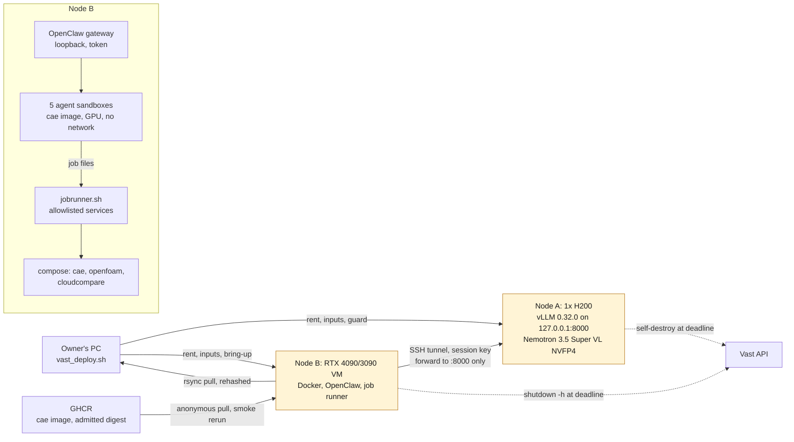

# 935 head twin on two Vast nodes, driven by OpenClaw agents

**State on 2026-11-18: prepared, not run on Vast.** Nothing has been rented
and no agent has run. The `cae` image was built on the owner's PC (no GPU) and
passes its CPU checks there (below); it has not been pushed, so it has no
registry digest and no GPU smoke. No image is admitted: `cae-935.lock.json` does not
exist, so `up` refuses to rent (see *Admitting the cae image*). The DOLFINx
template's witnesses and its demo case pass on the CPU in the pinned DOLFINx
image; its CUDA path has not run anywhere.

This folder deploys the twin of
[`twins/935-cylinder-head-cad-twin`](../../../twins/935-cylinder-head-cad-twin/README.md)
on two rented machines: Node A serves NVIDIA Nemotron 3.5 Super VL with vLLM,
and Node B runs the solver images, a job runner and five OpenClaw agents. It
follows the earlier two-node session in [`../engine-twin`](../engine-twin/README.md):
vLLM bound to loopback, an SSH tunnel with a key made for the session, one
guard per role, and results collected before teardown.

## What the repository says about the brief

Read before writing: the twin README (*State*, *Chain and selected tools*,
*Prepared work*, *Phase ledger*, *Limits*), `hypotheses.json` and the `params/`
records named below, the repository's `AGENTS.md`, `docs/AGENT_TOOL_GUIDE.md`,
`docs/TOOLCHAIN.md`, `docs/SAFETY.md`, `source/run_twin.sh`, the existing Vast
deployments under `deploy/vast/` and the OpenBao wrappers.

Several goals of the brief meet a rule or a recorded result of the
repository. Where they do, the repository wins, and the agents' guide says so:

| The brief asked for | What the repository holds | What this folder does |
|---|---|---|
| Valves, seats, guides and closed ducts so that the port domain passes `audit_port_domain.py` | Gate 3 reads only H05's status; gates 1 and 2 need closed sections along the centreline and 95 % of the wall on acquired facets (77 % and 92 % today). They need registered sections of the real port (H04 evidence), which no model supplies. Only 4 of 32 fitted features are confirmed. | A tagged hypothesis body set (proposed H13), kept out of the v2 body and the audit. H05 stays `not_modelled_in_v0`; the audit must still say `not_admissible`. |
| Barrel, cam-housing and oil boundary conditions *so that* peaks drop below 235–250 °C | The assembly screen reads 386–428 °C at the published loading; SAFETY.md: "a synthetic temperature is not a temperature". | Add each heat path as a declared hypothesis with a source; first reproduce the CalculiX screen in DOLFINx; report what comes out. No condition is tuned toward a target. |
| GPU DOLFINx for the 2 mm thermomechanical build | The build screen's mechanics already run in DOLFINx 0.11 on the CPU (`build_sim_dolfinx.py`, acceptance written before its first run; [PR #715](https://github.com/cluster2600/porscheparts/pull/715), merged on 2026-11-17). The official DOLFINx images ship PETSc **without** CUDA. | `Dockerfile.cae` builds PETSc 3.25.1 with CUDA and DOLFINx 0.11.0 from source. Assembly stays on the CPU; only the Krylov solve moves. RTX cards run FP64 slowly, so speed is measured, not promised. The agents build on that script. |
| Calibrate laser absorptivity | The melt-pool check "calibrates nothing": no melt pool of this machine was measured. | A value taken from published widths is a new hypothesis with that source. |
| A distortion compensation field | *Limits*: the distortion "moves with the lump height and is not a compensation field". | No compensation field; a convergence study comes first. |
| PhysicsNeMo / DoMINO surrogates for Cd sweeps | Surrogates only after converged, correlated cases. DoMINO is trained on DrivAerML car aerodynamics. No port CFD exists. | The image is wired in (repository lock, by digest) behind a compose profile; no agent starts it. |
| Newton for valve float | No cam, spring or masses for this head; no dynamics tool assigned (Chrono is the named candidate). | Newton is in the image and in the smoke check (a free fall). Agents may prepare a spring-mass witness and nothing for the head. |
| pyLife fatigue | No stress history and no S-N curve. | Tool witness only. |
| SimReady `.usdz` with full physical materials and simulation fields | `export_simready.py` exists; no mass is authored while no alloy is selected. | A rerun on changed bodies; fields only as a separate layer of a run that passed QA. |
| Agents that rent and destroy burst nodes with `vastai` | The credit is shared with other sessions; a 2026-11-15 rental cost 3.22 USD and produced nothing; rentals go through the owner. | Agents hold no credential. A burst need is a request file for the owner. |

Every number in the table comes from the twin's records; check them there,
since they move.

## Architecture



*Diagram: the two rented nodes as amber because neither has run. Every arrow
into Node A is the session's tunnel key, restricted to one port forward. Node
B never builds the `cae` image: it pulls the digest that `cae-935.lock.json`
admits.*

## Files

| File | What it does | Checked |
|---|---|---|
| [`vast_deploy.sh`](vast_deploy.sh) | `preflight`, `offers`, `qualify`, `admit`, `up`, `sync`, `status`, `down`, `guard` | `bash -n`, shellcheck; `admit` and `up`'s refusals tested offline on 2026-11-18 (below); never run against Vast |
| [`onstart-llm.sh`](onstart-llm.sh) | Node A: self-destroy at the deadline, tunnel key, vLLM with the model card's 1x H200 flags | `bash -n`, shellcheck |
| [`onstart-cae.sh`](onstart-cae.sh) | Node B, `MODE=qualify` or `session`: `shutdown -h` at the deadline, sparse clone at the session commit, `cae` pulled by digest and smoked; in a session, then the tunnel, the other images and OpenClaw | `bash -n`, shellcheck; not run |
| `cae-935.lock.json`, `receipts/` | written by `admit`: the admitted digest, the Dockerfile hash, the GPU smoke receipt and who read its renders | **absent**: no image admitted |
| [`Dockerfile.cae`](Dockerfile.cae) | `cae` (CUDA PETSc with CPU hypre, DOLFINx, Warp, Newton, Gmsh, build123d, PyVista, OpenUSD, pyLife) and `openfoam` (mesh-cfd + foamlib) | `cae` built locally on 2026-11-18, CPU checks pass (below); not pushed, no GPU smoke. `openfoam` not built |
| [`docker-compose.yml`](docker-compose.yml) | the tool services, no network, repository and scan read-only | `docker compose config` |
| [`smoke-cae.sh`](smoke-cae.sh) | admits the `cae` image on its GPU: CUDA PETSc, Warp kernel, Newton free fall, EGL render, template witnesses on both backends | Newton calls checked against the 1.8.0 wheel; not run |
| [`jobrunner.sh`](jobrunner.sh), [`sync-hook.sh`](sync-hook.sh) | the agents' only path to tool images; optional push to a bucket | `bash -n`, shellcheck |
| [`openclaw/openclaw.json`](openclaw/openclaw.json) | provider, five agents, sandbox, tool allow and deny lists | keys checked against the OpenClaw v2026.11.4 docs; not loaded by OpenClaw |
| [`openclaw/agents/AGENTS.md`](openclaw/agents/AGENTS.md) | the agents' guide: state, rules, roles, tools | — |
| [`dolfinx_thermal_mech_template.py`](dolfinx_thermal_mech_template.py) | Gmsh `.msh` → DOLFINx heat and thermoelasticity → `.bp`, record, PNG views | witnesses pass on CPU (below) |

## The template, as run on 2026-11-16

In `dolfinx/dolfinx@sha256:58b27e84…` (v0.11.0.post0, PETSc 3.25.1 without
CUDA), 2 cores, 3 GB cap:

| Witness | Closed form | Result | Acceptance |
|---|---|---|---|
| W1 steady slab with a source | `T0 + q x (L − x) / 2k` | L2 error 1.4e-4 on the fine mesh, order 1.945 on the effective cell size | ≤ 2e-3, ≥ 1.7 |
| W2 transient slab, one face stepped | Fourier series at Fo = 0.2 | 4.7e-5 of the step | ≤ 0.02 |
| W3 restrained bar heated by 150 K | σxx = −E α ΔT = −220.5 MPa | 7e-14 relative | ≤ 1e-5 |

W1 failed its first run: on nominal 4 and 2 mm meshes of a 10 mm section the
order read 1.49, because two cells across do not halve with the nominal size.
The witness moved to 2 and 1 mm meshes and to the effective cell size; the
acceptance did not change. The demo block (not the head) solved on 2 MPI ranks:
energy balance closed, mean 148.8 °C against a 149 °C lumped estimate. Its
renders were read: the first mechanics picture hid a 1.5× expansion because
the camera refits the deformed body; it now scales the displacement to 5 % of
the diagonal and draws the undeformed edges in black.

## The cae image, as built on 2026-11-18

Built on the owner's WSL host (22 cores, 25 GB, no GPU) with `BUILD_NP=6`:
about 2 h 40 min, mostly MPICH (80 min), PETSc with its downloads (30 min) and
ADIOS2 (20 min). Local image `sha256:f09b95ac402980d0316c4d178b38dbbb5bd21337272ac2255b55e219fdcc1b73`,
label `porscheparts.dockerfile_sha256` equal to this `Dockerfile.cae`. The
first attempts failed, and each fix is in the Dockerfile with its error:

| Failure | Fix |
|---|---|
| `CUDA_ARCH=all-major` would break PETSc's hypre build (version numbers only) | `CUDA_ARCH=86,89` |
| PETSc builds hypre with CUDA and GPU-aware MPI; this MPICH is not CUDA-aware | hypre `--without-cuda`, checked at build time |
| DOLFINx's SuperLU_DIST interface cannot compile against PETSc's CUDA SuperLU_DIST (`cublas_v2.h`, then `cuda_fp16.h` inside `extern "C"`) | `-DDOLFINX_ENABLE_SUPERLU_DIST=OFF`; SuperLU_DIST stays usable through PETSc |
| nanobind 3.1.0 (unpinned): DOLFINx's `Form` constructor rejects its own arguments | nanobind 2.12.0 and cffi 2.0.0, as in the official image |
| `useradd -u 1000`: Ubuntu 24.04 ships user `ubuntu` with uid 1000 | remove it first |

Checked in the image on that host, network off, 8 GB cap. Without a driver,
`petsc4py` cannot load (`libnvidia-ml.so.1`, `libcuda.so.1` come from the
NVIDIA runtime), so these runs point the loader at CUDA's stub libraries:

- Versions as written in the Dockerfile. PETSc has CUDA, hypre, MUMPS and
  SuperLU_DIST; hypre's config defines no `HYPRE_USING_GPU`; DOLFINx has
  ADIOS2.
- The template's witnesses on the CPU backend pass on 1 and 2 ranks with
  BoomerAMG. W1: L2 error 1.396e-4, order 1.945. W2: 4.7e-5 of the step.
  W3: 7e-14. These are the official image's numbers.
- The demo block solved on 2 ranks gives the official image's result:
  136.06–157.65 °C, mean 148.845 °C, imbalance 0, 0.286 mm, 51.1 MPa.
- Its renders were read. VTK fell back to a software window, so the EGL path
  is the GPU smoke's.
- The CUDA backend stops at "CUDA driver is a stub library", as it must here.

Nothing about the GPU path is known until `qualify` runs.

## Admitting the cae image

`up` rents nothing until `cae-935.lock.json` admits an image, so a session
never qualifies its own image (the first gate of
[SOFTWARE_STACK.md](../../../docs/SOFTWARE_STACK.md#gates-before-paid-gpu-computation)).
The lock is written once, in five steps:

1. **Build** on any x86-64 Docker host. Compiling needs no GPU; `BUILD_NP`
   caps the parallel compiles (about 3 GB each at worst):

   ```sh
   docker build -f Dockerfile.cae --target cae --build-arg BUILD_NP=6 \
     --build-arg DOCKERFILE_SHA256=$(sha256sum Dockerfile.cae | cut -d' ' -f1) \
     -t porscheparts/cae-935:dev .
   ```

2. **Push** (owner): tag it `ghcr.io/cluster2600/3dprinting993-cae-935:<date>`,
   `docker push` it, note the digest the push prints, and make the package
   public. Node B pulls it without a registry credential; no GitHub token
   goes to Vast.
3. **Qualify**: `./vast_deploy.sh qualify <offer> ghcr.io/cluster2600/3dprinting993-cae-935@sha256:<digest>`
   rents one VM (no model, no scan), which pulls the digest and runs
   `smoke-cae.sh`. The receipt comes home, then the VM is destroyed. At most
   `QUAL_HOURS=1`, under `QUAL_BUDGET_USD=1.00`.
4. **Read** every PNG under the receipt: the EGL sphere, the demo block's
   temperature views and its deformed shape.
5. **Admit**: `./vast_deploy.sh admit <receipt dir>` checks that the smoke
   passed, that the image pulled carries the digest named, and that its
   `porscheparts.dockerfile_sha256` label is this `Dockerfile.cae`'s hash.
   It then asks who read the pictures, writes the lock, and copies the
   receipt's JSON files (no pictures, no scan data) to `receipts/`. Commit and
   push both.

Before any call to Vast, `up` checks four things: the lock, the receipt's
hash, the `Dockerfile.cae` hash it records, and that this folder matches the
session commit (Node B runs the commit, not the working tree). Node B pulls
the digest, reruns the smoke on its own GPU, and starts no agent if the smoke
fails. A change to `Dockerfile.cae` voids the lock: rebuild, qualify, admit.

Tested offline on 2026-11-18, in a scratch repository with a fake receipt and
a `vastai` that always fails:

- `up` refuses without a lock, with a lock but uncommitted changes in the
  folder, after `Dockerfile.cae` changes, after a receipt edit, and when the
  lock names no reader.
- `admit` refuses an image labelled with another Dockerfile hash, a smoke with
  a non-zero exit, a pulled digest that differs, and an empty reader.
- With a valid lock, `up` gets past every check and stops at the `vastai`
  call.
- `qualify` refuses a tag that is not a digest.
- Once `up` or `qualify` has rented anything, any exit before its setup
  completes destroys the session's instances: an error, `die`, Ctrl-C or
  SIGTERM. A Node B whose bring-up never started has no deadline shutdown, so
  it would otherwise bill until someone noticed. Tested with a fake `vastai`
  and an unreachable sshd, and with SIGTERM during the SSH wait: one
  `destroy`, nothing left.

## Before renting

The gates of [SOFTWARE_STACK.md](../../../docs/SOFTWARE_STACK.md#gates-before-paid-gpu-computation),
for this session:

1. **Image by digest.** Enforced by `up`, above.
2. **SSH key on the account and an SSH route.** Outbound SSH to Vast's high
   ports is blocked from the owner's daytime network; run from home.
3. **Inputs frozen.** `up` hashes the inputs list, asks for confirmation, and
   rehashes on Node B. The scan's licence is open (#462): copying it to a
   rented machine is a decision for each run.
4. **Cost.** `preflight` refuses below `BUDGET_USD` of credit; `up` refuses
   above it. At the prices this was written for (an H200 is several USD an
   hour, an RTX 4090 VM under one), three hours cost roughly 10–15 USD, well
   above the credit last seen (1.33 USD on 2026-11-18, enough for `qualify`).
5. **Teardown tested.** The first `qualify` tests Node B's teardown: check
   that the VM disappears and whether it had `CONTAINER_API_KEY`. Node A's
   teardown still needs one `up`/`down` on a cheap offer (set `LLM_QUERY`).

## Use

Needs `vastai`, `jq`, `rsync`, `ssh`, `openssl` on the owner's PC; `jq` was
missing from the WSL host on 2026-11-18 (`sudo apt install jq`).

```sh
cd deploy/vast/935-twin-openclaw
./vast_deploy.sh preflight
./vast_deploy.sh offers
./vast_deploy.sh qualify <offer> <image@sha256:digest>             # once per image, then admit
./vast_deploy.sh up <offer A> <offer B> ~/private/935-inputs.txt   # one absolute path per line
./vast_deploy.sh sync          # after every step that matters
./vast_deploy.sh down          # final sync, destroy both, check they are gone
```

The OpenClaw dashboard is on Node B's loopback; forward it with the command
`up` prints. Session secrets (tunnel key, vLLM key, gateway token) live in
`~/.local/state/porscheparts-vast/<session>/`, mode 0700, never in Git.

## Not verified

- No part of this folder has run on Vast, and OpenClaw has not loaded the
  config. `onstart-cae.sh` in either mode has not run.
- hypre is built without CUDA (`--download-hypre-configure-arguments`), and the
  build fails if hypre's config defines `HYPRE_USING_GPU`. Whether
  BoomerAMG then runs on 1 and 2 ranks beside CUDA PETSc is the smoke's CPU
  witnesses.
- Whether OpenClaw substitutes `${CAE_IMAGE}` in `sandbox.docker.image` as it
  does in other strings.
- Whether a Vast **VM** has `CONTAINER_API_KEY`; container instances do
  ([Vast docs](https://docs.vast.ai/guides/instances/docker-environment)).
  Without it, Node B relies on `shutdown -h`, which stopped GPU billing on the
  2026-11-15 VM while storage kept billing.
- `RTX_3090` and `cpu_cores_effective` in the offer query follow the CLI's
  naming but were not checked against a live search.
- OpenClaw has published many security advisories. The gateway binds
  loopback with a token, agents run in network-less sandboxes with explicit
  tool allowlists, and no ClawHub skill is installed. Run `openclaw security
  audit` (the bring-up does) and read it.
