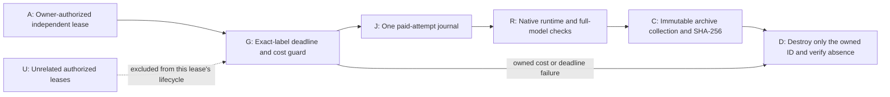

# Independently bounded parallel PicoGK/CalculiX leases

The owner explicitly authorized simultaneous Vast rentals on 2026-11-04.
This versioned delta scopes admission and cleanup to the exact attempt label,
instance ID and image. Unrelated account instances do not trigger teardown.
Each lease retains its own deadline, budget, transfer allocation, one-shot
paid journal, runtime checks and verified destruction. No credential scope or
credential value changes.

The historical wrapper and guard are hash-pinned and remain unchanged:

- `deploy/openbao/openbao-vastai`: `42fe39ebcf7fc81e8f6c4a85e38fa9da03fd4637bb93a37b3a422c315e8a5aa4`.
- `deploy/vast/picogk/deadline_guard.py`: `c1d82cfaf5c8f178b5eaeb32ca5d98774b3dd60502087310f10a2966e53ff3f4`.

`wrapper-parallel.patch` applies to a disposable copy of the frozen wrapper
and to the installed wrapper's shared function prefix. It changes only the
normal `picogk-m64-v1` ownership gate; installed FEA512 and other unrelated
extensions are preserved. Existing labels cannot be relaunched, and changed
owned IDs/images or duplicate owned labels are refused.

`wrapper-ssh-propagation.patch` permits two five-second retries of an initial
authentication denial using the same already-approved key and pinned endpoint.
Persistent denial stops after three probes. Changed host keys and other
security failures are never retried. No raw private streams are emitted.

Use this directory's `deadline_guard_v2.py` for new leases. It permits unrelated
jobs before arming and during monitoring, while preserving exact ownership,
per-lease cost checks and robust cleanup. Cost-failure diagnostics now include
the inventory count and owned/initial price to distinguish future failures.
The earlier account-exclusivity mutex companion is superseded for this task.

The first parallel guard, `deadline_guard.py`, remains unchanged for exact
replay of the completed lease. It destroyed that lease after an inventory read
failed, interrupting bulk result collection and the separate repair comparison.
Version 2 first attempts a fresh exact-owned `show` lookup. The same ID, label,
image, active state and unchanged cost checks still apply. If both monitoring
reads are unavailable, at most three dual failures or 90 seconds are allowed;
each read is capped at 30 seconds and the original rental deadline takes
precedence. Ownership or price changes remain immediate failures. Eight new
no-network tests cover recovery, identity/cost rejection and both time bounds.



Run the no-network controls:

```sh
python3 -m unittest discover -s tests -p test_openbao_vastai_picogk_parallel.py -v
python3 -m unittest discover -s tests -p test_openbao_vastai_picogk_parallel_v2.py -v
```

Seven tests passed. They cover unrelated jobs, owned-identity changes,
duplicate attempts, independent cost rejection, delayed key propagation,
persistent authentication failure and immediate host-key rejection.

The local installation used compare-before-replace checks and preserved all
unrelated functions and file permissions. Its receipts remain private in
`work/carrier-parallel-install-001/installation.json` and
`work/carrier-parallel-install-002/installation.json`. Current full-mesh trial:
`work/carrier-high-memory-direct-007/` and
`work/carrier-high-memory-direct-010/` are closed. Attempts 008/009 stopped
before any paid creation when the eligible offer changed. Attempt 010 passed
runtime readiness, then failed its bandwidth gate and was destroyed before
model upload. Native execution, actual transfer admission and engineering
assessment remain separate from the guard's software-control result.
