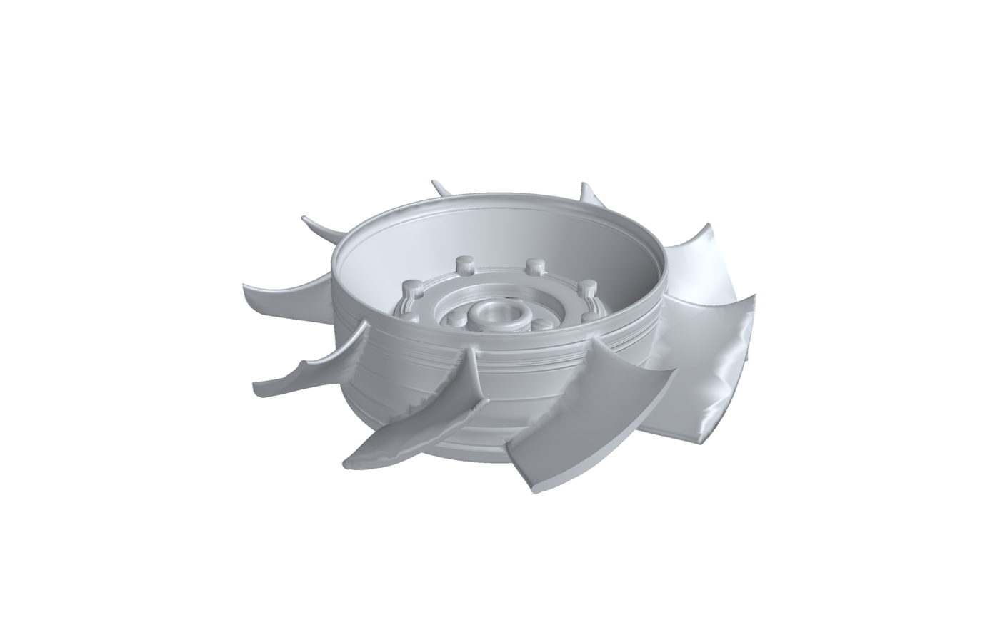
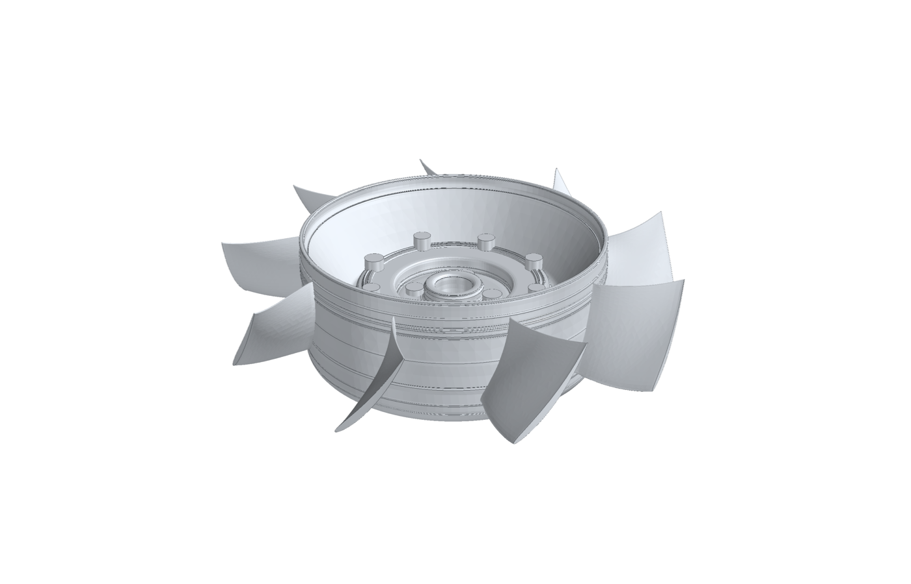

# 993 flat fan rotor F0 — a horizontal fan for the 993 from the measured 935 rotor

**Not ready to print.** Design study only: no installation, no structural
screen, no engineering review (`prohibited_pending_engineering`).
Catalogue record: [`993-ENG-FLAT-FAN-ROTOR-WE43-F0-0001`](../../parts/993-eng-flat-fan-rotor-we43-f0-0001/README.md).

| original: 935 flat-fan rotor, top-down CAD twin | this concept: 993 flat-fan rotor F0 |
|---|---|
|  |  |

## Two fans, one envelope

The owner's goal (2026-11-06) is two flat fans: the original 935 fan rebuilt
faithfully, and a new horizontal fan for the 993 in the spirit of Gunther
Werks' 993-based cars. The first is the
[935 top-down twin](../../twins/935-horizontal-fan-cad-twin/README.md),
fitted to a private scan. This dossier is the second.

The 993 rotor is an original design that copies no product. It keeps the
envelope and interfaces of the measured 935 rotor:

- tip Ø 270.5 mm, drum hub r 89.3 mm, the same axial band;
- the two drive dogs and the fastener pattern of the 935 hub, so it fits a
  935-type right-angle drive output.

Inside that envelope:

- **nine new blades** from velocity triangles with the F1 method
  ([`flat_fan_993_f0.py`](../../parts/993-eng-flat-fan-rotor-we43-f0-0001/source/flat_fan_993_f0.py)):
  chord 53 → 64 mm, stagger 17° → 37° from axial, camber 42° → 22°,
  t/c 0.10 → 0.06, stacked on the 935 blade's mid-chord line;
- **a hollow hub**: the section the scanner could not see inside is designed
  as a 2.5 mm shell
  ([`build_flat_fan_993.py`](../../parts/993-eng-flat-fan-rotor-we43-f0-0001/source/build_flat_fan_993.py)).

**Mass: 1.03 kg in WE43** (1.49 kg in AlSi10Mg), before fillets, inserts
and coating ([`cad-summary.json`](../../parts/993-eng-flat-fan-rotor-we43-f0-0001/evidence/cad-summary.json)).
For scale, the upright 993 Turbo rotor is listed at 0.9 kg for 245 mm.

## Estimated performance

One-dimensional blade-element model (the F1 method), both rotors in the
same envelope, on the 993 duty that the F1 study inferred: 2.34 m³/s at
2,155 Pa. Bellmouth inlet, 2 mm tip gap, generic stator
([evidence](../../parts/993-eng-flat-fan-rotor-we43-f0-0001/evidence/flat-fan-993-f0.json)).
The 935 rotor enters the model through its fitted chord, stagger and
camber-line angles.

| | fitted 935 rotor | 993 F0 rotor |
|---|---|---|
| speed for the duty | 9,095 rpm (tip 129 m/s) | **5,773 rpm (tip 82 m/s)** |
| shaft power | 6.64 kW, η 0.76 | **6.12 kW, η 0.82** |
| power at duty | — | **−7.9 %** |
| air at equal power (fan laws) | — | +2.8 % |

Without a stator the gain is −6.6 % power (935: 7.69 kW, η 0.66; F0:
7.18 kW, η 0.70, at 8,991 rpm). With a 1.5× loss factor on the 935's blunt
sections, the 935 needs about 5 % more power still.

The modest power gain says the 935 blade was already well shaped. The larger
result is the speed: the same air at 63 % of the speed, so centrifugal
stress falls to about 40 % and noise drops. That margin is what makes the
light hollow hub plausible; no structural screen has checked it yet.

These are model estimates on an inferred duty, not measurements, not CFD,
and not a statement about any real 935 or 993.

## Geometry and publication

The CAD is generated from the twin's fitted parameters and the chosen design.
It is kept private because the hub is fitted from a scan whose reuse rights
are not established; the catalogue record cites the SHA-256 of the private
STL under `geometry.private_derived_files`, and the public images are rendered
from those bytes (`scripts/render_part_previews.py --private-cad DIR`).

## Reproduce

```sh
VENV=work/flat-fan/venv   # numpy, scipy, shapely, trimesh, build123d
PART=parts/993-eng-flat-fan-rotor-we43-f0-0001
$VENV/bin/python $PART/source/flat_fan_993_f0.py study $PART/evidence/flat-fan-993-f0.json
$VENV/bin/python $PART/source/build_flat_fan_993.py work/flat-fan/private/cad993
```

## Open before this can go further

1. A 993 installation: right-angle drive and ratio, plenum to both banks,
   relocated alternator, engine mounting.
2. The stator, designed for this rotor (the factory 935 flat fan had one).
3. Blade-root fillets, then a structural, modal and fatigue screen.
4. A measured duty (stock 993 fan flow, pressure and power) to replace the
   inferred one.
