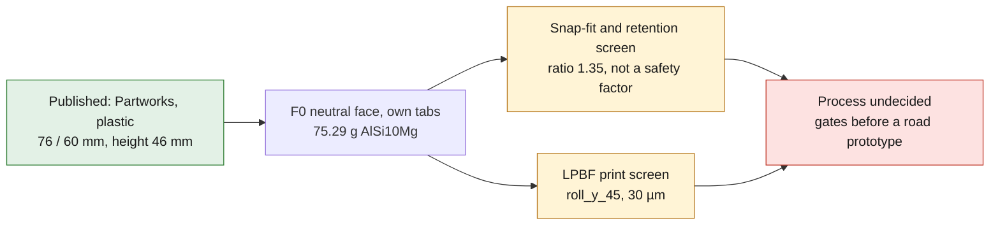
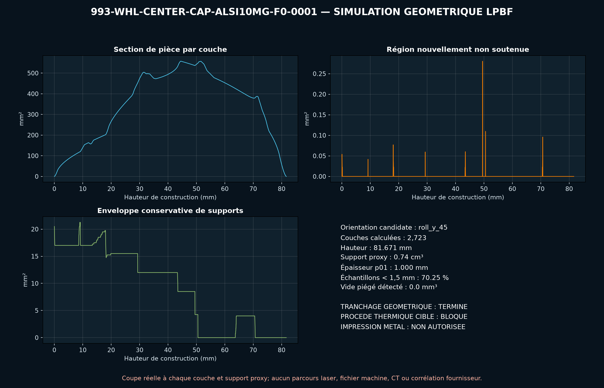

# 993 wheel center cap — AlSi10Mg F0 concept

PorscheFanatics identifies `993 361 303 07` as a wheel center cap and keeps its
historical PET status `U`, discontinued without replacement, while stating
that its current availability is unknown. Partworks currently sells an
original variant and declares: plastic, outer diameter `76 mm`, inner diameter
`60 mm` and height `46 mm`.

The F0 keeps only these three dimensions. Its face is deliberately neutral: no
Porsche crest, logo or design is reproduced. The skirt, the centering ring and
the four tabs with beads are the project's own assumptions.

*Diagram: the dossier's own path, restated from the text below. It adds no number or result, and it proves nothing about the physical part.*

## Why test metal AM

LPBF consolidates into a single solid a face, two rings and four tabs with
undercuts. This may be of interest for a small series or a customized variant.
Since the original is plastic, however, MJF, SLS and injection molding remain
competitors that are probably lighter and more flexible. The process therefore
stays `undecided`.

## Screening run

For assumptions of `0.4 mm` snap-fit deflection, `0.30` friction, `250 km/h`
speed, `315 mm` rolling radius, `20 g` axial shock and a `120 K` thermal
difference, the report recalculates:

- exact volume of the annular cylinders and tabs, then mass `rho V`;
- `I=b t³/12`, cantilever force `3 E I delta/L³` and root stress;
- friction retention capacity and axial inertial demand;
- wheel speed `omega=v/R`, centrifugal load on the tabs and hoop stress in the
  ring;
- aluminum/steel differential expansion;
- single OCCT BREP and STEP re-read.

The concept gives `75.29 g`, `16.59 N` per tab, `93.33 MPa` at the root and a
synthetic retention/demand ratio of `1.35`. This ratio is not a safety factor:
real wheel geometry, friction, fatigue, wear and shock are absent.

## Gates before a road prototype

1. Measure an identified wheel and a real cap: bore, clips, insertion,
   pull-out and tolerances.
2. Objectively compare AlSi10Mg, MJF/SLS polymer and injection molding.
3. Add fillets, orientation, heat treatment and surface finish.
4. Inspect by CT and dimensionally, then bench-test insertion/pull-out,
   rotation, shock, corrosion and thermal cycles.
5. Obtain a professional review of the detachment risk before road use.

PhysicsNeMo will wait for insertion curves, rotation tests and thermal cycles.
SimReady stays deferred as long as the wheel interface and the retention law
are not measured.

<!-- print-screen:begin -->

## LPBF geometric screening — process physics not calculated

The STEP was tessellated, then sliced over its full height at `30 µm`, within the candidate EOS M 290 envelope. Candidate material/process reference: `EOS Aluminium AlSi10Mg / M290 30 um`. Orientation chosen by a geometric rule, not thermal optimisation: `roll_y_45`.

The 45° overhang rule only flags geometric regions. The vertical columns are a **hypothetical support envelope**, not supplier-designed metal supports. Their volume is not a metal consumption estimate. Metal LPBF support design must address heat transfer, residual stress, recoater interaction and removal; none is validated here.

| quantity | value |
|---|---:|
| layers | 2,723 |
| build height | 81.67 mm |
| layers flagged by the geometric overhang rule | 28 |
| hypothetical support-envelope volume | 742.45 mm³ |
| local thickness p01 | 1.000 mm |
| trapped powder at 1.00 mm | 0.00 mm³ |

**Process physics has not been calculated:** no melt-pool, thermal, residual-stress, distortion or recoater simulation. No qualified support design or machine build file is provided. **Printing remains prohibited.**

<!-- print-screen:end -->
