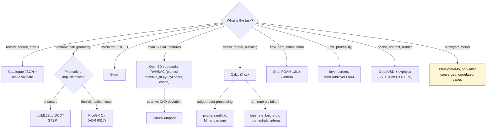
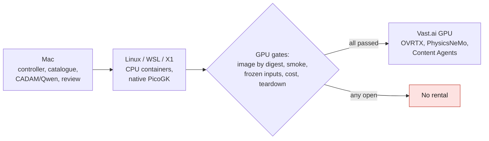
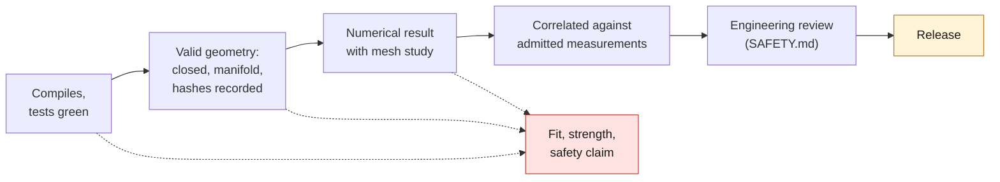
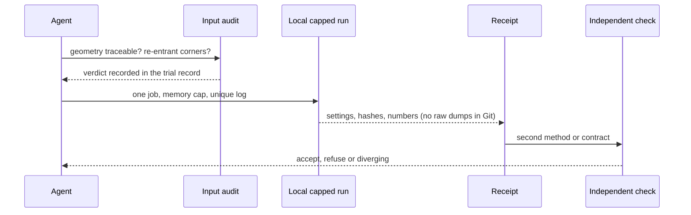

# Agent tool guide

For agents (and people) doing engineering work in this repository: **which tool
to use for a task, how to run it, where it runs, what its output can claim, and
the pitfalls already paid for.** The rules themselves are in
[AGENTS.md](../AGENTS.md). Tool selection is in [TOOLCHAIN.md](TOOLCHAIN.md),
the stack and its execution status in [SOFTWARE_STACK.md](SOFTWARE_STACK.md),
images in [CONTAINER_INDEX.md](CONTAINER_INDEX.md), and workstation setup in
[LOCAL_HOST_SETUP.md](LOCAL_HOST_SETUP.md).

Three rules come before any tool:

1. **Audit the input before sweeping the tool.** A mesh, solver or process
   study inherits every defect of its geometry (AGENTS.md). If the surface is not
   traceable to acquired data, or has a sharp re-entrant corner, no setting can
   repair the result.
2. **A green run validates the software chain, never the part.** Compiling,
   a watertight mesh, a converged residual or a clean render establish nothing
   about fit, strength, material qualification or safety.
3. **Model output never inspects itself.** Check a model's proposal against an
   independent interface contract or a second method.

## 1. Pick the tool for the task

*Diagram: the default tool per task, as given in the table below. It adds no
tool beyond that table.*

| Task | Tool | How to run it | Where | What the output can claim | Runbook |
|---|---|---|---|---|---|
| Validate records, pages, images, links | Python stdlib, Make | `make check-setup && make check`; single checks such as `make validate`, `make part-pages-check`, `make docs-links-check` | any Linux host on ext4 | structure and consistency only | [LOCAL_HOST_SETUP.md](LOCAL_HOST_SETUP.md) |
| Part images after a geometry change | `scripts/render_part_previews.py` | `make part-previews` (each part runs in `3dprinting993-cadsim:dev`, 6 GB cap) | Docker CPU | public images match the record and CAD hashes | AGENTS.md |
| Parametric CAD | build123d 0.11 / OCCT 7.9 | the part's `parts/<id>/source/*.py`; qualified image `cad-author-f28` | host venv or container | a STEP built from declared parameters | [TOOLCHAIN.md](TOOLCHAIN.md) |
| Implicit, lattice or voxel geometry | PicoGK 2.3 + LEAP 71 ShapeKernel/LatticeLibrary | `dotnet build -p:UpstreamRoot=<sources>`, then run under a memory cap; catalogue driver `parts/picogk-catalog/tools/run_part.py`; the 962 head only through its bounded Linux runner `run_native.py`, never the native DLL directly | native host or `containers/m64-leap71` | a voxel/mesh body; never a BREP master. The 962 Linux runner is qualified on a synthetic witness only; the head generator has not run on Linux | [LOCAL_HOST_SETUP.md §4](LOCAL_HOST_SETUP.md#4-native-picogk-on-linux-or-wsl), [LEAP_STACK.md](../twins/vehicle-911-917/LEAP_STACK.md), [962 Linux runner](../twins/962-cylinder-head-f0/source/linux_runtime/README.md) |
| Scan-to-CAD feature fitting (planes) | Open3D 0.19 `segment_plane`, repeated, keeping only inliers whose normals agree; refit each plane by least squares | [`benchmarks/scan-primitive-fitting/`](../benchmarks/scan-primitive-fitting/README.md): venv from its hash lock; set the distance to about 3× the scan noise | host venv | planes of a scan, each with its own fit residual. Qualified on a synthetic drafted-fin witness only (24/24 faces, drafts 0–3°); cylinders, cones and fillets are not covered | [README](../benchmarks/scan-primitive-fitting/README.md) |
| Scan-to-CAD feature fitting (cylinders, cones, fillets) | [`primitive_fit.py`](../benchmarks/scan-primitive-fitting/primitive_fit.py) on SciPy `least_squares`; one model for cylinder and cone, so draft is measured | same venv: `primitive_fit.py <scan> --noise-mm <sigma> --output <fits.json>`; the noise must come from a measured flat or the scanner record | host venv | axis, radius and half-angle of each primitive with its own standard deviation, or `"determined": false`. Qualified on synthetic isolated features only (18/18, plus ten further scenes); a 3 mm fillet at 1 mm pitch is reported as not determined. Spheres, tori and tangent-constrained blends are not covered | [README](../benchmarks/scan-primitive-fitting/README.md#cylinders-cones-and-fillets) |
| Scan-versus-CAD deviation | CloudCompare 2.13.2, command line | build `containers/free-tools-cloudcompare.Dockerfile`, then `python3 benchmarks/free-tools/native_container.py cloudcompare --image <image> --output <new dir>` | CPU container, no network | point-to-surface distances in mm after a stated rigid transform. Sampled diagnostics; synthetic controls only (0, 1 and 0 mm recovered), no measured scan registered | [free tools](architecture/free-tools/README.md) |
| Fatigue post-processing | pyLife 2.3 (Apache-2.0): rainflow counting, Wöhler curves, Miner damage | [`benchmarks/fatigue-postprocessor/`](../benchmarks/fatigue-postprocessor/README.md): venv from its hash lock; stress histories from a converged FE result | host venv | counts and damage for a **stated** S-N curve. It supplies no material data: S-N, mean-stress and AM process properties need their own source | [README](../benchmarks/fatigue-postprocessor/README.md) |
| Laminate first-ply failure | [`scripts/laminate_failure.py`](../scripts/laminate_failure.py) (NumPy): lamination theory, maximum stress, Tsai-Wu, Hashin 1980, Puck inter-fibre | `python3 scripts/laminate_failure.py <case.json> --output <report.json>`; ply stresses from lamination theory or supplied from a laminated-shell solve | any host with NumPy | a reserve factor per ply face and criterion, for **stated** stiffness, strength and criterion parameters. It supplies no material data; no delamination, progressive damage or crash ([ADR 0018](decisions/0018-composite-crash-no-claim.md)). Reading ply stresses out of a CalculiX result is not implemented | script docstring, `tests/test_laminate_failure.py` |
| FE / CFD meshing | Gmsh (pinned per evidence) | Python API inside the study's source | container or host | a mesh with recorded size fields and quality | study README |
| Stress, modal, buckling, thermal | CalculiX 2.21 `ccx` | text deck written by the study script; **one thread** | `3dprinting993-cadsim` or capped host | a numerical result for stated loads and supports | [twins/964-chassis/fea/README.md](../twins/964-chassis/fea/README.md) |
| CFD, conjugate heat | OpenFOAM 13 (`cadsim`, `mesh-cfd`) or 14 + AATE (`openfoam-engine-f35`) | case generator in the study, `checkMesh` first | container CPU | fields for stated boundaries; not vehicle-correlated | study README, [COMPUTE_ENVIRONMENT.md](COMPUTE_ENVIRONMENT.md) |
| Thermochemistry, 0D/1D networks | Cantera 3.2 | study scripts in `engine-cycle-f33` | container CPU | uncorrelated model output | study README |
| LPBF geometric screen | repository layer slicer + trimesh | `make print-screens PYLIB=<dir>`, one part at a time | `cadsim`, 6 GB cap | slices, thin walls and powder traps of a mesh | [AM_VALIDATION_PIPELINE.md](AM_VALIDATION_PIPELINE.md) |
| LPBF melt pool | ORNL AdditiveFOAM 2.0 on OpenFOAM 14 | image `qwen-picogk/additivefoam`; needs a process map and coupons | CPU/HPC | melt-pool fields; blocked for the small 993 parts | [usd-brep-lpbf.md](architecture/usd-brep-lpbf.md) |
| STEP to OpenUSD, validation | `usd-convert-cad 0.2`, `nvidia_usd_validate 1.21` | see the runbook; exact solids via `make container-smoke-usd-brep` | CPU container | a valid stage; asserts no fit | [usd-brep-lpbf.md](architecture/usd-brep-lpbf.md) |
| Rigid contact, motion | `ovstage` + `ovphysx 0.5` | lifecycle `create → populate → attach → step → detach → destroy` | CPU, or a Vast GPU | contact and motion for declared, often synthetic, properties | [SOFTWARE_STACK.md](SOFTWARE_STACK.md#omniverse-and-simready) |
| Render, sensors | OVRTX | only after the GPU gates | rented RTX GPU | pixels; never a physical result | [SOFTWARE_STACK.md](SOFTWARE_STACK.md#gates-before-paid-gpu-computation) |
| Local AI CAD proposals | CADAM + local Qwen/MLX | per the runbook; proposals checked independently | Mac | a proposal, never its own inspection | [cadam-local-qwen.md](architecture/cadam-local-qwen.md) |
| Measurement intake | `scripts/capture_caliper.py`, `scripts/capture_photoset.py` | contributor data only ([ADR 0019](decisions/0019-accept-contributed-measurements.md)) | contributor | an admitted reading with instrument and uncertainty | [CAPTURE_PROTOCOL.md](CAPTURE_PROTOCOL.md) |
| Self-intersection audit of a surface mesh | CGAL 5.6 auditor (`surface_intersections_cgal.cpp`), read-only | `g++ -std=c++20 -O2 … -lgmp -lmpfr`, then set `M64_CGAL_INTERSECTIONS` | host with `libcgal-dev`, or CI | which triangles cross or overlap. It repairs nothing and admits no mesh for CFD or manufacturing | [LOCAL_HOST_SETUP.md](LOCAL_HOST_SETUP.md#retained-cgal-intersection-auditor) |
| Second volume mesher, for comparison | SALOME 9.16 with NETGEN | `python3 benchmarks/free-tools/native_container.py salome --image <image> --output <new dir>` | CPU container | a tetrahedral mesh with checked boundary and CalculiX format. Synthetic cube and bore only; the carrier is blocked until its face groups are reviewed | [free tools](architecture/free-tools/README.md) |
| Mesh cleanup, decimation, heavy mesh operations | pymeshlab 2025.7 (`scan-mesh-f17` image); Blender `--background --python` (`mesh-cfd`, `recon`) | per study script | CPU container | a derived mesh. Blender has a version check only and no recent receipt | [TOOLCHAIN.md](TOOLCHAIN.md) |
| CFD cross-check (lattice Boltzmann) | FluidX3D at a pinned commit, **non-commercial licence** | `make 917-aircooled-4v-f34-fluidx3d-image` | container, CPU OpenCL | a second flow estimate. Its three-grid study did not pass mesh independence | [F34 record](../archive/917/docs/917_AIRCOOLED_4V_F34.md) |
| LPBF thermal research codes | adamantine, GO-MELT, LPBF-CUDA, each at a pinned revision | `make go-melt-smoke`, `make lpbf-cuda-cpu-smoke`; adamantine per its README | CPU | kernel and export witnesses only: no full scan, no CUDA run, no physical validation | [usd-brep-lpbf.md](architecture/usd-brep-lpbf.md), [adamantine](../benchmarks/lpbf-adamantine-export/README.md) |
| LPBF slicing and hatching | PySLM at a pinned, patched revision | the installers in `parts/993-eng-carrier-0001/source/process-*`; the two generations are not interchangeable | macOS arm64, Python 3.11 | layers and hatches of one part. Not an admitted build preparation and no machine file | [carrier process](../parts/993-eng-carrier-0001/source/process-coverage-20261016/README.md) |
| Sensitivity and optimisation studies | OpenTURNS 1.27, OpenMDAO 3.45 | `make free-tools-check`, `make free-tools-controls` | venv from `benchmarks/free-tools/requirements.lock.txt` | analytic controls only. No probability distribution is invented for a part | [test plan](architecture/free-tools/IMPLEMENTATION_TEST_PLAN.md) |
| Versioned private data between hosts | DVC 3.67 | `benchmarks/free-tools/storage.py archive`, `restore`, `replicate` | same venv | a transfer that rehashes on restore. A push is not a verified backup | [free tools](architecture/free-tools/README.md) |
| Differentiable FE, GPU geometry kernels | JAX-FEM 0.0.12; NVIDIA Warp 1.18 | per runbook; Warp: `bash containers/warp-geometry-build.sh <tag>` | CPU container | smoke and synthetic geometry controls. Neither has run on a GPU, and no study uses JAX-FEM | [JAX-FEM](../containers/stack-20261105/JAX_FEM_NATIVE.md), [Warp pilot](WARP_GEOMETRY_VAST_PILOT.md) |
| Electronics schematic checks | KiCad 9.0.2, image pinned by digest | the rear-panel tests, run inside the image | CPU container | ERC and a fresh netlist against the contract. No PCB; not validated for manufacturing | [KiCad README](projects/993-programmable-rear-panel/electronics/kicad/README.md) |
| Human CAD review | FreeCAD 1.1 (`FreeCADCmd`) | interactive, or scripted per study | Mac only; not on the Linux host or in `cadsim` | a person's reading of a STEP. No CI job runs it | [935 example](research/935-source-cut-admission-20261106/README.md) |
| Polymer slicing | PrusaSlicer (unpinned in `cadsim`; 2.9.7 in the stack recipe) | command line | CPU container | a sliced file. Only a synthetic cube has been sliced by script; no printer is qualified | [stack recipes](../containers/stack-20261105/README.md) |
| Back up private outputs (STEP, meshes, solver fields) | [`scripts/private_release_backup.py`](../scripts/private_release_backup.py) | `backup`, then `verify`, into a release of a **private** repository (935 data: `porscheparts-935-private`); files still being written are skipped and listed | any host with `gh` | a storage copy whose every file rehashes identically after download. Not a DVC registration: the DVC stores (Mac, Kali) are not reachable from every host | script docstring |
| 962 cylinder-head work | `workflow_plan.py` + the 19-phase contract | read the head's AGENTS.md and WORKFLOW.md **first** | per phase | phase states, never physical approval | [WORKFLOW.md](../twins/962-cylinder-head-f0/WORKFLOW.md) |

## 2. Where each tool runs

*Diagram: the host split from [SOFTWARE_STACK.md](SOFTWARE_STACK.md); local
compute first, paid GPU only after every gate.*

Images are cited by digest from their lock file, never by tag alone
([CONTAINER_INDEX.md](CONTAINER_INDEX.md)). Rentals go through the OpenBao
wrappers in [`deploy/openbao/`](../deploy/openbao/README.md), one at a time, with
teardown.

## 3. What a result can claim

*Diagram: each step needs the one before it. None of the first three supports a
fit, strength or safety claim (AGENTS.md, SAFETY.md).*

## 4. Before a heavy or paid run

*Diagram: the order AGENTS.md requires: audit first, then a capped local run,
a receipt and an independent check. A paid run comes only after these, through
the GPU gates.*

## 5. Pitfalls already paid for

Each of these cost at least one rejected PR series or trial. Check the
neighbouring study's README for more before starting.

### CalculiX

- **S3 shells lock in bending.** Expanded to linear wedges, the Scordelis-Lo roof
  reached 7/12/21 % of the reference deflection at 8/16/32 grids, against
  82/98/100 % for S6. On the 964 monocoque, S3 overstated torsional stiffness
  about ×1.8 (boxes) and ×10 (open shell), and PRs #139–#156 had to be redone. Use
  S6, collapse sliver "needles" (q_min 0.1) or S6 fails with
  `nonpositive jacobian`, and include mid-side nodes in clamp sets.
- **Multi-threaded SPOOLES occasionally returns a wrong solution** on the same
  input (stiffness up to +60 %, spurious buckling factors). Run with
  `OMP_NUM_THREADS=1`. Results that don't repeat mean a solver problem, not
  noise to vote away.
- **`*BUCKLE` output:** the first DISP block in the `.frd` is the static base
  state (value 0.0). The modes follow; take the last *n* blocks.
- Validate a new element type on a benchmark with a known answer before the
  real study. A value that "converges from above" while still falling is a
  locking warning, not a result.

### Stress peaks and mesh studies

- **A peak at a sharp re-entrant corner is a singularity, not a stress.** The
  WE43 impeller blade-root peak rose 88.5 → 100.2 → 110.1 → 120.9 MPa as the
  root mesh went 2.0 → 1.4 → 1.0 → 0.7 mm (log-log slope 0.295). Never quote a
  peak or a margin there until the corner is blended. Resolving a blend needs
  h ≈ 0.26 r.
- An out-of-memory kill can look like a solver failure: a 395-byte `ccx` log
  plus exit 1 from the wrapper. Check `dmesg` or the cgroup events before
  diagnosing.

### Lattices and voxel convergence

- **A fixed level-set threshold changes the solid at each resolution.** The
  gyroid unit-cell "2 % convergence" gate tracked solid-fraction drift
  (ratio 1.1–2.5), not discretisation error. Hold the *actual* solid fraction
  constant across resolutions before judging convergence.
- Measure mass savings against the **solid counterpart** (same features and
  voids), not against the bionic body. A pocket-fill step closed almost all of
  a 2.5 mm-cell core while the generator reported 5–49 % savings. Use cells of
  at least nine wall thicknesses.

### Scan feature fitting

- **A fine Z-level histogram misses drafted faces.** With a 0.1 mm window it
  found levels near only 7 of 28 fin faces on the 935 head (2026-11-09): a cast
  face drafted by 1–2° spreads over 1–2 mm of height and never forms a sharp
  peak. On the synthetic witness the same detector recovered only the undrafted
  faces (4/24) and reported 1,514 spurious levels. The twin's later per-face fit
  recovered all 28 on the real scan; it is not on main and has no witness.
- **Open3D `detect_planar_patches` with library defaults misses stacked
  faces.** On the same witness (fins 3 mm thick, 4 mm apart) it returned the two
  outermost faces only. Sequential `segment_plane` with a normal-agreement
  filter recovered all 24; the normal filter is what keeps a fin's facing
  neighbour out of its inliers.

- **Draft makes a cylinder a cone.** A cylinder-only fit of bores and bosses
  drafted by 0.5 to 2° reported each as a determined cylinder outside the
  limits and left ten spurious fragments; the cone-or-cylinder model recovered
  all of them to 0.001°.
- **A small fillet between two flanks may hold no usable points.** At 1 mm
  pitch a 3 mm fillet keeps two columns of vertices outside the zones it shares
  with its flanks, and a cylinder a sixth of its radius fits those exactly.
  Check the normals, and treat `"determined": false` as "not measured".
- **A narrow cone band does not fix its own axis.** A 3 mm valve-seat band
  gave 0.1° and 0.03 mm of axis uncertainty against 0.01° and 0.002 mm for its
  guide. Take the axis from the guide, and read the reported standard
  deviations before using an axis.

### Laminate failure

- **A reserve factor is only as good as its strengths.** `laminate_failure.py`
  evaluates a criterion only where its parameters are stated and has no
  defaults: the Tsai-Wu interaction term, Hashin's transverse shear strength and
  Puck's inclination parameters are material inputs that need a source.
- Compare reserve factors, not raw indices: Tsai-Wu's index is not linear in
  load, so an index of 0.5 does not mean half the failure load.

### PicoGK 2.3

- `IntersectImplicit` aborts below 1/3 mm voxels; use
  `new Voxels(lib, implicit, bbox)` then `BoolIntersect`. `Library.MmToVoxels`
  is wrong in 2.3.0.
- `new Voxels(mesh)` fills fully enclosed cavities, so trapped powder needs a
  separate ray-parity check.
- PicoGK voxel meshes can carry **zero-area triangles with coincident
  vertices**. `trimesh` then counts their collapsed edges as non-manifold. Weld
  exactly before concluding, and drop those triangles in the output stage
  (piston gallery, issue #468).
- Pass a log path: the default `~/Documents/PicoGK.log` crashes if that folder
  is missing.

### OCC / build123d

- **A difference of two large OCC volumes cannot judge a small feature.**
  Eleven sequential blade unions drift 10–20 mm³ in a 229,000 mm³ solid, the
  size of the fillet being checked. Judge a blend on its own surface (face
  areas, sampled curvature radius), and verify the base body's symmetry first.
  `is_valid` and a single solid catch none of this.

### Memory, logs and the host

- A heavy job that outgrows memory can take WSL down. Cap it; exit 137 is the
  cap, not a verdict. Keep the sum of concurrent caps below about 12 GB on the
  15 GB host, and write results after each case, not at the end.
- The LPBF slicer keeps every layer in memory. Tall parts exceed 6 GB, so run
  one part at a time and rerun only killed parts at 10 GB.
- One `make check` at a time, with a unique log per run
  ([LOCAL_HOST_SETUP.md §3](LOCAL_HOST_SETUP.md#3-heavy-jobs-on-a-shared-or-wsl-host)).

## 6. Not available yet

| Need | State | Tracked in |
|---|---|---|
| Explicit crash (OpenRadioss) | chosen in the monocoque docs, not installed | ADR 0018, #441 |
| Photogrammetry on real data (COLMAP/GLOMAP) | image defined, never run on real captures | `containers/recon.Dockerfile` |
| Material Agent / Omniverse endpoints | HTTP 403 | #459, #561 |
| PhysicsNeMo on a part | GPU smoke only; needs converged, correlated cases | SOFTWARE_STACK.md |
| Vehicle dynamics, multibody, valve-train dynamics | candidate: Chrono (BSD-3; Chrono::Vehicle for the car), not installed: no image, lock or witness. A head twin needs it for anything beyond static geometry; code-to-code validation only until measured 993 data exist | [twin tooling research](research/993-digital-twin-tooling-2026-11-06.md), #504 |
| Laminate strengths, delamination | no admitted ply strength or criterion parameter for any laminate; `laminate_failure.py` covers in-plane first-ply failure only. Interlaminar stresses, cohesive zones and reading ply stresses from a CalculiX result are not implemented | [computation chain](MONOCOQUE_964_993_COMPUTATION_CHAIN.md), ADR 0018 |
| Small fillets, spheres, tori, tangent blends from a scan | not covered by `primitive_fit.py`; a fillet needs several vertex columns outside its shared zones, or a fit constrained tangent to its flanks | [fitting README](../benchmarks/scan-primitive-fitting/README.md) |
| Dimensioned drawings for a supplier | [TOOLCHAIN.md](TOOLCHAIN.md) promises one with every titanium order; no tool is assigned or witnessed. build123d 0.11 in `cadsim` carries projection and dimension objects (import and one call checked, nothing more); FreeCAD TechDraw is not installed | TOOLCHAIN.md |
| ParaView, Meshroom | named in TOOLCHAIN.md, installed in no recipe and never run; PyVista does the post-processing | TOOLCHAIN.md |
| Fatigue material data | none admitted. pyLife (above) computes damage only from an S-N curve someone states; titanium and AM parts need alloy-, process- and orientation-specific data (AGENTS.md) | SAFETY.md |
| System co-simulation | candidates: OMSimulator, FMPy, Ecos; FMI 2.0 co-simulation is the common level; ovfmi (pre-release) bridges FMUs to OpenUSD | same research, #504 |
| Validated 1D engine and turbo gas dynamics | Aeolus1D 0.3.3 (MIT, alpha) runs in the digest-pinned F39 image `ghcr.io/cluster2600/3dprinting993-wave-action-f39@sha256:7425…`, used for 917 network construction checks. Only a Sod shock-tube smoke qualifies its runtime: no engine, turbo or 993 validation. No mature maintained alternative (OpenWAM dormant since 2016). No `containers/*.lock.json` names the image, so the container index lists it as unlocked | same research, [917 reference engine](../twins/reference-917-engine/README.md) |
| Operational data from the car | python-OBD only on OBD-II-compliant 993s; nothing free for 19-pin / K-line Motronic | same research, #510–#514 |

Licences differ: FluidX3D is non-commercial, the NVIDIA SDKs are free to use
but proprietary, and Isaac Sim's Apache-2.0 source needs proprietary Kit
components to run. Record a tool's licence before it becomes part of an evidence
chain.
