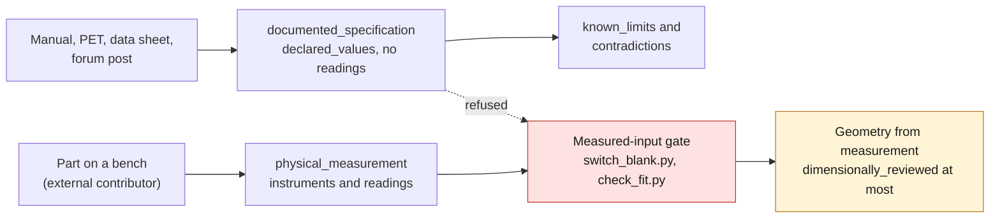

# Capture protocol — measurements, scans and declared values

One method for turning a part, or a document about a part, into evidence the
catalogue can check. It gathers rules that were spread over several documents,
by reference, and adds what was missing: accuracy targets per method, scan
acceptance thresholds fixed before acquisition, and the intake of declared
values from manuals, the PET catalogue, data sheets and forum posts.

How to read this page:

- A rule followed by a link is **in force**: it restates a validator, a
  template or a plan, and the linked document stays authoritative.
- A rule marked **Proposal** is a project proposal. It is not a requirement
  until the maintainer accepts it in a decision.

**Working frame.** The repository buys no part and measures none (project
owner, 2026-09-14; [PROJECT_CHARTER.md](PROJECT_CHARTER.md)). Sections 2 to 7
are a handover to an external contributor and have never been exercised.
Section 8, documentary intake, is what runs today; it was desk-tested on the
first pilot ([decision 0013](decisions/0013-pilots-advance-on-documentary-evidence.md)).

## 1. Where each rule lives

| Topic | Authoritative place |
|---|---|
| Choosing the method | [WORKFLOW.md, "Choosing the acquisition method"](WORKFLOW.md#choosing-the-acquisition-method) |
| Open-source tools | [TOOLCHAIN.md, "Acquisition and reconstruction"](TOOLCHAIN.md#acquisition-and-reconstruction): COLMAP then GLOMAP, Meshroom as a second opinion, pymeshlab, Open3D, Blender |
| Contributor prerequisites, session procedure | [MEASUREMENT_CAMPAIGN.md](MEASUREMENT_CAMPAIGN.md#session-procedure) |
| Record format and checks | [`measurement.schema.json`](../catalog/schemas/measurement.schema.json), [`validate_measurements.py`](../scripts/validate_measurements.py), [template](../catalog/templates/measurement-record.json) |
| Plan template | [`catalog/templates/measurement-plan.md`](../catalog/templates/measurement-plan.md) |
| Plans of the pilots (pinned, French) | `parts/<part_id>/evidence/measurement-plan.md` |
| Automated rules | [QUALITY_GATES.md, "Automated rules"](QUALITY_GATES.md#automated-rules) |
| Evidence levels A–E | [SOURCE_POLICY.md](SOURCE_POLICY.md#trust-hierarchy) |
| Capture tools | [`capture_caliper.py`](../scripts/capture_caliper.py), [`capture_photoset.py`](../scripts/capture_photoset.py) |

## 2. The kit

Accessible instruments only. Nothing here is bought by the repository.

| Instrument | Used for | Record field `type` |
|---|---|---|
| Digital caliper, 0–150 mm, 0.01 mm (as in the pilot plans) | interface dimensions | `caliper` |
| Micrometer | thin walls, faces and tabs | `micrometer` |
| Radius, pin and feeler gauges | corner radii, holes, clearances | `gauge_pin`, `other` |
| Depth gauge or rule | depths, clearances to a rail | `other` |
| Gauge block, pin gauge or known reference | zero check before each session | declared in `calibration.reference` |
| Certified scale bar (100 mm in the door pull plan) | scale of every photoset | `scale_bar` |
| Camera, fixed focal length, focus locked | photogrammetry | `camera` |

Each instrument declares its model, resolution, interface and calibration state;
`calibrated` requires a check date
([validator](../scripts/validate_measurements.py)). A structured-light scan or
CT is outsourced, and its order follows the CT brief of
[MEASUREMENT_CAMPAIGN.md](MEASUREMENT_CAMPAIGN.md#optional-ct-brief).

## 3. Accuracy

In force ([QUALITY_GATES.md](QUALITY_GATES.md#automated-rules)): an
uncertainty finer than half the instrument resolution is rejected; a value must
match the mean of its samples within half the resolution; level `A` requires at
least three samples and a known calibration state.

**Proposal P1 — targets per method.** Expanded uncertainty to reach, on top of
the floor the validator enforces.

| Method | Floor in force | Proposed target | Basis of the proposal |
|---|---|---|---|
| Digital caliper, 0.01 mm | 0.005 mm | ≤ 0.10 mm on an interface dimension | a 4:1 ratio, a common metrology convention, against the 0.4 mm size step of the switch blank fit-test kit, the finest decision a pilot dimension feeds today |
| Micrometer, 0.001 mm | 0.0005 mm | ≤ 0.02 mm | for faces and tabs whose caliper readings do not meet 0.10 mm |
| Radius, pin or feeler gauge | half the step between the two adjacent gauges | the floor itself | a gauge resolves its step and nothing finer |
| Scaled photogrammetry | the scale reference's own uncertainty | no absolute accuracy claimed; acceptance by section 7 | a photoset gives a shape; interface dimensions come from the caliper |
| Outsourced scan or CT | the provider's stated uncertainty | written into the order | the provider's report, checked by section 7 |

## 4. Repeatability

In force ([MEASUREMENT_CAMPAIGN.md](MEASUREMENT_CAMPAIGN.md#session-procedure)):
at least three readings per critical dimension, never made to converge; a value
typed by hand stays `manual_entry`; the value is computed from its samples.

**Proposal P2 — how to state the uncertainty.**

- Release and re-seat the part between readings, so the three readings sample
  the set-up and not only the display.
- Record `uncertainty` = the larger of the range of the readings and the
  instrument resolution. Basis `repeatability` when the range is larger,
  `instrument_resolution` otherwise.
- Use `combined` only with a written budget (temperature, jaw force,
  calibration), and never `estimated` for a critical dimension.

## 5. Datums and scale markers

In force: origin, axes and reference planes are defined before the first
reading and stay identifiable in the photos and the CAD
([session procedure](MEASUREMENT_CAMPAIGN.md#session-procedure), step 3).
Photogrammetry has no origin of its own: registration on measured interfaces
gives it one. A mirror is taken about the vehicle's longitudinal plane, not
about the part.

| Pilot | Datum in its plan |
|---|---|
| `993-INT-SWITCH-BLANK-0001` | origin at the center of the visible face; X width, Y height, Z out of the face toward the cabin, as in `TWIN-993-CABIN-DASH-SWITCH-0001` |
| `993-INT-DOOR-PULL-0001` | origin at the center of the mounting plane; X along the handle, Z normal to the mounting plane |
| `993-INT-SEAT-RAIL-COVER-0001` | origin on the axis of the first fixing; X along the rail, Z up |

Scale, in force: a certified scale bar in every shot
([session procedure](MEASUREMENT_CAMPAIGN.md#session-procedure), step 5).
`capture_photoset.py` will not run without `--scale-reference`; it records the
declared reference and does not check it.

**Proposal P3.** Two scale references in different orientations: one sets the
scale, the other is held out as a check. A printed target helps feature
matching; it is not a scale reference unless its printed length is itself
measured.

## 6. Lighting, glossy and black surfaces

In force, from the pinned plans of the door pull and the dashboard trim:

- diffuse light, no direct flash, matte background, dust-free surface;
- fixed focal length and locked focus;
- two full passes at different camera heights, overlap of at least 70 %, and
  the back of the part covered;
- a manifest with camera, focal length, number of views, software and version,
  reprojection error, scale bars used and residual deviation;
- a glossy or black part gets a removable matting treatment (door pull plan); a
  dark grained surface is favorable, unlike a glossy varnish (dashboard plan);
  nothing is sprayed before the initial state is photographed and recorded.

**Proposal P4.** Take the caliper interface dimensions before any matting coat.
A coat adds thickness: record its product and its removal, and compare a coated
scan with uncoated dimensions only once the coat thickness is measured or
bounded in the manifest.

## 7. Scan against reference: thresholds before acquisition

In force: a scan is a reference, never absolute truth
([WORKFLOW.md](WORKFLOW.md#4-reconstruction)); critical dimensions are measured
separately; the door pull plan registers on D01 and D02, checks D03 to D05, and
leaves its threshold "to define before acquisition".

**Proposal P5 — the comparison.**

1. Before acquisition, commit the registration dimensions, the held-out check
   dimensions, one threshold `T` per check dimension, and what a failure means.
   That commit precedes the one that adds results; a threshold that first
   appears next to its results counts as set after the fact.
2. `T` is at least twice the caliper uncertainty of the same dimension;
   otherwise the reference cannot decide.
3. Scale and register on the registration dimensions only.
4. For each check dimension, deviation = scan − caliper; it passes if
   |deviation| ≤ `T`.
5. Report every deviation, the reprojection error and the residual scale error.
   Never rescale, re-register or drop a check dimension after seeing results. A
   failure is recorded as a contradiction.

**Proposal P6 — thresholds for the pilots**, to accept or change before any
acquisition.

| Pilot | Registration | Held-out checks | Proposed `T` |
|---|---|---|---|
| Door pull | D01, D02 | D03, D04, D05 | 0.5 mm each: five times the caliper target of P1, so the comparison tests the scan; well below the 2 mm relaxation signal of the dashboard plan; the scan carries only the grip surface |
| Switch blank | none | none | no scan: its plan calls 3D acquisition visual evidence only |
| Seat rail cover | none | D01–D05, left against right | no scan; symmetry holds only if each left-right difference stays within the declared uncertainty (rule of its plan) |

## 8. Documentary intake

This is how a declared value enters the catalogue. It runs today.

1. **Register the source first** in `catalog/sources/`, with access status,
   rights and evidence level ([SOURCE_POLICY.md](SOURCE_POLICY.md)). A value
   whose source is not registered is not recorded.
2. **One record per source**:
   `catalog/measurements/MEAS-DECLARED-<PART>-<SOURCE>.json`,
   `record_kind: documented_specification`. The validator requires every
   declared value to carry the record's `source_id`, and forbids instruments and
   readings in such a record.
3. **Each declared value** keeps:
   - `value_text`, the source's text; when only the source record's paraphrase
     is available, for instance because the page is blocked, `details` says so
     and `checked_against_original_post` is `false`;
   - `unit`, the source's unit; a conversion goes in `details`, beside it;
   - a locator: `pdf_page`, or `null` with `plate` holding the plate, page or
     thread;
   - instrument, tolerance and repeats as stated, or `not stated`, never a
     plausible value;
   - `extraction_status`: `manually_checked` only when checked against the
     source itself, `ocr_unreviewed` for unreviewed OCR, `structured_derived`
     for a value taken from a structured register;
   - any mapping to a plan or twin dimension (`D01`, `H01`) labelled as the
     repository's reading, not the source's.
4. **Evidence level**: the source's level, never higher. The measurement enum
   has `A`, `C`, `E` and `unrated`: **Proposal P7**, a `B` source is recorded
   `C` and a `D` source `E`.
5. **Declared is not measured.** A declared value never enters `readings`,
   never sets `geometry.source_type` to `measured` or `accuracy_mm`, and never
   opens a measured-input gate: `switch_blank.py` refuses any record that is not
   a `physical_measurement`. A concept may use a declared value only if the
   concept file names its source, as `concept-f0.json` does.
6. **Contradictions** go in `evidence.contradictions` and in the part's
   `validation.known_limits`. Both values are kept; none is averaged or chosen
   for convenience. Two level-C sources that agree do not raise the level, and
   sources that copy each other are not two confirmations.
7. **A missing dimension** is written as unsourced or candidate in
   `known_limits`. Nobody is sent to measure it.
8. **Part numbers** enter `porsche_part_numbers` only from a registered PET
   source with an illustration or plate and a position. Otherwise the number is
   a candidate in `known_limits`, with its source.
9. Run `make check`. If a record fails, fix the transcription, not the value.

## 9. Desk test on the first pilot

Applied to `993-INT-SWITCH-BLANK-0001` on 2026-10-15, documentary intake only.
Result, detailed in [decision 0013](decisions/0013-pilots-advance-on-documentary-evidence.md):
two declared records, three contradictions, and one finding: the fit-test kit
brackets 19 × 31 mm, a figure its source gives for the passage under the
covering, while the faceplate opening (thread 1202129) and the console switch
opening (thread 750484) both give about 17 × 28 mm.
The measured-input gate stayed closed, and
`tests/test_switch_blank_measurement_gate.py` keeps it closed.

Sections 2 to 7 are untested: no contributor, part or instrument exists yet.

## 10. Reviewer checklist

- [ ] Every value has a registered source, or an instrument and its readings.
- [ ] Declared values sit in a `documented_specification`, never in `readings`.
- [ ] The datum is defined before the first reading and visible in a photo.
- [ ] Three readings per critical dimension; uncertainty and basis stated.
- [ ] Each photoset declares its scale reference and has a manifest.
- [ ] Scan thresholds were committed before the results.
- [ ] Contradictions are listed in the record and in the part's `known_limits`.
- [ ] No status moves above `concept` on declared values.
- [ ] `make check` passes.
