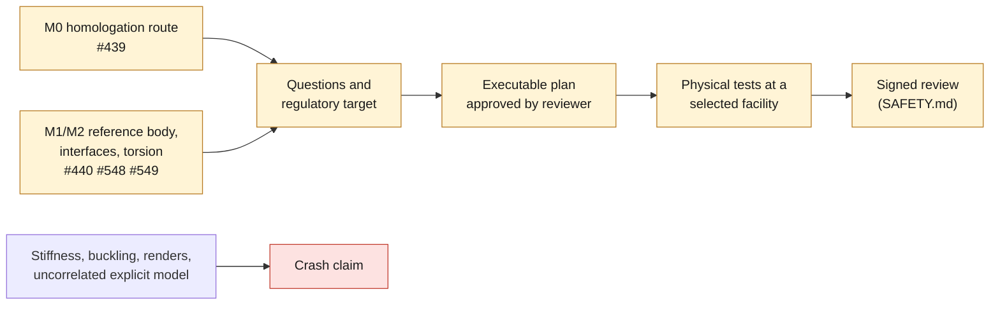

# Monocoque crash: physical validation-plan stub

**Status: stub for review, not an executable plan.** Issue #441, decision
[ADR 0018](decisions/0018-composite-crash-no-claim.md). Every field below is a
question to be answered by qualified professionals. None of them is answered
here, and no value is proposed. Current crash state: `unvalidated`; safety
class: `prohibited_pending_engineering`.

*Diagram: the only route to a crash statement, and the inputs that never lead
to one. It adds nothing beyond ADR 0018.*

## 1. Questions the plan must answer

| Area | Open question | Answered by |
|---|---|---|
| Regulatory target | Which markets and which impact, restraint-anchorage and roof-strength requirements apply to the vehicle identity chosen in M0? | Homologation counsel (#439) |
| Impact cases | Which load cases: frontal, offset, side, rear, roof, seat and belt anchorage pull? Which are full-vehicle and which are component tests? | Engineering reviewer |
| Occupant restraint | Where do belt, seat and (if present) airbag loads enter the cell? Which anchorage strength tests apply? | Engineering reviewer, with M0 |
| Specimen identity | Which exact cell revision, layup, cure and joint configuration is tested? How is it tied to the drawing and the build record? | Engineering reviewer, supplier (M6) |
| Boundary and loads | Which mass, pulse or velocity, barrier, fixture and constraint definitions? What is the reference frame tied to the M1 datums? | Engineering reviewer, test facility |
| Material characterisation | Which coupon tests (tension, compression, in-plane shear, interlaminar, strain rate) and which crush-tube or sub-component tests calibrate the material and failure models? | Materials engineer, supplier (M6) |
| Joints and inserts | How are bonded joints, inserts and the steel-to-composite interfaces to suspension and restraint tested? | Engineering reviewer |
| Instrumentation | Which accelerometers, load cells, high-speed video and deformation measurements, with which calibration and uncertainty? | Test facility |
| Simulation role | Which explicit model (for example OpenRadioss) is correlated against which test, with which predeclared correlation metric? | Engineering reviewer |
| Acceptance | Which pass criteria, and who has the authority to accept them? | Engineering reviewer, homologation route |
| Independence | Who reviews the plan and the results independently of the people who designed the cell? | Owner names the reviewer |
| Facility | Which accredited facility or standard test house runs the tests? | Selected by qualified professionals |

## 2. Prerequisites before this stub can become a plan

- [ ] M0 route identified, or the programme stopped (#439).
- [ ] M1 measured interface datums accepted (#548), and M2 torsion baseline measured (#549).
- [ ] M3 to M6 completed: model recalibrated (#550), target specification frozen (#551), architecture and layup (#552), process and coupons qualified (#553).
- [ ] Independent safety review and approved validation plan (#554, phase M7).

## 3. What this stub does not do

It does not select a test method, a standard, a pulse, a mass, a barrier or an
acceptance value. It does not schedule or authorise any test. It does not
permit any crash, energy-absorption or occupant-protection claim.
