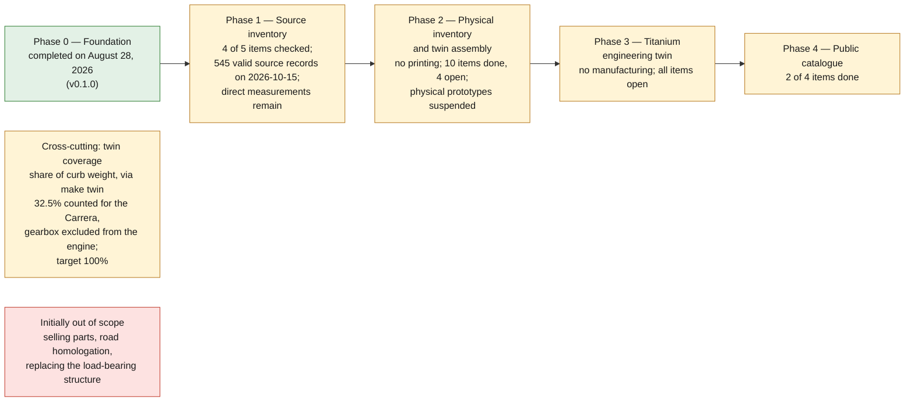

# Roadmap

The phases at a glance, with the state each section below records:

## Phase 0 — Foundation

Status: **completed on August 28, 2026** (`v0.1.0`).

Goal: make the project open to contributions before adding a part.

- [x] Charter and safety limits
- [x] Free and open toolchain
- [x] Part record schema
- [x] Measurement and titanium manufacturing templates
- [x] Automatic catalogue validation
- [x] GitHub contribution templates

Exit criterion: `make check` passes on a clean repository.

## Phase 1 — Source inventory

Detailed log: [docs/PHASE1_SOURCE_INVENTORY.md](PHASE1_SOURCE_INVENTORY.md).

Additional research: [German-language batch of twenty candidates](research/phase-1-german-research.md).

- [x] Survey official catalogues, legally accessible manuals and measurements
- [x] Survey 3D models with a verifiable licence
- [ ] Classify references by variant, year and availability — partial: every
  assembly-skeleton family has at least one official or manufacturer source
  rated A or B (a classification by type and level, not a check of the copy or
  the pages), and model years and dated availability are recorded only where
  stated, in [catalog/registers/](../catalog/registers/README.md)
- [x] Identify missing or hard-to-obtain parts
- [x] Assess each source: provenance, licence, accuracy, reuse

Exit criterion: twenty documented candidates, without importing unauthorised
content. Progress: 545 valid source records in `catalog/sources/` on 2026-10-15;
acquiring direct measurements remains to be done.

## Phase 2 — Physical inventory and twin assembly

Architecture: [docs/DIGITAL_TWIN.md](DIGITAL_TWIN.md).

Active mode: **no printing**. The twin is fed by components whose size,
material, mass and application are all sourced. Mounting relationships are
recorded separately from spatial transforms.

- [x] Define fidelity levels `F0` to `F4`
- [x] Create the registry, schema and validations for sub-twins
- [x] Create the physical component and assembly registries
- [x] Admit the first size + material + mass batch: 17-inch Fuchs wheels
- [x] Logically assemble the documented front and rear pairs
- [x] Add the 18-inch Fuchs wheels and their 5x130 / 71.5 mm interface
- [x] Complete the 17-inch Fuchs wheel interface from the KBA type approvals
- [x] Document the block on Michelin PS2 N3 tyres for lack of consistent manufacturer material and mass
- [x] Qualify the Carrera Brembo/ATE discs and document their block for lack of net mass and full grade
- [x] Research community CAD/3D work and qualify the windscreen templates, the seat ring and a full scan
- [ ] Extend the inventory by subassembly family
- [ ] Complete the interfaces needed for spatial positioning
- [ ] Generate STEP/FreeCAD assemblies once the transforms are known
- [ ] Compute mass and centre of gravity of positioned assemblies

Exit criterion: a first multi-component subassembly positioned in the vehicle
reference frame, with sourced mass, material, interfaces, uncertainties and
relationships for each component.

### Physical prototypes — suspended

> **One exception, 2026-09-25:** a fit-test kit for the switch blank is published
> as the repository's first printable file — see
> [decision 0009](decisions/0009-first-fit-test-print-switch-blank.md) and
> [`parts/993-int-switch-blank-0001/print/`](../parts/993-int-switch-blank-0001/print/README.md).
> The F1 switch trim ring followed as a printable part
> ([decision 0010](decisions/0010-print-the-trim-ring-f1-in-polymer.md)).
> The F0 connecting rod and the K16 wheel pair are published as engraved display
> mock-ups only
> ([decision 0011](decisions/0011-printable-display-mockups-of-prohibited-parts.md)).
> Every other part stays unprinted.

Three non-critical parts selected, records created at status `concept`:

| Category | Part | Record |
|---|---|---|
| Simple geometry, caliper | Switch blank cover | `993-INT-SWITCH-BLANK-0001` |
| Organic, photogrammetry | Door pull handle | `993-INT-DOOR-PULL-0001` |
| Symmetric or missing | Seat rail cover | `993-INT-SEAT-RAIL-COVER-0001` |

- [x] Select three non-critical parts
- [x] Write a measurement plan per part
- [x] Write the measurement-driven master geometry (part 1)
- [x] Resume only after an explicit decision to leave digital-only mode: [decision 0019](decisions/0019-accept-contributed-measurements.md) (2026-11-06) accepts contributed measurements; nothing is bought or measured in-house

Since decision 0019 the existing plans are the public request to outside
contributors; no manufacturing file is generated until contributed data is
admitted.

Execution plan and handover dossier:
[docs/MEASUREMENT_CAMPAIGN.md](MEASUREMENT_CAMPAIGN.md).

Preparation specifications from the manual and from Porsche Fanatics are mapped
in [docs/993/993_MANUAL_DATA_MAP.md](993/993_MANUAL_DATA_MAP.md).
The exhaustive page-by-page register is in
[`catalog/manual/993-workshop-manual-measurements.json`](../catalog/manual/993-workshop-manual-measurements.json).

Exit criterion: three prototypes fitted, photographed and measured.
**Conditional on a contributor who has the parts**: see the operating constraint
in [docs/PROJECT_CHARTER.md](PROJECT_CHARTER.md).

### Body track opened in parallel

`993-BODY-FRONT-LID-0001`, composite front lid. Chosen as the first body pilot
because it combines four advantages: a **bolted-on** panel, with no structural
function or anti-intrusion beam; a **single, gently curved surface**, hence the
simplest mold on the car; an **original steel panel**, hence a real gain, with a
benchmark already set by Porsche Motorsport at 8 kg in aluminium; and an
**inexpensive used donor panel** to take the mold from, unlike rare mechanical
parts.

Original masses established by a German comparison table
(`SRC-FEDERLEICHTE-ELFER-993-WEIGHTS`), which finally makes it possible to put
numbers on the programme instead of estimating it:

| Part | Original | Carbon | Gain |
|---|---:|---:|---:|
| Front lid | 14.0 kg | 4.1 kg | **9.9 kg** |
| Front fenders, pair | 14.4 kg | 4.4 kg | 10.0 kg |
| Rear spoiler | 12.5 kg | 4.8 kg | 7.7 kg |
| Rear bumper | 5.05 kg | 3.1 kg | 2.0 kg |
| Mirrors, pair | 1.8 kg | 0.25 kg | 1.6 kg |
| Rear light panel | 1.26 kg | 0.26 kg | 1.0 kg |
| **Total** | **49.0 kg** | **16.9 kg** | **32.1 kg** |

Thirty-two kilos without touching a single structural part or removing a single
safety element — against 0.45 kg for the titanium engine carrier.

Two lines of that table are deliberately left out. The **doors**, 32.0 kg against
5.9 kg, show the largest gain in the table, but the lightweight version is a
race door: the gain comes from removing the anti-intrusion beams, the window
regulator and the glazing, not from the material. The **roof**, 22.0 kg against
2.5 kg, is a welded structural panel. Neither is an equivalent replacement.

The historical plans require physical access to the vehicle and the parts. No
dimension is estimated in the meantime: `parts/993-int-switch-blank-0001/source/switch_blank.py`
refuses to build until the seven dimensions it requires are measured.

## Phase 3 — Titanium engineering twin, no manufacturing

Candidate under study: **oval exhaust tip `993-EXH-OVAL-TIP-TI-F1-0001`**,
retained by [decision 0007](decisions/0007-first-titanium-exhaust-tip.md)
and kept by [decision 0014](decisions/0014-exhaust-tip-route-matrix-conditional-titanium.md)
behind a conditional go/no-go that is closed today. The record is `functional`,
not `non_critical`; the owner accepted it as the first titanium candidate on
2026-11-09 (0014, issue #5). Sourcing the deciding temperature remains open.

The engine carrier `993-ENG-CARRIER-0001` (993 115 021 53) is no longer the
Phase 3 candidate. It stays a safety-critical study: at identical geometry it
would be roughly twice as flexible in titanium as in steel, and
[`TITANIUM.md`](TITANIUM.md) uses it as the example of a part with nothing to
gain from being printed. Its load cases stay in
`parts/993-eng-carrier-0001/evidence/load-cases.md`.

- [x] Choose a part where Ti-6Al-4V brings a real benefit (decision 0014, accepted 2026-11-09)
- [x] Compare LPBF, CNC, sheet metal and casting ([route matrix](../catalog/manufacturing/exhaust-tip-route-matrix.json))
- [ ] Define loads, interfaces, environment and service life
- [ ] Perform FEA and a manufacturability review with a supplier
- [ ] Integrate geometry, loads and results at the `F3_engineering` level
- [ ] Correlate at least one calculation case with a physical test
- [ ] Build the virtual titanium component with documented material and process
- [ ] Numerically compare the steel, aluminium and Ti-6Al-4V variants

Exit criterion: a digital material, mass, stiffness, fatigue and
manufacturability report available. All manufacturing remains outside the active
phase. The conditional report is
[993_EXHAUST_TIP_PHASE3_REPORT.md](993/993_EXHAUST_TIP_PHASE3_REPORT.md):
mass and the geometric manufacturability screen are established; material,
stiffness and fatigue stop at named blockers.

## Cross-cutting goal — digital twin coverage

Twin progress is measured as the share of curb weight described by documented,
sourced parts, via `make twin`.

| Milestone | Coverage | State |
|---|---:|---|
| First survey | 30.5% | reached on August 28, 2026, 417.5 kg of 1,370 kg, with a 186.9 kg engine from an unregistered community weighing |
| Engine mass from the workshop manual | 34.7% | October 15, 2026, 476.0 kg of 1,370 kg; engine scope open and Turbo-only parts included, see below |
| Coverage per variant | 32.5% | November 5, 2026, 445.7 kg of 1,370 kg for the manual-transmission Carrera; Turbo and RS parts excluded, see below |
| Complete body and trim | ~45% | in progress |
| Detailed powertrain | ~60% | overall engine known, parts to be detailed |
| Running gear and brakes | ~75% | not started |
| Remainder | 100% | not started |

How to read the 32.5%:

- **The engine figure excludes the gearbox; the rest of its scope is open.**
  The workshop manual's p. 15 technical-data sheet gives 232 kg under the label
  "Manual transmission" and 224 kg under "Tiptronic"; that transcription is
  `structured_derived` and has not been checked against an authorised copy of
  the manual. On November 5, 2026 the same two figures were read visually in a
  second Porsche document, the 993 technical specification booklet
  (`SRC-PORSCHE-993-SPEC-BOOKLET-PUBSTACK`, printed p. 18): "Engine Weight
  (Tiptronic) kg/lbs 232 (224)". The booklet lists "Transmission Weight with
  Oil" separately (66 kg for the G50/21, 105 kg for the Tiptronic, pp. 22-23),
  so 232 kg is not engine plus gearbox. Neither document says dry or wet, or
  which ancillaries are included. The now-registered community weighing
  (`SRC-PELICAN-TIMMINS-993-ENGINE-WEIGHTS`) reports a 1995 Carrera conversion
  configuration, not a stock complete-engine specification. Its scope and
  conversion to 186.9 kg are recorded in the
  [source addendum](research/993-engine-mass-scope-20261107.md). Configuration
  differences are documented, but the approximately 45.1 kg gap remains
  unallocated. The historical
  [engine-carrier load cases](../parts/993-eng-carrier-0001/evidence/load-cases.md)
  are not promoted by this source recovery.
  With the weighing, the coverage would read 29.2%.
- **Each counted part names its variants.** Entries in
  `catalog/reference/993-declared-part-data.json` that carry a mass and a
  quantity per car now carry `variants`, and `make twin` counts an entry only
  for a variant it names, or for every variant when its source names none
  (`unspecified`). For the Carrera this excludes 15.3 kg of Turbo parts (the K16
  turbochargers, 11.36 kg; the Turbo engine carrier, 1.96 kg; the charge-air
  duct, hoses, sensor and turbo heat shield, 1.99 kg) and the 15.0 kg pair of
  RS door panels: 34.7% becomes 32.5%. The 19 `unspecified` entries are body,
  glass and trim from a source that names no variant; they are still counted for
  every variant.
- **The Turbo has no engine and no registered curb weight.** No registered
  source gives the M64/60 engine mass, and `scripts/twin_coverage.py` stops for
  Tiptronic and Turbo runs unless `--kerb-weight` is given. With the 1,500 kg
  Turbo curb weight declared in the reference data (`VEHICLE-KERB-TURBO`, a
  third-party figure), the Turbo run counts 229.0 kg, i.e. 15.3%, and no engine.

### Assembly skeleton — done

The factory parts catalogue provided the framework: ten systems, 239 illustrations,
12,864 located references (`catalog/reference/993-assembly-skeleton.json`).

| System | References | Illustrations |
|---|---:|---:|
| 8xx Body and trim | 4,553 | 85 |
| 1xx Engine | 2,398 | 34 |
| 9xx Electrical and equipment | 1,499 | 29 |
| 3xx Transmission | 1,368 | 34 |
| 6xx Brakes and hydraulics | 820 | 13 |
| 4xx Steering and front axle | 624 | 14 |
| 2xx Fuel and exhaust | 611 | 11 |
| 7xx Controls and clutch | 494 | 8 |
| 5xx Rear axle and drivetrain | 326 | 7 |
| 0xx Consumables | 171 | 4 |

Two coverages coexist, and they do not say the same thing: **0.18% of
references** carry a documented mass, but those few parts, with the manual's
engine figure, account for **32.5% of the Carrera's curb weight**, with the caveats above.
The twin fills up by mass before it fills up by count.

### Position — started with a reference envelope

A mass without a position gives no centre of gravity, no distribution and no
inertia. A first 3D envelope and datum cage, based on seven dimensions from the
Porsche manual, is available in
[`twins/993-reference-envelope/`](../twins/993-reference-envelope/). It serves as a visual datum for the US profile, but does
not reconstruct the body and does not yet position the parts.

The next step is to replace this cage with a licensed body-shell geometry or
with a scaled survey, then tie the anchor points and subassemblies to
verifiable measurements.

## Phase 4 — Public catalogue

- [x] Publish only the parts that have cleared their quality gates ([public catalogue](catalogue/README.md), `make catalogue-pages`)
- [x] Generate catalogue pages from the JSON records
- [ ] Add views, dimensioned drawings and manufacturing instructions
- [ ] Track versions, tested vehicles and field feedback

## Composite monocoque: study only

Opened by the owner on 2026-10-08, **as a study and digital twin only**
([programme](MONOCOQUE_964_993_PROGRAMME.md),
[architecture](MONOCOQUE_964_993_ARCHITECTURE.md)).

- In scope: interface contract, measurement plans, calculation (CalculiX
  chain), design studies such as the PicoGK closed-ring concept in
  `twins/964-chassis/monocoque/picogk-rings/`, and display mock-ups under
  [decision 0011](decisions/0011-printable-display-mockups-of-prohibited-parts.md).
- Out of scope, unchanged: **manufacturing, having manufactured, or releasing
  any load-bearing structure** (`SAFETY.md`). The monocoque stays
  `prohibited_pending_engineering`. The body shell carries the chassis number,
  occupant protection and crash absorption; a monocoque is designed as such and
  cannot be translated from a sheet-steel body shell; its validation requires
  physical crash tests that no study here replaces.

  Such a monocoque **exists commercially** for the 964 and 993
  (`SRC-ZESAD-CARBON-MONOCOQUE-964-993`), from €129,990 to €219,990, but its
  product page publishes no mass, no torsional stiffness, no crash test and no
  homologation. A safety structure with no published structural data is exactly
  what `docs/QUALITY_GATES.md` prohibits entering in the catalogue; the study
  track exists to produce such data, not to bypass that gate.

  Body panels remain a legitimate goal in their own right: see
  `SRC-GUNTHER-WERKS-CARBON-993`, where the most advanced 993 restomod on the
  market clothes the car in carbon while keeping and reinforcing the steel body
  shell.

## Initially out of scope

- Selling parts
- Road homologation
- Hosting protected manuals or scans
- Publishing unqualified critical parts
- Buying or operating an LPBF machine
- AI surrogate model before a coherent FEA/CFD corpus exists
