# Warp geometry pilot: local checks and a future Vast CUDA test

Status: preparation of a bounded software test. The image recipe, build output,
CPU smoke report and real CUDA report are separate deliverables. This document
does not attest that a Vast instance has been rented or that CUDA has run.
Registry state: `published_digest=null` until an explicitly requested image
publication returns a registry digest. This preparation does not publish the
image or start a paid rental.

The first test computes unsigned distances from synthetic points to triangulated
box surfaces. It contains no Porsche geometry, raw scan, Qwen weights, inference
service or manufacturing job. It does not resume the stopped cooling-fan study.

## Position in our software chain

```mermaid
flowchart LR
    A_INFO["A-INFO : Information service<br/>PorscheFanatics.com sources"] -->|documentary inputs| D_INPUT["D-INPUT : Data object<br/>Requirements and measured interfaces"]
    D_INPUT -. bounded assistance .-> A_QWEN["A-QWEN : Application service<br/>Our qwen-picogk planner"]
    A_QWEN -->|independently checked parameters| A_PICO["A-PICO : Application service<br/>Reviewed C# and PicoGK"]
    D_INPUT -->|manual authoring| A_PICO
    A_PICO -->|mesh and sample arrays| A_WARP["A-WARP : Application service<br/>Batch geometry queries"]
    A_WARP -->|JSON measurement report| A_REVIEW["A-REVIEW : Process<br/>Geometry and interface review"]
    A_REVIEW -->|accepted geometry| A_CAE["A-CAE : Application service<br/>Meshing and CFD or structural cases"]
```



The integration boundary can remain file based: PicoGK exports a mesh; a
reviewed adapter prepares vertices, triangle indices and probe points; Python
loads those arrays into Warp; the report returns to the geometry review.
STL plus NPZ is a proposed exchange format for that next adapter. The present
pilot generates all arrays internally; it does not yet import a scan or a
PicoGK STL/NPZ bundle.

Our Qwen may eventually select an allowed query and interpret a typed report.
It does not supply its own acceptance criteria, replace the oracle or create
unreviewed kernels at runtime. No Qwen inference is needed for this pilot.

Warp performs these geometry queries before expensive solver cases. Their
success establishes neither airflow, strength, fit nor process qualification.
The architecture follows [the engineering workflow](architecture/engineering-workflow.md)
and [PicoGK's geometry decision](decisions/0004-picogk-new-geometry.md).

## Test and acceptance contract

The implementation is in [pilot.py](../benchmarks/warp-geometry/pilot.py) and
[kernels.py](../benchmarks/warp-geometry/kernels.py). It evaluates three bounded
cases: `surface_identity`, `mixed_probes` and `translated_box`. Their boxes and
probes are synthetic dimensions expressed in millimetres.

For an axis-aligned box, an independent NumPy oracle computes the exact unsigned
distance to its surface. Outside points use their distance to the clamped box;
inside points use the nearest face distance. Warp queries the triangulated
surface. The oracle does not call Warp or reuse its triangle-query code.

| Requirement | Acceptance evidence |
|---|---|
| WARP-01: bounded reproducible input | Reported hashes identify the synthetic mesh and probes; sample count and cases are explicit. |
| WARP-02: independent numerical check | Every query returns a finite distance; no query misses; each case meets the declared `0.0001 mm` absolute tolerance against the analytic oracle. |
| WARP-03: explicit execution device | `--device cpu` is a CPU smoke check. `--device cuda:0` must dispatch on CUDA and fail if the requested device is unavailable; there is no CPU fallback. |
| WARP-04: measured scope | Record cold and repeated warm pipeline times, versions and device metadata. Preserve unsuccessful runs as unsuccessful. |
| WARP-05: no engineering upgrade | Reports retain `geometry_only=true` and `manufacturing_authorized=false`. `gpu_validated` requires successful CUDA dispatch and numerical checks. |

`--output` must name a new JSON file in an existing output directory. A previous
report is not overwritten. Keep stdout/stderr and the process exit code with it.
Use a fresh directory or filename for each repeat of the complete command.

The JSON contains `source_sha256`, device metadata and per-case fixture hashes.
The timing object states its boundaries: cold timing includes import/runtime
initialization and kernel loading; warm timings include fresh mesh/BVH and
buffers, transfers, query, synchronization and host readback. A pre-existing
disk cache can affect cold compilation; record the cache state. Fixture
generation and oracle assessment are outside these timed pipeline scopes.

The NumPy
oracle timing is a correctness reference, not an equivalent production
benchmark: a box formula and a mesh query do different work. A CPU/CUDA speedup
claim requires the same Warp algorithm, versions, input hashes and sample count,
with cold initialization and warm repetitions reported separately. A CPU run
under Apple Silicon's `linux/amd64` emulation is only a smoke check, not a native
CPU performance baseline.

## Build the isolated image

The recipe is [warp-geometry.Dockerfile](../containers/warp-geometry.Dockerfile),
with [pinned requirements](../containers/warp-geometry.requirements.txt):
Python 3.12, Warp 1.18.0 and NumPy 2.2.6. It packages only this pilot and its
runtime. No service port, provider API client, workload secret or model weights
are required.

Our [Warp fork](https://github.com/cluster2600/warp) is the project's upstream
tracking repository. This image installs the hash-pinned upstream `warp-lang`
wheel; it does not claim to include custom changes from that fork.

From the repository root, on a machine with Docker:

```bash
bash containers/warp-geometry-build.sh porscheparts-warp-geometry:dev
```

The [build helper](../containers/warp-geometry-build.sh) copies only the
Dockerfile, pinned requirements and two pilot source files into a temporary
context. It never sends the source checkout, data directories or credentials
to Docker. The [image workflow](../.github/workflows/warp-geometry-image.yml)
builds and checks the image on relevant pull requests or manual dispatch. Its
publication option defaults to false and is a separate operation. A recipe or
successful build is not a published image; record the registry digest after
publication before preparing a rental.

For a local CPU smoke check:

```bash
mkdir -p work/warp-geometry-cpu
docker run --rm --platform linux/amd64 --network none \
  --user "$(id -u):$(id -g)" --read-only \
  --tmpfs /tmp:rw,exec,nosuid,nodev,size=512m,mode=1777 \
  --env WARP_CACHE_PATH=/tmp/warp-cache \
  --mount type=bind,src="$PWD/work/warp-geometry-cpu",dst=/output \
  porscheparts-warp-geometry:dev --device cpu \
  --output /output/report.json --samples 4096 --repeats 5
```

Warp JIT compilation needs a writable cache from which compiled modules can be
loaded. `/tmp` is deliberately not mounted `noexec`; it is ephemeral. The JSON
report is written to the explicit bind mount.

### Observed local checks, 2026-10-21

The `linux/amd64` image was built locally (841,852,738 expanded bytes, user
`9179:9179`). Its [build identity and input hashes](../benchmarks/warp-geometry/observed/20261021-local/build.json)
are retained with the reports. It has no published registry digest.

On Apple Silicon emulation, Warp's default native CPU detection selected the
unsupported Clang target `athlon-xp`; the [failed report](../benchmarks/warp-geometry/observed/20261021-local/cpu-native-emulation-error.json)
remains an error. A separate wrapper set `wp.config.cpu_compiler_flags = ""`
before loading the pilot, using Warp's documented generic CPU target. That
[emulated smoke check](../benchmarks/warp-geometry/observed/20261021-local/cpu-generic-emulated.json)
passed all three cases, 4,096 probes per case, five warm repetitions, with no
missed query and maximum absolute error below `0.0001 mm`.
All [15 tests passed in that image](../benchmarks/warp-geometry/observed/20261021-local/tests-emulated.log)
with the same generic CPU wrapper. This is not a native CPU performance result.
[Warp's CPU compiler configuration](https://github.com/NVIDIA/warp/blob/v1.18.0/warp/config.py)
defines this option.

A [CUDA request on the CPU-only host](../benchmarks/warp-geometry/observed/20261021-local/cuda-unavailable.json)
correctly returned exit code 1 and `gpu_validated=false`. Native x86 image
execution is checked separately by the image workflow; actual CUDA and Vast
execution still require their own reports.

On an existing compatible NVIDIA Docker host, run the CUDA check with the same
fixture size:

```bash
mkdir -p work/warp-geometry-cuda
docker run --rm --platform linux/amd64 --gpus all --network none \
  --user "$(id -u):$(id -g)" --read-only \
  --tmpfs /tmp:rw,exec,nosuid,nodev,size=512m,mode=1777 \
  --env WARP_CACHE_PATH=/tmp/warp-cache \
  --mount type=bind,src="$PWD/work/warp-geometry-cuda",dst=/output \
  porscheparts-warp-geometry:dev --device cuda:0 \
  --output /output/report.json --samples 4096 --repeats 5
```

These commands intentionally expose no port. Container execution requires the
host's NVIDIA driver and NVIDIA Container Toolkit for the CUDA variant.

## Prepare a future Vast test

The user requested preparation of this CUDA experiment. No particular rental,
offer, price or runtime budget is selected here. This is a separate bounded
CUDA pilot, not a move of the engine's CPU workflow to paid GPU infrastructure.

Before any paid launch, record the exact image digest, offer and driver, total
hourly cost including storage, maximum spend, wall-clock deadline, evidence
retrieval plan and teardown condition. Use the existing approved, narrow
OpenBao-backed provider wrapper and deadline guard. If that access or a required
operation is unavailable, obtain it explicitly; do not invent a wrapper command
or retrieve credentials from Keychain, environment dumps or plaintext files.

1. **Select a published `linux/amd64` image by digest.** The expected registry
   namespace is `ghcr.io/cluster2600/porscheparts-warp-geometry`; replace the
   template `@sha256:<published-digest>` with the actual registry receipt. Do not
   rent with `latest` or treat this template as a published reference.
2. **Check current host compatibility.** For the pinned Warp 1.18.0 PyPI wheel,
   NVIDIA documents CUDA 13.4, an R580-series or newer driver, and Turing
   (`sm_75`) or newer hardware. Check the offer and the exposed runtime before
   dispatch; a label advertising some CUDA version is insufficient. A CUDA 12
   compatibility wheel is a different artifact and needs its own pinned recipe
   and check. [NVIDIA's installation and compatibility guidance](https://nvidia.github.io/warp/stable/).
3. **Size for this fixture.** One compatible GPU is sufficient for the pilot's
   scope. Start offer selection with 10 GB disk as a provisional allowance;
   verify it against the built image's expanded size, cache and outputs before
   creation. This tiny box fixture does not establish production scan memory
   needs. Disk allocation cannot be changed after instance creation.
4. **Use the image's Docker ENTRYPOINT mode.** The image is the workload
   container; do not run Docker inside the Vast instance. No notebook or public
   inference endpoint is needed. SSH and Jupyter packages are absent, and those
   launch modes can replace the image's entrypoint. Verify output retrieval and
   provider log access before creation. [Vast's launch settings](https://github.com/vast-ai/docs/blob/main/guides/templates/template-settings.mdx).
5. **Retrieve evidence and destroy the rental.** The command's exit does not
   confirm teardown or the end of billing. The external controller must enforce
   the deadline, recover results or record collection failure, and read back the
   destroyed state. A stopped instance can continue storage charges; destroyed
   disks lose their data. [Vast's instance lifecycle reference](https://github.com/vast-ai/docs/blob/main/guides/reference/faq/instances.mdx).

The default entrypoint runs `/opt/warp-geometry/pilot.py` with `cuda:0`; pass
`--device cuda:0 --output /output/report.json --samples 4096 --repeats 5` as its
arguments.
The image runs as UID/GID `9179:9179`; the controller must arrange a writable
`/output`, preserve provider logs on failure, and never restart automatically
onto the same report file. A bind mount must give this UID write permission.

The pilot prints the complete JSON to stdout between the exact lines
`WARP_GEOMETRY_REPORT_BEGIN` and `WARP_GEOMETRY_REPORT_END`, in addition to the
file. It exits nonzero on failure. The controller must collect provider logs
and process-exit metadata, then retrieve the mounted output before destruction.
Do not add an on-start shell script or select SSH/Jupyter mode for this image.

The provider wrapper is responsible for image selection, start, deadline and
teardown; it must not require placing a provider key inside this image. Before
destruction, download `/output/`, verify the report hash locally, and retain the
source commit, registry digest, non-secret instance metadata and final billing
state. Compare the JSON file with the delimited log report when both are
available. If only the complete delimited log report can be recovered, retain
its bytes and hash and explicitly record that volume collection failed. An
absent or truncated report is not success. See
[Vast's container startup documentation](https://github.com/vast-ai/docs/blob/main/guides/instances/docker-environment.mdx).

## Evidence levels and next integration

| Artifact | What it establishes | What remains open |
|---|---|---|
| Reviewed source and pinned recipe | Defined software test and runtime inputs | Build, numerical execution and CUDA access |
| Successful image build and explicit CPU report | The packaged test runs on CPU and meets its analytic checks | CUDA compatibility, actual GPU dispatch and GPU timing |
| Published image digest | An immutable registry artifact is available | Successful execution on the selected GPU host |
| Successful CUDA report with logs and exit code | The fixture's GPU execution and numerical checks on that recorded host | Production scan support, acceleration on useful workloads and physical validation |
| Retrieved hashes and read-back teardown receipt | Preserved results and completed rental lifecycle | No additional engineering qualification follows |

After the synthetic test succeeds, prepare a measured scan/reconstruction
adapter with explicit units and frame, bounded queries, finite-value and miss
checks, input hashes and an independent reference. Keep exact interface and
self-intersection audits separate. Select a representative workload before
claiming acceleration; no performance gain is assumed from installing Warp.

## Where cluster_compilot can help

Our [cluster_compilot](https://github.com/cluster2600/cluster_compilot) project
can assist a later, measured CPU optimization task. At revision
[`362a080d`](https://github.com/cluster2600/cluster_compilot/commit/362a080d6c5b7cb9272e6c2fbdcb7ca9a48d664a),
its [runner](https://github.com/cluster2600/cluster_compilot/blob/362a080d6c5b7cb9272e6c2fbdcb7ca9a48d664a/compilot/runner.py)
uses C, clang/OpenMP, ISL legality checks, numerical checks and repeated timings.
The inspected path is a CPU loop optimizer, not a cluster scheduler or a direct
C#/PicoGK/Warp/CUDA backend. Its
[dependencies](https://github.com/cluster2600/cluster_compilot/blob/362a080d6c5b7cb9272e6c2fbdcb7ca9a48d664a/pyproject.toml)
require Python 3.14 or newer and ISL; keep a future ComPilot environment separate
from this Python 3.12 image.

A useful next experiment would isolate a demonstrably costly regular CPU loop,
retain an independent numerical reference, then compare legal transformations
and end-to-end timings. ComPilot's OpenAI-compatible model client can accept
candidate transformations from a suitable model, but our specialized
qwen-picogk planner has not been evaluated for this task. Neither ComPilot nor
Qwen is required to build or run this Warp fixture.
