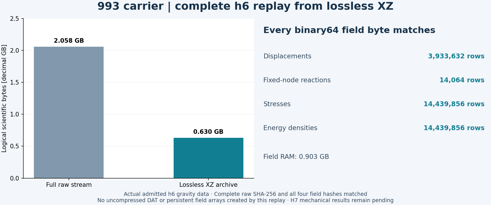
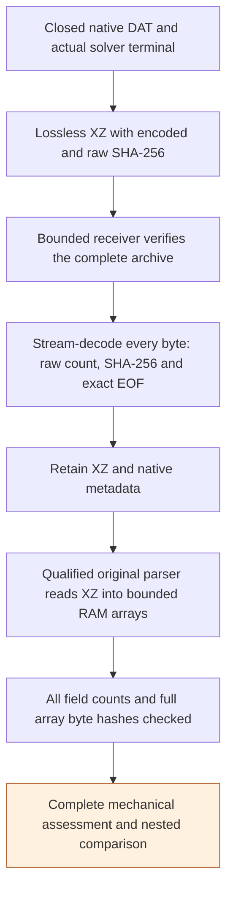

# Complete scientific fields from lossless XZ

Complete solver fields can be retained as **lossless XZ archives** and read
into the qualified RAM-backed arrays. The raw DAT byte count and SHA-256 are
verified by a bounded decoder before a field is accepted. This avoids a
second, uncompressed DAT file on the receiving disk.

This route was exercised on the **actual complete h6 gravity result**:
2,057,529,854 raw bytes, retained in a 629,741,592-byte XZ archive. The unchanged
field parser consumed every displacement, reaction, stress and energy row.
Every binary64 field byte matches the earlier admitted raw-DAT replay.
H7 mechanical results remain separate and pending.



## Executed storage and reader contract



[Rendered workflow](../media/carrier-lossless-xz-workflow-20261105.png).

The public [stream decoder](../../scripts/calculix_stream_decode.py) is
byte-identical to the previously executed decoder
(`aa09782c60dc4bdfe12952d2142b77fb0a3aa3d0446244192a943f55b27735d9`).
The new [XZ source view](../../scripts/calculix_lossless_source.py) is
byte-identical to its executed prototype
(`3d755b9a8c51fa780ccce2d70101047ebf24b9f9c88d6a384af5ba3ce33fcb27`).
The [RAM array adapter](calculix-memory-replay.md), numerical parser and
acceptance thresholds are unchanged.

```python
from calculix_stream_decode import decode
from calculix_lossless_source import VerifiedXZSource

source = VerifiedXZSource(
    archive_path, expected_archive_sha256,
    expected_raw_bytes, expected_raw_sha256, decode,
    maximum_raw_bytes=2_750_000_000,
)
source.verify()  # Complete raw-byte verification; no uncompressed disk file.
# Pass source to the original parser's Path-like open() interface.
```

The receiver distinguishes encoded-file identity from raw DAT identity. An
archive is accepted only after both match the frozen native terminal/codec
receipts. CRC errors, truncation, trailing bytes, concatenated streams, wrong
raw sizes and changed hashes are rejected. The decoder limits each output
chunk to 1 MiB and its LZMA memory to 256 MiB. The source view checks archive
identity again around reads. A parser's complete row/count checks remain
mandatory; successful decompression alone is not mechanical validation.

## Actual qualification

| Complete h6 field | Consumed rows | Raw-DAT replay comparison |
|---|---:|---|
| Displacements | 3,933,632 | All bytes identical |
| Fixed-node reactions | 14,064 | All bytes identical |
| Stresses | 14,439,856 | All bytes identical |
| Energy densities | 14,439,856 | All bytes identical |

The four field arrays allocated 903,376,640 RAM bytes. The complete replay,
including byte verification and array hashing, took 142.3 seconds. Neither
an uncompressed DAT file nor persistent field arrays were created by this
qualification. The original admitted h6 raw DAT remains retained separately.

A second actual synthetic stream decoded **2,684,354,560 bytes**, beyond the
signed 32-bit count range, with its complete raw SHA-256 matched and no
uncompressed file. Negative controls and six public regression tests also
passed. This establishes the storage/reader route, not a new h7 response.

The new h7 receiver profile reserves 8 GiB locally plus a bounded 1.1 GB
encoded output per case and metadata. Both complete outputs are accounted
for before rental. Each raw stream remains capped at 2.75 GB and is verified
in full. The earlier raw-plus-XZ and 32 GiB bulk-storage profiles are not
claimed to pass.

The APFS mount check uses native `diskutil` volume identity and `df` mount
readback, together with owner/device/canonical-path checks. `Path.is_mount()`
returned false for the actual mounted APFS Data volume because its parent
has the same reported device. Four negative mount-identity controls passed.

Before native rental, packet014 also passed exact-image unpack of all 90
files and their modes, then an actual ELF quadratic-control execution under
local x86_64 emulation. An earlier attempt correctly failed because Docker's
`/tmp` was `noexec`; the successful bounded fixture explicitly used an
executable temporary mount. These are local witnesses; leased-host native
controls must still execute independently.

Reproduction receipts stay private:

- `work/carrier-lossless-xz-replay-001/h6-complete.json` binds the actual archive,
  raw DAT, unchanged reader and every complete field hash;
- `work/carrier-lossless-xz-replay-001/controls.json` records actual large-stream
  and malformed-archive controls;
- `work/carrier-h7-lanes-001/deployment-composition.json` checks both real case
  templates at 128/256 GiB simulated resource limits; transport is explicitly
  mocked in that composition check;
- `work/carrier-high-memory-input-014/image-v3-terminal.json` records the exact
  local image/packet/control execution and container absence.

Run the public regressions with:

```sh
.venv-check/bin/python -m unittest discover -s tests \
  -p test_calculix_lossless_source.py -v
```
