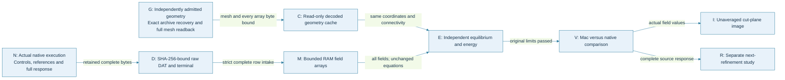
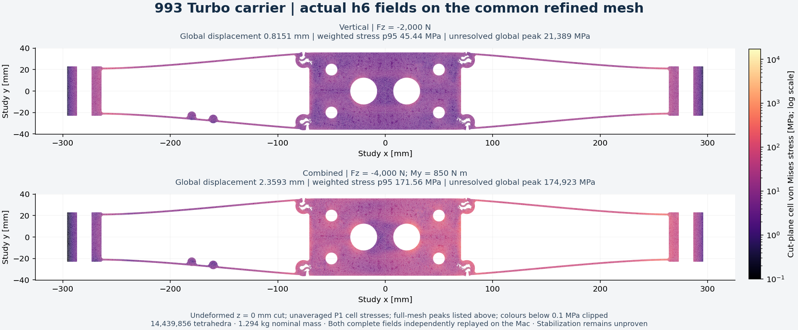

# Complete CalculiX field replay with bounded disk use

The 993 Turbo carrier h6 responses were independently replayed on the Mac for
both study loads on 2026-11-05. Every displacement, reaction, stress and energy
row was consumed. Changing field storage to bounded RAM kept the strict reader,
equilibrium equations, stress-compliance integration and numerical limits intact.
The complete raw DAT files remain retained with verified hashes. The executed
local runtime was Python 3.12.11 with NumPy 2.2.6 on macOS arm64.

This is a verified replay route for the existing carrier study. Mesh refinement
and manufacturing preparation have their own inputs and checks; see the
[current mechanics](../reports/carrier-current-mechanics-20261104.md) and
[software allocation](../reports/carrier-software-review-20261104.md).

## Executed process



[Rendered process](../media/carrier-memory-replay-workflow-20261105.png).

| Actual h6 replay | Gravity | Combined force and torque |
|---|---:|---:|
| Displacement rows | 3,933,632 | 3,933,632 |
| Reaction rows | 14,064 | 14,064 |
| Stress rows, one point per tetrahedron | 14,439,856 | 14,439,856 |
| Energy-density rows | 14,439,856 | 14,439,856 |
| RAM field allocation, bytes | 1,134,414,336 | 1,134,414,336 |
| Peak sampled process-group RSS, bytes | 2,154,823,680 | 2,218,868,736 |
| Bounded process elapsed time, seconds | 73.23 | 73.24 |
| Mac/native external-work difference, N mm | 0 | -3.6379788071e-12 |

Maximum displacement, global stress peak, volume-weighted stress p95 and both
energy integrals agree with native results exactly at the recorded precision.
The combined relative energy-residual differences are about 1.9e-16. Both
processes returned zero and were reaped. These checks retain the original
1e-4 energy limit and the existing force/moment limits. They do not change
the measured h5-to-h6 increments, 1.2243% and 2.5340%, or pass the 1% screen.

## Ready-to-use components

- [Strict complete-field reader](../../scripts/calculix_c3d4_field_reader.py):
  complete contiguous IDs, reaction roster, finite numeric values, one
  integration point and all required sections.
- [RAM storage and decoded-cache adapter](../../scripts/calculix_field_memory.py):
  a bounded allocation interface and reuse of existing geometry only after the
  mesh hash, array shapes, types and every array byte match the supplied contract.
- [Adapter integration checks](../../tests/test_calculix_field_memory.py):
  disk/RAM bit parity for all four fields; duplicate, missing, malformed and
  repeated data refusals; allocation/destination limits; foreign geometry refusal.
- [Same-load nested comparison](../../scripts/calculix_compare_nested_p1.py):
  unchanged source/fine bindings and complete energy-norm comparison.

The public storage adapter is byte-identical to the one used for both actual
h6 replays. The public reader's `parse_dat` function has the same AST as the
executed native-payload reader; its separate command-line wrapper is outside
that equivalence check. Run the focused public integration checks with:

```sh
python3 -m unittest discover -s tests -p test_calculix_field_memory.py -v
```

An engineer can use `Fields.create` in place of `numpy.lib.format.open_memmap`
for the strict reader's output arrays. Restore the original function afterward
and run one adapter per worker process. The cached-geometry contract must come
from independently admitted source data; the adapter binds bytes and does not
certify geometry quality. The actual h6 assessor rechecks all native controls
and both complete references before integrating the complete current fields.

## Storage profile and evidence

The new profile allows 2 GiB for field arrays, a 12 GiB process-group RSS cap,
600 seconds per replay and an 8 GiB free-disk reserve. Postflight measurement
verified that new unshared case files remained below 64 MiB per case; no
continuous case-output-size guard is claimed. The decoded geometry, raw current DAT and actual reference DAT/NPZ
objects use verified existing bytes on the same filesystem. Large field arrays
stay in RAM; only the numerical reports, field hashes and cut-plane samples
are written. Raw current fields can be reproduced from the retained DAT.

The external evidence volume was unresponsive, and the original 32 GiB bulk
storage profile did not pass. This explicitly different storage profile was
qualified with positive and rejection controls before complete execution;
it does not turn the earlier failed storage checks into passes. No native
solver, reference solve or paid instance was started for the Mac replay.

Private receipts remain outside Git:

| Evidence | Local receipt |
|---|---|
| Actual reader: disk/RAM parity and five damaged-input refusals | `work/carrier-h6-memory-replay-001/controls-v2.json` |
| Cached geometry and altered bindings | `work/carrier-h6-memory-replay-001/cache-controls.json` |
| Read-only maps and RAM fields composed | `work/carrier-h6-memory-replay-001/routing-controls.json` |
| Full two-case replay and native comparisons | `work/carrier-h6-memory-replay-001/complete.json` |
| Actual new case-file footprint | `work/carrier-h6-memory-replay-001/disk-postflight.json` |
| Public adapter bytes and reader-function equivalence | `work/carrier-h6-memory-replay-001/public-source-qualification.json` |
| Actual unaveraged h6 cut fields and source hashes | `work/carrier-h6-field-figure-001/figure.json` |


