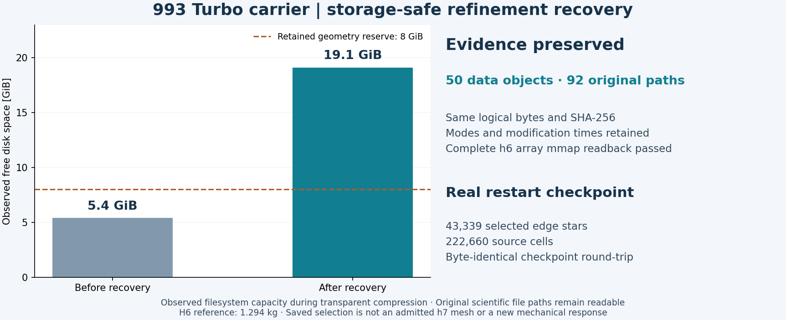
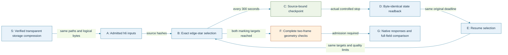

# Resuming the 993 carrier refinement

The h7 selection now saves its state instead of losing the whole selection
when a process stops. A controlled interruption of the actual carrier run
saved 43,339 selected edge stars and 222,660 source cells. Its checkpoint
reopened and reproduced the **identical archive SHA-256**, and the resumed
calculation continued from those selections.

H6 remains the admitted mechanical reference: 1.2941382 kg, with complete
h5-to-h6 energy-norm increments of 1.2243% and 2.5340%. The h7 trial still
requires both marking targets, complete geometry checks and new response
comparisons. See the [current mechanics](../reports/carrier-current-mechanics-20261104.md)
and [refinement review](../reports/carrier-refinement-admissibility-20261105.md).



## Recovery process



[Rendered process](../media/carrier-refinement-recovery-workflow-20261105.png).

## Storage without changing the scientific inputs

The installed [afsctool](https://github.com/RJVB/afsctool), version 1.7.2,
applied LZFSE filesystem compression to verified copies of closed carrier
artifacts on APFS. After complete hash readback, every hardlink alias was
rebound to the verified compressed object. The process retained **50 data
objects and 92 original paths**, their virtual sizes, SHA-256 hashes, modes
and modification times. Complete actual h6 vertex/connectivity arrays also
passed binary readback through NumPy memory mapping afterward.

Observed free capacity increased from approximately 5.4 to 19.1 GiB during
the operation. This measures filesystem capacity, rather than a claim that
logical file size equals uniquely allocated disk space. The original 32 GiB
bulk-replay profile remains separate and is not claimed to pass.

A native `ditto --hfsCompression` fixture did not activate compression on this
host. The subsequently tested afsctool route did. One system-wide process
probe timed out during compression; the original copy remained intact, the
compressor PID was verified absent, and the already complete copied file was
recovered only after a full SHA-256 check. Later probes used the specific
owned PID. The unknown original compressor return code was retained as
unknown; it was not rewritten as a successful numerical execution.

Filesystem compression is local storage behavior. Transfers and archives
still verify the ordinary logical bytes and their original hashes.

## Checkpoint contents and acceptance

The [checkpoint module](../../scripts/calculix_refinement_checkpoint.py) is
byte-identical to the module used by the actual carrier run. It stores the
selected edges, parent-cell offsets, exact original/serialized midpoints,
ordered children, attempted edges, traversal positions, seen cells, coverage
accumulators and refusal counts. The context binds the source geometry,
indicators, population, operator/formatter/metrics code and NumPy version.
Restoring also requires identical sorted traversal-order hashes.

Each immutable snapshot is written and bound to its SHA-256 before an atomic update
of `latest.json`. An uncommitted or damaged snapshot does not replace the last
valid state. This mechanism was tested for process interruption; it is not a
power-loss or cross-platform continuation qualification.

| Executed check | Actual result |
|---|---|
| Abrupt synthetic process exit and fresh-process resume | Exit 23, then resume exit 0; selections and exact-cavity child bytes match the uninterrupted run |
| Traversal on both complete h6 indicator vectors | 8,000 steps match the previous selector, including a cursor restart after 5,000; diagnostic traversal only |
| Actual carrier graceful stop | Exit 75, child reaped, checkpoint saved; no geometry admission |
| Actual checkpoint reopen/repack | Identical `1ac4db626db23933b02f4a6cd9e9448b8376548acc0b587239323bdaa0416c5a` archive hash |
| Protected source population | All 135 protected cells remain untouched |
| Recorded post-restart progress | 36 progress points from 44,000 through 79,000 selected edges match the earlier uninterrupted prefix exactly |
| Public integration tests | Six passed: cursor restart, bit preservation, foreign context, damaged/uncommitted data and duplicate parents |

The progress comparison covers counts and coverage, not equality with the old
unsaved geometry arrays. The actual checkpoint's arrays were verified by the
separate byte-identical round-trip. The diagnostic cursor test uses a traversal
target of 1.0 to exercise a longer prefix; production still requires **50%
marking separately for each case**, with the original exact partition,
protected-cell and 1e6 raw/normalized conditioning checks.

The fresh selection has a 7,200-second total wall budget. The controlled
restart retains its original absolute deadline. Periodic checkpoints use a
2 GiB cache limit; the controller requests a graceful stop below 10 GiB free
space, leaving the existing 8 GiB reserve plus checkpoint headroom. A saved
selection never authorizes assembly or a solver by itself.

For public regression checks, select the project's Python/NumPy environment:

```sh
.venv-check/bin/python -m unittest discover -s tests \
  -p test_calculix_refinement_checkpoint.py -v
```

The executed local runtime is Python 3.12.11 with NumPy 2.2.6 on macOS arm64.

## Reproduction trail

| Private receipt | Purpose |
|---|---|
| `work/carrier-transparent-compression-001/plan.json` | Exact owned artifact/alias inventory and tool hash |
| `work/carrier-transparent-compression-001/controls-v2.json` | Full hashes, hardlink and binary64 mmap fixture |
| `work/carrier-transparent-compression-001/complete-v2.json` | Completed storage operation |
| `work/carrier-transparent-compression-001/postflight.json` | Actual complete h6 array readback |
| `work/carrier-checkpointed-selection-001/controls.json` | Actual abrupt process interruption and restart |
| `work/carrier-checkpointed-selection-001/full-source-cursor-v2.json` | Complete-source traversal control |
| `work/carrier-adaptive-h7-checkpointed-002/real-checkpoint-qualification.json` | Actual carrier checkpoint round-trip |
| `work/carrier-adaptive-h7-checkpointed-002/actual-resume-trace.json` | Recorded post-restart progress parity |
| `work/carrier-adaptive-h7-checkpointed-002/resume-001-intent.json` | Same-deadline resumed execution |

Raw meshes, snapshots and numerical fields remain private. The
[software allocation review](../reports/carrier-software-review-20261104.md)
and [complete-field Mac replay](calculix-memory-replay.md) describe the
surrounding chain.
