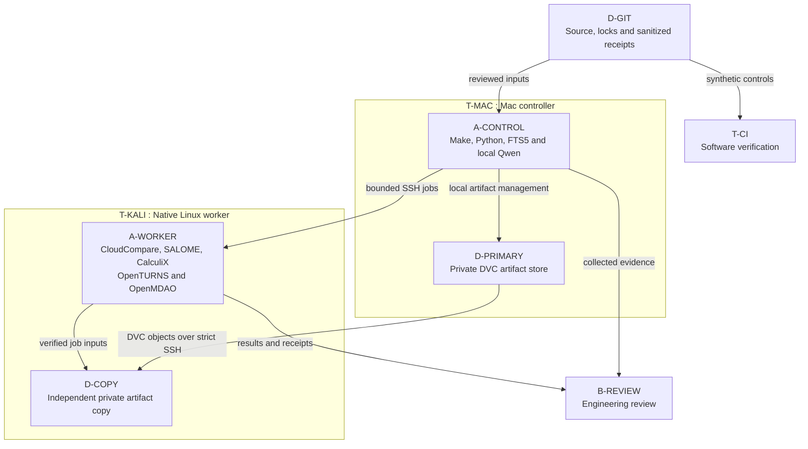
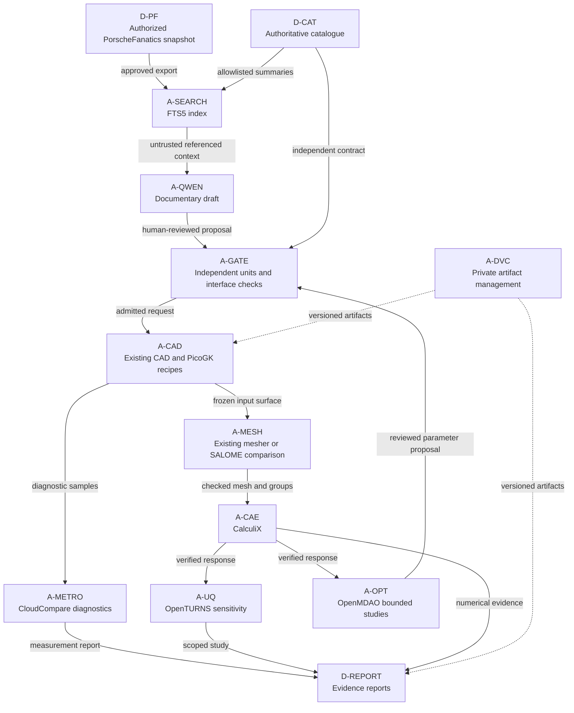
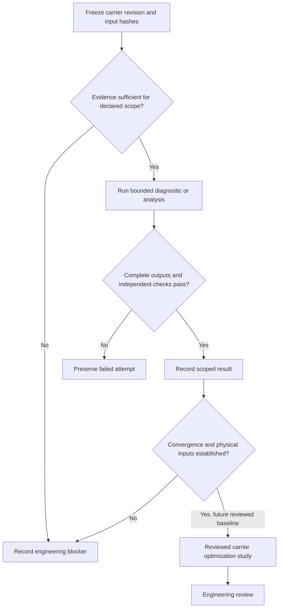

# Free tools architecture

This is an implemented batch-tool integration with separately recorded native
execution status. Allocation diagrams describe the target Mac/Kali deployment;
they do not assert that either host is currently reachable.

The [existing architecture conventions](../README.md) apply: stable element
IDs, named relationships and clear business/application/technology boundaries.
These Mermaid views are project viewpoints, not a full ArchiMate exchange model.

## Infrastructure architecture

The Mac holds the primary store and metadata outside any Git checkout. Kali
holds an independent store, on a native Linux filesystem, outside disposable
caches. Successful SSH transfer is insufficient: restoration into a fresh empty
cache and SHA-256 verification are required for each store.

Use existing SSH identities with strict host-key checking. Thunderbolt link
activity does not establish an SSH identity. Only owned jobs and containers may
be terminated. Geometry control containers have no network, no capabilities,
a read-only root, bounded CPU/RAM/PIDs and a finite deadline. Images contain
tool code and synthetic fixtures, not project scans or credentials.

## Software architecture

The documentary path does not modify `qwen-picogk-qualified` or inject arbitrary
text into its canonical numeric request. Optional MLX inference runs offline
with explicit local model/adapter directories, records their identities, and
produces only a draft. Model output is never executed or used as inspection
evidence. The 30-case retrieval suite does not measure generated-answer quality.

FTS5 stores source IDs, titles, excerpts, rights, scope and the snapshot digest.
The index is a disposable derivative. Corpus changes require a rebuild. Its
claim metadata is documentary input, not a new engineering authority.

DVC transfers content objects. Existing SHA-256 manifests establish input
identity independently of DVC's internal object hashes. The private DVC metadata
and remote paths remain private; public receipts retain sanitized asset IDs.

## Logical architecture

The registered carrier baseline deliberately cannot enable optimization.
Changes to its evidence require a new reviewed baseline and acceptance policy,
not editing a caller-supplied boolean. Current physical-interface and convergence
blockers are read back in each admission replay. Historical surface certificates
are not replaced by CloudCompare samples or SALOME's volume checks.

Each run writes into a new directory. Missing output, nonfinite values, hash
mismatch, invalid units, timeout and tool failure prevent acceptance. Failed
logs remain private. A completed command can still yield `blocked_engineering`.

The Markdown Mermaid blocks above are the diagram source of truth. SVG exports
are generated for rendering checks, never maintained as competing manual views.
