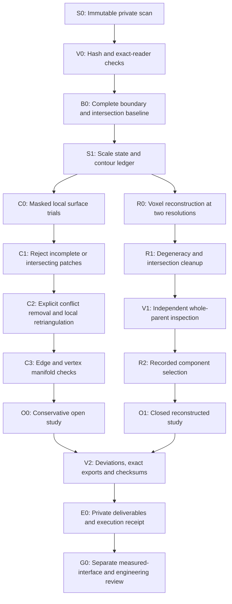

# Private scan repair and reconstruction workflow

Use this runbook to produce two inspectable study outputs from an immutable
scan: a conservative open surface and a closed reconstructed volume. The first
full execution is the [935 cylinder-head study of October 29, 2026](../research/935-scan-repair-20261029.md).
Its results apply to that input and runtime, not automatically to another scan.

This process sits before functional CAD reconstruction and solver admission in
the [engineering architecture](README.md). It follows the
[capture protocol](../CAPTURE_PROTOCOL.md), [source policy](../SOURCE_POLICY.md)
and [quality gates](../QUALITY_GATES.md). A repaired mesh does not raise a
catalogue evidence level or replace measured interfaces and engineering review.

## Outputs and authority

| Output | Geometry policy | Acceptance condition |
|---|---|---|
| Immutable source | Never overwrite, weld, rescale or repair it | File and decoded-array hashes agree with the intake record |
| Conservative surface study | Retain original coordinates; mask removed faces and added patches | Exact changes, consistent winding, no intersections or degenerate faces, manifold edges and used vertices; unresolved boundaries remain explicit |
| Closed reconstruction study | Infer missing surfaces using voxel rebuilding and cleanup | Whole-parent and export checks pass; component selection and both deviation directions are recorded |
| Functional CAD or manufacturing part | Separate measured-interface contract and physical evidence | Existing engineering gates; software output cannot approve them |



The operator retains attempts. An independent detector checks geometry; the
repair engine cannot supply its own acceptance evidence. The engineering
reviewer accepts physical assumptions and inferred surfaces. Model output,
renders and engine success flags do not grant that acceptance.

## 1. Freeze inputs and establish the baseline

Keep raw scans, supplier photos, masks, derived geometry and geometry-bearing
reports outside Git. Track source rights and provenance. Documentation and
reviewed scalar summaries can be published without restricted assets.

Record the file SHA-256, reader/version, vertex and triangle counts, and hashes
of decoded little-endian Float64 coordinates and Int64 face indices. Compare
independent readers before allowing import preprocessing. A reader merging
coincident coordinates has created a different topology; keep its result
separate from the original scan's defect count.

Inventory every boundary edge and connected boundary component. Check vertex
degree before calling a component a simple cycle. Give original contours stable
IDs and retain their vertex/edge indices. Record connected surface components,
winding, zero-area faces, edge incidence and used-vertex manifoldness.

Run full-resolution independent intersection predicates with separated,
crossing, coplanar-overlap, adjacent and degenerate-face index-mapping controls.
If the detector excludes zero-area faces, report their original IDs and count;
predicate exclusion does not remove them from the candidate.

## 2. Record scale without inventing calibration

Keep a working scale hypothesis distinct from a calibrated factor. State units
on every report and export. Catalogue ranges can support a unit-class hypothesis;
specimen identity, nominal feature location and port assignment may remain
unresolved. Never match unrelated holes or related-part dimensions to force scale.

In the 935 execution the owner explicitly confirmed 1 OBJ unit per millimetre.
Use that as the accepted project input and record its owner-instruction basis;
do not repeatedly request the same scale confirmation. Independent physical
calibration remains unverified. A millimetre declaration in an export carries
the project units; it is not a calibration certificate.

## 3. Screen every contour and run masked local trials

Create a ledger whose denominator covers all original contours. Each row needs
geometric measurements, a trial decision, rejection reasons, retained-patch
outcome and physical-classification state. A small near-planar boundary is an
experimental candidate, not proof of scan damage.

The observed 935 screen used these experimental limits:

| Quantity | Limit |
|---|---:|
| Boundary edges | 3–128 |
| Bounding-box diagonal | At most 3 mm under the working scale |
| Maximum deviation from fitted plane | At most 0.25 mm under the working scale |
| 10th percentile of absolute adjacent-normal alignment with plane normal | At least 0.8 |
| Direct contact with a detected intersection face | Excluded from initial gap trials |

These are trial parameters, not manufacturing tolerances. The normal-alignment
screen helps reject rims whose walls are not tangent to the proposed cap; it
does not identify an opening anatomically.

Test a known missing-face control and a second unselected opening. Run CGAL
explicit-edge and PyMeshLab selected-face trials on copies of the full scan.
Retain raw candidates, including failures. Check each proposed patch for:

1. exact preservation of source coordinates and oriented face connectivity;
2. vertices confined to the intended contour mask;
3. complete triangulation and a patch perimeter equal to the selected boundary;
4. consistent winding, positive area and valid edge incidence;
5. no new intersections on the full candidate.

Reject an entire incomplete or intersecting patch. Discard out-of-scope additions
without changing unrelated faces. PyMeshLab's selected-face option did not enforce
exact contour scope in this execution. A passing cube control did not waive the
full-scan mask check.

## 4. Resolve conflicts and inspect vertex topology

Compare local CGAL intersection repair with MeshLib CutAndFill/Relax using
independent predicates. A lower intersection count is not acceptance if required
checks still fail or changes extend beyond supported regions.

When local repair does not resolve all conflicts, a conservative alternative
is explicit removal of intersection-involved and zero-area faces. This creates
missing surface, which must remain visible in masks and area accounting.
Preserve unaffected coordinates. Retriangulate only recorded newly created local
loops; do not indiscriminately cap a loop merged with an original ambiguous
boundary. Recheck the full candidate after filtering.

Check edges and used vertices. Removing faces can leave disconnected face fans
incident on one vertex despite zero non-manifold edges. In the 935 execution,
bounded removal of smaller fans resolved that condition without moving vertices.
Record each removed face and require convergence; do not silently expand pruning
across the scan. Count unreferenced original vertices separately from non-manifold
used vertices.

The conservative output may remain open. Recorded omissions are not measured
surfaces and should not be disguised by forced closure.

## 5. Build a separate closed study volume

Run MeshLib voxel rebuilding from the frozen source at two recorded resolutions.
The observed settings were 0.5 and 0.25 mm under the scale hypothesis, decimation
and pre-subdivision disabled, automatic sign detection, and hole-winding closure
enabled. Voxel size is not dimensional accuracy.

Use CGAL degeneracy/self-intersection cleanup after extraction. Independently
inspect the whole parent mesh: a nominally watertight voxel output can still
contain intersections or zero-area triangles.

For MeshLib arrays, apply the topology's valid-face mask before export:

```python
faces = np.asarray(mrmeshnumpy.getNumpyFaces(mesh.topology))
valid = np.asarray(
    mrmeshnumpy.getNumpyBitSet(mesh.topology.getValidFaces()), dtype=bool
)
assert len(valid) == len(faces)
assert int(valid.sum()) == mesh.topology.numValidFaces()
faces = faces[valid]
```

Vacant slots in the observed extraction otherwise appeared as zero-index
triangles. Retain that attempt as an adapter failure rather than attributing its
counts to the native repair engine. Record import rounding separately. Restoring
unchanged indexed coordinates requires a verified indexing/connectivity contract
and another independent intersection check.

Inventory surface components and signed volumes. A surface component can be a
cavity shell or inferred island rather than a physical part. If selecting the
largest complete component for export, preserve the whole parent and exclusion
masks. Whole-component selection preserves validated triangle geometry but can
worsen fit to excluded source fragments.

## 6. Measure the actual deliverable and verify exports

Use independent point-to-triangle distances on the selected deliverable, not
only the unfiltered parent. Measure both directions:

- Scan → candidate measures fit to observed source surfaces.
- Candidate → scan also exposes inferred surfaces without source support.

The 935 execution used 100,000 area-weighted points per surface, seed 93529,
plus every original boundary vertex. Retain samples, percentiles, maxima and
coverage fractions. Report component-selection effects. A sampled maximum is
not a Hausdorff bound; missing surfaces have no measured ground truth. Do not
quote only the more favorable direction.

Keep authoritative double-precision arrays and a 17-significant-digit OBJ.
Verify coordinate/index round trips where applicable. Independently stream-check
every 3MF vertex and triangle against packaged arrays, explicit millimetre units,
placement and ZIP CRC. Keep selectors, metadata, audits and SHA-256 manifests.

| Final check | Conservative study | Closed study |
|---|---|---|
| Source unchanged; decoded-array hashes verified | Required | Required |
| Changes and component exclusions traced | Required | Required |
| Zero intersections and zero degenerate faces | Required | Required |
| Consistent winding; manifold edges and used vertices | Required | Required |
| Boundary accounting | Unresolved boundaries explicit | Zero open edges |
| Actual-deliverable deviations in both directions | Required | Required |
| Exact export arrays, units, placement and checksums | Required | Required |
| Physical/manufacturing acceptance | Separate gate | Separate gate |

## Runtime and local execution

The [dated execution record](../research/935-scan-repair-20261029.md) gives tested
versions, outputs and the private bundle layout. Archived drivers are not a
portable CLI installed by this repository: they contain study-specific paths
and depend on preceding private inventories and a separate faithful-scan audit
checkout. Read their constants before replaying them.

Do not run mutation commands in the completed bundle. Replay requires a fresh
sibling output directory, copied driver source and verified private inputs.
Candidate directories must remain separate; the drivers refuse to overwrite
them. The following command families assume that preparation and a verified
`STUDY_PYTHON` interpreter; they are not the complete replay sequence:

```sh
cmake -S . -B build -DCMAKE_BUILD_TYPE=Release
cmake --build build -j 2
"$STUDY_PYTHON" screen_all_boundaries.py
"$STUDY_PYTHON" run_intersection_engines.py CGAL
"$STUDY_PYTHON" run_intersection_engines.py CGAL --mode smooth
"$STUDY_PYTHON" run_intersection_engines.py MeshLib --valid-faces
"$STUDY_PYTHON" run_pymeshlab_gaps.py
"$STUDY_PYTHON" run_volume_reconstruction.py 0.5
"$STUDY_PYTHON" run_volume_reconstruction.py 0.25
```

Complete each phase and retain its evidence before advancing:

| Phase | Archived drivers / operation | Required output |
|---|---|---|
| Baseline | Faithful-scan `inventory_935_scan_boundaries.py`, `check_935_scan_intersections.py` | Exact arrays, contour IDs, original intersection/zero-area IDs |
| Gap trials | `screen_all_boundaries.py`, CGAL `cgal_batch`, `run_pymeshlab_gaps.py`, `validate_gap_trials.py` | Raw attempts, masks, rejected-patch reasons |
| Conflict trials | `run_intersection_engines.py`, `audit_candidates.py` | Comparable full-resolution audits, including failures |
| Conservative output | `clean_surface_candidate.py`, explicit-edge CGAL fill, `finalize_clean_surface.py`, `prune_nonmanifold_fans.py` | Open surface, removed-face masks, exact-coordinate checks |
| Closed outputs | `run_volume_reconstruction.py`, native `repair_intersections ... smooth`, `import_cgal_outputs.py` | Reconstructed parents at each resolution |
| Inspection | `audit_candidates.py`, `audit_structure.py` | Whole-parent intersections, degeneracies, edges, vertices, components |
| Delivery | `package_deliverables.py`, `measure_deviations.py`, `verify_3mf.py` | Selected arrays, exclusions, deviations, exact 3MF checks |
| Receipt | `render_deliverables.py`, `make_final_report.py`, `freeze_receipt.py` | Labeled previews, full ledger, versions, hashes, acceptance state |

Read-only archive inspection does not require rebuilding. Do not rerun the
receipt writer merely to inspect it: it rewrites dated metadata. Rollback means
discarding a rejected derived candidate and restarting from the hashed source
or a named verified predecessor. Never replace the source or copy another run's
reports as evidence. A hash mismatch stops the run. Unresolved feature identity
or missing functional surfaces require specimen measurement and engineering
review.

## Continue into supported CAD

The [935 engineering execution](../research/935-scan-engineering-20261029.md)
records source-face partitioning, datum fits, partial editable CAD and independent
export checks. Preserve open section chains explicitly: a helper exposing only
closed paths omits real observations. Keep endpoint source-edge IDs, parent face
IDs and per-station segment denominators. A wire export is not a port surface.
Analysis admission must name missing geometry, material and boundary conditions
and refuse incomplete cases without substituting guessed values.
