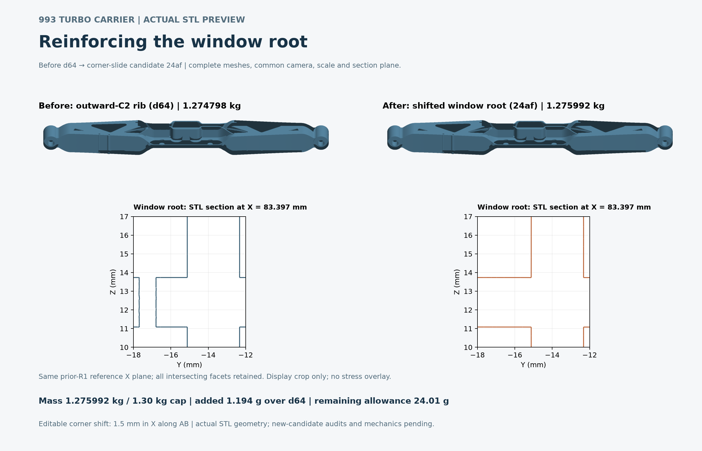
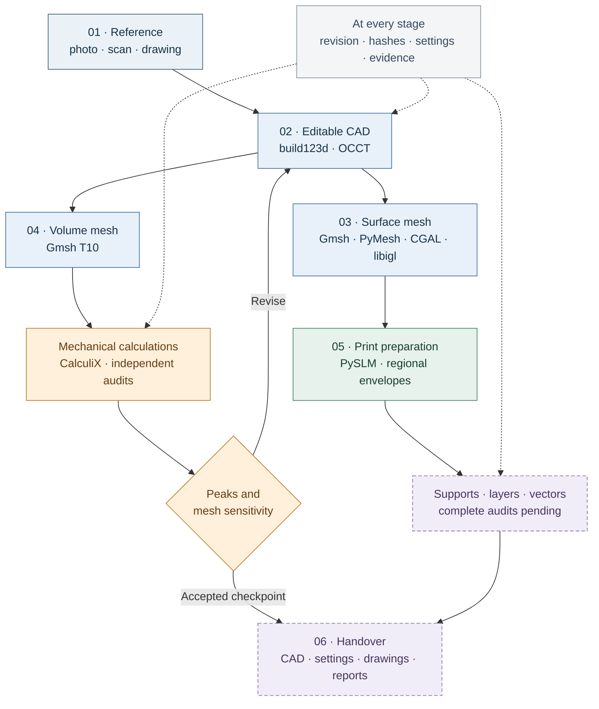
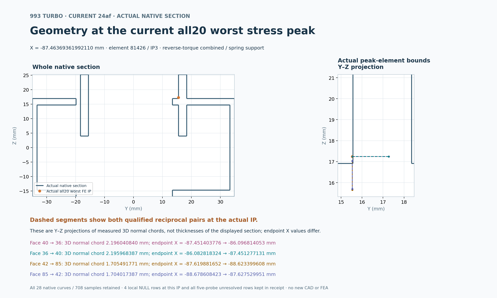

# 993 Turbo engine carrier

### From a reference part to a reproducible manufacturing workflow

**20 October 2026 · Engineering resumed — numerical root hotspots under investigation**

[Latest progress, images and reproducible prototype](../reports/carrier-resume-20261020/README.md). The 18 October checkpoint below remains the retained 24af baseline.

[Quick start](CARRIER_QUICK_START_EN.md) · [Software](#the-software-chain) · [Results](#what-the-calculations-show) · [Evidence](#files-and-evidence) · [Resume point](#where-to-resume)

We are developing a lighter, editable engine-carrier design for the Porsche
993 Turbo reference **993 115 021 53**, together with a process that can be
repeated for other parts. The starting input can be a photograph, a 3D scan or
a measurement drawing. The intended output is one matching set of CAD,
meshes, calculations, print-preparation files and instructions.

The current carrier is revision **24af0584**. Its dimensions remain those of
the documented nominal study model. The work has produced a reproducible CAD
bundle, checked meshes, twenty coarse mechanical cases, two refined cases and
seven checked geometric envelopes for additive preparation. The refined
stress peaks still increase: junction improvement and complete print
preparation remain unfinished.

| Current checkpoint | Recorded value |
| :--- | ---: |
| Nominal titanium mass | **1.275992 kg** |
| Maximum requested mass | **1.30 kg** |
| Remaining mass allowance | **24.01 g** |
| Surface mesh | **598,372 triangles** |
| Coarse volume mesh | **160,005 nodes · 85,958 T10 elements** |
| Saved refined mesh | **164,109 nodes · 88,569 T10 elements** |
| Mechanical cases completed | **20 coarse + 2 refined** |
| Additive-preparation inputs | **7 regions · 1,034 target layers** |

## The workflow at a glance

**Reading the diagram:** CAD, surface, mesh, mechanical and envelope stages
have actual carrier results. The dashed stages remain open. A changed shape receives new meshes
and calculations; results from an earlier design are kept with that design.

## What we have built

**An editable and reproducible carrier.** The current design reinforces the
first window root by moving its corner **1.5 mm in X along the original AB
edge**, on both mirrored arms. The existing rib geometry is retained. Native
solid checks, material-retention comparisons, mass, bounds, all four tool
columns and the eight protected study-interface rosters pass. The delivered
CAD bundle has an actual successful source-reproduction record and a working
verification command. [Open the CAD bundle](../../parts/993-eng-carrier-0001/source/design-20261016/corner-slide-candidate-20261018/README.md).

**Controlled surface and volume meshes.** The surface passes the complete
topology and intersection checks. Sampled two-way distances to its CAD master
are **0.014917 / 0.047388 mm**, below the retained **0.06 mm** screen. The coarse
and refined T10 meshes have their own volume, Jacobian and interface records.
All seven measured local refinement targets pass. The separate exact-P2
comparison permits the saved refinement; the earlier strict zero-volume
comparisons remain false and are preserved in the report.

**A mechanical calculation and audit chain.** Ten declared loading cases are
run with two mounting models: fixed end eyes and distributed elastic supports.
The chain retains every integration-point stress maximum, all-node maximum
displacement, serialized loads, equilibrium observations and an independent
energy audit. It never drops an inconvenient peak from the comparison.

**A growing print-preparation chain.** The current pose, seven inputs and
1,034-layer calendar are recorded. All seven geometric envelopes have been
joined and checked for this exact surface. The source-2 repair retains four
explicitly unknown faces, which cannot authorize attachment anchors. The
current layer-cache run was stopped cleanly on the pause request after
**440 contiguous layers**; its partial files are preserved. Complete support,
layer-vector and machine-job stages have not been completed.

## The software chain

The links below lead to the upstream projects. Exact local versions, patches
and file identities are retained in the repository recipes; different stages
can use different pinned runtimes.

| Software | What it does in this project | Recorded version / scope |
| :--- | :--- | :--- |
| [build123d](https://github.com/gumyr/build123d) + [Open CASCADE](https://github.com/Open-Cascade-SAS/OCCT) | Editable parametric solids, native Booleans, sections, BREP and STEP | build123d **0.11.1**; OCP packages **7.9.3.1.1** |
| [Gmsh](https://gitlab.onelab.info/gmsh/gmsh) | CAD triangulation, T10 volume meshing and refinement | **4.15.2**; [GitHub mirror](https://github.com/live-clones/gmsh) |
| [PyMesh](https://github.com/PyMesh/PyMesh) | Executed native regional Boolean and prism operations | **0.3**; recorded native runtime |
| [CGAL](https://github.com/CGAL/cgal) + [libigl](https://github.com/libigl/libigl) | Exact geometric operations, snap/retriangulation work and independent intersection/topology audits | Stable CGAL **6.1.3** witness and separately pinned campaign archives; libigl **2.6.3** |
| [PySLM](https://github.com/drlukeparry/pyslm) | Build pose, regional support preparation, sections and hatch/vector generation | Commit **8fa03f1…** with repository patches |
| [Shapely](https://github.com/shapely/shapely) + [pyclipr](https://github.com/drlukeparry/pyclipr) | Polygon, contour and domain operations in the AM chain | **2.2.0 / 0.1.8** in the recorded slicing environment |
| [CalculiX](https://github.com/Dhondtguido/CalculiX) | Actual linear-static carrier calculations | **2.21**, inside the pinned CAE container |
| [Docker](https://github.com/docker/cli) / [Moby](https://github.com/moby/moby) | Isolated native execution, resource limits and owned cleanup | Image, binary and CLI identities pinned; current CCX image is Linux ARM64 |
| Python exact arithmetic + repository auditors | Rational predicates, geometric lineage, load/resultant checks, energy and full-peak comparisons | Versioned source, parameters and receipts |
| [Matplotlib](https://github.com/matplotlib/matplotlib) + [Pillow](https://github.com/python-pillow/Pillow) + [Poppler](https://gitlab.freedesktop.org/poppler/poppler) | Actual mesh/field figures, PNG/SVG/PDF output and inspection of rendered PDF pages | Combined-field figure runtime: **3.10.8 / 11.3.0**; other figure/runtime records are retained separately |
| [Adamantine](https://github.com/adamantine-sim/adamantine) | Separate thermal/exporter/coupon software controls | Does not provide a carrier print-distortion result |
| [PicoGK](https://github.com/leap71/PicoGK) / OpenVDB | Broader reconstruction and computational-geometry route available in the project | Broader programme **2.3.0 / picogk.26.2**; current carrier CAD and FEA use the native BREP route above |

For installation recipes and the distinction between native campaign
archives, see the [full workflow guide](PART_WORKFLOW_EN.md)
and the [project software stack](../SOFTWARE_STACK.md).

## What the calculations show

The two combined cases below use the same **Fz = −4,000 N**, **My = 850 N·m**,
**E = 107,000 MPa** and **ν = 0.31**. Elastic mounting means **1,000 N/mm total
per end eye and axis**, divided across that eye's **2,278 nodes**.

| Combined load case | Coarse peak stress | Refined peak stress | Change | Coarse → refined displacement |
| :--- | ---: | ---: | ---: | ---: |
| Fixed end eyes | 602.29 MPa | **907.80 MPa** | **+50.72%** | 2.7011 → **2.7024 mm** |
| Elastic end eyes | 1,564.90 MPa | **2,141.97 MPa** | **+36.88%** | 16.4254 → **16.4281 mm** |

The refined independent energy errors are **2.31 × 10⁻⁹** and
**1.41 × 10⁻⁹**, below the original **10⁻⁴** limit. Displacement changes little,
but the stress peaks increase. That is the current design finding:
**stress convergence and strength acceptance have not been established**.
The remaining eighteen refined cases are queued and unstarted.

The [complete coarse-case table](../reports/carrier-rib-20261018/corner-slide-twenty-case-summary.md)
contains all twenty results. The [latest refined checkpoint](../reports/carrier-pause-20261018/refined-combined-root-review.json)
retains both complete results and their matching coarse comparisons.

*This is the coarse all20 snapshot at element 81426 / IP3. All 28 native curves
and 708 drawing samples are retained. Dashed segments are projections of 3D
normal chords; they are not section-thickness measurements.*
[Open the PDF, SVG and source data](../media/carrier-current24af-own-worst-section-20261018/README.md).

Native smoothing trials and their refusals are also retained. The latest
law-evaluator observation stopped before any fillet construction; it produced
no replacement carrier. The proposed point-radius construction remains an
unexecuted source sketch.

## Files and evidence

| Start here | Contents |
| :--- | :--- |
| [Workshop quick start](CARRIER_QUICK_START_EN.md) | The short process, current files and runnable CAD verification/rebuild commands |
| [Editable CAD bundle](../../parts/993-eng-carrier-0001/source/design-20261016/corner-slide-candidate-20261018/README.md) | Source, parameters, BREP/STEP/STL and manifest |
| [Actual CAD reproduction](../../parts/993-eng-carrier-0001/source/design-20261016/corner-slide-candidate-20261018-evidence/ACTUAL_REPLAY.md) | Successful reproduction and delivered-folder verification |
| [Nominal interface drawing](../media/carrier-nominal-interfaces-20261018/README.md) | Axes, holes, bearing faces and study dimensions |
| [Detailed numerical report](../reports/carrier-rib-20261018/README.md) | Current and historical revisions, meshes, calculations and retained refusals |
| [Pause checkpoint](../reports/carrier-pause-20261018/README.md) | Latest refined results, interrupted layer-cache record and exact copied evidence identities |
| [Complete workflow recipes](PART_WORKFLOW_EN.md) | Installation, stage recipes, controls and retained runtime requirements |

A reproducible run keeps the input reference, explicit parameters, source and
runtime identities, original outputs and a manifest connecting them. Large
native calculation fields and external runtimes remain at their recorded
local paths. The delivered CAD command is runnable; the current downstream
chain has not yet become one complete portable command.

## Where to resume

The user resumed engineering on 20 October. The [new prototype report](../reports/carrier-resume-20261020/README.md) records explicit NURBS patches, continuous surface-error bounds, a passing 603,152-triangle union audit and a 927,734-cell TetGen volume with exact boundary preservation. The earlier interrupted layer job remains stopped; its partial results stay with the baseline.

1. Develop an endpoint-safe junction correction while keeping the **1.30 kg**
   limit and protected interfaces.
2. Check the new solid and surface, rebuild its volume mesh, and repeat the
   mechanical cases and local-refinement comparisons on that revision.
3. Complete the selected revision's layer cache, full vector audit, seven
   support regions and contact/collision checks.
4. Assemble the matching manufacturing files, settings, drawings and reports
   into one handover package.

These remain the downstream engineering steps for the resumed work. The new surface result is a separate prototype; revised mechanical and full print-preparation results remain pending.
