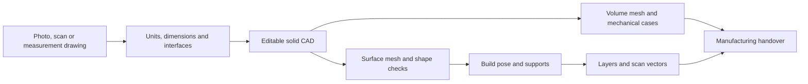

# 993 Turbo carrier — workshop quick start

Start with the [current editable CAD bundle](../../parts/993-eng-carrier-0001/source/design-20261016/corner-slide-candidate-20261018/README.md) and its [actual reproduction report](../../parts/993-eng-carrier-0001/source/design-20261016/corner-slide-candidate-20261018-evidence/ACTUAL_REPLAY.md). Revision **24af0584** weighs **1.275992 kg** at the study's titanium density of **4,420 kg/m³**. The maximum is **1.30 kg**, leaving **24.01 g**.

The working dimensions come from the retained nominal model. The [interface drawing](../media/carrier-nominal-interfaces-20261018/README.md) identifies the current axes, holes and faces. The [actual shape comparison](../media/carrier-corner-slide-actual-surfaces-20261018/README.md) shows the window-root reinforcement.

## Follow the same sequence for each new part



| Step | What to do | What to keep |
| --- | --- | --- |
| Reference | Record the input, its units and known dimensions. Identify assumptions for hidden features. | Image/scan/drawing reference and parameter sheet |
| CAD | Build the solid in build123d/OCCT or PicoGK. Preserve mounting axes and bearing faces. | Editable sources, parameters, BREP and STEP |
| Surface | Generate the STL; check closure, intersections and its distance from that CAD revision. | STL and complete mesh report |
| Mechanics | Mesh the solid, define material/load/mount conditions and run CalculiX. Check every peak, energy balance and local refinement. | Mesh, solver inputs, fields and comparison plots |
| Print preparation | Select pose, construct supports, check contacts and collisions, then produce sections and vectors. | Pose, supports, ordered layers, vectors and checks |
| Handover | Select one revision and collect its matching files and reports. | Manufacturing files, settings, drawings and manifest |

The CAD rebuild below is runnable. The [full workflow guide](PART_WORKFLOW_EN.md) describes the installed tools and retained stage recipes. The current revision's downstream stages are still being joined into one runnable recipe; the historical v6 recipe is not a completed replay of 24af.

## Check the delivered CAD sources

Run from the repository root with the existing exact local runtime:

```sh
CARRIER_BUNDLE="$PWD/parts/993-eng-carrier-0001/source/design-20261016/corner-slide-candidate-20261018"
CARRIER_RUNTIME="$PWD/work/part-workflow/runtimes"
CARRIER_PY="$CARRIER_RUNTIME/design-standalone/bin/python"
CARRIER_OUTPUT="$PWD/work/new-24af-replay"

"$CARRIER_PY" -I -B "$CARRIER_BUNDLE/rebuild.py" verify \
  --output "$CARRIER_OUTPUT" --runtime-root "$CARRIER_RUNTIME"
```

`verify` reads the source/runtime files and does not generate CAD. The delivered bundle contains exactly its **55 manifest-controlled files**; reproduction reports are in the sibling evidence folder. The actual delivered-folder check returned `SOURCE_AND_RUNTIME_BYTES_VERIFIED_NO_NATIVE` with **10,402 pins** on 18 October 2026.

## Rebuild the same CAD revision

Use a normal nice-0 shell and an output path that does not exist:

```sh
env OMP_NUM_THREADS=1 OPENBLAS_NUM_THREADS=1 MKL_NUM_THREADS=1 \
  VECLIB_MAXIMUM_THREADS=1 NUMEXPR_NUM_THREADS=1 \
  /usr/bin/nice -n 10 "$CARRIER_PY" -I -B "$CARRIER_BUNDLE/rebuild.py" rebuild \
  --output "$CARRIER_OUTPUT" --runtime-root "$CARRIER_RUNTIME"
```

Read `assessment.json` and `fresh-reproduction-comparisons.json` in the output. This command reproduces the selected CAD; it does not run mechanics or print preparation. A deliberate dimension or shape change starts a new revision and receives new downstream results. The [bundle README](../../parts/993-eng-carrier-0001/source/design-20261016/corner-slide-candidate-20261018/README.md) gives the exact runtime, bounds and output requirements.

## Current 24af results

| Item | Recorded result |
| --- | --- |
| CAD and exchange | One valid solid; protected study interfaces and STEP comparison pass |
| Mass | **1.275992 kg**, below **1.30 kg** |
| Surface | **598,372 triangles**; whole topology/intersection checks and sampled CAD distances pass |
| Mechanics | **20 coarse cases computed**; seven refinement targets pass; exact P2 volume comparison permits fresh refined calculations |
| Supports | Current pose and seven regional inputs prepared; source-0 and repaired source-2 geometric envelopes checked; complete support and layer stages remain open |

The [20-case image](../media/carrier-corner-slide-all20-summary-20261018/README.md) shows every coarse stress and displacement maximum. These results still guide the geometry correction and refinement; a strength acceptance is not recorded. The [English numerical report](../reports/carrier-rib-20261018/README.md) links each result to its exact geometry, inputs and calculation.
