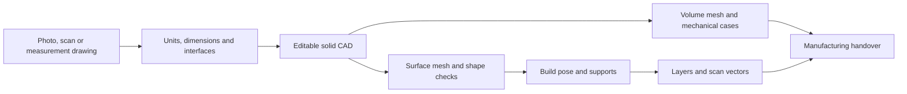

# 993 Turbo carrier — workshop quick start

**Current entry point — 7 November 2026:** read the [H9 mechanical results](../reports/carrier-h9-native-results-20261107.md), [complete current-surface slicing results](../reports/carrier-current-am-full-20261107.md) and [software coverage ledger](../reports/carrier-toolchain-coverage-20261106.md). All **1,034 part layers** and their complete scan vectors passed independent checks. Mechanical convergence, supports and the machine job remain open. The owner has removed the **1.30 kg design ceiling**. The CAD commands and 24af results below reproduce the historical 18 October revision; they do not rebuild the current H9 exterior.

Both native H9 cases, complete field recovery and independent CUDA energy checks passed. The complete H8→H9 energy-norm increments are **2.6726% for gravity and 3.3256% for combined loading**. The two-successive-below-1% convergence criterion remains unmet; the [H9 refined mesh and exact nesting map](../reports/carrier-h9-global-geometry-20261107.md) preserve the comparison geometry.

The [current support-region audit](../reports/carrier-current-support-projection-20261107.md) preserved all 905,248 selected triangles. Exact projections cover **all 4,676 components**; the subsequent complete mask pass retains **seven current mask candidates**, with exact containment and area checks and every exclusion accounted for. All seven masks now have checked triangulations totaling 50,498 positive triangles. The first current exact envelope (component 148) and its unchanged float64 representation now pass independent checks, with an actual three-view image. Complete contacts, the other six envelopes and final support structures remain unfinished.

The complete H9 marking fields and both independent nodal-equilibrium/displacement-to-stress audits are now retained. Seven-digit displacement output limits the algebraic diagnosis. The Mac and Linux/PARDISO 17-digit candidates now pass their analytic and four-field controls; the [four-site source patch](../../parts/993-eng-carrier-0001/source/calculix-print17-20261107/README.md) includes verified application instructions. The new ordinary packet and actual pinned-image quadratic control also pass. Complete higher-precision H9 replay precedes H10 selection; per-case launch remains held for consistent lease transfer allowances.

The [current float64 layer replay](../../parts/993-eng-carrier-0001/source/process-float64-20261107/README.md) is an executable recipe through the existing workflow runner. Its actual layer-517 output matches the admitted reference byte for byte. It requires the recorded Mac runtime at its original paths and the explicit private inputs; installation on another machine remains a separate step.

The [public full-calendar recipe](../../parts/993-eng-carrier-0001/source/process-float64-full-20261107-v4/README.md) now reproduces all 1,034 layers through the repository workflow runner. Independent readback verified all 3,102 NPZ files and 13,442 arrays byte for byte against the original calculation, with zero numerical differences. See the [actual replay result](../reports/carrier-current-am-full-20261107.md#complete-public-recipe-replay-passed).

The [historical editable CAD bundle](../../parts/993-eng-carrier-0001/source/design-20261016/corner-slide-candidate-20261018/README.md) has an [actual reproduction report](../../parts/993-eng-carrier-0001/source/design-20261016/corner-slide-candidate-20261018-evidence/ACTUAL_REPLAY.md). Revision **24af0584** weighs **1.275992 kg** at the study's titanium density of **4,420 kg/m³**. Its then-applicable maximum was **1.30 kg**, leaving **24.01 g**.

That revision's working dimensions come from the retained nominal model. Its [interface drawing](../media/carrier-nominal-interfaces-20261018/README.md) identifies the axes, holes and faces. The [actual shape comparison](../media/carrier-corner-slide-actual-surfaces-20261018/README.md) shows the window-root reinforcement.

## Follow the same sequence for each new part



| Step | What to do | What to keep |
| --- | --- | --- |
| Reference | Record the input, its units and known dimensions. Identify assumptions for hidden features. | Image/scan/drawing reference and parameter sheet |
| CAD | Build the solid in build123d/OCCT or PicoGK. Preserve mounting axes and bearing faces. | Editable sources, parameters, BREP and STEP |
| Surface | Export the surface with adequate coordinate precision; check closure, intersections and its distance from the selected revision. Independently read the exported coordinates and faces back. | Source-bound surface, export identity and complete mesh report |
| Mechanics | Mesh the solid, define material/load/mount conditions and run CalculiX. Check every peak, energy balance and local refinement. | Mesh, solver inputs, fields and comparison plots |
| Print preparation | Select pose, construct supports, check contacts and collisions, then produce sections and vectors. | Pose, supports, ordered layers, vectors and checks |
| Handover | Select one revision and collect its matching files and reports. | Manufacturing files, settings, drawings and manifest |

The historical CAD rebuild below is runnable with its recorded runtime. The [full workflow guide](PART_WORKFLOW_EN.md) describes the installed tools and retained stage recipes; the [coverage ledger](../reports/carrier-toolchain-coverage-20261106.md) records their current carrier evidence. Neither the historical v6 recipe nor the 24af CAD rebuild is a completed replay of the current carrier chain.

## Check the delivered CAD sources

Run from the repository root with the existing exact local runtime:

```sh
CARRIER_BUNDLE="$PWD/parts/993-eng-carrier-0001/source/design-20261016/corner-slide-candidate-20261018"
CARRIER_RUNTIME="$PWD/work/part-workflow/runtimes"
CARRIER_PY="$CARRIER_RUNTIME/design-standalone/bin/python"
CARRIER_OUTPUT="$PWD/work/new-24af-replay"

"$CARRIER_PY" -I -B "$CARRIER_BUNDLE/rebuild.py" verify \
  --output "$CARRIER_OUTPUT" --runtime-root "$CARRIER_RUNTIME"
```

`verify` reads the source/runtime files and does not generate CAD. The delivered bundle contains exactly its **55 manifest-controlled files**; reproduction reports are in the sibling evidence folder. The actual delivered-folder check returned `SOURCE_AND_RUNTIME_BYTES_VERIFIED_NO_NATIVE` with **10,402 pins** on 18 October 2026.

## Rebuild the same CAD revision

Use a normal nice-0 shell and an output path that does not exist:

```sh
env OMP_NUM_THREADS=1 OPENBLAS_NUM_THREADS=1 MKL_NUM_THREADS=1 \
  VECLIB_MAXIMUM_THREADS=1 NUMEXPR_NUM_THREADS=1 \
  /usr/bin/nice -n 10 "$CARRIER_PY" -I -B "$CARRIER_BUNDLE/rebuild.py" rebuild \
  --output "$CARRIER_OUTPUT" --runtime-root "$CARRIER_RUNTIME"
```

Read `assessment.json` and `fresh-reproduction-comparisons.json` in the output. This command reproduces the selected CAD; it does not run mechanics or print preparation. A deliberate dimension or shape change starts a new revision and receives new downstream results. The [bundle README](../../parts/993-eng-carrier-0001/source/design-20261016/corner-slide-candidate-20261018/README.md) gives the exact runtime, bounds and output requirements.

## Historical 24af results — 18 October 2026

| Item | Recorded result |
| --- | --- |
| CAD and exchange | One valid solid; protected study interfaces and STEP comparison pass |
| Mass | **1.275992 kg**, below the historical **1.30 kg** ceiling |
| Surface | **598,372 triangles**; whole topology/intersection checks and sampled CAD distances pass |
| Mechanics | **20 coarse cases computed**; seven refinement targets pass; exact P2 volume comparison permits fresh refined calculations |
| Supports | Current pose and [all seven geometric envelopes](../reports/carrier-rib-20261018/corner-slide-seven-envelope-store-root-review.json) joined for this geometry; repaired source-2 retains four unknown faces and no process anchors; complete support and layer stages remain open |

The [20-case image](../media/carrier-corner-slide-all20-summary-20261018/README.md) shows every coarse stress and displacement maximum. These results still guide the geometry correction and refinement; a strength acceptance is not recorded. The [English numerical report](../reports/carrier-rib-20261018/README.md) links each result to its exact geometry, inputs and calculation.
