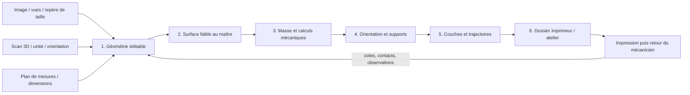

# De la référence au dossier d'impression

Cette chaîne transforme une référence de pièce en un dossier numérique que
l'imprimeur et le mécanicien peuvent suivre. Le support moteur 993 Turbo est
le pilote. Chaque étape conserve son entrée, ses réglages, ses logiciels, ses
sorties et ses résultats ; un changement de géométrie crée une nouvelle révision.



## Trois entrées, une même sortie CAO

| Référence disponible | Travail d'entrée | Sortie commune |
| --- | --- | --- |
| Image ou photographie | Repérer les vues, la taille de référence et les formes visibles ; consigner les dimensions retenues et les parties reconstruites | Paramètres explicites et modèle éditable |
| Scan 3D | Conserver l'original, déclarer l'unité et la pose, nettoyer les doublons, reconstruire les surfaces utiles et comparer la CAO au scan | STEP ou source PicoGK avec écart de reconstruction enregistré |
| Plan de mesures | Transcrire les cotes, axes, portées et tolérances dans un fichier de paramètres ; vérifier les unités et les conventions d'axes | Source build123d/PicoGK et STEP exporté |

Une image unique peut servir à dessiner une hypothèse ; les dimensions utilisées
restent visibles dans le dossier. Le logiciel ne transforme pas silencieusement
un pixel en millimètre ou une face cachée en mesure.

Le chemin scan réutilise la chaîne PyMesh / reconstruction / PicoGK du projet
`qwen-picogk` et le [contrat CAD-Recode](../../scripts/cad_recode/pipeline.py).
Le chemin par cotes réutilise les sources paramétriques du catalogue, au lieu de
dessiner une nouvelle pièce sans lien avec ses paramètres.

## Les six étapes à suivre

| Étape | Logiciels et rôle | Fichiers à conserver | Contrôles numériques |
| --- | --- | --- | --- |
| 1. Géométrie | build123d/OCCT ou PicoGK ; construction et modification de la forme | Source, paramètres, STEP, convention d'axes | Solide valide, nombre de corps, dimensions, portées et axes protégés, volume après réimport |
| 2. Surface | PyMesh pour le nettoyage, Gmsh pour la triangulation CAD, libigl pour les intersections | STL brut et corrigé, empreintes, rapport avant/après | Fermeture, composantes, orientation, triangles effilés, intersections, distance au maître STEP |
| 3. Mécanique | Gmsh C3D10, CalculiX, audit énergétique indépendant | Maillage, charges, matériau, jeux de calcul, champs et tableaux | Masse, déplacements, contraintes, équilibre, énergie, sensibilité et raffinement |
| 4. Supports | PySLM ; pose à plat et génération des supports LPBF | Pose, surfaces de support, paramètres de grille et de dents | Encombrement, contacts pièce/plaque, accès et intersections conservées dans le rapport |
| 5. Couches | PySLM et intersection de maillage ; contours, hachures et trajectoires des supports | Couches, vecteurs, réglages et vues des sections | Contours, trous préservés, segments finis, doublons, nombres de couches et identités de géométrie |
| 6. Remise | Générateur de guide ; dossier autonome HTML/PDF | STEP/STL, supports, trajectoires, paramètres, rapports et manifeste | Empreintes de tous les fichiers remis et cohérence de révision |

Le tranchage ouvert prépare les géométries et les vecteurs. Le format machine et
le réglage laser final restent ceux du procédé choisi chez l'imprimeur ; aucun
export générique ne se fait passer pour un travail déjà chargé sur une machine.

## Une commande pour exécuter une recette enregistrée

Le [lanceur](../../scripts/run_part_workflow.py) utilise des recettes lisibles
dans `manufacturing/workflows/`. Une recette énumère les fichiers d'entrée
avec leurs empreintes, les commandes, les délais et les sorties attendues.
Le fichier de runtime local indique où se trouvent les interpréteurs installés.

Les environnements déjà prêts se trouvent sous `work/part-workflow/runtimes/` :

| Clé du runtime | Fonction |
| --- | --- |
| `cad_python` | CAO, inspection des fixations et maillage volumique |
| `geometry_python` | Triangulation du STEP et distances exactes à ses surfaces |
| `mesh_audit_python` | Topologie, intersections libigl et distance inverse, dans un conteneur Linux ARM64 local |
| `am_python` | Supports, sections, contours, hachures et figures |
| `pdf_python` | Assemblage du guide HTML/PDF avec ReportLab |

Dans un checkout neuf sur macOS ARM64, la base CAO peut être installée sans
emprunter l'ancien environnement du projet. Les 45 roues de la base exécutée
sont épinglées par version et SHA-256 :

```sh
python3 parts/993-eng-carrier-0001/source/design-20261016/setup_cad_base.py \
  --python CHEMIN_DU_PYTHON_310 \
  --output work/part-workflow/runtimes/cad-base
```

Cet installateur refuse les plateformes différentes de macOS ARM64/Python
3.10, les versions non épinglées et les dossiers déjà présents. Il exécute un
solide percé dont le volume est comparé à sa formule analytique, puis vérifie
l'export et le réimport STEP ainsi que l'empreinte du noyau natif. Son reçu et
les journaux d'installation restent dans le dossier du runtime. Le Python de
cette base devient `CHEMIN_DU_PYTHON_CAD` ci-dessous.

Pour installer les quatre environnements de calcul, indiquer explicitement
ce Python CAD et un Python 3.11. Les installateurs refusent d'écraser un dossier
inconnu ; les réglages locaux ne modifient pas la base.

```sh
python3 parts/993-eng-carrier-0001/source/design-20261016/setup_runtime.py \
  --cad-python CHEMIN_DU_PYTHON_CAD \
  --output work/part-workflow/runtimes/design

python3 parts/993-eng-carrier-0001/source/remesh-20261016/setup_runtime.py \
  --cad-python CHEMIN_DU_PYTHON_CAD

python3 parts/993-eng-carrier-0001/source/remesh-20261016/setup_mesh_audit.py

CHEMIN_DU_PYTHON_311 parts/993-eng-carrier-0001/source/process-20261016/setup_pyslm.py \
  work/part-workflow/runtimes/pyslm
```

Chaque installateur conserve ses versions et sa provenance. Le backend libigl
utilise la roue Linux officielle : la roue macOS a été essayée, son défaut
d'import est conservé dans le dossier de travail. CalculiX utilise son image
locale épinglée, une seule CPU, 6 Gio sans swap et sans réseau. Le lanceur
supprime uniquement son propre conteneur après les calculs.

```sh
python3 scripts/run_part_workflow.py run manufacturing/workflows/993-carrier.json \
  --runtime work/part-workflow/runtime.json \
  --output work/part-workflow/run-001

python3 scripts/run_part_workflow.py verify work/part-workflow/run-001
```

Le premier passage `run-001` est conservé **refusé à la préparation LPBF** :
une région de support omise et un défaut de correspondance des sommets ont
été identifiés dans PySLM. Ses 526 couches calculées restent inspectables.
Les versions corrigées sont préparées séparément ; cette commande identifie
le témoin initial, et ne promet pas un dossier d'impression admis.

Le dossier de sortie doit être neuf. Les étapes s'exécutent dans l'ordre,
avec leurs journaux séparés. Un échec conserve les sorties et s'arrête à l'étape
concernée ; la correction donne lieu à un nouveau passage. L'état `executed`
signifie que les commandes et sorties déclarées sont présentes : les rapports
de calcul conservent leurs propres verdicts.

Pour le pilote 993, conserver les sorties sous `work/` : la fabrication du
guide reprend les fichiers de ce passage et vérifie que le STEP, la surface,
les calculs et le tranchage portent les mêmes identités. Le plafond de masse
autorisé par Maxime le 16 octobre est **1,30 kg**. Les essais antérieurs sous
1,20 et 1,23 kg restent conservés avec leurs propres critères et leurs refus.

Les recettes exécutables appartiennent au dépôt. Une image ou un fichier de
mesures reçu en entrée ne peut pas ajouter une commande à exécuter.

## Le dossier du mécanicien

La remise présente d'abord la pièce et sa révision, puis les dimensions de
travail, la masse, les points de fixation et les résultats utiles. Les détails
logiciels sont disponibles dans un second niveau de lecture.

La fiche de retour de pose recueille la fixation concernée, la cote prévue et
observée, les contacts ou jeux, les modifications demandées, les conditions de
fonctionnement et les photos. Ces retours rejoignent la révision suivante sans
effacer le dossier précédent.

## Reproduire le guide

Le [générateur](../../scripts/build_part_workflow_guide.py) produit le parcours
interactif hors ligne et son PDF à partir d'une description complète. La
dernière étape de la recette renseigne le modèle de description avec les
résultats et fichiers admis du passage. Le modèle vide de
`manufacturing/workflows/` n'est pas une description prête à rendre.

Pour refaire uniquement la présentation d'un passage admis, utiliser son
`guide-description.json` avec le Python indiqué par la clé `pdf_python` du
runtime. Cet interpréteur doit fournir ReportLab ; il est déjà disponible
dans les dépendances du bureau Codex pour le runtime local.

```sh
CHEMIN_DU_PYTHON_PDF scripts/build_part_workflow_guide.py \
  work/PASSAGE_ADMIS/guide-description.json work/part-workflow/guide-rebuilt
```

Le générateur copie uniquement les fichiers explicitement choisis et en
calcule les empreintes. Les entrées privées restent dans le dossier de travail.

Les guides affichent les résultats réellement obtenus par la révision retenue.
Une image de supports vient du maillage de supports ; une image de contrainte
vient du jeu de calcul correspondant. Aucun rendu ne remplace un résultat.
