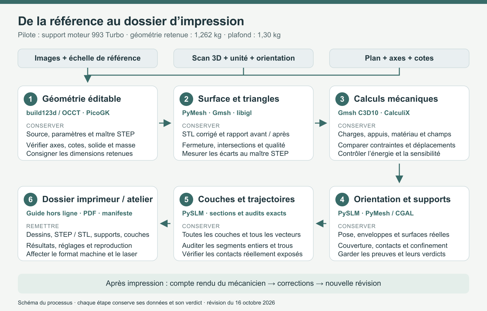
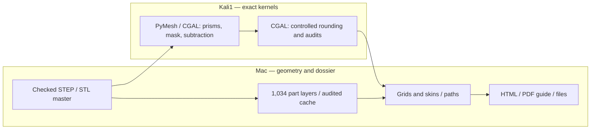

# From reference to print dossier

[English guide](PART_WORKFLOW_EN.md) · [English results supplement](CARRIER_SUPPLEMENTS_20261017_EN.md)

This chain turns a part reference into a digital dossier that the
printer and the mechanic can follow. The 993 Turbo engine carrier is
the pilot. Each step keeps its input, settings, software, outputs and
results; a geometry change creates a new revision.

The [17 October supplements](CARRIER_SUPPLEMENTS_20261017.md) describe
guide 7 with the 32-state mechanical cycle and launcher 3 with its per-step
budgets. The v6 commands below keep their recorded recipe.

The guide keeps an exact copy of the receipt used to link its figures,
in `delivery-assets/source-workflow.json`. The launcher can then finish
and update its own `workflow.json`; the state used for the images
remains readable and verifiable in the delivered dossier.



The [vector diagram](../media/carrier-workflow-20261016/process.svg) and its
[PDF](../media/carrier-workflow-20261016/process.pdf) remain legible when
printed. They describe the process; the receipts of each run
carry the results actually obtained.

## Three inputs, one CAD output

| Available reference | Input work | Common output |
| --- | --- | --- |
| Image or photograph | Identify the views, the reference size and the visible shapes; record the dimensions adopted and the reconstructed portions | Explicit parameters and editable model |
| 3D scan | Keep the original, declare the unit and pose, clean duplicates, reconstruct the useful surfaces and compare the CAD to the scan | STEP or PicoGK source with recorded reconstruction deviation |
| Measurement drawing | Transcribe dimensions, axes, seats and tolerances into a parameter file; check units and axis conventions | build123d/PicoGK source and exported STEP |

A single image can be used to draw a hypothesis; the dimensions used
remain visible in the dossier. The software does not silently turn
a pixel into a millimetre or a hidden face into a measurement.

The scan route reuses the PyMesh / reconstruction / PicoGK chain of the
`qwen-picogk` project. The existing [CAD-Recode contract](../../scripts/cad_recode/pipeline.py)
describes a 935 case: its identity and OBJ units must be
adapted explicitly before running it on another reference.
The dimension route reuses the catalogue's parametric sources, instead of
drawing a new part unconnected to its parameters.

## The six steps to follow

| Step | Software and role | Files to keep | Digital checks |
| --- | --- | --- | --- |
| 1. Geometry | build123d/OCCT or PicoGK; building and modifying the shape | Source, parameters, STEP, axis convention | Valid solid, number of bodies, dimensions, protected seats and axes, volume after reimport |
| 2. Surface | PyMesh for cleaning, Gmsh for CAD triangulation, libigl for intersections | Raw and corrected STL, digests, before/after report | Closure, components, orientation, slender triangles, intersections, distance to the STEP master |
| 3. Mechanics | Gmsh C3D10, CalculiX, independent energy audit | Mesh, loads, material, load cases, fields and tables | Mass, displacements, stresses, equilibrium, energy, sensitivity and refinement |
| 4. Supports | PySLM; flat placement and generation of LPBF supports | Pose, support surfaces, grid and tooth parameters | Footprint, part/plate contacts, access and intersections kept in the report |
| 5. Layers | PySLM and mesh intersection; contours, hatches and support paths | Layers, vectors, settings and section views | Contours, preserved holes, finite segments, duplicates, layer counts and geometry identities |
| 6. Delivery | Guide generator; self-contained HTML/PDF dossier | STEP/STL, supports, paths, parameters, reports and manifest | Digests of all delivered files and revision consistency |

Support preparation is admitted separately from its generation. The six
checks cover envelopes, covered regions, skins,
grids, contacts and collisions. The
[v6 delivery generator](../../scripts/build_carrier_workshop_guide_v6.py)
refuses the dossier if a check is missing, remains unexecuted or points to a receipt
whose digest has changed. The path audit examines whole segments
in the sections, keeping holes and islands; checking only their
end points is not enough.

Open slicing prepares the geometries and vectors. The machine format and
the final laser settings remain those of the process chosen at the printer; no
generic export passes itself off as a job already loaded on a machine.

## One command to run a recorded recipe

The [v2 launcher](../../scripts/run_part_workflow_v2.py) uses readable recipes
in `manufacturing/workflows/`. A recipe lists the input files
with their digests, the commands, the timeouts and the expected outputs.
The local runtime file states where the installed interpreters are.

The [integrated v6 recipe](../../manufacturing/workflows/993-carrier-lpbf-v6.json)
contains 37 steps and 293 pinned input files. It keeps exactly
the first twelve CAD, surface, mechanics and drawing steps of the
initial recipe, then separates the seven native computations and the seven support
generations. Their construction keeps the whole useful domain and adds
attested contact bands; the incremental assembly keeps the same contours
and exact receipts. Rational containment, the six geometric admissions and
the two complete path audits precede the guide.
The [review of commands and identities](../../parts/993-eng-carrier-0001/source/process-skins-20261016/cold-v6-recipe-evidence/assessment.json)
passed: the ten modified commands parse, 27 contracts are carried over
after verification of their identities and the 293 digests are re-verified.
It remains distinct from a complete replay of the carrier.

The nine support generation and assembly steps each have
a four-hour budget. The v2 launcher keeps the checks, the
logs and the stopping of its process group; only its maximum
duration bound moves from one to four hours. The old recipes remain kept.

An inward-facing contact band is omitted only if its
entire quadrilateral is already contained in the source domain, with exact
proof. The domain then keeps the same material. Other cases remain
refused. Each intermediate surface and its receipt are kept; the admission
recomputes the checks with the authority actually recorded in the receipt.

The producers reuse the rational areas already computed, without
changing the contours or the decisions. The [parallel admissions](../../parts/993-eng-carrier-0001/source/process-skins-20261016/README_parallel_exact_admissions.md)
re-read the units in four processes and keep each unit's
results. The guide links this execution receipt to the six checks and the delivered files.

The guide's mechanics page keeps the exceedances of the ideal
900 MPa diagnostic under K1000, the scope of the published Grade 23 ELI sensitivity and the
distinct verdicts of the cycle: Piola balance admitted, ENER diagnostic refused over
all states. The six references are copied into the dossier. Their
attribution requires exactly the same discrete mesh and the same linear set
of loads and supports; it does not treat two distinct STEP exports as equivalent.

```sh
python3 scripts/run_part_workflow_v2.py run manufacturing/workflows/993-carrier-lpbf-v6.json \
  --runtime work/part-workflow/runtime-v2.json \
  --output work/part-workflow/NOUVEAU_PASSAGE
```

The v2 runtime uses the corrected PySLM environment `pyslm-coverage-011`.
The separate native manifest describes the available Linux prefixes; its structure,
the installers and the witnesses are described in the
[native per-region procedure](../../parts/993-eng-carrier-0001/source/process-skins-20261016/README-native-case.md).
The output directory must be new. A change of inputs requires a
new revision; the native left repair is bound to the frozen source arrays
and refuses any other geometry.

The environments already prepared are under `work/part-workflow/runtimes/`:

| Runtime key | Function |
| --- | --- |
| `cad_python` | CAD, fastening inspection and volume meshing |
| `geometry_python` | STEP triangulation and exact distances to its surfaces |
| `mesh_audit_python` | Topology, libigl intersections and reverse distance, in a local Linux ARM64 container |
| `am_python` | Supports, sections, contours, hatches and figures |
| `pdf_python` | HTML/PDF guide assembly with ReportLab |

The [reinstallable PDF base](../../manufacturing/runtimes/pdf/README.md)
has its own lock for Python 3.12 on macOS arm64: ReportLab, Pillow and
charset-normalizer are pinned by version and wheel digest. It was
installed in `work/part-workflow/runtimes/pdf-base-001`, then verified by
`pip check`, the guide tests and a synthetic PDF with an image. After this
installation, `pdf_python` can point to its `bin/python`. The real guide keeps
its own checks of files, results and presentation.

In a fresh checkout on macOS ARM64, the CAD base can be installed without
borrowing the project's old environment. The 45 wheels of the executed base
are pinned by version and SHA-256:

```sh
python3 parts/993-eng-carrier-0001/source/design-20261016/setup_cad_base.py \
  --python CHEMIN_DU_PYTHON_310 \
  --output work/part-workflow/runtimes/cad-base
```

This installer refuses platforms other than macOS ARM64/Python
3.10, unpinned versions and directories already present. It runs a
drilled solid whose volume is compared with its analytical formula, then checks
STEP export and reimport as well as the digest of the native kernel. Its receipt and
the installation logs stay in the runtime directory. The Python of
this base becomes `CHEMIN_DU_PYTHON_CAD` below.

To install the four compute environments, state explicitly
this CAD Python and a Python 3.11. The installers refuse to overwrite an unknown
directory; local settings do not modify the base.

```sh
python3 parts/993-eng-carrier-0001/source/design-20261016/setup_runtime.py \
  --cad-python CHEMIN_DU_PYTHON_CAD \
  --output work/part-workflow/runtimes/design

python3 parts/993-eng-carrier-0001/source/remesh-20261016/setup_runtime.py \
  --cad-python CHEMIN_DU_PYTHON_CAD

python3 parts/993-eng-carrier-0001/source/remesh-20261016/setup_mesh_audit.py

CHEMIN_DU_PYTHON_311 parts/993-eng-carrier-0001/source/process-coverage-20261016/setup_pyslm.py \
  work/part-workflow/runtimes/pyslm-corrected
```

Each installer keeps its versions and provenance. The libigl backend
uses the official Linux wheel: the macOS wheel was tried, and its import
defect is kept in the working directory. CalculiX uses its pinned local
image, a single CPU, 6 GiB without swap and without network. The launcher
removes only its own container after the computations.

The corrected PySLM reinstallation was run in a new directory:
37 pinned versions, four compliant corrected files and 775 slicing sources and
binaries identical to the part cache. The
[receipt](../../parts/993-eng-carrier-0001/source/process-slicing-20261016/pyslm-reinstall-validation.json)
covers only this installation and the part slicing; the
supports keep their own admissions.

The exact construction of the support volumes uses the local Linux worker
Kali1. PyMesh keeps rationals between booleans; CGAL handles
the export in floating-point coordinates with a declared precision. This work
returns to the Mac before the computation of grids, skins and layers.



On Linux Debian AMD64, the CGAL bootstrap compiles into a new prefix with
the pinned archives and extracts the MPFR header locally. It uses the
development tools already present and an audit Python with libigl 2.6.3:

```sh
python3 parts/993-eng-carrier-0001/source/native-cgal-20261016/setup.py \
  PREFIXE_CGAL_NEUF --audit-python PYTHON_LINUX_AUDIT

python3 parts/993-eng-carrier-0001/source/native-cgal-distance-20261016-v3/setup.py \
  PREFIXE_DISTANCE_NEUF --cgal-runtime PREFIXE_CGAL_NEUF
```

It does not modify system packages. Executables, sources, libraries
and licences are recorded. Jobs have their own CPU,
memory and duration limits; their workspaces are isolated without network. The
kernel's success does not by itself admit the volume: topology, intersections,
geometric fidelity and data identity must also pass. The second
executable measures distances in exact arithmetic, keeping
triangles of positive area and treating collinear triangles explicitly
as segments or points.
Version V3 first looks for an exact witness in the lineage triangles;
if that witness is not enough, it uses the exact AABB tree. It does not replace
the check with a floating-point distance to a very thin sheet.

The native reinstallations and witnesses are kept with their receipts:

| Tool | Role in the chain | Reproduction receipt |
| --- | --- | --- |
| PyMesh 0.3 / CSGTree | Booleans with exact intermediate constructions | [Installation and prisms](../../parts/993-eng-carrier-0001/source/native-pymesh-20261016/reproduction-results.json) |
| CGAL 6.1.3 | Controlled conversion of the result to IEEE coordinates | [Installation and topology witnesses](../../parts/993-eng-carrier-0001/source/native-cgal-20261016/reproduction-results.json) |
| Exact distance V3 | Check of the displacement bound, in both directions | [Installation and distance witnesses](../../parts/993-eng-carrier-0001/source/native-cgal-distance-20261016-v3/reproduction-results.json) |
| Local PyMesh cutter | Cost reduction through an equivalent boolean expression | [Complete witness with audits](../../parts/993-eng-carrier-0001/source/native-pymesh-clip-20261016/reproduction-results.json) |

These witnesses verify the software. The seven real support regions
keep their own receipts and their own verdicts.
The [consolidated Linux bootstrap](../../parts/993-eng-carrier-0001/source/native-toolchain-20261016/README.md)
composes these installers with its own audit environment. Its PyMesh
input is the exact software archive kept outside Git; the copy option
allows it to be included in a self-contained package. The individual installers and
the new audit environment have been run. The consolidated launch
of the five installers was then carried out in a new prefix:
[complete installation verified](../../parts/993-eng-carrier-0001/source/native-toolchain-20261016/complete-installation-results.json),
internal archive of 439,278,729 bytes, five receipts and 47 source files
re-verified. It reruns no part during this installation.

```sh
python3 scripts/run_part_workflow.py run manufacturing/workflows/993-carrier.json \
  --runtime work/part-workflow/runtime.json \
  --output work/part-workflow/run-001

python3 scripts/run_part_workflow.py verify work/part-workflow/run-001
```

The first run `run-001` is kept **refused at LPBF preparation**:
an omitted support region and a vertex correspondence defect were
identified in PySLM. Its 526 computed layers remain inspectable.
The corrected versions are prepared separately; this command identifies
the initial witness, and does not promise an admitted print dossier.

The output directory must be new. The steps run in order,
with their separate logs. A failure keeps the outputs and stops at the step
concerned; the correction gives rise to a new run. The state `executed`
means that the declared commands and outputs are present: the computation
reports keep their own verdicts.

For the 993 pilot, keep the outputs under `work/`: building the
guide reuses the files of this run and checks that the STEP, the surface,
the computations and the slicing carry the same identities. The mass ceiling
authorised by Maxime on 16 October is **1.30 kg**. The earlier trials under
1.20 and 1.23 kg remain kept with their own criteria and their refusals.

Executable recipes belong to the repository. An image or a measurement file
received as input cannot add a command to run.

## Reusing steps already computed

Correcting the supports does not require redoing the mechanics if the STEP
and its STL remain exactly identical. The
[pilot assembler](../../scripts/assemble_carrier_workflow.py) verifies the
first twelve steps of the source run and copies their files without
modifying them. It combines them with a complete LPBF preparation, its six admitted
checks and the audits of all part and support paths.

```sh
python3 scripts/assemble_carrier_workflow.py assemble \
  --source work/part-workflow/run-001 \
  --process work/PREPARATION_LPBF_ADMISE \
  --audit work/AUDIT_COMPLET_DE_CETTE_PREPARATION \
  --support-audit work/AUDIT_COMPLET_DES_TRAJECTOIRES_DE_SUPPORTS \
  --output work/part-workflow/ASSEMBLAGE_NEUF

python3 scripts/assemble_carrier_workflow.py verify \
  work/part-workflow/ASSEMBLAGE_NEUF
```

These paths designate the admitted outputs to supply once slicing is
finished; they do not designate results already present. The
`assembly.json` receipt keeps the status of the initial run, the imported steps,
the provenances and all the copied digests. It explicitly declares
the reuse of the computations. The initial run remains refused and is never
rewritten as a successful execution. The assembly files remain verifiable
after the source directory is moved or archived.

The [part layer cache](../../parts/993-eng-carrier-0001/source/process-cache-20261016/part_cache.py)
applies the same rule during the work: STL identity, pose and mesh
arrays, slicing parameters, dependency versions and digests,
order of all cutting planes and file digests must match.
The cache contains only the part's sections and paths; the
supports are computed and checked separately. A partial cache is refused.

## The mechanic's dossier

The delivery first presents the part and its revision, then the working
dimensions, the mass, the attachment points and the useful results. The software
details are available at a second level of reading.

The fitting feedback form collects the fastening concerned, the planned and
observed dimension, contacts or clearances, requested changes, operating
conditions and photos. This feedback joins the next revision without
erasing the previous dossier.

## Reproducing the guide

The [generator](../../scripts/build_part_workflow_guide.py) produces the offline
interactive walkthrough and its PDF from a complete description. The
last step of the recipe fills in the description template with the
admitted results and files of the run. The empty template in
`manufacturing/workflows/` is not a description ready to render.

To redo only the presentation of an admitted run, use its
`guide-description.json` with the Python given by the runtime's `pdf_python`
key. This interpreter must provide ReportLab; it is already available
in the Codex desktop dependencies for the local runtime.

```sh
CHEMIN_DU_PYTHON_PDF scripts/build_part_workflow_guide.py \
  work/PASSAGE_ADMIS/guide-description.json work/part-workflow/guide-rebuilt
```

The generator copies only the explicitly chosen files and computes
their digests. Private inputs stay in the working directory.

The guides show the results actually obtained by the adopted revision.
A support image comes from the support mesh; a stress image
comes from the corresponding load case. No render replaces a result.

[Plate 24 of the C1 fields](../../parts/993-eng-carrier-0001/source/progress-figures-20261016/C1-fields-20261017/README.md) shows the two closed computations on rigid supports and K1000, with their global peaks and a deformed shape at ×1. Its drawing replay depends on the native C1 capsule and reproduces the three formats byte for byte; it does not rerun a solver and does not demonstrate stress convergence.
