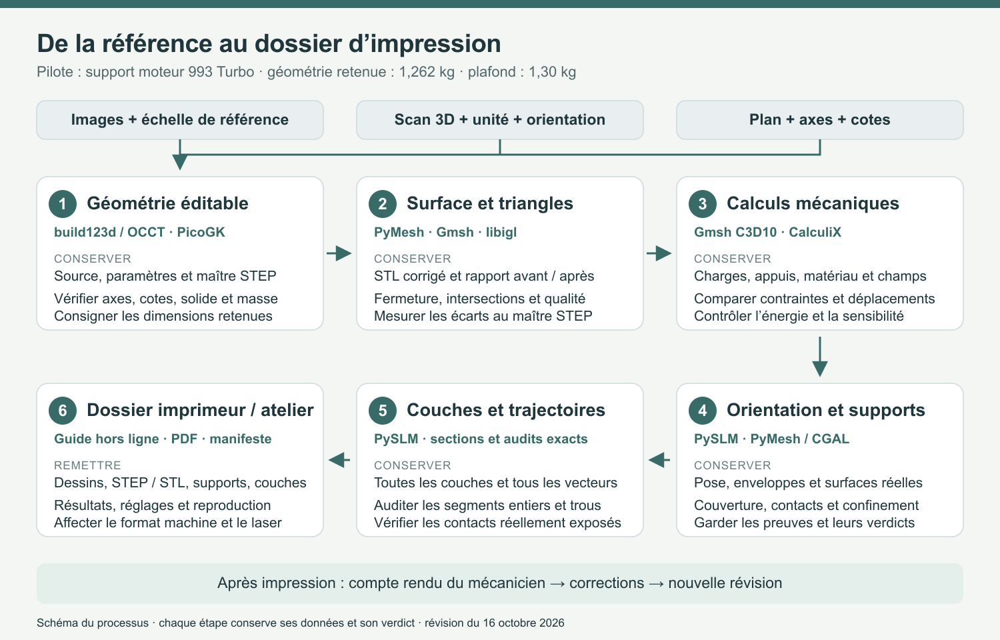
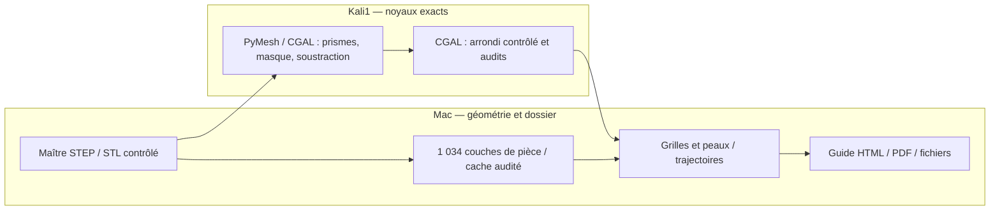

# De la référence au dossier d'impression

Cette chaîne transforme une référence de pièce en un dossier numérique que
l'imprimeur et le mécanicien peuvent suivre. Le support moteur 993 Turbo est
le pilote. Chaque étape conserve son entrée, ses réglages, ses logiciels, ses
sorties et ses résultats ; un changement de géométrie crée une nouvelle révision.

Le guide conserve une copie exacte du reçu utilisé pour relier ses figures,
dans `delivery-assets/source-workflow.json`. Le lanceur peut ensuite terminer
et mettre à jour son propre `workflow.json` ; l'état employé pour les images
reste consultable et vérifiable dans le dossier remis.



Le [schéma vectoriel](../media/carrier-workflow-20261016/process.svg) et son
[PDF](../media/carrier-workflow-20261016/process.pdf) restent lisibles à
l’impression. Ils décrivent le processus ; les reçus de chaque passage
portent les résultats effectivement obtenus.

## Trois entrées, une même sortie CAO

| Référence disponible | Travail d'entrée | Sortie commune |
| --- | --- | --- |
| Image ou photographie | Repérer les vues, la taille de référence et les formes visibles ; consigner les dimensions retenues et les parties reconstruites | Paramètres explicites et modèle éditable |
| Scan 3D | Conserver l'original, déclarer l'unité et la pose, nettoyer les doublons, reconstruire les surfaces utiles et comparer la CAO au scan | STEP ou source PicoGK avec écart de reconstruction enregistré |
| Plan de mesures | Transcrire les cotes, axes, portées et tolérances dans un fichier de paramètres ; vérifier les unités et les conventions d'axes | Source build123d/PicoGK et STEP exporté |

Une image unique peut servir à dessiner une hypothèse ; les dimensions utilisées
restent visibles dans le dossier. Le logiciel ne transforme pas silencieusement
un pixel en millimètre ou une face cachée en mesure.

Le chemin scan réutilise la chaîne PyMesh / reconstruction / PicoGK du projet
`qwen-picogk`. Le [contrat CAD-Recode](../../scripts/cad_recode/pipeline.py)
existant décrit un cas 935 : son identité et ses unités OBJ doivent être
adaptées explicitement avant de le lancer sur une autre référence.
Le chemin par cotes réutilise les sources paramétriques du catalogue, au lieu de
dessiner une nouvelle pièce sans lien avec ses paramètres.

## Les six étapes à suivre

| Étape | Logiciels et rôle | Fichiers à conserver | Contrôles numériques |
| --- | --- | --- | --- |
| 1. Géométrie | build123d/OCCT ou PicoGK ; construction et modification de la forme | Source, paramètres, STEP, convention d'axes | Solide valide, nombre de corps, dimensions, portées et axes protégés, volume après réimport |
| 2. Surface | PyMesh pour le nettoyage, Gmsh pour la triangulation CAD, libigl pour les intersections | STL brut et corrigé, empreintes, rapport avant/après | Fermeture, composantes, orientation, triangles effilés, intersections, distance au maître STEP |
| 3. Mécanique | Gmsh C3D10, CalculiX, audit énergétique indépendant | Maillage, charges, matériau, jeux de calcul, champs et tableaux | Masse, déplacements, contraintes, équilibre, énergie, sensibilité et raffinement |
| 4. Supports | PySLM ; pose à plat et génération des supports LPBF | Pose, surfaces de support, paramètres de grille et de dents | Encombrement, contacts pièce/plaque, accès et intersections conservées dans le rapport |
| 5. Couches | PySLM et intersection de maillage ; contours, hachures et trajectoires des supports | Couches, vecteurs, réglages et vues des sections | Contours, trous préservés, segments finis, doublons, nombres de couches et identités de géométrie |
| 6. Remise | Générateur de guide ; dossier autonome HTML/PDF | STEP/STL, supports, trajectoires, paramètres, rapports et manifeste | Empreintes de tous les fichiers remis et cohérence de révision |

La préparation des supports est admise séparément de leur génération. Les six
contrôles portent sur les enveloppes, les régions couvertes, les peaux, les
grilles, les contacts et les collisions. Le
[générateur de remise v5](../../scripts/build_carrier_workshop_guide_v5.py)
refuse le dossier si un contrôle manque, reste non exécuté ou désigne un reçu
dont l'empreinte a changé. L'audit des trajectoires examine les segments entiers
dans les sections, en conservant trous et îlots ; vérifier seulement leurs
extrémités ne suffit pas.

Le tranchage ouvert prépare les géométries et les vecteurs. Le format machine et
le réglage laser final restent ceux du procédé choisi chez l'imprimeur ; aucun
export générique ne se fait passer pour un travail déjà chargé sur une machine.

## Une commande pour exécuter une recette enregistrée

Le [lanceur](../../scripts/run_part_workflow.py) utilise des recettes lisibles
dans `manufacturing/workflows/`. Une recette énumère les fichiers d'entrée
avec leurs empreintes, les commandes, les délais et les sorties attendues.
Le fichier de runtime local indique où se trouvent les interpréteurs installés.

La [recette intégrée v5](../../manufacturing/workflows/993-carrier-lpbf-v5.json)
contient 37 étapes et 285 fichiers d’entrée épinglés. Elle conserve exactement
les douze premières étapes de CAO, surface, mécanique et dessins de la recette
initiale, puis sépare les sept calculs natifs et les sept générations de
supports. Leur construction conserve le domaine utile entier et ajoute des
bandes de contact attestées ; l’assemblage incrémental garde les mêmes contours
et reçus exacts. Le confinement rationnel, les six admissions géométriques et
les deux audits complets de trajectoires précèdent le guide.
La [revue des commandes et des identités](../../parts/993-eng-carrier-0001/source/process-skins-20261016/cold-v5-recipe-evidence/assessment.json)
a passé : les dix commandes modifiées sont parsées, 27 contrats sont repris
après vérification de leurs identités et les 285 empreintes sont revérifiées.
Elle reste distincte d’un rejeu complet du carrier.

Une bande de contact dirigée vers l’intérieur n’est omise que si son
quadrilatère entier est déjà contenu dans le domaine source, avec preuve
exacte. Le domaine conserve alors la même matière. Les autres cas restent
refusés. Chaque surface intermédiaire et son reçu sont conservés ; l’admission
recalcule les contrôles avec l’autorité réellement enregistrée dans le reçu.

La page mécanique du guide conserve les dépassements du diagnostic idéal
900 MPa sous K1000, la portée de la sensibilité publiée Grade 23 ELI et les
verdicts distincts du cycle : bilan Piola admis, diagnostic ENER refusé sur
l’ensemble des états. Les six références sont copiées dans le dossier. Leur
attribution exige exactement le même maillage discret et le même jeu linéaire
de charges et d’appuis ; elle n’assimile pas deux exports STEP distincts.

```sh
python3 scripts/run_part_workflow.py run manufacturing/workflows/993-carrier-lpbf-v5.json \
  --runtime work/part-workflow/runtime-v2.json \
  --output work/part-workflow/NOUVEAU_PASSAGE
```

Le runtime v2 utilise l’environnement PySLM corrigé `pyslm-coverage-011`.
Le manifeste natif séparé décrit les préfixes Linux disponibles ; sa structure,
les installateurs et les témoins sont décrits dans la
[procédure native par région](../../parts/993-eng-carrier-0001/source/process-skins-20261016/README-native-case.md).
Le dossier de sortie doit être neuf. Une modification des entrées impose sa
nouvelle révision ; la réparation native gauche est liée aux tableaux sources
gelés et refuse toute autre géométrie.

Les environnements déjà prêts se trouvent sous `work/part-workflow/runtimes/` :

| Clé du runtime | Fonction |
| --- | --- |
| `cad_python` | CAO, inspection des fixations et maillage volumique |
| `geometry_python` | Triangulation du STEP et distances exactes à ses surfaces |
| `mesh_audit_python` | Topologie, intersections libigl et distance inverse, dans un conteneur Linux ARM64 local |
| `am_python` | Supports, sections, contours, hachures et figures |
| `pdf_python` | Assemblage du guide HTML/PDF avec ReportLab |

La [base PDF réinstallable](../../manufacturing/runtimes/pdf/README.md)
possède son propre lock pour Python 3.12 sur macOS arm64 : ReportLab, Pillow et
charset-normalizer sont épinglés par version et par empreinte de roue. Elle a
été installée dans `work/part-workflow/runtimes/pdf-base-001`, puis vérifiée par
`pip check`, les tests du guide et un PDF synthétique avec image. Après cette
installation, `pdf_python` peut désigner son `bin/python`. Le guide réel garde
ses propres contrôles de fichiers, de résultats et de présentation.

Dans un checkout neuf sur macOS ARM64, la base CAO peut être installée sans
emprunter l'ancien environnement du projet. Les 45 roues de la base exécutée
sont épinglées par version et SHA-256 :

```sh
python3 parts/993-eng-carrier-0001/source/design-20261016/setup_cad_base.py \
  --python CHEMIN_DU_PYTHON_310 \
  --output work/part-workflow/runtimes/cad-base
```

Cet installateur refuse les plateformes différentes de macOS ARM64/Python
3.10, les versions non épinglées et les dossiers déjà présents. Il exécute un
solide percé dont le volume est comparé à sa formule analytique, puis vérifie
l'export et le réimport STEP ainsi que l'empreinte du noyau natif. Son reçu et
les journaux d'installation restent dans le dossier du runtime. Le Python de
cette base devient `CHEMIN_DU_PYTHON_CAD` ci-dessous.

Pour installer les quatre environnements de calcul, indiquer explicitement
ce Python CAD et un Python 3.11. Les installateurs refusent d'écraser un dossier
inconnu ; les réglages locaux ne modifient pas la base.

```sh
python3 parts/993-eng-carrier-0001/source/design-20261016/setup_runtime.py \
  --cad-python CHEMIN_DU_PYTHON_CAD \
  --output work/part-workflow/runtimes/design

python3 parts/993-eng-carrier-0001/source/remesh-20261016/setup_runtime.py \
  --cad-python CHEMIN_DU_PYTHON_CAD

python3 parts/993-eng-carrier-0001/source/remesh-20261016/setup_mesh_audit.py

CHEMIN_DU_PYTHON_311 parts/993-eng-carrier-0001/source/process-coverage-20261016/setup_pyslm.py \
  work/part-workflow/runtimes/pyslm-corrected
```

Chaque installateur conserve ses versions et sa provenance. Le backend libigl
utilise la roue Linux officielle : la roue macOS a été essayée, son défaut
d'import est conservé dans le dossier de travail. CalculiX utilise son image
locale épinglée, une seule CPU, 6 Gio sans swap et sans réseau. Le lanceur
supprime uniquement son propre conteneur après les calculs.

La réinstallation corrigée de PySLM a été exécutée dans un dossier neuf :
37 versions épinglées, quatre fichiers corrigés conformes et 775 sources et
binaires de tranchage identiques au cache de pièce. Le
[reçu](../../parts/993-eng-carrier-0001/source/process-slicing-20261016/pyslm-reinstall-validation.json)
porte uniquement sur cette installation et le tranchage de pièce ; les
supports conservent leurs propres admissions.

La construction exacte des volumes de support utilise le worker Linux
local Kali1. PyMesh conserve les rationnels entre les booléens ; CGAL traite
l'export en coordonnées flottantes avec une précision déclarée. Ce travail
revient au Mac avant le calcul des grilles, des peaux et des couches.



Sur Linux Debian AMD64, le bootstrap CGAL compile dans un préfixe neuf avec
les archives épinglées et extrait l'en-tête MPFR localement. Il utilise les
outils de développement déjà présents et un Python d'audit avec libigl 2.6.3 :

```sh
python3 parts/993-eng-carrier-0001/source/native-cgal-20261016/setup.py \
  PREFIXE_CGAL_NEUF --audit-python PYTHON_LINUX_AUDIT

python3 parts/993-eng-carrier-0001/source/native-cgal-distance-20261016-v3/setup.py \
  PREFIXE_DISTANCE_NEUF --cgal-runtime PREFIXE_CGAL_NEUF
```

Il ne modifie pas les paquets système. Les exécutables, sources, bibliothèques
et licences sont enregistrés. Les jobs ont leurs propres limites de CPU,
mémoire et durée ; leurs espaces de travail sont isolés sans réseau. La
réussite du noyau n'admet pas à elle seule le volume : topologie, intersections,
fidélité géométrique et identité des données doivent aussi passer. Le second
exécutable mesure les distances en arithmétique exacte, en conservant les
triangles d'aire positive et en traitant explicitement les triangles
collinéaires comme segments ou points.
La version V3 cherche d'abord un témoin exact dans les triangles de filiation ;
si ce témoin ne suffit pas, elle utilise l'arbre AABB exact. Elle ne remplace
pas le contrôle par une distance flottante à une feuille très mince.

Les réinstallations et témoins natifs sont conservés avec leurs reçus :

| Outil | Rôle dans la chaîne | Reçu de reproduction |
| --- | --- | --- |
| PyMesh 0.3 / CSGTree | Booléens avec constructions exactes intermédiaires | [Installation et prismes](../../parts/993-eng-carrier-0001/source/native-pymesh-20261016/reproduction-results.json) |
| CGAL 6.1.3 | Conversion contrôlée du résultat en coordonnées IEEE | [Installation et témoins de topologie](../../parts/993-eng-carrier-0001/source/native-cgal-20261016/reproduction-results.json) |
| Distance exacte V3 | Contrôle de la borne de déplacement, dans les deux sens | [Installation et témoins de distance](../../parts/993-eng-carrier-0001/source/native-cgal-distance-20261016-v3/reproduction-results.json) |
| Cutter local PyMesh | Réduction du coût par une expression booléenne équivalente | [Témoin complet avec audits](../../parts/993-eng-carrier-0001/source/native-pymesh-clip-20261016/reproduction-results.json) |

Ces témoins vérifient les logiciels. Les sept régions réelles de support
gardent leurs propres reçus et leurs propres verdicts.
Le [bootstrap Linux consolidé](../../parts/993-eng-carrier-0001/source/native-toolchain-20261016/README.md)
compose ces installateurs avec son propre environnement d'audit. Son entrée
PyMesh est l'archive logicielle exacte conservée hors Git ; l'option de copie
permet de l'inclure dans un paquet autonome. Les installateurs individuels et
le nouvel environnement d'audit ont été exécutés. Le lancement consolidé
des cinq installateurs a ensuite été réalisé dans un préfixe neuf :
[installation complète vérifiée](../../parts/993-eng-carrier-0001/source/native-toolchain-20261016/complete-installation-results.json),
archive interne de 439 278 729 octets, cinq reçus et 47 fichiers sources
revérifiés. Il ne relance aucune pièce lors de cette installation.

```sh
python3 scripts/run_part_workflow.py run manufacturing/workflows/993-carrier.json \
  --runtime work/part-workflow/runtime.json \
  --output work/part-workflow/run-001

python3 scripts/run_part_workflow.py verify work/part-workflow/run-001
```

Le premier passage `run-001` est conservé **refusé à la préparation LPBF** :
une région de support omise et un défaut de correspondance des sommets ont
été identifiés dans PySLM. Ses 526 couches calculées restent inspectables.
Les versions corrigées sont préparées séparément ; cette commande identifie
le témoin initial, et ne promet pas un dossier d'impression admis.

Le dossier de sortie doit être neuf. Les étapes s'exécutent dans l'ordre,
avec leurs journaux séparés. Un échec conserve les sorties et s'arrête à l'étape
concernée ; la correction donne lieu à un nouveau passage. L'état `executed`
signifie que les commandes et sorties déclarées sont présentes : les rapports
de calcul conservent leurs propres verdicts.

Pour le pilote 993, conserver les sorties sous `work/` : la fabrication du
guide reprend les fichiers de ce passage et vérifie que le STEP, la surface,
les calculs et le tranchage portent les mêmes identités. Le plafond de masse
autorisé par Maxime le 16 octobre est **1,30 kg**. Les essais antérieurs sous
1,20 et 1,23 kg restent conservés avec leurs propres critères et leurs refus.

Les recettes exécutables appartiennent au dépôt. Une image ou un fichier de
mesures reçu en entrée ne peut pas ajouter une commande à exécuter.

## Réutiliser les étapes déjà calculées

La correction des supports ne demande pas de refaire la mécanique si le STEP
et son STL restent exactement identiques. L'
[assembleur du pilote](../../scripts/assemble_carrier_workflow.py) vérifie les
douze premières étapes du passage source et copie leurs fichiers sans les
modifier. Il les réunit avec une préparation LPBF complète, ses six contrôles
admis et les audits de toutes les trajectoires de pièce et de supports.

```sh
python3 scripts/assemble_carrier_workflow.py assemble \
  --source work/part-workflow/run-001 \
  --process work/PREPARATION_LPBF_ADMISE \
  --audit work/AUDIT_COMPLET_DE_CETTE_PREPARATION \
  --support-audit work/AUDIT_COMPLET_DES_TRAJECTOIRES_DE_SUPPORTS \
  --output work/part-workflow/ASSEMBLAGE_NEUF

python3 scripts/assemble_carrier_workflow.py verify \
  work/part-workflow/ASSEMBLAGE_NEUF
```

Ces chemins désignent les sorties admises à fournir lorsque le tranchage est
terminé ; ils ne désignent pas des résultats déjà présents. Le reçu
`assembly.json` conserve le statut du passage initial, les étapes importées,
les provenances et toutes les empreintes copiées. Il déclare explicitement
la réutilisation des calculs. Le passage initial reste refusé et n'est jamais
réécrit en exécution réussie. Les fichiers de l'assemblage restent vérifiables
après déplacement ou archivage du dossier source.

Le [cache des couches de pièce](../../parts/993-eng-carrier-0001/source/process-cache-20261016/part_cache.py)
applique la même règle pendant le travail : identité du STL, pose et tableaux
du maillage, paramètres de tranchage, versions et empreintes des dépendances,
ordre de tous les plans de coupe et empreintes des fichiers doivent correspondre.
Le cache contient exclusivement les sections et trajectoires de la pièce ; les
supports sont calculés et contrôlés à part. Un cache partiel est refusé.

## Le dossier du mécanicien

La remise présente d'abord la pièce et sa révision, puis les dimensions de
travail, la masse, les points de fixation et les résultats utiles. Les détails
logiciels sont disponibles dans un second niveau de lecture.

La fiche de retour de pose recueille la fixation concernée, la cote prévue et
observée, les contacts ou jeux, les modifications demandées, les conditions de
fonctionnement et les photos. Ces retours rejoignent la révision suivante sans
effacer le dossier précédent.

## Reproduire le guide

Le [générateur](../../scripts/build_part_workflow_guide.py) produit le parcours
interactif hors ligne et son PDF à partir d'une description complète. La
dernière étape de la recette renseigne le modèle de description avec les
résultats et fichiers admis du passage. Le modèle vide de
`manufacturing/workflows/` n'est pas une description prête à rendre.

Pour refaire uniquement la présentation d'un passage admis, utiliser son
`guide-description.json` avec le Python indiqué par la clé `pdf_python` du
runtime. Cet interpréteur doit fournir ReportLab ; il est déjà disponible
dans les dépendances du bureau Codex pour le runtime local.

```sh
CHEMIN_DU_PYTHON_PDF scripts/build_part_workflow_guide.py \
  work/PASSAGE_ADMIS/guide-description.json work/part-workflow/guide-rebuilt
```

Le générateur copie uniquement les fichiers explicitement choisis et en
calcule les empreintes. Les entrées privées restent dans le dossier de travail.

Les guides affichent les résultats réellement obtenus par la révision retenue.
Une image de supports vient du maillage de supports ; une image de contrainte
vient du jeu de calcul correspondant. Aucun rendu ne remplace un résultat.
