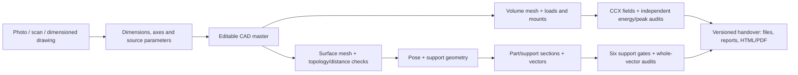

# From a part reference to the manufacturing handover

[French guide](PART_WORKFLOW.md) · [17 October results and reproduction notes](CARRIER_SUPPLEMENTS_20261017_EN.md)

This workflow turns a photograph, scan or dimensioned drawing into an editable
CAD revision, controlled meshes, mechanical results and an LPBF preparation
package. The Porsche 993 Turbo engine carrier is the working example. Each
stage retains its inputs, settings, software identities, outputs and reports.
A geometry change creates a new revision; results follow that revision.

For the current **C1 native BREP** revision, the calculated CAD mass is
**1.262369675 kg, below the 1.30 kg limit**. Both linear C1 cases and their
local H2 refinement have completed. The refined integration-point stress peaks
are about **997 MPa on rigid mounts and 2,996 MPa with K1000**. Their energy
audits pass, while stress convergence remains open. The complete seven-region
support and 1,034-layer trajectory package is not admitted by the evidence
linked here. A machine-specific build job has not been produced.

The [current-results supplement](CARRIER_SUPPLEMENTS_20261017_EN.md) separates
these results from historical runs. The [figure gallery](../../parts/993-eng-carrier-0001/source/progress-figures-20261016/index.html)
provides the drawings and their source records. [Figure 24](../../parts/993-eng-carrier-0001/source/progress-figures-20261016/index.html#C1-fields)
shows the **coarse C1** cases, not the later H2 results.

## One workflow, three possible starting points

| Available reference | Work to perform | Common output |
| --- | --- | --- |
| Photograph or image | Identify views and a known scale; record adopted dimensions and reconstructed features | Explicit parameters and editable CAD |
| 3D scan | Preserve the original; state units and pose; reconstruct useful surfaces and measure CAD-to-scan differences | Editable source and a reconstruction report |
| Dimensioned drawing | Transcribe dimensions, axes, bearing faces and tolerances; check units and axis conventions | Parameter file, build123d/PicoGK source and CAD export |

A single view can support a documented geometric assumption. Hidden surfaces
and dimensions remain identified as assumptions, rather than becoming measured
data. The scan route reuses the PyMesh/reconstruction/PicoGK tools from
`qwen-picogk`. The existing [CAD-Recode contract](../../scripts/cad_recode/pipeline.py)
uses a 935 example: part identity and OBJ units must be adapted explicitly.
The dimensioned route reuses the catalogue's parametric sources.



The retained [process illustration](../media/carrier-workflow-20261016/process.png),
[SVG](../media/carrier-workflow-20261016/process.svg) and
[PDF](../media/carrier-workflow-20261016/process.pdf) describe the same stages.
Their original artwork is unchanged.

## The six stages and their deliverables

| Stage | Tools and purpose | Retained files | Checks |
| --- | --- | --- | --- |
| 1. Geometry | build123d/OCCT or PicoGK constructs the form | Source, parameters, axis convention, CAD master/export | Valid solid, body count, dimensions, protected axes and bearing faces, import identity |
| 2. Surface | Gmsh triangulates the CAD; PyMesh/libigl provide mesh operations and independent checks | Original and revised STL, hashes, before/after reports | Closure, components, orientation, needles, intersections and distance to the corresponding CAD master |
| 3. Mechanics | Gmsh C3D10, CalculiX and independent energy/peak audits | Mesh, material, loads/mounts, INP, DAT/FRD/NPZ, full reports | Volume/Jacobians, displacement, all stress peaks, equilibrium/energy and measured local refinement |
| 4. Supports | PySLM defines the pose and LPBF support geometry | Pose, support surfaces, grid and tooth parameters | Build envelope, part/plate contacts, regions covered, access and collisions |
| 5. Layers | Mesh sections and PySLM produce contours, hatches and support vectors | Ordered layers, vectors, settings and section views | Holes/islands, whole-segment confinement, finite coordinates, duplicates and source identities |
| 6. Handover | Repository guide builders package the selected revision | CAD/STL, supports, vectors, parameters, reports, HTML/PDF and manifest | File hashes, consistent revision and completed prerequisite gates |

For C1, the editable master is **BREP**, not a successfully exchanged STEP.
The refused STEP exports remain historical files. Its dedicated surface mesh
has its own checks against that BREP; old-model distance results are not reused
for the intentionally changed fillet.

Support generation and admission are separate stages. The six support gates
cover envelopes, regional coverage, skins, grids, contacts and collisions.
The [v6 guide builder](../../scripts/build_carrier_workshop_guide_v6.py) refuses
missing/unexecuted gates and changed receipt hashes. Whole-vector audits check
complete segments in sections, including holes and islands; endpoint checks
alone are insufficient.

Generic geometry and scan vectors are a handover to the printer. The chosen
machine's build format and final laser/process settings remain to be defined
with that printer; generic vectors are not an EP-M650 or BLT-S600 build file.

## Running a retained recipe

The [v2 runner](../../scripts/run_part_workflow_v2.py) reads recipes under
`manufacturing/workflows/`. A recipe lists input SHA-256 identities, commands,
time limits and expected outputs; a local runtime JSON supplies interpreter
paths. Output directories must be new. A failure retains its outputs and
stops the stage; corrections use a new run directory.

The retained [v6 recipe](../../manufacturing/workflows/993-carrier-lpbf-v6.json)
has 37 stages and 293 pinned inputs. Its twelve initial CAD/surface/mechanical
stages refer to the historical model; later native and regional support stages
retain their own identities. The [recipe review](../../parts/993-eng-carrier-0001/source/process-skins-20261016/cold-v6-recipe-evidence/assessment.json)
checked commands and input contracts. That review is not a completed full-carrier
run. The following is the recorded invocation, with its original placeholder:

```sh
python3 scripts/run_part_workflow_v2.py run manufacturing/workflows/993-carrier-lpbf-v6.json \
  --runtime work/part-workflow/runtime-v2.json \
  --output work/part-workflow/NOUVEAU_PASSAGE
```

The [v3 runner](../../scripts/run_part_workflow_v3.py) preserves the contract
and permits **1–86,400 seconds per stage**. Stages remain sequential. Existing
recipes retain their declared budgets; increasing a bound is not a result or
a promise of completion. See the [English supplement](CARRIER_SUPPLEMENTS_20261017_EN.md)
for the local region recipe and the separate diagnostic supervisors.

An inward contact band may be omitted only when its **entire quadrilateral**
is already inside the source domain, with an exact proof. Other cases remain
refused. Intermediate materials and receipts are retained. Exact area reuse
keeps contours and decisions; [parallel admissions](../../parts/993-eng-carrier-0001/source/process-skins-20261016/README_parallel_exact_admissions.md)
retain each unit's result. A local unit result does not supply all six gates.

## Software and runtime map

Installed interpreter locations are recorded in the runtime JSON and their
receipts, rather than assumed from the shell's default Python.

| Runtime/tool | Role and location |
| --- | --- |
| `cad_python` | Editable CAD, protected interfaces and volume meshing; macOS ARM64 CAD base |
| `geometry_python` | Gmsh surface meshing and CAD-distance checks; geometry-standalone runtime |
| `mesh_audit_python` | Topology and libigl intersections in the pinned local Linux ARM64 container |
| CalculiX | Pinned local image/binary; one CPU, 6 GiB, no swap/network; owned-container cleanup |
| `am_python` | PySLM support geometry, sections, contours, hatches and views; each run binds its actual revision |
| Local discrete refinement | Isolated scikit-fem 12.0.2 and retained bridge; preserves the discrete geometry and protected entities under its own checks |
| Native Linux tools | Kali1 PyMesh/CGAL exact operations and their separately attested prefixes |
| `pdf_python` | ReportLab-based HTML/PDF delivery generation |

The [native case procedure](../../parts/993-eng-carrier-0001/source/process-skins-20261016/README-native-case.md)
describes the Linux manifest, installers and small witnesses. Existing
`pyslm-coverage-011`/later runtime identities are preserved per run; names are
not interchangeable. The [PySLM reinstall receipt](../../parts/993-eng-carrier-0001/source/process-slicing-20261016/pyslm-reinstall-validation.json)
records 37 pinned versions, four corrected files and 775 slicing sources and
binaries matching the part cache. Its scope is installation and part slicing.

### Reinstalling the retained bases

On macOS ARM64/Python 3.10, the [CAD base installer](../../parts/993-eng-carrier-0001/source/design-20261016/setup_cad_base.py)
uses 45 version/hash-pinned wheels in a fresh directory. It checks an analytic
solid, STEP export/reimport and native-kernel identities. The uppercase tokens
below are the original path placeholders, retained verbatim:

```sh
python3 parts/993-eng-carrier-0001/source/design-20261016/setup_cad_base.py \
  --python CHEMIN_DU_PYTHON_310 \
  --output work/part-workflow/runtimes/cad-base
```

Use that CAD Python and an explicit Python 3.11 for the separate environments:

```sh
python3 parts/993-eng-carrier-0001/source/design-20261016/setup_runtime.py \
  --cad-python CHEMIN_DU_PYTHON_CAD \
  --output work/part-workflow/runtimes/design

python3 parts/993-eng-carrier-0001/source/remesh-20261016/setup_runtime.py \
  --cad-python CHEMIN_DU_PYTHON_CAD

python3 parts/993-eng-carrier-0001/source/remesh-20261016/setup_mesh_audit.py

CHEMIN_DU_PYTHON_311 parts/993-eng-carrier-0001/source/process-coverage-20261016/setup_pyslm.py \
  work/part-workflow/runtimes/pyslm-corrected
```

Each installer records versions and provenance and refuses an unknown existing
directory. The libigl backend uses its official Linux wheel; the earlier macOS
import failure is retained. The [PDF base](../../manufacturing/runtimes/pdf/README.md)
separately pins Python 3.12/macOS ARM64 wheels for ReportLab, Pillow and
charset-normalizer; its installation checks do not replace guide checks.

On Debian AMD64, the existing CGAL bootstrap uses fresh prefixes, pinned
archives and a locally extracted MPFR header, with the pre-existing compiler
and audit Python/libigl 2.6.3:

```sh
python3 parts/993-eng-carrier-0001/source/native-cgal-20261016/setup.py \
  PREFIXE_CGAL_NEUF --audit-python PYTHON_LINUX_AUDIT

python3 parts/993-eng-carrier-0001/source/native-cgal-distance-20261016-v3/setup.py \
  PREFIXE_DISTANCE_NEUF --cgal-runtime PREFIXE_CGAL_NEUF
```

It records executable, source, library and licence identities without changing
system packages. Jobs have explicit CPU, memory and time limits and network-free
workspaces. The exact-distance V3 tool retains positive-area triangles and
handles collinear triangles as segments or points; it first uses lineage
witnesses, then an exact AABB search when required.

| Retained native evidence | Scope |
| --- | --- |
| [PyMesh reproduction](../../parts/993-eng-carrier-0001/source/native-pymesh-20261016/reproduction-results.json) | Exact intermediate Boolean constructions and prism witnesses |
| [CGAL 6.1.3 reproduction](../../parts/993-eng-carrier-0001/source/native-cgal-20261016/reproduction-results.json) | Controlled IEEE export and topology witnesses |
| [Exact-distance V3 reproduction](../../parts/993-eng-carrier-0001/source/native-cgal-distance-20261016-v3/reproduction-results.json) | Bidirectional displacement-bound witnesses |
| [PyMesh cutter reproduction](../../parts/993-eng-carrier-0001/source/native-pymesh-clip-20261016/reproduction-results.json) | Equivalent local Boolean expression and its audits |
| [Consolidated installation](../../parts/993-eng-carrier-0001/source/native-toolchain-20261016/complete-installation-results.json) | Five installers, receipts and retained inputs |

These are software witnesses; actual support regions keep separate verdicts.
The [archive-restoration capsule](../../parts/993-eng-carrier-0001/source/software-archive-restoration-20261017/README.md)
distinguishes the restored experimental CGAL b4e8 archive from stable 6.1.3,
and states which host dependencies already existed. It does not claim that
three local archives alone reinstall the entire stable toolchain offline.

## Historical first run and reuse of unchanged stages

These commands identify the original retained run:

```sh
python3 scripts/run_part_workflow.py run manufacturing/workflows/993-carrier.json \
  --runtime work/part-workflow/runtime.json \
  --output work/part-workflow/run-001

python3 scripts/run_part_workflow.py verify work/part-workflow/run-001
```

`run-001` remains **rejected at LPBF preparation**, including the omitted region
and vertex-correspondence defect. Its 526 calculated layers remain inspectable.
Corrected runs are separate. `executed` records that declared commands/outputs
exist; each calculation report retains its own verdict.

The [workflow assembler](../../scripts/assemble_carrier_workflow.py) can reuse
unchanged stages only when the CAD, surface and source identities match exactly.
It verifies and copies the twelve historical stages, then requires a complete
admitted LPBF preparation and both whole-trajectory audits:

```sh
python3 scripts/assemble_carrier_workflow.py assemble \
  --source work/part-workflow/run-001 \
  --process work/PREPARATION_LPBF_ADMISE \
  --audit work/AUDIT_COMPLET_DE_CETTE_PREPARATION \
  --support-audit work/AUDIT_COMPLET_DES_TRAJECTOIRES_DE_SUPPORTS \
  --output work/part-workflow/ASSEMBLAGE_NEUF

python3 scripts/assemble_carrier_workflow.py verify \
  work/part-workflow/ASSEMBLAGE_NEUF
```

These placeholder paths identify outputs still to supply; they are not names
of already admitted packages. `assembly.json` preserves the original refusal,
the imported stages and every copied hash. It never relabels an old rejected
run as successful.

The [part-layer cache](../../parts/993-eng-carrier-0001/source/process-cache-20261016/part_cache.py)
checks STL identity, pose/arrays, settings, versions, dependency hashes and
ordered section heights. It contains only part sections and trajectories;
supports and their graphs are controlled separately. A partial cache is refused.
C1 mechanical results are not substituted into the old STEP recipe by renaming
metadata.

## Reproducing and handing over the evidence

The [current C1 capsule](../../parts/993-eng-carrier-0001/source/design-20261016/native-C1-20261017/README.md)
contains the editable BREP, surfaces, mesh and complete coarse-C1 case outputs
in three archives, each below 100 MB. From the repository root:

```sh
python3 -I -B parts/993-eng-carrier-0001/source/design-20261016/native-C1-20261017/restore.py verify --manifest-sha256 faa9069cc12e4ac69c784ab4af50e74de65c0c26403172721c500b8d5641e1d1
python3 -I -B parts/993-eng-carrier-0001/source/design-20261016/native-C1-20261017/restore.py restore work/C1-native-RESTORED --manifest-sha256 faa9069cc12e4ac69c784ab4af50e74de65c0c26403172721c500b8d5641e1d1
```

Its retained analysis replay reproduced both complete energy reports and both
peak reports without rerunning CCX. [Figure 24's dependent replay](../../parts/993-eng-carrier-0001/source/progress-figures-20261016/C1-fields-20261017/README.md)
restores those archives, adds only its small source/proof mirror and redraws
three byte-identical formats. Both require their documented installed runtimes.
The newer H2 results have their own [root closeout](../../work/carrier-process-20261017/bounded-webs-C1-qualified-h2-static-preparation-001/root-terminal-review-001.json);
they are not silently inserted into that coarse-C1 archive or figure.

The separate [durable C1 H2 capsule](../../parts/993-eng-carrier-0001/source/design-20261016/native-C1-h2-20261017/ACTUAL_REPRODUCTION.md)
now preserves the qualified refinement and both complete H2 cases. Its three
new ZIPs depend on the existing C1 capsule without duplicating coarse fields.
One closed analysis replay restored all 420 members and regenerated the four
complete energy/peak reports byte-identically, without rerunning a solver,
mesher or CAD kernel. The [root replay closeout](../../parts/993-eng-carrier-0001/source/design-20261016/native-C1-h2-20261017/evidence/root-review/root-replay-terminal-review-001.json)
retains that result; stress convergence remains open.

The mechanic's handover starts with revision, dimensions, mass, mounting
interfaces and the useful results. Detailed software evidence follows in a
second layer. A fit-feedback sheet records the interface, intended/observed
dimension, contact or clearance, requested changes and photographs against
that revision.

For a fully admitted workflow, the [guide generator](../../scripts/build_part_workflow_guide.py)
uses its completed `guide-description.json` with `pdf_python`:

```sh
CHEMIN_DU_PYTHON_PDF scripts/build_part_workflow_guide.py \
  work/PASSAGE_ADMIS/guide-description.json work/part-workflow/guide-rebuilt
```

The empty template is not a ready delivery description. The builder copies only
explicitly selected files and records their hashes. It retains the exact
figure-binding receipt in `delivery-assets/source-workflow.json`, even if the
runner later updates its own `workflow.json`. CAD, fields, support vectors and
reports must belong to the selected revision; machine-specific job preparation
remains a separate handover item.


## The local C1 junction in an oblique section

[Figure 25](../../parts/993-eng-carrier-0001/source/progress-figures-20261016/index.html#C1-junction-section)
shows the actual before/after CAD profiles in the plane of the coarse 84037/IP1
normal ray and Z. Its short chord is a local junction observation; the later H2
peak is not plotted. The [sampled-point replay and complete evidence](../../parts/993-eng-carrier-0001/source/progress-figures-20261016/C1-junction-section-20261017/README.md)
retain the distinct native producer and presentation sources, the refused STEP
exchange, and three byte-identical exports without another CAD or FEA run.
