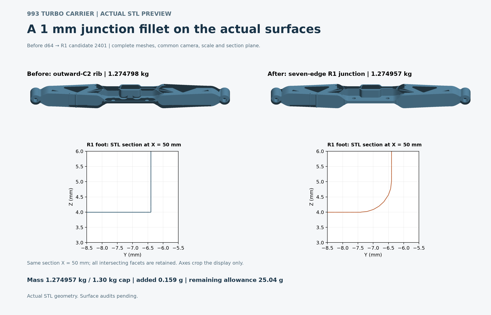

# R1 junction: actual surface comparison

The before model is the **d64a7faf** rib carrier at **1.274797998 kg**. The after model is the **240109ca** seven-edge R1 trial at **1.274957364 kg**, below the **1.30 kg** ceiling. The added reference mass is **0.159 g**; the remaining allowance is **25.04 g**.

Both views use the complete actual surface meshes: **597,720 / 651,012 triangles**, with common camera and scale. The lower panels show the same STL section at **X = 50 mm** in Y/Z coordinates. The full section is computed before cropping the displayed axes; no section segment is filtered. It shows the change from a sharp foot to the declared **1 mm** junction fillet.

The [editable SVG](comparison.svg), [actual render receipt](source-receipt.json), [retained helper origins](source-reuse.json), [display-only source derivation](source-changes.json) and [independent ROOT closure and visual review](visual-review.json) retain source identities, rendering settings, runtime hashes and completed-process checks. ROOT viewed the exported PNG and checked its legibility. The [archive](archive.json) hashes every published payload.

These are actual STL geometry previews. The [English numerical checkpoint](../../reports/carrier-rib-20261018/README.md#r1-junction-trial--separate-candidate) records each R1 geometry and surface result separately. Full generators, source meshes and runtimes remain at the retained local paths in the receipts; this image folder is not a standalone CAD or solver replay.
