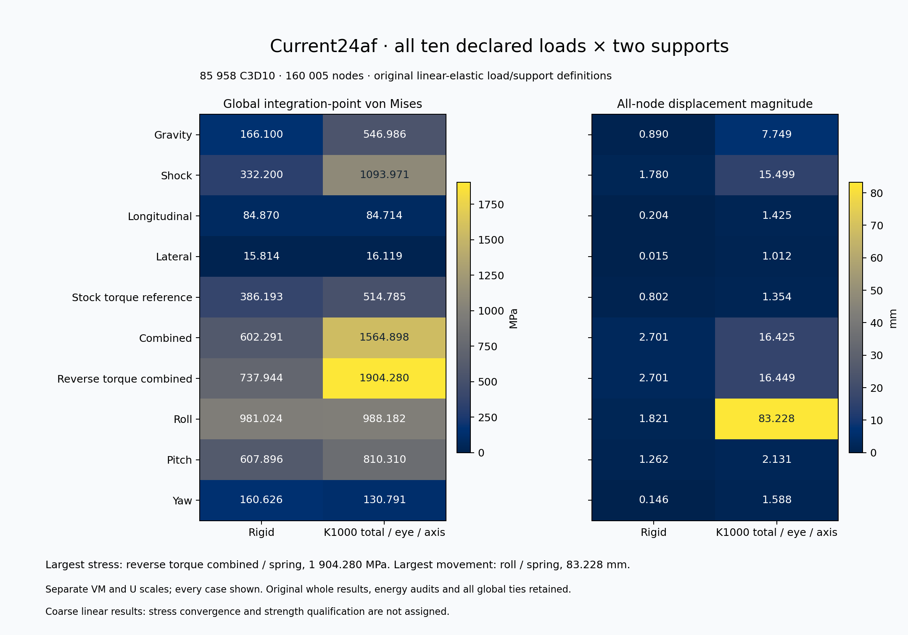

# Current24af: twenty actual coarse load/support cases

The two panels show all ten declared loads under rigid and K1000 supports, using separate stress and displacement scales. K1000 is **1,000 N/mm total per end eye and axis**. Values come from the complete closed current24af solver records; no solver, mesh or CAD operation was run to draw this summary.

The highest integration-point stress is **1,904.280173 MPa**, reverse-torque combined/spring. The largest nodal displacement is **83.227529 mm**, roll/spring. These are coarse linear-elastic results; stress convergence and adequate strength are not assigned.

The actual [PNG](current24af-all20-summary.png) was inspected at ROOT and all 40 cells, row labels, scales and footers are legible. The [SVG](current24af-all20-summary.svg) retains editable vector artwork. Revision 002 changes only duplicate right-hand Y-label visibility; the original overlapping revision remains preserved at its recorded source path.

[Full unrounded data](data-closed.json), [renderer](render.py), [binding checks](bind_ROOT.py), [recorded plan](plan.json), [render receipt](receipt.json), [whole terminal owner](terminal-collection-001.json) and [ROOT review](root-terminal-review-001.json) retain the sources and execution scope. These copied sources are an evidence mirror; their exact external dependencies and original working-directory layout remain required for replay. This folder is not a self-contained runtime distribution.
