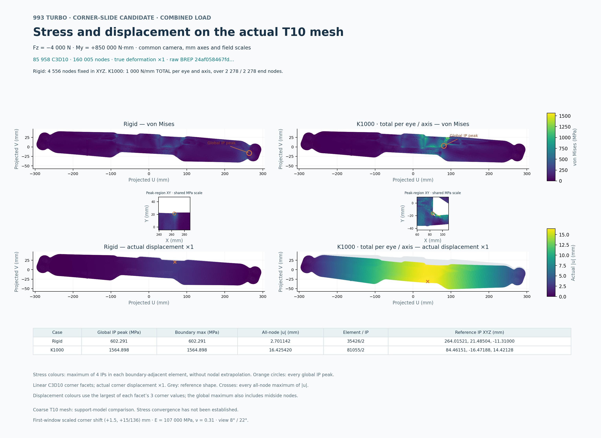

# Current window-root candidate: the two combined-load fields

[PDF](carrier-corner-slide-combined-fields.pdf) · [SVG](carrier-corner-slide-combined-fields.svg) · [complete render record](render-receipt.json) · [independent closure](evidence/root-terminal-review.json) · [visual review](evidence/root-visual-review.json) · [inventory](archive.json)

The actual **24af0584** candidate weighs **1.275991674 kg** at **4,420 kg/m³**, below the **1.30 kg** limit. These are its two completed **combined** load cases, on its own **160,005-node / 85,958-T10** coarse mesh: rigid end eyes and K1000 springs. Both apply **Fz = −4,000 N / My = 850 N·m**, with **E = 107,000 MPa / ν = 0.31**. K1000 is **1,000 N/mm total per end eye and axis**, distributed over that eye's actual nodes.

The actual global peaks are **602.291437 / 1,564.897510 MPa**, with maximum displacements **2.701142 / 16.425420 mm**. The complete original fields, all integration-point rows and every global tie feed the unchanged renderer. Views share the original camera and colour scales; displayed displacement uses true deformation ×1. No stress peak is excluded. All 20 coarse cases are now closed separately: this image shows two of them. The overall worst case is reverse-torque combined/spring, **1,904.280173 MPa**; roll/spring has **83.227529 mm** maximum movement. See the [complete current checkpoint](../../reports/carrier-rib-20261018/README.md#twenty-completed-coarse-loadsupport-cases). Passing equilibrium/energy checks does not establish converged stress, adequate strength or physical qualification.

These PNG/PDF/SVG bytes are the accepted revision002 authoring output. Both actual PNG and rasterized PDF were visually reviewed. Revision001's annotation overlap and numerical closure are preserved in the [original review](evidence/original001-layout-root-review.json) and [visual record](evidence/original001-layout-visual-review.json). This publication does not rerender or rerun CAD, meshing or mechanics.

The copied sources and controls retain their original work paths. [External inputs](external-inputs.json) records exact field, mesh, helper and runtime hashes; full scientific arrays and runtime binaries remain external. This is a review snapshot, with no self-contained or portable full replay claim.
