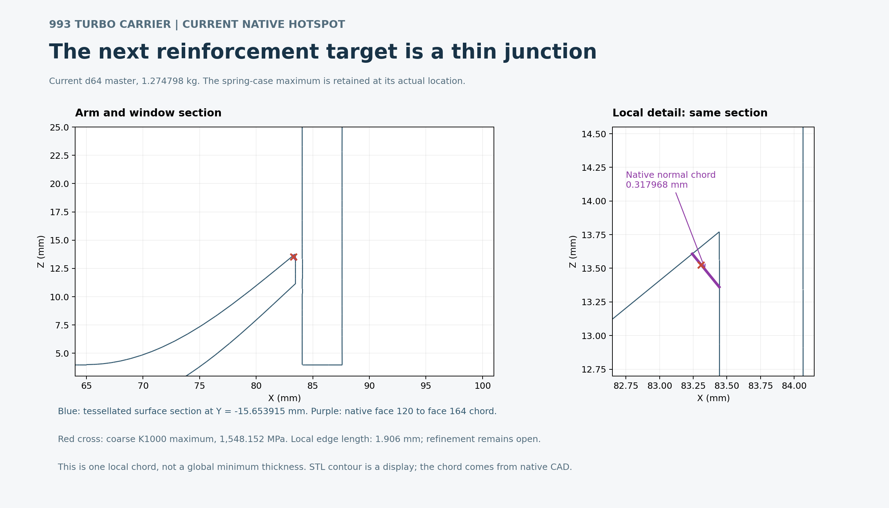

# Current thin junction at the spring-case maximum

The current **d64a7faf** master weighs **1.274797998 kg**. The figure intersects
its complete **597,720-triangle** STL with the plane
**Y = −15.653914962673937 mm**. All crossing triangles are considered;
**4,674 section segments** are retained. The right panel enlarges the same
section, with no smoothing or invented outline.

The purple segment is a separate closed native-CAD observation: face 120 to
face 164 along the first face's inward normal, length **0.317968484 mm**.
The reverse observation on face 164 gives **0.300345471 mm** at a different
nearby point. These are local chords, not a global minimum-thickness survey.
The red cross is the actual coarse K1000 maximum at element **81,008 / IP3**,
**1,548.151984 MPa**. It remains in the result set; convergence is open.

The contour is a tessellated display. The native chord is computed from CAD,
independently of that contour. No native geometry operation or mechanical
solver was rerun to create this image. [SVG](current-thin-junction.svg),
[render receipt](receipt.json) and [visual review](visual-review.json) retain
the source identities, exact points and actual render completion.

The rendering source and pinned observation inputs remain at the local paths
in those receipts. This compact media folder is not a self-contained runtime.
