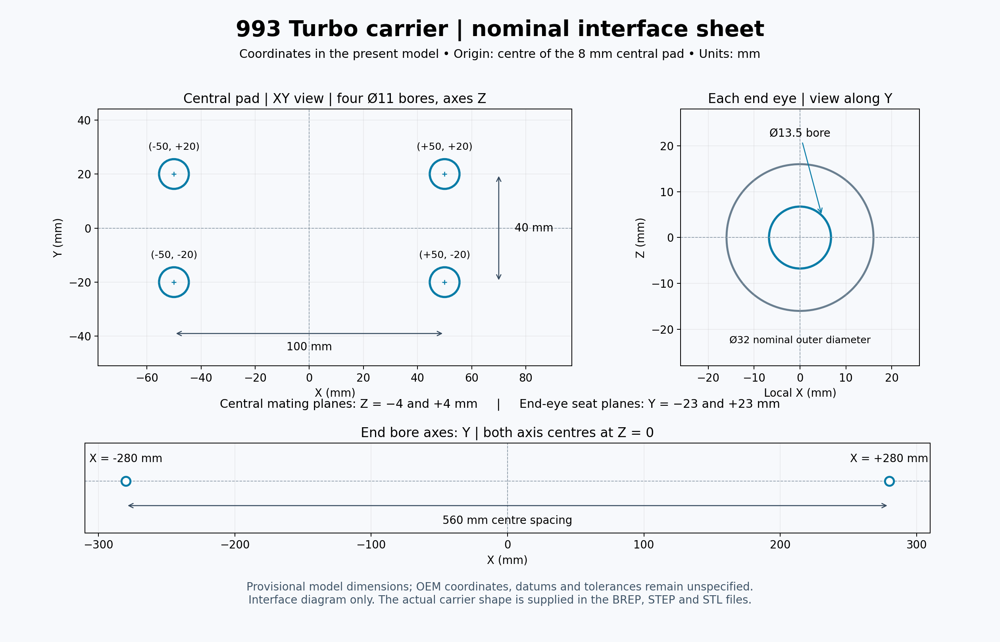

# Nominal carrier interface sheet

This English sheet collects the present model coordinates: the 100 × 40 mm central pattern with four Ø11 mm Z-axis bores, the 560 mm end-eye spacing, the Ø13.5 mm Y-axis end bores, and the mating/seat planes. These are the retained provisional model dimensions. OEM datums, coordinates and tolerances remain unspecified.

The actual carrier surface is shown in the [CAD surface comparison](../carrier-rib-actual-surfaces-20261018/README.md); this sheet deliberately draws only the interface features. Use the native BREP or STEP for the complete shape.

The [SVG](carrier-nominal-interfaces.svg) is scalable. [Receipt](receipt.json) identifies the source JSON, frozen comparator and CAD constructor. The source drawing was executed from `work/carrier-interface-drawing-20261018-001/render.py` using the installed Python 3.10/Matplotlib environment; it remains external to this compact image folder. [Visual review](visual-review.json) records the accepted render. No geometry was modified.
