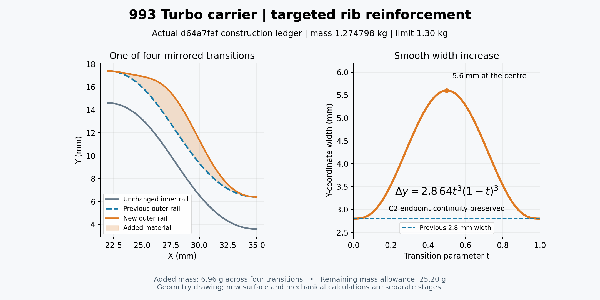

# Targeted rib reinforcement drawing

This English drawing shows the retained **d64a7faf** construction: an outward C2 bump on four mirrored rib transitions, with the inner rail unchanged. The previous Y-coordinate width is 2.8 mm and the central value is 5.6 mm. This coordinate difference is not a measured normal wall thickness.

The native trial retained a valid single solid, strict original-baseline and stock retention, positive addition, mass and bounds checks at **1.274797998 kg**. Added mass is **6.96 g**, leaving **25.20 g** below the 1.30 kg cap. [Trial proof](trial-root-review.json) and [body/volume proof](body-root-review.json) identify that exact candidate. These local geometry results do not establish strength, stress convergence or physical qualification.

The [PNG](carrier-rib-C2-geometry.png) and [SVG](carrier-rib-C2-geometry.svg) are exact copies of the accepted render 003. Its 401 drawing samples illustrate the source polynomial; they are not a surface-distance or thickness proof. The [four-branch ledger](rib-width-branch-ledger.jsonl), [render receipt](render-receipt.json), [visual review](visual-review.json) and [independent review](independent-review.json) retain provenance and scope. The image footer is the original rendering checkpoint; fresh downstream calculations remain separate evidence and are not transferred from the earlier stock mechanics.

The copied `render.py` is preserved byte-for-byte, including its original work-directory paths. It has not been rebased or replayed here. Its prior source, input and absolute NumPy/Matplotlib/Pillow runtime dependencies are listed in [external-references.json](external-references.json); they are external to this folder. `from-002.json` records the three layout-only changes from the preceding work version. This delivery does not claim a portable replay and contains no CAD or FEA data archive. [archive.json](archive.json) hashes every other file in this folder.
