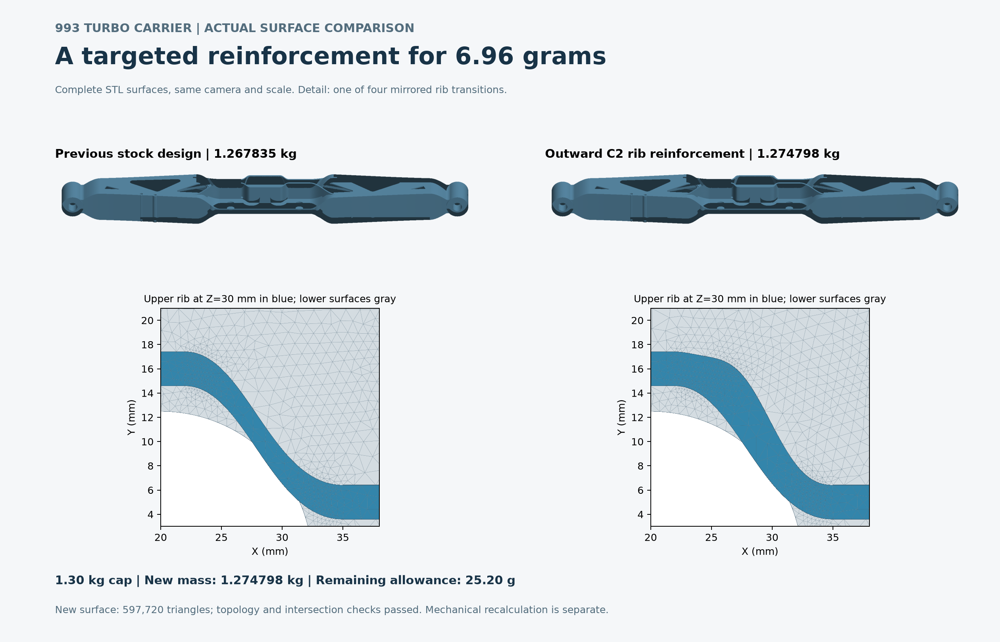

# Actual stock and reinforced-rib surfaces

The left surface is the previous **42da92cc** stock design (1.267835378 kg); the right is the **d64a7faf** outward-C2 rib design (1.274797998 kg). The full views retain all **582,946 and 597,720 triangles** at the same camera and scale. The identical XY close-up shows one of four mirrored transitions. Exactly Z = 30 mm faces are blue and other faces are gray; this is display colouring, not a thickness or stress measurement.

The new trial retained a valid single solid, strict original-baseline and stock retention, positive addition, mass and bounds gates. Its [joint surface review](joint-root-review.json) retains zero topology defects and self-intersections, with sampled distances **0.015438140 mm STL-to-CAD / 0.047388128 mm CAD-to-STL**, below the original 0.06 mm screen. These sampled checks do not establish a continuous distance bound, strength or physical qualification. [Trial](trial-root-review.json) and [body/volume](body-root-review.json) proofs identify the candidate and its native mass. New mesh and mechanical calculations remain separate.

The [PNG](carrier-rib-actual-surfaces.png) and [SVG](carrier-rib-actual-surfaces.svg) are exact copies of accepted display 002. [ROOT image review](root-image-review.json) and the [independent review](independent-review.json) record actual PNG inspection. The first display was preserved; its two layout/colour changes are recorded in `from-001.json`. No geometry or field data were modified to make this image.

`render.py` retains its original work paths byte for byte and has not been rebased or replayed here. It depends on the earlier stock display helper/raster, both external STL files, local proof records and absolute NumPy/Matplotlib/Pillow runtime paths. [external-references.json](external-references.json) and the complete [render receipt](render-receipt.json) identify those dependencies. No CAD, STL, FEA or runtime payload is duplicated here, and no portable replay is claimed. [archive.json](archive.json) hashes every other file in this folder. No new render or PDF was made during this copy.
