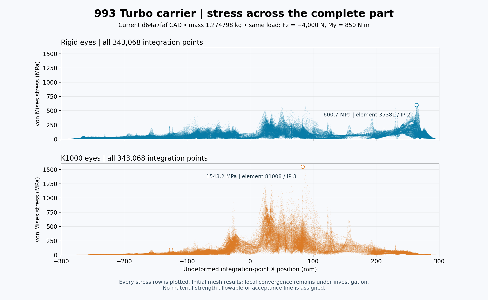

# Stress across the complete reinforced carrier

Both panels show the current **d64a7faf** geometry, mass **1.274798 kg**, under Fz = −4,000 N and My = 850 N·m. Each plots **343,068 integration-point stresses**, with the same 0–1,600 MPa scale. Every row is included; the complete global maximum ties match the independently closed reports. The two cases have different peak locations.

The [receipt](receipt.json) records the original INP reader, complete mesh/field identities, all straight-midside checks, the original affine four-point rule and the maximum-coordinate checks. Coordinate-band summaries in that receipt guide design only; they exclude no peak from the calculation and introduce no acceptance criterion. The [visual review](visual-review.json) records the accepted PNG. The [SVG](carrier-stress-distribution.svg) embeds the full scatter rendering to keep its size practical.

See the [current numerical checkpoint](../../reports/carrier-rib-20261018/README.md) for exact maxima, displacement, energy closure and scope. These initial mesh results do not establish stress convergence or an allowable stress. The original fields and `work/carrier-d64-stress-distribution-001/render.py` remain external to this compact image folder; no self-contained replay is claimed.
