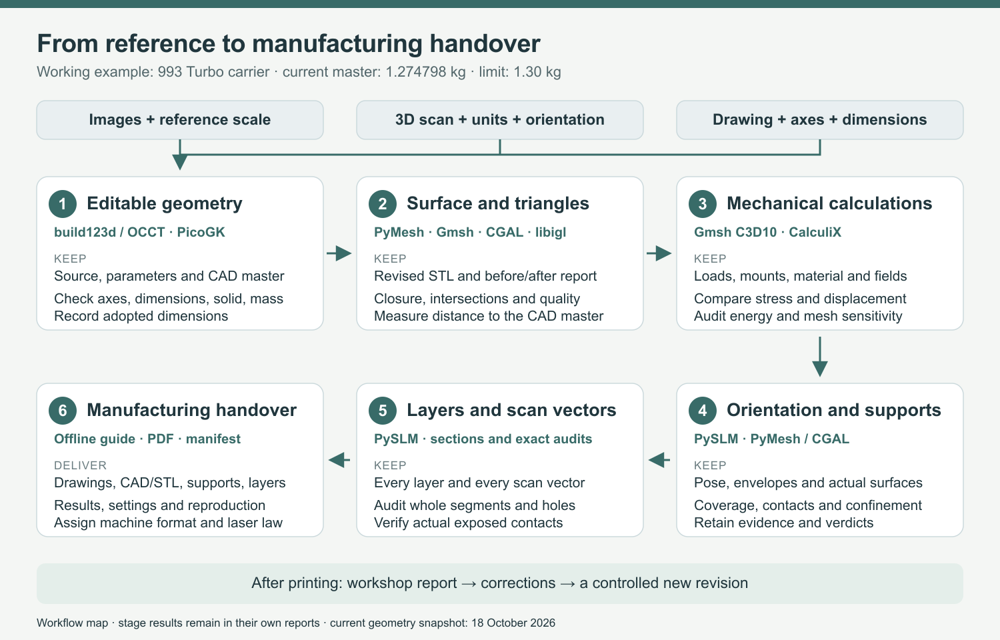

# Reproducible part-to-print workflow — English



[One-page PDF](process.pdf) · [Editable SVG](process.svg) ·
[Source receipt](source-receipt.json) · [Render record](exports.json) ·
[Visual review](visual-review.json)

Three possible inputs lead to six stages. Each stage lists its tools, files
and checks. The current 993 Turbo master weighs **1.274797998 kg**, below the
**1.30 kg** limit. This is a workflow map; it does not mark all stages complete.
The [English guide](../../manufacturing/PART_WORKFLOW_EN.md) links the current
geometry, calculations, open work and executable recipes.

This revision reuses the retained artwork layout and replaces all 51 text
nodes with English. The source receipt binds the original SVG, exact text
replacements and current native mass record. `rsvg-convert` 2.63.2 rendered
both outputs. The PNG and the only PDF page were actually viewed.

To export the supplied editable SVG with the installed renderer:

```sh
rsvg-convert -f png -o process.png process.svg
rsvg-convert -f pdf -o process.pdf process.svg
```

The source-generation script remains at
`work/carrier-workflow-English-20261018-001/derive.py`; the source receipt
retains its identity. No CAD, mechanical or LPBF calculation was rerun for
this illustration.
