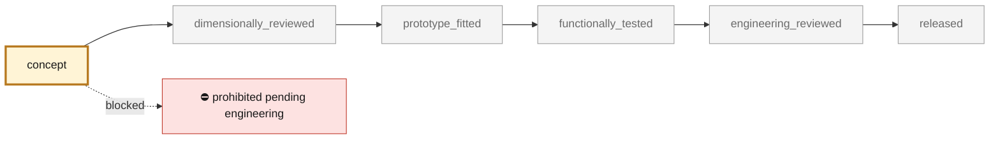
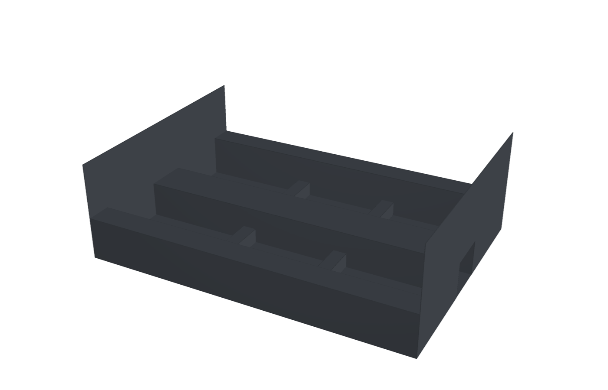
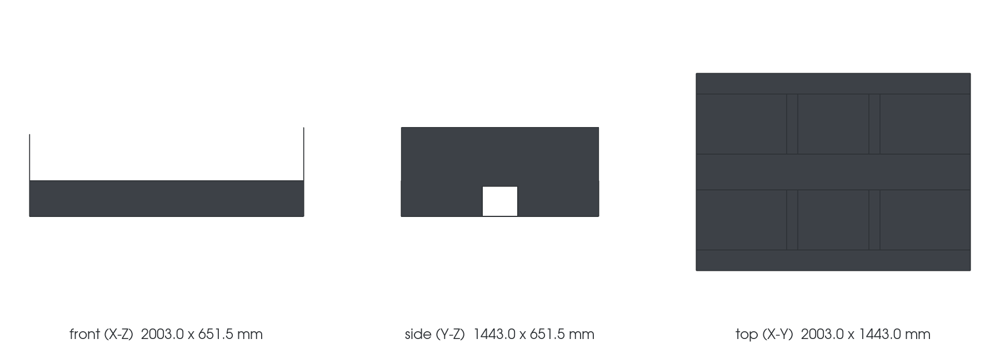

<!-- generated by scripts/render_part_pages.py - do not edit by hand -->

# 964 central carbon cell, F1 assumption-only study

**Status: **prohibited pending engineering**. No part is released; see [SAFETY.md](../../docs/SAFETY.md).**

Editable clean-sheet central-tub concept with floor regions, sills, a driveline service tunnel, bulkheads and seat-crossmember load paths. Geometry, interfaces, material properties and loads are declared design hypotheses; this is not a reconstruction of the donor or a copy of a commercial monocoque.

*Validation ladder of `catalog/schemas/part.schema.json`; this record is at `concept`.*

Catalogue record: [`catalog/parts/964-central-cell-assumed-f1.json`](../../catalog/parts/964-central-cell-assumed-f1.json)

## Identity

| field | value |
|---|---|
| identifier | 964-CENTRAL-CELL-ASSUMED-F1 |
| generation | 964 |
| variants | Carrera_2_study_scope_only |
| model years | 1989 to 1994 |
| Porsche part numbers | not recorded |
| category | central_load_bearing_cell_study |
| safety class | prohibited_pending_engineering |
| intended use | Hypothesis-only architecture, editable geometry and conditional torsion/bending studies; no vehicle fitment, manufacture or road/track release |

## Material and manufacturing

| field | value |
|---|---|
| preferred process | undecided |
| candidate processes | composite_layup |
| material family | assumed carbon-fibre/epoxy composite for elastic screening |
| grade | undecided; no supplier-certified laminate or core allowables |
| standard | undecided; no process or road/track qualification |
| supplier requirements | Measured functional interfaces and an independently accepted load path before functional part design or tooling commitment., Traceable laminate, core, adhesive and insert properties, process definition, coupons, inspection and professional validation plan. |
| post-processing | not recorded |

## Geometry

| field | value |
|---|---|
| source type | estimated |
| master format | PicoGK |
| units | mm |
| accuracy (mm) | not recorded |

**Master file**

- [`twins/964-chassis/assumed-cell-20261106/picogk/Program.cs`](../../twins/964-chassis/assumed-cell-20261106/picogk/Program.cs)

**Derived files**

- [`parts/964-central-cell-assumed-f1/derived/assumed-cell.step`](../../parts/964-central-cell-assumed-f1/derived/assumed-cell.step)

## Images

*`parts/964-central-cell-assumed-f1/media/preview.png` — concept CAD block, **not** the original part, not a print file.*

*`parts/964-central-cell-assumed-f1/media/views.png` — concept CAD block, **not** the original part, not a print file.*

## Provenance and sources

| field | value |
|---|---|
| record license | Repository LICENSE for independently authored study geometry and code; no source scan, proprietary manual, vendor photograph or commercial CAD reused |

**Sources**

- [Owner-authorized assumption-only central-cell study](https://github.com/cluster2600/porscheparts/tree/main/twins/964-chassis/assumed-cell-20261106)

## Validation

| field | value |
|---|---|
| status | concept |
| vehicle tested | not recorded |
| reviewed by |  |
| limitations | All new dimensions, attachment positions and service envelopes are design assumptions, not Porsche or donor measurements. The source frame is a local study frame; no donor registration, dimensional accuracy or physical side correspondence is admitted. The Carrera 2 scope does not establish donor model year or gearbox, and supplies no 993 or Carrera 4 compatibility evidence. The current open-top tub omits windshield, door and roof load paths; it is not a complete enclosed central cell. Fixture/load-introduction regions are hypothetical; calculated stiffness applies only to the declared model and boundary conditions. Conditional elastic results do not establish laminate strength, joint capacity, fatigue, buckling, crash, occupant-restraint, fire or aging performance. No measured material/process allowables, mould qualification, physical correlation or manufacturing/road/track approval is supplied. Historical rejected whole-body geometry and its renders remain withdrawn as the product baseline; their results do not transfer to this study. This concept is not a released functional part or a validated final digital twin. |

**Evidence**

- [`twins/964-chassis/assumed-cell-20261106/assumptions.json`](../../twins/964-chassis/assumed-cell-20261106/assumptions.json)
- [`twins/964-chassis/assumed-cell-20261106/build.py`](../../twins/964-chassis/assumed-cell-20261106/build.py)
- [`twins/964-chassis/assumed-cell-20261106/picogk/Program.cs`](../../twins/964-chassis/assumed-cell-20261106/picogk/Program.cs)

---

*Page generated from the catalogue record by `scripts/render_part_pages.py`, checked by `make check`. Corrections go in the record, not here.*
