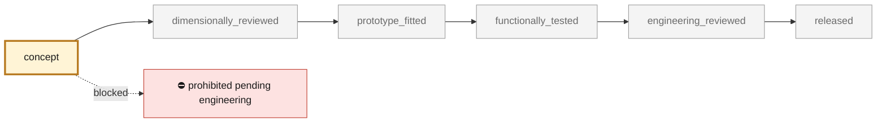
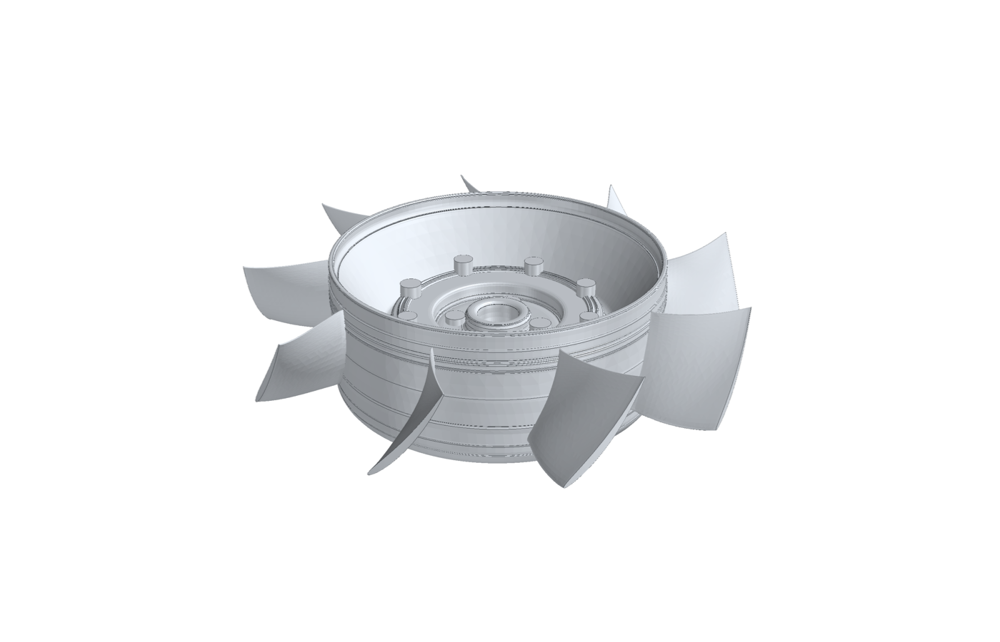
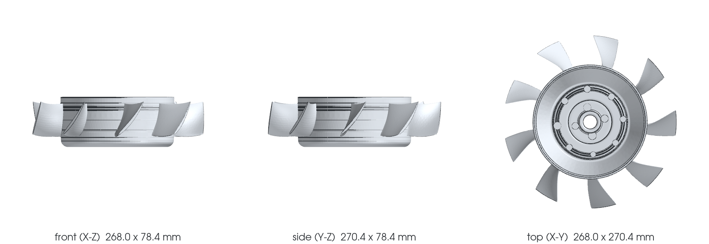

<!-- generated by scripts/render_part_pages.py - do not edit by hand -->

# Flat (horizontal) engine cooling fan rotor for a 993, WE43 concept F0 in the envelope of the scanned 935 flat fan

**Status: **prohibited pending engineering**. No part is released; see [SAFETY.md](../../docs/SAFETY.md).**

Concept rotor for a flat-fan conversion of a 993 engine, the layout of the 935 and of Gunther Werks' 993-based cars: the fan lies horizontally above the engine, driven through a right-angle drive, with the alternator moved off the fan shaft. It is an original design, not a copy of any product. It keeps the envelope and interfaces of the one flat-fan rotor this repository has measured, the 935 rotor rebuilt top-down from a private scan (twins/935-horizontal-fan-cad-twin): 270.5 mm tip diameter, drum hub r 89.3 mm, the two drive dogs and the fastener pattern, the same axial band. Inside it, nine new blades are drawn from velocity triangles with the F1 method, and the hub section the scanner could not see is designed as a 2.5 mm shell. A one-dimensional blade-element model, applied to both rotors on the 993 duty inferred by the F1 study (2.34 m3/s at 2,155 Pa) with a stator, estimates that the new rotor needs about 8 % less shaft power than the fitted 935 rotor and turns at 5,770 instead of 9,100 rpm. These are model estimates, not measurements.

*Validation ladder of `catalog/schemas/part.schema.json`; this record is at `concept`.*

Catalogue record: [`catalog/parts/993-eng-flat-fan-rotor-we43-f0-0001.json`](../../catalog/parts/993-eng-flat-fan-rotor-we43-f0-0001.json)

## Identity

| field | value |
|---|---|
| identifier | 993-ENG-FLAT-FAN-ROTOR-WE43-F0-0001 |
| generation | 993 |
| variants | 993_Carrera, 993_Carrera_4, flat_fan_conversion_study |
| model years | 1994 to 1998 |
| Porsche part numbers | not recorded |
| category | engine_cooling_fan_impeller |
| safety class | prohibited_pending_engineering |
| intended use | F0 design study of a flat-fan rotor for a 993: aerodynamic comparison with the fitted 935 rotor in the same envelope, CAD for packaging and further study; no manufacture, rotation, installation or start-up authorized |

## Material and manufacturing

| field | value |
|---|---|
| preferred process | LPBF |
| candidate processes | LPBF, CNC, casting |
| material family | candidate LPBF magnesium-yttrium-rare-earth alloy |
| grade | WE43 LPBF, solutionized and aged, for comparison; 7075 machining (the reproduction 935 practice) and AlSi10Mg LPBF as alternatives |
| standard | ASTM B80/B107 WE43 composition reference only; rotating-part LPBF, HCF, balance and overspeed specification to be contracted |
| supplier requirements | inert, magnesium-rated LPBF machine with powder handling and fire procedure, traceable parameters, orientation, supports, powder and batch, oriented coupons with tensile and HCF tests, CT of the hollow hub and metallography, metrology of drive dogs, bore, runout, blades and mass, proof of balance, overspeed, vibration, flow and containment |
| post-processing | solutionizing and ageing, distortion monitored, machined drive-dog faces, holes and bore, conversion or PEO coating and galvanic isolation from steel fasteners and the aluminium drive, two-plane dynamic balancing in the final condition |

## Geometry

| field | value |
|---|---|
| source type | mixed |
| master format | build123d |
| units | mm |
| accuracy (mm) | not recorded |

**Master file**

- [`parts/993-eng-flat-fan-rotor-we43-f0-0001/source/build_flat_fan_993.py`](../../parts/993-eng-flat-fan-rotor-we43-f0-0001/source/build_flat_fan_993.py)

**Derived files**

- none

## Images

*`parts/993-eng-flat-fan-rotor-we43-f0-0001/media/preview.png` — concept CAD block, **not** the original part, not a print file.*

*`parts/993-eng-flat-fan-rotor-we43-f0-0001/media/views.png` — concept CAD block, **not** the original part, not a print file.*

## Provenance and sources

| field | value |
|---|---|
| record license | All rights reserved (see LICENSE) for the concept, the scripts and the calculations; no scan, photograph or commercial geometry redistributed |

**Sources**

- [935 horizontal fan, top-down CAD twin (this repository)](https://github.com/cluster2600/porscheparts/tree/main/twins/935-horizontal-fan-cad-twin)
- [Ferdinand magazine - EB Motorsport flat fan kit](https://ferdinandmagazine.com/porsche-flat-fan-kit)
- [Jim Torres Racing - reproduction 935 flat fan](https://jimtorresracing.com/for-sale/reproduction-flat-fan)
- [Gunther Werks 993-based cars (press)](https://www.carscoops.com/2022/08/gunther-werks-project-tornado-is-a-carbon-bodied-porsche-993-turbo-restomod-with-up-to-700-hp/)

## Validation

| field | value |
|---|---|
| status | concept |
| vehicle tested | not recorded |
| reviewed by |  |
| limitations | No 993 flat-fan installation exists in this repository: the right-angle drive, its ratio, the plenum to both cylinder banks, the relocated alternator and the engine mounting are not designed. The drive dogs copy the 935 rotor's, so the rotor assumes a 935-type drive output. The duty is the one the F1 study inferred from the 993 Turbo rotor rebuild (2.34 m3/s at 2,155 Pa); a flat-fan plenum may have a different resistance, and no 993 fan map is measured. Both rotors are judged by a one-dimensional blade-element model, not CFD or a rig. The 935 rotor enters through its fitted chord, stagger and camber-line angles; its blunt rounded ends are not modelled beyond a 1.5x loss-factor sensitivity (about 5 % more power). The comparison assumes a 2 mm tip gap and a bellmouth for both rotors, and a generic zero-exit-swirl stator; the stator is not designed yet. Running at 5,770 rpm instead of about 9,100 rpm lowers centrifugal stress to about 40 %, but no structural, modal or fatigue screen has been run on this geometry, and the blade-root fillet is not modelled. The hub geometry is fitted from a private scan on an owner-declared scale; its shell interior is a design choice, and the 935 rotor's real wall thickness is not observed. The 935 rotor's rotation sense and flow direction are deduced from its blade shape (hypothesis H-FLOW-DIRECTION), not observed. |

**Evidence**

- [`docs/993/993_FLAT_FAN_ROTOR_F0.md`](../../docs/993/993_FLAT_FAN_ROTOR_F0.md)
- [`parts/993-eng-flat-fan-rotor-we43-f0-0001/evidence/flat-fan-993-f0.json`](../../parts/993-eng-flat-fan-rotor-we43-f0-0001/evidence/flat-fan-993-f0.json)
- [`parts/993-eng-flat-fan-rotor-we43-f0-0001/evidence/cad-summary.json`](../../parts/993-eng-flat-fan-rotor-we43-f0-0001/evidence/cad-summary.json)
- [`parts/993-eng-flat-fan-rotor-we43-f0-0001/source/flat_fan_993_f0.py`](../../parts/993-eng-flat-fan-rotor-we43-f0-0001/source/flat_fan_993_f0.py)
- [`twins/935-horizontal-fan-cad-twin/params/blade.json`](../../twins/935-horizontal-fan-cad-twin/params/blade.json)
- [`twins/935-horizontal-fan-cad-twin/params/scorecard-nominal.json`](../../twins/935-horizontal-fan-cad-twin/params/scorecard-nominal.json)
- [`twins/935-horizontal-fan-cad-twin/hypotheses.json`](../../twins/935-horizontal-fan-cad-twin/hypotheses.json)
- [`catalog/sources/src-ferdinand-eb-motorsport-flat-fan-kit.json`](../../catalog/sources/src-ferdinand-eb-motorsport-flat-fan-kit.json)
- [`catalog/sources/src-jim-torres-racing-935-reproduction-flat-fan.json`](../../catalog/sources/src-jim-torres-racing-935-reproduction-flat-fan.json)

## Design dossiers

- [993_FLAT_FAN_ROTOR_F0](../../docs/993/993_FLAT_FAN_ROTOR_F0.md)

---

*Page generated from the catalogue record by `scripts/render_part_pages.py`, checked by `make check`. Corrections go in the record, not here.*
