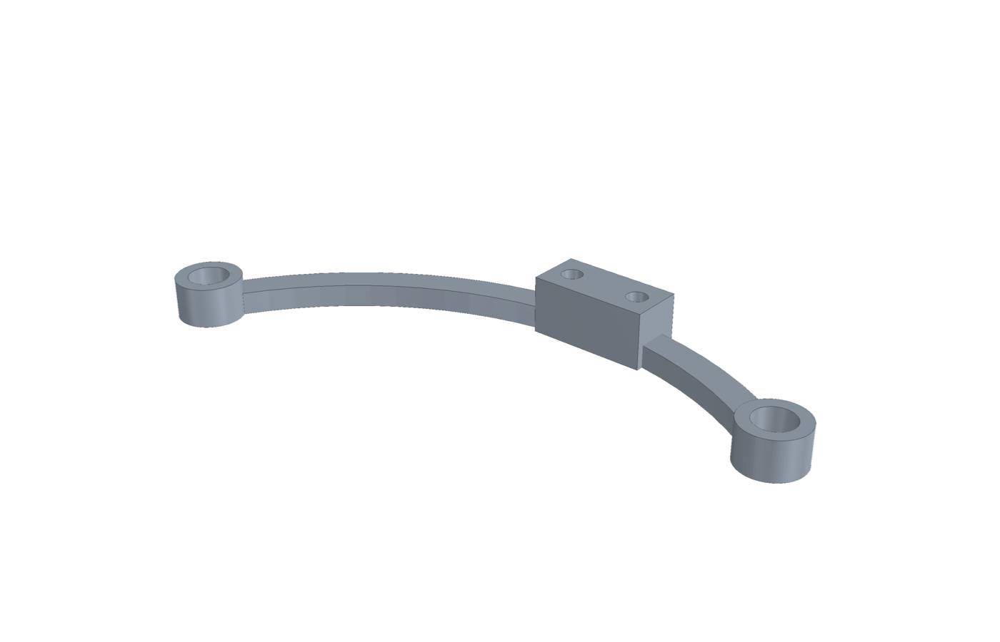
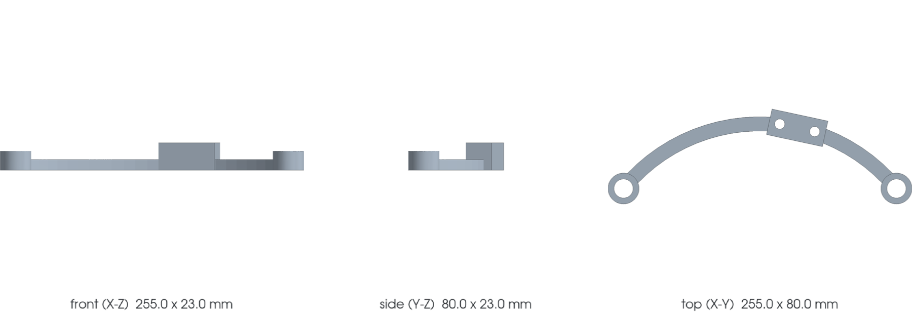

<!-- generated by scripts/render_part_pages.py - do not edit by hand -->

# 993 Turbo/GT2 intercooler bracket, titanium F1 concept (photo-informed topology)

**Status: functional. No part is released; see [SAFETY.md](../../docs/SAFETY.md).**

Single curved arm with a socket eye at each end and an off-centre raised two-hole pad, the topology of the genuine 993 110 110 50 as seen in a seller photograph and consistent with the PET 107-45 fastener and rubber-mount stack. Sizes are fitted to the FVD 255 x 80 x 23 mm envelope or assumed; no interface is measured. Supersedes the F0 two-rail plate, whose topology had no evidence behind it.

*Validation ladder of `catalog/schemas/part.schema.json`; this record is at `concept`.*

Catalogue record: [`catalog/parts/993-eng-intercooler-bracket-ti-f1-0001.json`](../../catalog/parts/993-eng-intercooler-bracket-ti-f1-0001.json)

## Identity

| field | value |
|---|---|
| identifier | 993-ENG-INTERCOOLER-BRACKET-TI-F1-0001 |
| generation | 993 |
| variants | 993_Turbo, 993_GT2 |
| model years | 1995 to 1998 |
| Porsche part numbers | 99311011050, 99311011052 |
| category | charge_air_support |
| safety class | functional |
| intended use | CAD and DfAM study of the bracket topology; interfaces blocked until measured; no vehicle fitting authorized |

## Material and manufacturing

| field | value |
|---|---|
| preferred process | CNC |
| candidate processes | LPBF, CNC, sheet_metal |
| material family | candidate LPBF titanium |
| grade | Ti-6Al-4V Grade 5 for screening; the photographed OEM part looks cast aluminium, so titanium is a material change, not a like-for-like copy |
| standard | ASTM F2924 or equivalent supplier specification to be contracted |
| supplier requirements | traceable powder, machine, parameters, orientation, lot and powder recycling, witness coupons in critical orientations with representative tensile and fatigue, dimensional inspection of datums, center distances, bores and envelope, CT of nodes and bosses, then dye penetrant inspection after machining, contracted roughness, porosity, alpha case and residual stresses, instrumented static, vibration and thermal tests before any fitting |
| post-processing | support removal, heat treatment qualified for the machine, parameters and orientation, HIP to be decided after fatigue analysis, machining of eye bores and pad holes once measured, deburring and radiusing of the eye and pad junctions, passivation and galvanic isolation after dimensional inspection |

**Titanium**

| field | value |
|---|---|
| alloy | Ti-6Al-4V Grade 5 candidate only |
| heat treatment | Indicative EOS cycle to be confirmed for the selected machine and parameters; no recipe is frozen |
| HIP | to_be_determined |
| machined surfaces | two eye bores (rubber-mount seats, unmeasured), pad face and two pad holes (unmeasured) |
| inspection | CT of bosses and rail junctions, dimensional inspection of machined interfaces, dye penetrant inspection after machining, roughness and porosity, tensile and fatigue coupons representative of the orientation |
| galvanic isolation | Electrically separate the titanium from the aluminum intercooler and the steel fasteners with bushings, washers, coating and sealing qualified after the actual materials are identified. |
| fatigue assumptions | not recorded |

## Geometry

| field | value |
|---|---|
| source type | mixed |
| master format | build123d |
| units | mm |
| accuracy (mm) | not recorded |

**Master file**

- [`parts/993-eng-intercooler-bracket-ti-f1-0001/source/intercooler_bracket_f1.py`](../../parts/993-eng-intercooler-bracket-ti-f1-0001/source/intercooler_bracket_f1.py)

**Derived files**

- [`parts/993-eng-intercooler-bracket-ti-f1-0001/derived/intercooler_bracket_ti_f1.step`](../../parts/993-eng-intercooler-bracket-ti-f1-0001/derived/intercooler_bracket_ti_f1.step)
- [`parts/993-eng-intercooler-bracket-ti-f1-0001/derived/intercooler_bracket_ti_f1.stl`](../../parts/993-eng-intercooler-bracket-ti-f1-0001/derived/intercooler_bracket_ti_f1.stl)

## Images

*`parts/993-eng-intercooler-bracket-ti-f1-0001/media/preview.png` — concept CAD block, **not** the original part, not a print file.*

*`parts/993-eng-intercooler-bracket-ti-f1-0001/media/views.png` — concept CAD block, **not** the original part, not a print file.*

## Provenance and sources

| field | value |
|---|---|
| record license | All rights reserved (see LICENSE) for the concept, the script and the calculations; no photograph, PET illustration or commercial geometry redistributed |

**Sources**

- [PorscheFanatics - PET transcription of the 993 Turbo groups](https://porschefanatics.com/oem/993/202-16/)
- [PorscheFanatics dataset - PET 107-45 charge air cooler lines (data/oem-listed.json)](https://porschefanatics.com/oem/993/107-45/)
- [Auto Atlanta - Support intercooler 993 Turbo, listing photograph](https://www.autoatlanta.com/products/support-intercooler-993-turbo)
- [FVD - reinforced intercooler bracket FVD11011050](https://www.fvd.net/de/shop/traeger-ladeluftkuehler-993-turbo-gt2-verstaerkt-fvd11011050~p265005)
- [EOS Titanium Ti64 Grade 5 material data sheet](https://www.eos.info/metal-solutions/metal-materials/data-sheets/mds-eos-titanium-ti64-grade-5)
- [TIMETAL 6-4 physical properties](https://www.timet.com/documents/datasheets/alpha-and-beta-alloys/timetal-6-4.pdf)

## Validation

| field | value |
|---|---|
| status | concept |
| vehicle tested | not recorded |
| reviewed by |  |
| limitations | Topology (curved arm, two end eyes, off-centre two-hole pad) is read from an unscaled seller photograph; no dimension is taken from it. Eye chord and arm sagitta are fitted to the FVD 255 x 80 x 23 mm envelope of an aftermarket reinforced bracket, not to the OEM part. Eye bores, heights, arm section, pad position, hole diameter and pitch are assumptions. Interfaces IF-1 to IF-3 are blocked_unmeasured: mating parts, datums, hole spacing and the assignment of the PET 107-45 fastener stack are not established. No load case is evidenced, so F1 carries no stress or deflection result. The OEM part looks cast aluminium; a Ti-6Al-4V copy of this shape screens at about 233 g against 141 g in aluminium, so titanium is not a mass win here. The STEP proves only a valid BREP inside the envelope; it must be neither manufactured for fitting nor installed. |

**Evidence**

- [`catalog/sources/src-porschefanatics-993-oem-listed-pet.json`](../../catalog/sources/src-porschefanatics-993-oem-listed-pet.json)
- [`catalog/sources/src-porsche-austria-993-107-45-pet.json`](../../catalog/sources/src-porsche-austria-993-107-45-pet.json)
- [`catalog/sources/src-autoatlanta-993-intercooler-bracket-oem-photo.json`](../../catalog/sources/src-autoatlanta-993-intercooler-bracket-oem-photo.json)
- [`catalog/sources/src-fvd-993-intercooler-bracket-dimensions.json`](../../catalog/sources/src-fvd-993-intercooler-bracket-dimensions.json)
- [`catalog/sources/src-eos-ti64-grade5.json`](../../catalog/sources/src-eos-ti64-grade5.json)
- [`catalog/sources/src-timet-ti64-physical-properties.json`](../../catalog/sources/src-timet-ti64-physical-properties.json)
- [`parts/993-eng-intercooler-bracket-ti-f1-0001/evidence/engineering-screen.json`](../../parts/993-eng-intercooler-bracket-ti-f1-0001/evidence/engineering-screen.json)

---

*Page generated from the catalogue record by `scripts/render_part_pages.py`, checked by `make check`. Corrections go in the record, not here.*
