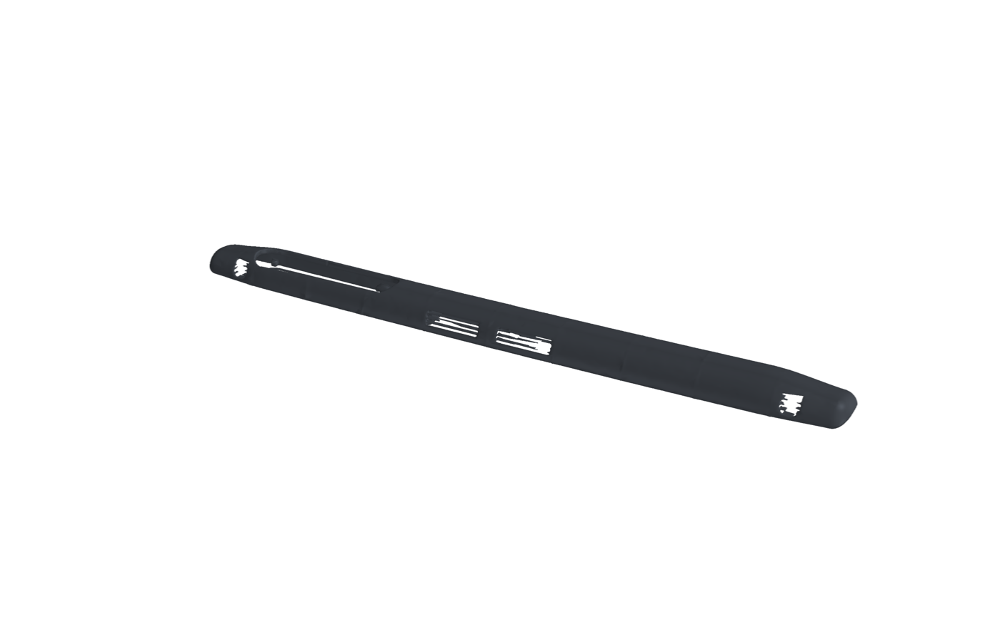
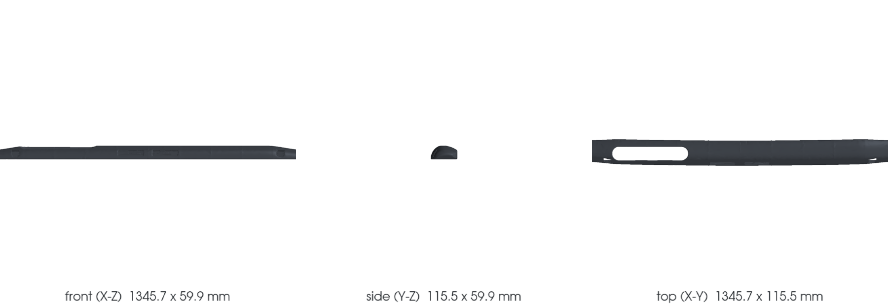
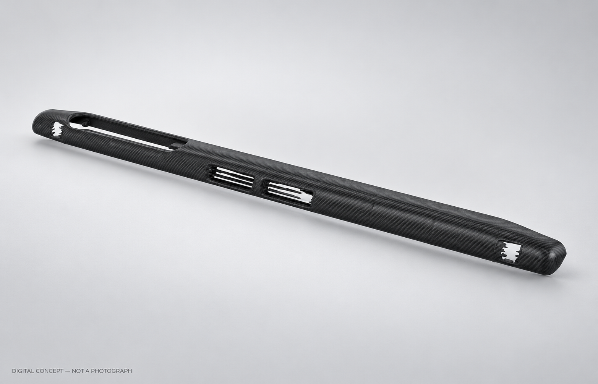

<!-- generated by scripts/render_part_pages.py - do not edit by hand -->

# Dashboard trim, composite

**Status: functional. No part is released; see [SAFETY.md](../../docs/SAFETY.md).**

Composite study of the 993 dashboard trim, intended only for a vehicle independently verified to have no passenger airbag. The trim is distinct from body-shell panel 993 502 027 02 and from the original knee protection. A carbon/Kevlar racing dashboard is marketed, but equivalence to the exact M564 trim, attachments and occupant protection has not been established.

*Validation ladder of `catalog/schemas/part.schema.json`; this record is at `concept`.*

Catalogue record: [`catalog/parts/993-int-dashboard-trim-0001.json`](../../catalog/parts/993-int-dashboard-trim-0001.json)

## Identity

| field | value |
|---|---|
| identifier | 993-INT-DASHBOARD-TRIM-0001 |
| generation | 993 |
| variants | M564, left-hand drive, non-RS (proposed target; trim identity unresolved) |
| model years | 1994 to 1998 |
| Porsche part numbers | not recorded |
| category | interior_trim |
| safety class | functional |
| intended use | Concept study of visible dashboard trim for an independently verified M564 left-hand-drive non-RS vehicle. The original knee protection remains in place; its exact identity, anchors and relationship to the trim are unverified. |

## Material and manufacturing

| field | value |
|---|---|
| preferred process | undecided |
| candidate processes | casting |
| material family | organic matrix composite |
| grade | fiber and resin to be determined; the visible finish requires a fabric and a surface finish, which no hidden panel does |
| standard | none |
| supplier requirements | not recorded |
| post-processing | trimming of the air vent and instrument openings, fitting of inserts and attachment points, visible surface finish, clear coat and UV resistance, clearance check with instrument hood, center console and pillars |

## Geometry

| field | value |
|---|---|
| source type | estimated |
| master format | build123d |
| units | mm |
| accuracy (mm) | not recorded |

**Master file**

- [`scripts/build_993_concept_f0.py`](../../scripts/build_993_concept_f0.py)

**Derived files**

- [`parts/993-int-dashboard-trim-0001/derived/dashboard_trim_concept_f0.step`](../../parts/993-int-dashboard-trim-0001/derived/dashboard_trim_concept_f0.step)

## Images

*`parts/993-int-dashboard-trim-0001/media/preview.png` — concept CAD block, **not** the original part, not a print file.*

*`parts/993-int-dashboard-trim-0001/media/views.png` — concept CAD block, **not** the original part, not a print file.*

*`parts/993-int-dashboard-trim-0001/media/photo-concept.png` — AI-generated studio illustration based on the concept CAD preview. Material and finish are illustrative; generated details may differ. Not a photograph or evidence of fit, function or manufacturing.*

## Provenance and sources

| field | value |
|---|---|
| record license | All rights reserved (see LICENSE); existing geometry is an estimated concept only |

**Sources**

- [Porsche PET - 911 1994-1998 Type 993, parts catalogue revision Kat 017](https://rsworkshop.ch/downloaded/pet-porsche/993_1994-98_KATALOG.pdf)
- [Federleichte Elfer - mass table, 993 interior](http://www.federleichte-elfer.de/dp93/innen.html)
- [Porsche PET KAT 017, English, 911 1994-1998](https://files.porsche.com/f/332100/cfbfd366e3/kat017-e-911-98-katalog.pdf)
- [PorscheFanatics dashboard-trim case study](https://porschefanatics.com/projects/parts/993-int-dashboard-trim-0001/)
- [FVD Brombacher carbon/Kevlar race dashboard FVD55522005](https://www.fvd.net/en-us/shop/race-dashboard-964-993-carbon-fiber-kevlar-left-hand-drive-without-a-c-vent-fvd55522005~p238149)

## Validation

| field | value |
|---|---|
| status | concept |
| vehicle tested | not recorded |
| reviewed by |  |
| limitations | Scope requires an independently confirmed no-passenger-airbag vehicle and exact variant. PET KAT 017 defines M564 as no airbag, M561 as driver airbag only and M562 as driver and passenger airbags. Position 1 on the passenger-airbag 809-00 plate and the RS no-passenger-airbag 809-02 plate both list 993 552 055/056 00, so that number alone does not classify the restraint configuration. No non-RS M564 or M561 position-1 mapping has been established; the full-dashboard target keeps its trim number null. M562 and any passenger-airbag assembly are excluded. Whether a deployment flap is integral to position-1 trim is not established by the PET. Check the redacted option label and passenger-side reverse in the same vehicle before any measurement or design decision. Ruling out a passenger airbag does not settle occupant impact risk. A rigid composite substitute could change the impact response and fragment behavior of the original occupant-facing assembly. The selected class remains functional, not non_critical. Applicability of ECE R21 and FMVSS 201 to a modified classic vehicle, including projections and energy absorption, has not been studied; an independent professional review is required before fitting. The knee protection is separate and stays original. PET 809-01 lists complete 964 552 053 00 /LL and 993 552 054 00 /RL strips in the passenger-airbag assembly; they are not proven M564 identities. PET 809-02 lists separate left/right strips for RS M002 (911 552 069/070 00 /LL) and RS M003 (964 552 077/078 70 /LL), with distinct right-hand-drive suffixes. The exact non-RS M564 strip identities and all anchor geometry remain unknown. Moving an original anchor would affect occupant protection. This is not a substantiated mass-saving project. The 1.15 kg gain is a third-party estimate, not a measurement of this target. A carbon/Kevlar racing dashboard is marketed, but exact M564 trim equivalence, attachments and occupant protection remain unverified. No measured geometry. The complete dashboard has freeform surfaces and multiple interfaces: air vents, instrument contour, steering column, glovebox, console junction, pillars and windshield base. A physical reference needs fitted and removed scans or scaled photogrammetry plus independent interface measurements. The existing F0 CAD is an estimated visual concept. SRC-CGTRADER-993-DASHBOARD-SCALE-MODEL is a 1/8-scale model and SRC-FSH-993-DASHBOARD-TRIM-DIMENSIONS describes an aftermarket trim; neither supplies OEM attachment geometry. The aging of the original distorts the mold, and so does its removal. A thirty-year-old dashboard is cracked and warped by heat; it is also constrained by its fasteners, so it can relax when it comes out of the vehicle. The shape must be captured fitted AND removed, and the difference between the two states recorded. Temperature and UV resistance not evaluated: this is the interior surface most exposed to the sun. Reflection. A clear-coated carbon surface under the windshield sends light back into the driver's field of view, which a grained leatherette does not. To be treated as a requirement, not as a finish. |

**Evidence**

- none

---

*Page generated from the catalogue record by `scripts/render_part_pages.py`, checked by `make check`. Corrections go in the record, not here.*
