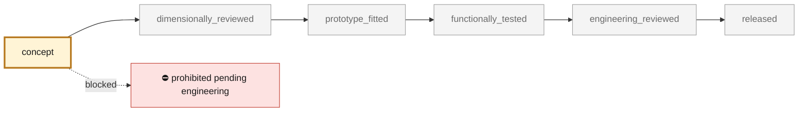
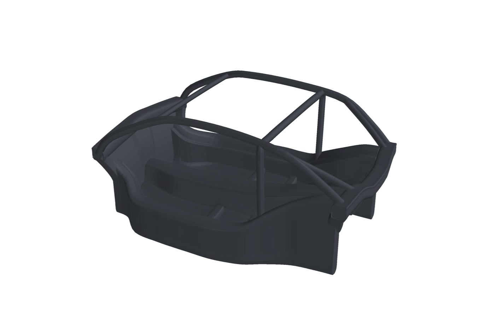
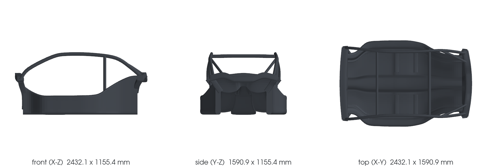

<!-- generated by scripts/render_part_pages.py - do not edit by hand -->

# 964 sculpted central carbon cell, F2 assumption-only study

**Status: **prohibited pending engineering**. No part is released; see [SAFETY.md](../../docs/SAFETY.md).**

Independently authored curved central-cell concept with paired floor bays, a changing service tunnel, stepped closed sills, scuttle and rear returns, pillar feet, seat-support regions and upper load-path members. Shape, material, module reservations and load introductions remain declared hypotheses; this is not a measured donor reconstruction or a commercial monocoque copy.

*Validation ladder of `catalog/schemas/part.schema.json`; this record is at `concept`.*

Catalogue record: [`catalog/parts/964-central-cell-sculpted-f2.json`](../../catalog/parts/964-central-cell-sculpted-f2.json)

## Identity

| field | value |
|---|---|
| identifier | 964-CENTRAL-CELL-SCULPTED-F2 |
| generation | 964 |
| variants | Carrera_2_study_scope_only |
| model years | 1989 to 1994 |
| Porsche part numbers | not recorded |
| category | central_load_bearing_cell_study |
| safety class | prohibited_pending_engineering |
| intended use | Assumption-only central-cell architecture, native geometry and conditional structural studies; no vehicle fitment, manufacture or road/track release |

## Material and manufacturing

| field | value |
|---|---|
| preferred process | undecided |
| candidate processes | composite_layup |
| material family | assumed carbon-fibre/epoxy composite, including upper structural members |
| grade | undecided; no supplier-certified laminate or core allowables |
| standard | undecided; no process or road/track qualification |
| supplier requirements | Measured functional interfaces and an independently accepted load path before functional part design or tooling commitment., Traceable laminate, core, adhesive and insert properties, process definition, coupons, inspection and professional validation plan. |
| post-processing | not recorded |

## Geometry

| field | value |
|---|---|
| source type | estimated |
| master format | PicoGK |
| units | mm |
| accuracy (mm) | not recorded |

**Master file**

- [`twins/964-chassis/sculpted-cell-f2-20261106/picogk/Program.cs`](../../twins/964-chassis/sculpted-cell-f2-20261106/picogk/Program.cs)

**Derived files**

- none

## Images

*`parts/964-central-cell-sculpted-f2/media/preview.png` — concept CAD block, **not** the original part, not a print file.*

*`parts/964-central-cell-sculpted-f2/media/views.png` — concept CAD block, **not** the original part, not a print file.*

## Provenance and sources

| field | value |
|---|---|
| record license | Repository LICENSE for independently authored study geometry and code; no source scan, proprietary manual, vendor photograph or commercial CAD reused |

**Sources**

- [Owner-authorized sculpted central-cell study](https://github.com/cluster2600/porscheparts/tree/main/twins/964-chassis/sculpted-cell-f2-20261106)
- [Original Porsche 911 German 1990 brochure, nominal technical table reproduced on Scribd](https://de.scribd.com/document/610802441/Porsche-911-1990-DE)

## Validation

| field | value |
|---|---|
| status | concept |
| vehicle tested | not recorded |
| reviewed by |  |
| limitations | Structural shapes, wall thicknesses, material properties, module reservations, fixture regions, the common ground datum and axle-X placement are authored assumptions. Brochure width/height, wheelbase, track and tyre-size nominals are documentary constraints, not measured donor interfaces. The design frame is independent; no donor transform, dimensional accuracy or 993/Carrera 4 compatibility is admitted. Model-year bounds identify study scope only. The current raw native mesh failed its quality screen: 36 collapsed, exactly zero-area faces are retained without filtering or repair. Published native views are unqualified diagnostics; source CAD/profile and transport checks do not admit native mesh quality. Native wall artifacts are retained privately. Public source and image receipts bind their hashes; the catalogue images are geometry renders, not photographs or a manufactured specimen. Any accompanying STEP consists of editable midsurfaces only and does not establish a physical wall solid. Native voxel geometry has separate resolution and topology limits. Wheel cylinders use nominal brochure tracks and tyre markings; front/rear module boxes remain assumed static reservations. Actual modules, loaded tyre geometry, steering, suspension motion, transmission linkage, attachments and tolerance stacks remain unqualified. Visible load-path members and numerical stiffness do not establish laminate strength, bond/insert capacity, buckling, fatigue, crash, occupant restraint, fire or aging performance. Laminate/core/adhesive allowables, manufacturing route, tooling, drape/cure, inspection, physical correlation and professional road/track/TUV approval remain open. The earlier F1 assumption study and withdrawn whole-body geometry remain separate; their calculations or renders do not qualify this design. No measured mass or superiority over a commercial monocoque is established. This concept is not a released functional part or a validated final digital twin. |

**Evidence**

- [`twins/964-chassis/sculpted-cell-f2-20261106/parameters.json`](../../twins/964-chassis/sculpted-cell-f2-20261106/parameters.json)
- [`twins/964-chassis/sculpted-cell-f2-20261106/geometry.py`](../../twins/964-chassis/sculpted-cell-f2-20261106/geometry.py)
- [`twins/964-chassis/sculpted-cell-f2-20261106/canonical-model.json`](../../twins/964-chassis/sculpted-cell-f2-20261106/canonical-model.json)
- [`twins/964-chassis/sculpted-cell-f2-20261106/visual-acceptance.json`](../../twins/964-chassis/sculpted-cell-f2-20261106/visual-acceptance.json)
- [`twins/964-chassis/sculpted-cell-f2-20261106/reference-ledger.json`](../../twins/964-chassis/sculpted-cell-f2-20261106/reference-ledger.json)
- [`twins/964-chassis/sculpted-cell-f2-20261106/picogk/Program.cs`](../../twins/964-chassis/sculpted-cell-f2-20261106/picogk/Program.cs)

---

*Page generated from the catalogue record by `scripts/render_part_pages.py`, checked by `make check`. Corrections go in the record, not here.*
