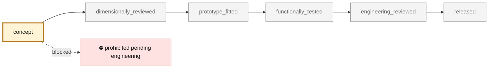

<!-- generated by scripts/render_part_pages.py - do not edit by hand -->

# Support moteur Turbo bionique — cage et enveloppe souple PicoGK

**Status: **prohibited pending engineering**. No part is released; see [SAFETY.md](../../SAFETY.md).**

Deux occurrences dans le groupe Turbo PET, position 21. Cage ouverte à branches courbes et racines bifurquées ; enveloppe souple séparée, étranglée et sculptée à six lobes. Aucun socle rectangulaire ni paroi de coupelle pleine. Cette morphologie ne reconstitue pas le mécanisme OEM et ne prédit ni raideur ni amortissement ; aucune optimisation sous charges réalisée.

*Validation ladder of `catalog/schemas/part.schema.json`; this record is at `concept`.*

Catalogue record: [`catalog/parts/993-eng-mounting-0001.json`](../../catalog/parts/993-eng-mounting-0001.json)

## Identity

| field | value |
|---|---|
| identifier | 993-ENG-MOUNTING-0001 |
| generation | 993 |
| variants | 993_Turbo |
| model years | 1995 to 1998 |
| Porsche part numbers | 993 375 049 05 |
| category | powertrain_mounting |
| safety class | prohibited_pending_engineering |
| intended use | Étude de formes et assemblage documentaire uniquement ; aucun portage moteur ni montage véhicule autorisé. |

## Material and manufacturing

| field | value |
|---|---|
| preferred process | undecided |
| candidate processes | FFF |
| material family |  |
| grade |  |
| standard |  |
| supplier requirements | Revue professionnelle du chemin de charge, des interfaces et du plan de validation avant toute fabrication fonctionnelle. |
| post-processing | not recorded |

## Geometry

| field | value |
|---|---|
| source type | estimated |
| master format | PicoGK |
| units | mm |
| accuracy (mm) | not recorded |

**Master file**

- [`parts/picogk-catalog/engine/EngineMounts.cs`](../../parts/picogk-catalog/engine/EngineMounts.cs)

**Derived files**

- [`twins/993-engine-mount-system-f0/derived/993-ENG-MOUNTING-0001.stl`](../../twins/993-engine-mount-system-f0/derived/993-ENG-MOUNTING-0001.stl)
- [`twins/993-engine-mount-system-f0/derived/993-ENG-MOUNTING-ISOLATOR-F0.stl`](../../twins/993-engine-mount-system-f0/derived/993-ENG-MOUNTING-ISOLATOR-F0.stl)

## Provenance and sources

| field | value |
|---|---|
| record license | All rights reserved (see LICENSE) |

**Sources**

- [Porsche PET 993, groupe 109-00 Turbo](https://assets-v2.porsche.com/us/-/media/Project/PCOM/SharedSite/PorscheClassic/Original-Parts-Catalogue/PDF-EN-US/KAT517_USA_911_98_KATALOG)
- [LEAP 71 PicoGK](https://github.com/leap71/PicoGK)

## Validation

| field | value |
|---|---|
| status | concept |
| vehicle tested | not recorded |
| reviewed by |  |
| limitations | not recorded |

**Evidence**

- [`twins/993-engine-mount-system-f0/interface-contract.json`](../../twins/993-engine-mount-system-f0/interface-contract.json)
- [`twins/993-engine-mount-system-f0/derived/study-report.json`](../../twins/993-engine-mount-system-f0/derived/study-report.json)
- [`twins/993-engine-mount-system-f0/source/mount-housing.json`](../../twins/993-engine-mount-system-f0/source/mount-housing.json)

---

*Page generated from the catalogue record by `scripts/render_part_pages.py`, checked by `make check`. Corrections go in the record, not here.*
