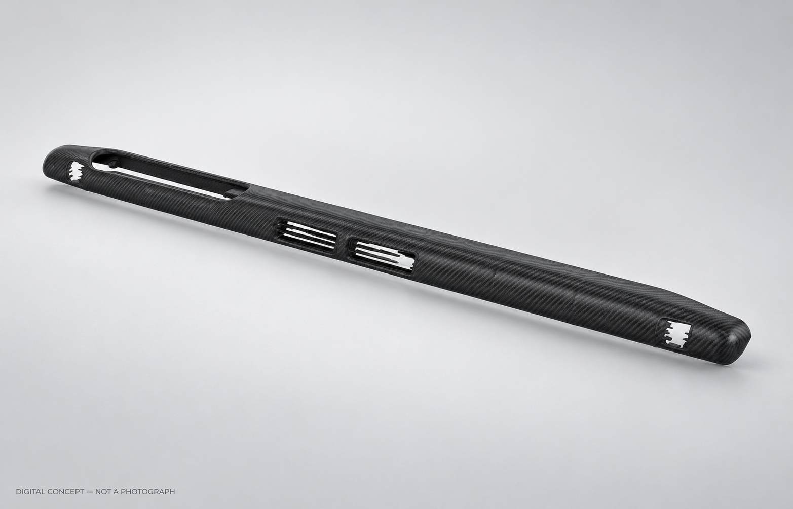
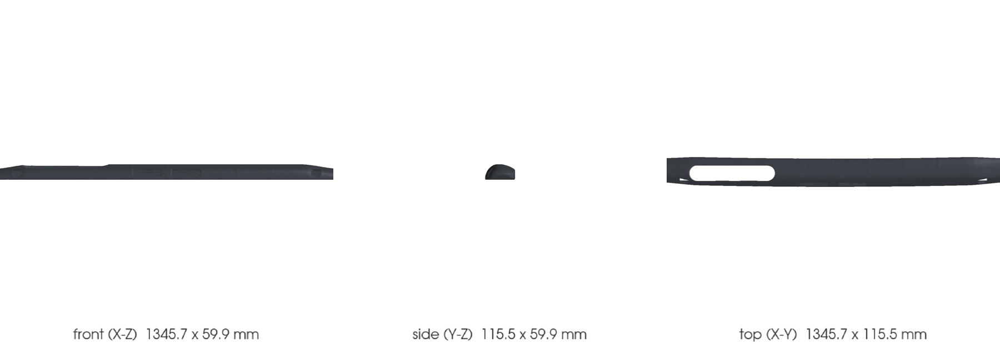

<!-- generated by scripts/render_part_pages.py - do not edit by hand -->

# Dashboard trim, composite

**Status: functional. No part is released; see [SAFETY.md](../../docs/SAFETY.md).**

993 dashboard trim reproduced in composite, **for vehicles without a passenger airbag only**. The part is not the dashboard itself: that one, 993 502 027 02, is a body shell panel. This is the trim that covers it, fitted on clip nuts and self-tapping screws. Selected because no manufacturer offers it in carbon, unlike body panels.

*Validation ladder of `catalog/schemas/part.schema.json`; this record is at `concept`.*

Catalogue record: [`catalog/parts/993-int-dashboard-trim-0001.json`](../../catalog/parts/993-int-dashboard-trim-0001.json)

## Identity

| field | value |
|---|---|
| identifier | 993-INT-DASHBOARD-TRIM-0001 |
| generation | 993 |
| variants | M564 without airbag, Carrera RS M002, Carrera RS Clubsport M003 |
| model years | 1994 to 1998 |
| Porsche part numbers | 993 552 055 00, 993 552 056 00, 993 552 055 70, 993 552 056 70 |
| category | interior_trim |
| safety class | functional |
| intended use | Visible trim of the dashboard cross member on a vehicle without a passenger airbag, carrying the air vents and the instrument hood, and receiving the knee protection strip, which stays original |

## Material and manufacturing

| field | value |
|---|---|
| preferred process | undecided |
| candidate processes | casting |
| material family | organic matrix composite |
| grade | fiber and resin to be determined; the visible finish requires a fabric and a surface finish, which no hidden panel does |
| standard | none |
| supplier requirements | not recorded |
| post-processing | trimming of the air vent and instrument openings, fitting of inserts and attachment points, visible surface finish, clear coat and UV resistance, clearance check with instrument hood, center console and pillars |

## Geometry

| field | value |
|---|---|
| source type | estimated |
| master format | build123d |
| units | mm |
| accuracy (mm) | not recorded |

**Master file**

- [`scripts/build_993_concept_f0.py`](../../scripts/build_993_concept_f0.py)

**Derived files**

- [`parts/993-int-dashboard-trim-0001/derived/dashboard_trim_concept_f0.step`](../../parts/993-int-dashboard-trim-0001/derived/dashboard_trim_concept_f0.step)

## Images

*`parts/993-int-dashboard-trim-0001/media/photo-concept.png` — AI-generated studio illustration based on the concept CAD preview. Material and finish are illustrative; generated details may differ. Not a photograph or evidence of fit, function or manufacturing.*

*`parts/993-int-dashboard-trim-0001/media/preview.png` — concept CAD block, **not** the original part, not a print file.*

*`parts/993-int-dashboard-trim-0001/media/views.png` — concept CAD block, **not** the original part, not a print file.*

## Provenance and sources

| field | value |
|---|---|
| record license | All rights reserved (see LICENSE) for the record, geometry not yet produced |

**Sources**

- [Porsche PET - 911 1994-1998 Type 993, parts catalogue revision Kat 017](https://rsworkshop.ch/downloaded/pet-porsche/993_1994-98_KATALOG.pdf)
- [Federleichte Elfer - mass table, 993 interior](http://www.federleichte-elfer.de/dp93/innen.html)

## Validation

| field | value |
|---|---|
| status | concept |
| vehicle tested | not recorded |
| reviewed by |  |
| limitations | SCOPE, AND THIS IS AN EXCLUSION, NOT A PRECAUTION. This part applies only to an M564 vehicle, or a Carrera RS whose catalogue illustration reads "for cars without Airbag, Passenger's side". On an M561 or M562 vehicle the trim carries the passenger airbag deployment flap, whose tear line is an occupant restraint part: fitting this part there would be a replacement of a safety component, and that is prohibited here. The option code is read from the vehicle label, before any measurement. Ruling out the airbag does not make the part harmless. An original dashboard is a soft surface in the occupant impact zone; a carbon laminate is rigid there and breaks into sharp shards where a foam crushes. That is why the selected class is functional and not non_critical. The interior fittings regulations, ECE R21 in Europe and FMVSS 201 in the United States, deal precisely with projections and energy absorption in this zone: their applicability to a modified classic vehicle has not been studied and must be before any fitting. The knee protection strip is a SEPARATE PART — 964 552 053 00 /LL and 993 552 054 00 /RL in series production, 964 552 077 70 and 964 552 078 70 on RS M003 — and it stays original. The composite trim must keep its attachment points identical. A reproduction that removed or moved these points would remove a protection. This is not a mass project. The stated gain is 1.15 kg, versus 9.9 kg for a front lid. The reason to make this part is that it does not exist in tuners' catalogues. No geometry. A dashboard is a freeform surface with multiple interfaces: air vents, instrument hood, steering column, glovebox, console junction, pillars and windshield base. It cannot be measured with calipers; it needs a scan or scaled photogrammetry. The two CAD leads already qualified by the repository are ruled out: SRC-CGTRADER-993-DASHBOARD-SCALE-MODEL is a 1/8 scale model, SRC-FSH-993-DASHBOARD-TRIM-DIMENSIONS describes an aftermarket trim. The aging of the original distorts the mold, and so does its removal. A thirty-year-old dashboard is cracked and warped by heat; it is also constrained by its fasteners, so it can relax when it comes out of the vehicle. The shape must be captured fitted AND removed, and the difference between the two states recorded. Temperature and UV resistance not evaluated: this is the interior surface most exposed to the sun. Reflection. A clear-coated carbon surface under the windshield sends light back into the driver's field of view, which a grained leatherette does not. To be treated as a requirement, not as a finish. |

**Evidence**

- none

---

*Page generated from the catalogue record by `scripts/render_part_pages.py`, checked by `make check`. Corrections go in the record, not here.*
