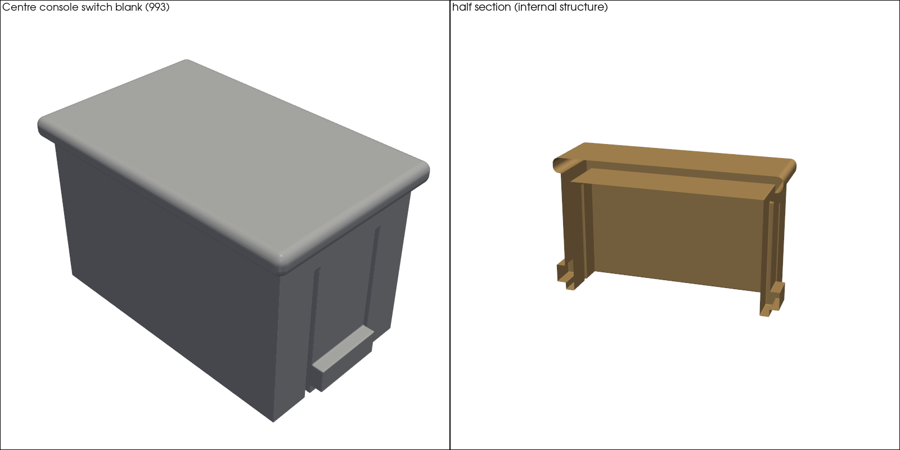
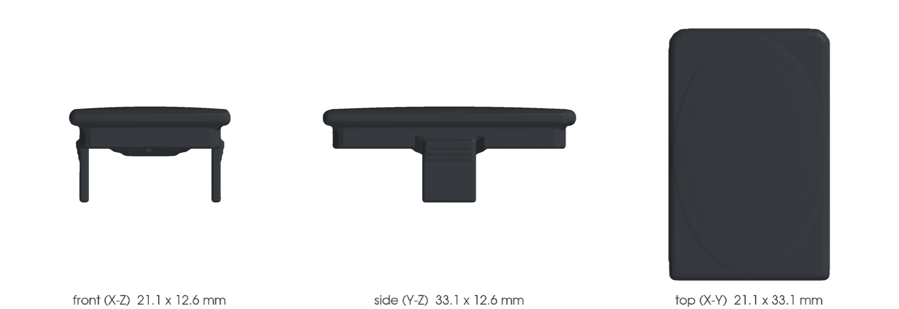
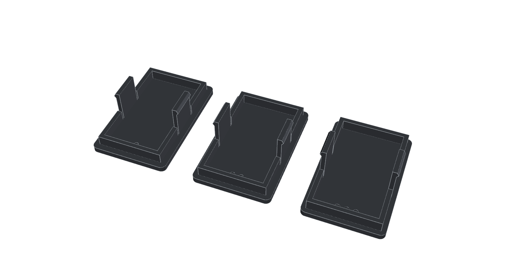

<!-- generated by scripts/render_part_pages.py - do not edit by hand -->

# Switch blank, dashboard

**Status: non-critical. No part is released; see [SAFETY.md](../../SAFETY.md).**

Blanking plug for an unequipped switch location in the dashboard. Trim part with flat faces and clips, measurable with calipers, retained as the pilot for the simple geometric category of phase 2.

```mermaid
flowchart LR
    L0["concept"]
    L1["dimensionally_reviewed"]
    L2["prototype_fitted"]
    L3["functionally_tested"]
    L4["engineering_reviewed"]
    L5["released"]
    L0 --> L1 --> L2 --> L3 --> L4 --> L5
    classDef here fill:#fff4d6,stroke:#b7791f,color:#1a1a1a,stroke-width:3px;
    classDef done fill:#e3f1e6,stroke:#2e7d32,color:#1a1a1a;
    classDef todo fill:#f4f4f4,stroke:#9e9e9e,color:#6b6b6b;
    classDef stop fill:#fde2e1,stroke:#c0392b,color:#1a1a1a;
    class L0 here
    class L1 todo
    class L2 todo
    class L3 todo
    class L4 todo
    class L5 todo
```

*Validation ladder of `catalog/schemas/part.schema.json`; this record is at `concept`.*

Catalogue record: [`catalog/parts/993-int-switch-blank-0001.json`](../../catalog/parts/993-int-switch-blank-0001.json)

## Identity

| field | value |
|---|---|
| identifier | 993-INT-SWITCH-BLANK-0001 |
| generation | 993 |
| variants | to_confirm_on_vehicle |
| model years | 1994 to 1998 |
| Porsche part numbers | not recorded |
| category | interior_trim |
| safety class | non_critical |
| intended use | Close an empty dashboard location, with no electrical or structural function |

## Material and manufacturing

| field | value |
|---|---|
| preferred process | FFF |
| candidate processes | FFF, SLA, MJF |
| material family | polymer |
| grade | to_be_determined_after_fit_test |
| standard | none |
| supplier requirements | not recorded |
| post-processing | deburring, dry clip-fit test |

## Geometry

| field | value |
|---|---|
| source type | estimated |
| master format | build123d |
| units | mm |
| accuracy (mm) | not recorded |

**Master file**

- [`parts/993-int-switch-blank-0001/source/switch_blank.py`](../../parts/993-int-switch-blank-0001/source/switch_blank.py)

**Derived files**

- [`parts/993-int-switch-blank-0001/derived/switch_blank_concept_f0.step`](../../parts/993-int-switch-blank-0001/derived/switch_blank_concept_f0.step)

## Images

*`parts/993-int-switch-blank-0001/media/picogk-batch-01.png` — concept CAD block, **not** the original part, not a print file.*

*`parts/993-int-switch-blank-0001/media/preview.png` — concept CAD block, **not** the original part, not a print file.*

*`parts/993-int-switch-blank-0001/media/views.png` — concept CAD block, **not** the original part, not a print file.*

*`parts/993-int-switch-blank-0001/print/plate.png` — a screening output, not a validation.*

## Provenance and sources

| field | value |
|---|---|
| record license | All rights reserved (see LICENSE) for the record, geometry not yet produced |

**Sources**

- [Porsche Classic Genuine Parts Catalogue - 911 (993)](https://www.porsche.com/australia/accessoriesandservice/classic/originalpartscatalogue/)
- [9xxteile - Porsche parts diagrams (PET exploded views)](https://www.9xxteile.com/en/pet/)
- [Rennlist - declared size of a 993 dashboard panel opening (window switch measured)](https://rennlist.com/forums/993-forum/1202129-dashboard-lighting-question.html)
- [Rennlist - declared console switch opening and switch blank sizes, 993](https://rennlist.com/forums/993-forum/750484-console-switch-hole-size.html)
- [partworks - OEM 993 Schalterblende listing, reference 993.613.523.00](https://partworks.de/Abdeckblende-Schalter-fuer-PORSCHE-993-9936135230001C)

## Validation

| field | value |
|---|---|
| status | concept |
| vehicle tested | not recorded |
| reviewed by |  |
| limitations | No measurement made: all dimensions are absent, not estimated. Porsche part number unsourced: no repository source gives it with a PET plate and position. Candidate 993 613 523 00 (SRC-PARTWORKS-993-SWITCH-BLANK-OEM, retailer listing, level B, switch panel and center console context) stays out of porsche_part_numbers until a PET plate confirms it for this location. Declared opening contradiction, unresolved (two level-C forum posts, no instrument): the concept F0 and the fit-test kit use 19 x 31 mm, which SRC-RENNLIST-993-DASHBOARD-LIGHTING-DIMENSIONS gives for the passage under the covering; the same source gives about 17 x 28 mm for the faceplate opening of a switch housing, and SRC-RENNLIST-993-CONSOLE-SWITCH-HOLE-DIMENSIONS gives 17.0 x 27.9 mm for the console opening and 16.2 x 27.4 mm for the blank. All three kit inserts (18.6 x 30.6 to 19.4 x 31.4 mm) are larger than a 17.0 x 27.9 mm opening. Transcribed in the two MEAS-DECLARED-993-INT-SWITCH-BLANK-0001 records; see decision 0013. Location not established: this record says dashboard, the console source concerns the center console, and the lighting source a window switch measured to estimate a lamp opening above the ignition lock. Variant and model year to be confirmed on the measured vehicle. Resistance to interior temperature and UV not evaluated. Evidence owner (decision 0013): documentary evidence, the maintainer (desk review of existing sources); physical capture, unassigned, awaits an external contributor. |

**Evidence**

- none

---

*Page generated from the catalogue record by `scripts/render_part_pages.py`, checked by `make check`. Corrections go in the record, not here.*
