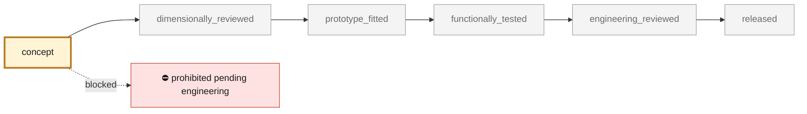
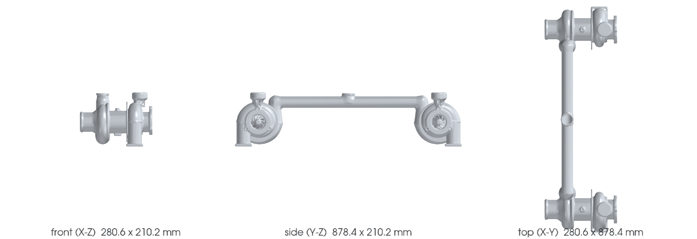
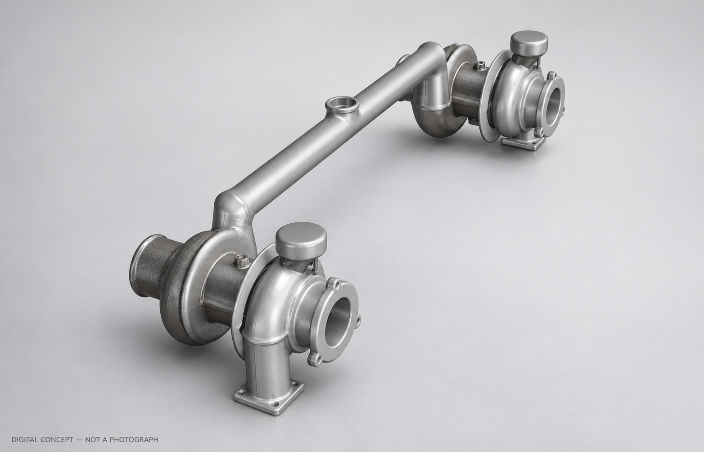

<!-- generated by scripts/render_part_pages.py - do not edit by hand -->

# Pair of K16 turbochargers of the 993 Turbo

**Status: **prohibited pending engineering**. No part is released; see [SAFETY.md](../../docs/SAFETY.md).**

Research target of the digital twin: two K16 turbochargers mounted in parallel on the 993 Turbo. This record establishes the functional identity and the available public data; it constitutes neither a replacement geometry nor a manufacturing authorization.

*Validation ladder of `catalog/schemas/part.schema.json`; this record is at `concept`.*

Catalogue record: [`catalog/parts/993-turbocharger-k16-pair-0001.json`](../../catalog/parts/993-turbocharger-k16-pair-0001.json)

## Identity

| field | value |
|---|---|
| identifier | 993-TURBOCHARGER-K16-PAIR-0001 |
| generation | 993 |
| variants | 993_Turbo |
| model years | 1995 to 1998 |
| Porsche part numbers | 993 123 013 51, 993 123 013 52, 993 123 014 51, 993 123 014 52 |
| category | turbocharger |
| safety class | prohibited_pending_engineering |
| intended use | Research, identification, simulation and dimensional reconstruction under engineering control; no engine or road use at this stage |

## Material and manufacturing

| field | value |
|---|---|
| preferred process | undecided |
| candidate processes | LPBF, CNC, casting |
| material family | unknown per subassembly; to be identified on parts and manufacturer documentation |
| grade | undetermined |
| standard | none |
| supplier requirements | Process qualification and lot traceability, Thermal, fatigue, rotordynamics and pressure dossier, Metrology and non-destructive testing report, High-speed balancing by a qualified operator, Formal engineering review before any engine test |
| post-processing | to be defined after geometry and material, machining of the interfaces and bearing faces, balancing of the rotating assembly if a rotor is studied, dimensional and non-destructive inspection |

## Geometry

| field | value |
|---|---|
| source type | estimated |
| master format | build123d |
| units | mm |
| accuracy (mm) | not recorded |

**Master file**

- [`scripts/build_993_concept_f0.py`](../../scripts/build_993_concept_f0.py)

**Derived files**

- [`parts/993-turbocharger-k16-pair-0001/derived/k16_pair_concept_f0.step`](../../parts/993-turbocharger-k16-pair-0001/derived/k16_pair_concept_f0.step)

## Images

*`parts/993-turbocharger-k16-pair-0001/media/preview.png` — concept CAD block, **not** the original part, not a print file.*

*`parts/993-turbocharger-k16-pair-0001/media/views.png` — concept CAD block, **not** the original part, not a print file.*

*`parts/993-turbocharger-k16-pair-0001/media/photo-concept.png` — AI-generated studio illustration based on the concept CAD preview. Material and finish are illustrative; generated details may differ. Not a photograph or evidence of fit, function or manufacturing.*

## Provenance and sources

| field | value |
|---|---|
| record license | All rights reserved (see LICENSE) for the record, no third-party geometry redistributed |

**Sources**

- [Porsche Christophorus - Technical data of the 911 Turbo (993)](https://newsroom.porsche.com/christophorus/fr/2020/394/turbo-engines.html)
- [BorgWarner - Performance Turbocharger Catalog](https://www.borgwarner.com/docs/default-source/iam/boosting-technologies/bw_turbo-performance-catalog.pdf)
- [FVD Brombacher - envelope and mass of the 993 K16s](https://www.fvd.net/de/shop/turbolader-k16-rechts-993-serie-99312301452-993123014dx~p239094)
- [Invasion Auto Products - internal catalog data of the right-hand K16](https://www.invasionautoproducts.com/94pocark16tu.html)
- [Design911 - Cross-reference of the 993 Turbo K16 turbochargers](https://www.design911.co.uk/b/borgwarner/2/)
- [TurboMaster - Exploded parts view of the BorgWarner K16 5316-988-6735](https://www.turbomaster.com/eng/turbo/borgwarner/5316-988-6735/)
- [Porsche Fanatics - PET transcription of the 993 turbo groups](https://porschefanatics.com/oem/993/202-16/)
- [Porsche Austria - PET 993, group 107-45 air cooler](https://www.porsche.at/media/Kwc_Basic_DownloadTag_Component/4740-45397-124814-downloadTag/default/f5000535/1729608718/kat017-d-911-98-katalog.pdf)
- [TurboMaster - K16 gauche 5316-988-6736 de 993 Turbo](https://www.turbomaster.com/eng/turbo/borgwarner/5316-988-6736/)

## Validation

| field | value |
|---|---|
| status | concept |
| vehicle tested | not recorded |
| reviewed by |  |
| limitations | No K16 unit, K16 data plate, K16 physical measurement, K16 scan or licensed K16 CAD is available in the project; K16 masses and envelopes are now available as supplier declarations, without tolerances or interfaces. The left/right part numbers come from public cross-references and must be confirmed on a part or in an authorized Porsche source. FVD declares 5.76 kg for the left-hand K16 and 5.6 kg for the right-hand K16, with a product envelope of 280 x 190 x 210 mm; these values serve the envelope and mass check, not the reconstruction of the bare turbo. Invasion Auto Products declares wheel diameters for the right-hand K16 (turbine 54.96/48.97 mm; compressor 40.6/60.5 mm), part numbers and an A/R of 8; these values must be confirmed before any wheel geometry or rotordynamic calculation. No compressor/turbine map, efficiency curve, mass flow, maximum speed, tip clearance, axial/radial play, oil pressure or turbine inlet temperature has been collected. The part numbers for wheels, housings, CHRA, actuator and A/R are supplier catalog declarations; they define neither the aero surfaces nor the tolerances. The local Porsche 993 manual is a source of service procedures and specifications; it does not provide a complete CAD definition of the K16 here. The Porsche Fanatics transcription adds a PET bill of materials for groups 202-16, 107-20 and 107-45, but no new dimensional measurement; the listed lines must be read in context before any fitment conclusion. A turbine wheel, a compressor wheel, a shaft, a bearing or a hot housing are loaded, thermal and/or rotating parts: no printing, fitment, engine test or road use is authorized by this record. The twin's first demonstrator must target a non-rotating cold-side duct or adapter, with an envelope prototype before any metal version. |

**Evidence**

- none

---

*Page generated from the catalogue record by `scripts/render_part_pages.py`, checked by `make check`. Corrections go in the record, not here.*
