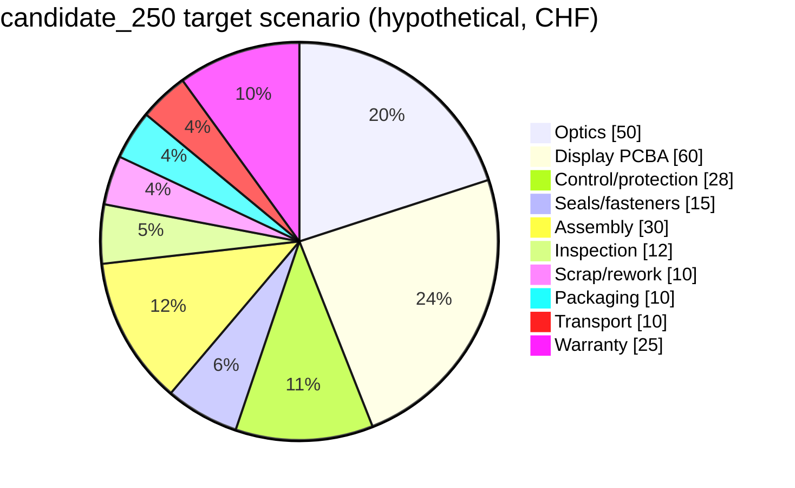

# Editable budget — CHF

Date: September 27, 2026. **No supplier quote received and no cost price
verified.** [budget.csv](budget.csv) holds three distinct series: historical,
hypothetical breakdown of that history, target scenario and one-off expenses. [The calculator](software/cost_model.py) displays them separately,
without adding them up as independent expenses. Amounts exclude recoverable VAT;
customs duties, non-recoverable taxes, exchange rate and Incoterm will be filled
in with the quotes.

## Baseline kept and what it means

| Baseline supplied by the project owner | CHF | Status |
|---|---:|---|
| Prototype | 685–1,450 | Non-contractual historical estimate; scope not itemized |
| 100 series | 223–420 / unit | Same status; proves neither Swissness nor road approval |
| 1,000 series | 138–271 / unit | Same status; economies of scale to be demonstrated |
| Manufacturing target | about 250 / unit | Goal; not a sale price |

The `unit_100` and `unit_1000` lines are a **working breakdown** that sums
exactly to the historical ranges, not a new validation of them. They make the
items to be quoted visible; each item must be replaced by a dated offer stating
quantity, site, finish, inspection and transport. The prototype history does not
implicitly fund all of the software development, the tests or the road approval.

## Target scenario: a negotiation ceiling, not a promise

`candidate_250` = optics 50 + display PCBA 60 + control/protection 28 + seals/
fasteners 15 + assembly 30 + inspection 12 + scrap/rework 10 + packaging 10 +
transport 10 + warranty 25 = **250 CHF**. The cost before packaging, transport and
warranty provision is 205 CHF. This broader definition avoids forgetting the
delivered cost and after-sales service; agree on the exact scope of the
"250 CHF manufacturing" figure.

*Breakdown of the `candidate_250` scenario above. It is a hypothetical ceiling,
not a quote or a measured cost.*

- Assembly: 0.5 h × 60 CHF/h = 30; the project owner's time is not free.
  At 1 h, this scenario rises to 280 CHF. The CAD remains entirely the owner's
  responsibility, valued separately in the one-off expenses.
- Scrap: a provision of 10 CHF per good unit, to be replaced by the actual yield.
  For 195 CHF committed before scrap, at 95% yield: surcharge 195/0.95−195 ≈
  10.26 CHF; at 90%: 21.67 CHF. Do not add these surcharges on top of a
  provision that already covers the same losses.
- Warranty: a provision of 25 CHF, not a failure-rate prediction; recalculate as
  frequency × after-sales cost (part, labor, returns, shipping).

**Costed trade-offs, hypothetical:** the display ceiling is 250−190=60 CHF.
An offer at 95 CHF instead of 60 would give 285 CHF; adding 5 CHF of power
makes 290 CHF. At 140 CHF of display and +15 CHF of power: 345 CHF. RGB will
only be kept at 250 CHF if quotes and savings on other items close 40–95 CHF
without removing protections, inspections or pay. These are sensitivities,
not observed RGB prices.

Going from a 4 to a 2.5 mm pitch multiplies the pixels by 2.56 at constant area;
from 4 to 1 mm, by 16. The full cost does not scale linearly with that number:
PCB, placement, drivers, yield and power supply all count. **It cannot be
demonstrated today that an undefined resolution is incompatible with 250 CHF.**
Ask for a PCBA price per useful panel at three pitches; never extrapolate from
tens of thousands of LEDs bought at retail. Reducing active area, pitch, number
of colors or frame rate are the levers; compare the effect on readability on
the coupon.

The observed public price of the Waveshare module [S02] is a range of
**17.99–21.99 USD** depending on the selection on the page (exact variant, taxes,
shipping and exchange not committed). It is only a purchase reference for the
coupon, not a series BOM in CHF.

## One-off expenses and funding

The `nre` lines are **proposed planning envelopes**, neither the history nor
quotes: scan, engineering, software, CAD time, jigs, packaging, tests and road
approval. The `approval` item is a provision, with no guarantee that the road
route is possible or that the maximum amount is enough. Bluetooth SIG fees and
the fees of any bodies involved are to be confirmed under this item, not assumed to be zero.

Full-width injection tooling, rework after failure, third-party licensing and a
commercial campaign are not costed: quotes are needed. The NRE total is
therefore partial: **21,230–64,980 CHF** under the current assumptions,
including valued internal time; this amount does not replace the historical
685–1,450 CHF for the prototype alone. Illustrative amortization: 212.30–649.80 CHF
at 100 units, or 21.23–64.98 CHF at 1,000 units, on top of the unit cost.
The 180 CHF part and the coupons are included as launch assumptions; the
historical prototype is still shown separately. Before committing, reconcile the
quote scopes so that coupons/boards/services are not counted twice.

Commercial amortization = actual NRE / reasonably forecast number of sellable
units, added to the unit cost. The script shows the effects at 100 and 1,000
parts. This does not turn a one-off expense into a recurring manufacturing cost,
and it is not the origin calculation: that one has its own rules.

## Swissness: a separate register

[swissness.csv](swissness.csv) takes **the same** 250 CHF scenario and separates
imported content from Swiss added value. Unproven examples: a 60 CHF invoice from
a Swiss EMS = 45 of foreign inputs + 15 of Swiss processing, not 60 Swiss.
Unknown costs stay in the denominator and out of the numerator, conservatively;
this convention does not replace the regulatory method.

Without R&D: 115 / 205 = **56.10%**, so the 60% goal is not met in this
example. For illustration only, 20,700 CHF of eligible R&D carried out entirely
in Switzerland, allocated to 1,000 units, would give (115+20.7)/(205+20.7)
= **60.12%**; at 2,000 units, only **58.21%**. The result is sensitive to the
base and to the amortization. No R&D expense is deemed actually Swiss or
eligible without evidence. Do not choose an artificially low volume to reach the
threshold; validate the allocation with the IPI (Swiss Federal Institute of
Intellectual Property) or a competent advisor.

The calculator accepts `--rd-ch`, `--rd-foreign`, `--units` and marks the result
**ILLUSTRATIVE_ONLY** while the evidence is missing. Even a result ≥60% does not
validate the activity that confers the essential characteristics, nor the
physical step required in Switzerland. See [compliance.md](compliance.md).
