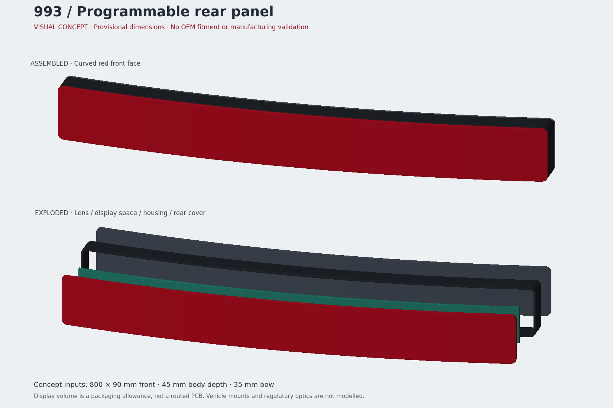

# Bandeau complet — maquette PicoGK

**10 octobre 2026 — maquette visuelle à cotes provisoires, autorisée comme telle.
Géométrie originale de concept, sans relevé de pièce Porsche. Aucun montage,
matériau, assemblage fonctionnel ou procédé de fabrication validé.**



Ouvrir le [modèle 3D GLB](preview/rear-panel-concept.glb) dans un visualiseur glTF
ou Blender. Les quatre objets restent séparés. Les couleurs servent à la revue ;
la façade est opaque dans cet aperçu, sans simulation de sa transmission optique.

## Contenu et paramètres

| Objet | Représentation | Limite |
|---|---|---|
| `lens` | Façade rouge courbe aux coins arrondis | Ni contour OEM, ni texture ou optique réglementaire reproduits |
| `housing` | Cadre creux noir | Aucun point de fixation, insert ou chemin de charge défini |
| `rear-cover` | Couvercle arrière indépendant | Retenue, joint et passage de câble à concevoir après mesures |
| `display-envelope` | Volume vert réservé à l'affichage | Courbe de convenance ; ce n'est ni un PCB ni une matrice disponible |

Le [JSON modifiable](concept.json) pilote le [générateur C#](Program.cs).
Toutes les valeurs ci-dessous sont des **choix visuels**, pas des cotes 993 :

| Paramètre | Valeur provisoire | Sens |
|---|---:|---|
| Largeur × hauteur | 800 × 90 mm | Rectangle extérieur, coins arrondis de rayon 10 mm |
| Profondeur du corps | 45 mm | Écart local selon Y, hors jeu/couvercle arrière et courbure |
| Flèche | 35 mm | Courbe parabolique entre centre et extrémités, sans courbure verticale |
| Façade / paroi / couvercle | 3,6 / 3,6 / 3,6 mm | Épaisseurs de concept ; pas de tolérance de fabrication |
| Jeu d'assemblage | 1,5 mm | Séparation visuelle, pas une définition de joint |
| Réserve d'affichage | 776 × 66 × 4 mm | Marge de 12 mm ; écart de 8 mm derrière la façade |
| Voxel | 1,2 mm | Résolution de calcul, **aucun rapport avec le pas des LED** |

Repère des STL : X = largeur, Y = vers la face visible, Z = hauteur, en mm.
Le GLB convertit ces coordonnées en mètres avec Y vertical. La boîte englobante
de l'ensemble généré mesure environ **800 × 84,83 × 90 mm** selon X/Y/Z :
les 45 mm du paramètre ne désignent donc pas la profondeur hors tout.
La déformation courbe conserve les épaisseurs selon Y, pas selon la normale à
la surface ; une vraie coque à épaisseur constante reste à construire après
métrologie. Aucun nombre de pixels, budget série ou consommation n'est déduit
de ce volume. Le [coupon E0](../electronics/coupon.md) reste une étude distincte.

## Régénérer

Exécuté avec **.NET SDK 9.0.317, PicoGK 2.3.0, macOS arm64**. Le paquet NuGet
apporte sa bibliothèque native macOS ; la version Windows fournie n'a pas été
testée. Le paquet utilisé ne fournit pas le runtime natif Linux : ne pas
transposer ces commandes à Linux sans un runtime PicoGK adapté.

Depuis la racine du dépôt, avec `dotnet` disponible :

```sh
dotnet restore docs/projects/993-programmable-rear-panel/cad/RearPanel.csproj --locked-mode
dotnet build docs/projects/993-programmable-rear-panel/cad/RearPanel.csproj -c Release --no-restore
dotnet docs/projects/993-programmable-rear-panel/cad/bin/Release/net9.0/RearPanel.dll --self-test docs/projects/993-programmable-rear-panel/cad/concept.json
dotnet docs/projects/993-programmable-rear-panel/cad/bin/Release/net9.0/RearPanel.dll docs/projects/993-programmable-rear-panel/cad/concept.json work/rear-panel-native
```

La dernière commande écrit quatre STL en mm et `geometry.json`, rapport de fin
avec empreintes SHA-256. Elle refuse d'écraser un dossier existant. Un dossier
sans rapport de fin indique une exécution incomplète. Les STL restent dans
`work/`, hors Git ; le GLB et l'image de revue sont versionnés ici.

L'[exporteur](export.py) contrôle les STL réellement produits par PicoGK avant
de créer le GLB et l'image. Il nécessite NumPy, trimesh, networkx et matplotlib
(exécution vérifiée avec trimesh 5.1.0 et networkx 3.4.2, Python 3.10.11).
Utiliser un environnement Python dédié ; aucun appel réseau dans cet export :

```sh
python3 docs/projects/993-programmable-rear-panel/cad/export.py work/rear-panel-native work/rear-panel-preview
python3 -m unittest discover -s tests -p 'test_993_rear_panel_picogk.py' -v
```

Après une modification, régénérer puis remplacer **ensemble** les trois fichiers
de `preview/` par ceux du nouvel export. Le test détecte des sources ou exports
qui ne correspondent plus au rapport. Le C# et le JSON constituent la source
paramétrique éditable ; les STL et le GLB sont des maillages dérivés, pas des
surfaces STEP ni un arbre de fonctions de CAO mécanique.

## Vérification et suite

Le [rapport machine](preview/checks.json) enregistre quatre volumes fermés,
orientés de façon cohérente, chacun d'un seul tenant. Le cadre possède bien une
ouverture (caractéristique d'Euler 0), les trois autres volumes ont Euler 2.
830 988 triangles natifs ; l'export enlève 108 faces dégénérées ou dupliquées du
volume d'affichage, sans changer ses bornes. Le GLB rechargé conserve quatre
objets et les dimensions après conversion d'unités. Deux générations natives
successives ont produit les mêmes empreintes STL sur cet environnement.
L'autocontrôle C# vérifie huit configurations invalides et des points intérieurs,
extérieurs et creux. La vue assemblée/éclatée a été relue visuellement.

Ces contrôles ne recherchent pas les auto-intersections et ne prouvent ni
l'étanchéité physique, ni la tenue, ni la fabricabilité. Les interfaces véhicule,
fonctions optiques d'origine et résolution électronique restent inconnues dans
le rapport natif. **Aucune fixation fictive n'est ajoutée.**

Pour convertir ce concept en CAO fonctionnelle : acquérir les mesures et datums
de la référence exacte, remplacer l'enveloppe par le contour relevé, définir les
surfaces d'appui et fixations avec leur chemin de charge, puis choisir l'empilement
optique/PCB sur les résultats du coupon. Voir la [fiche de mesures](../measurements.csv),
le [cahier de scan](../mechanical-optical.md) et la [validation](../validation.md).

## Provenance

Sources consultées le **10 octobre 2026** : [PicoGK, projet officiel LEAP 71](https://github.com/leap71/PicoGK)
et [paquet NuGet PicoGK 2.3.0](https://www.nuget.org/packages/PicoGK/2.3.0).
API C# `Library`, `IImplicit`, `Voxels` et `Mesh` vérifiée dans la documentation
XML du paquet installé. Le verrou NuGet conserve les versions et empreintes.
PicoGK est sous licence Apache-2.0 ; aucun binaire de dépendance n'est recopié
dans le dépôt. Aucun scan, modèle tiers, manuel ou logo Porsche utilisé.
La géométrie et ses sources originales suivent la [licence du dépôt](../../../../LICENSE).
