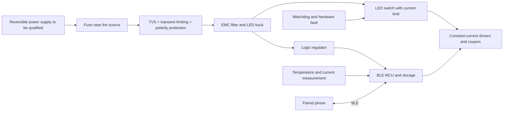

# Electronics — preliminary architecture

**NOT VALIDATED FOR MANUFACTURING.** This document and the BOM are design
hypotheses. No routable schematic, PCB, Gerber or pick-and-place file is
released. The coupon comes before the full-width board is drawn.

**Progress as of October 2:** [detailed E0 coupon](electronics/coupon.md),
[bench BOM](electronics/coupon-bom.csv), [pin/net connections](electronics/coupon-wiring.csv)
and [SPI encoder testable on a computer](software/coupon_driver.py), completed by
the [KiCad schematic and its PDF](electronics/kicad/README.md). ERC and netlist
comparison have been run; professional review, footprints and routing remain open. Proposal:
16 × 8 red, six TLC5947, 3.3 V bench supply; no board manufactured.
The automotive stage below remains a separate study, not sized.

The diagram does not represent approved electrical values or connections. The
existing regulatory functions must remain independent of the messages and of an
MCU failure; if the replacement removes them, redesigning them requires a
separate qualification dossier. Do not use a message driver as a presumed
substitute for a type-approved lamp.

## Power supply and protection

- Survey on the vehicle the cable path, the available source, the current margins,
  the connectors and the stop/start conditions. A removable adapter is the
  hypothesis; if it requires modifying the car, revise the product.
- Nominal 12 V automotive network ≠ clean 12 V supply. Size for undervoltage at
  cranking, sustained overvoltage, battery reversal, negative/positive pulses
  and load dump with the specialist. ISO 7637-2 and ISO 16750-2 protocol to be
  defined with the laboratory: levels, impedances and repetitions are not
  prescribed here. Do not apply destructive pulses on the car.
- Candidate LM7480-Q1 with back-to-back MOSFETs [S08]: this component replaces
  neither a TVS energy analysis, nor the MOSFET SOA, nor a correctly coordinated fuse.
  Choose the buck and the capacitors **after** the clamped maximum is defined,
  with voltage/temperature margins and short-circuit behavior.
- LEDs disabled in hardware at reset (pull-down on enable), independent current
  limit and thermal shutdown; brownout, watchdog and corrupted flash give a
  black screen. The shutdown must not disable the original lamps.
- Measure the quiescent current with the vehicle off, the PWM peak current and the
  inrush at connection; decide between ignition-switched supply and a dedicated cut-off.
  No low-power standby promise before measurements.

## Power: a bench example, not a vehicle prediction

The Waveshare P2.5 64×32 module is advertised at ≤12 W [S02]. For **one coupon** at 12 W,
plus 1 W of hypothetical logic and 85% conversion efficiency:
Pinput=13/0.85=15.3 W; at 12 V I≈1.28 A; converter loss≈2.3 W.
These numbers set neither the fuse nor the power of the panel. Measure each
mode, all pixels on and driver failure. For N modules, the power cannot be
deduced from the average animation alone.

For an abstract example of 625 mono pixels, 2 V and 2 mA **average** per pixel,
PLED≈2.5 W; RGB with three channels at the same current would require a sum
using the real Vf of each color. This is neither a guaranteed flux nor an
automotive profile. In multiplexing, do not multiply an already-average current
by the duty cycle again; the permissible peak current must come from the LED/driver datasheet.

Configurable software brightness cap + hardware current cap, sensor near the
LEDs and the converter, conduction toward the back, simulation then measurement
with the housing closed in the sun. The thermal limit depends on the optical grade,
the seals, the PCB and the junction temperature; air temperature alone is not enough.

## RF, EMC and electronics mechanics

Candidate: BLE module based on nRF52840, integrated antenna and supplier RF
documentation [S09]. Exact module reference and thermal grade to be selected.
A module qualification does not type-approve the final product. Mono: constant-current
SPI driver; for HUB75 RGB, verify throughput/refresh/RAM/DMA on target, then
choose a different MCU if necessary. The simulator demonstrates none of these throughputs.

Plan the ground plane, short switched loops, damped input filter, placement of
TVS/connectors, decoupling and current return. Measure conducted and radiated
emissions, ESD at the connector/housing and RF immunity; study UN R10 and RED together.
Keep the antenna away from LED ground, metal and conductive coating; test RF in the
mounted part. Locking connectors, keying, mechanical strain relief of the cables,
screws locked by a compatible process and PCB support against bending/vibration.

## Prototype in three deliveries

1. Coupon on a current-limited laboratory supply, off-the-shelf module
   and optical samples; voltage/current/temperature/lux log and controlled
   photos. No vehicle connection.
2. Small protection/control PCB + mono coupon: independent schematic/BOM review,
   DRC/ERC, test points, programming, current limits, dummy load then LEDs.
   RFQ for 3–5 boards; all marked "prototype non validé" (prototype not validated).
3. Full-width board/segments after G2: frozen interfaces, connectors between
   segments, heat/current distribution, repair access, PCBA then 100%
   inspection. AOI for small packages, additional inspection if joints are hidden,
   electrical test and firmware identified by version/hash.

Files to order from the specialist: native KiCad (or an agreed editable format),
PDF schematics, BOM with MPN/alternatives, stack-up, rules, Gerbers, drill files,
placement, test plan, ERC/DRC/review reports, license and transfer of the sources.
Manufacturing exports remain blocked until a signed review and a separate authorization.
