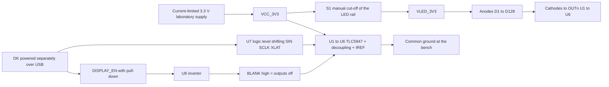

# E0 electronics coupon — design review

October 2, 2026 — **NOT VALIDATED FOR MANUFACTURING. BENCH ONLY.**
This dossier sets a first circuit proposal and an order of bring-up.
No component bought, no PCB routed, no hardware programmed.
The [three-sheet KiCad schematic](kicad/README.md) and its [PDF](coupon-e0.pdf)
transcribe these connections; ERC with no error and no warning. Review by
the electronics engineer and the tests remain necessary before manufacturing. There is
no Gerber, no placement and no PCB DRC check; footprints are unassigned.

## Starting choices

- **128 red LEDs, 16 × 8**, identical to the format of the existing simulator.
  Two placement variants: 2.5 and 4 mm pitch, same circuit. The outermost centers
  are spaced 37.5 × 17.5 and 60 × 28 mm respectively. These are proposed coupon
  dimensions, never measurements of the panel; PCB outline not defined.
- Candidate LED **APHHS1005LSECK/J3-PF**, 1 × 0.5 mm package [S01]. The miniature
  package does not set the pitch. Its footprint and orientation will have to be
  verified on the manufacturer drawing, not deduced from the "0402" designation.
- **Six TLC5947DAP**, 24 outputs each: 128 used, 16 unused, constant
  current and hardware PWM. No row multiplexing. This choice makes the optical
  measurements easier; its cost and footprint are not extrapolated to
  production. A multiplexed matrix will be reconsidered after G2 if necessary.
- **20.0 kΩ, 1% on each IREF**: ideal current ≈2.46 mA, rather than aiming
  exactly at the driver's lower limit of 2 mA. Start with a PWM cap of 1024/4096.
  The real tolerance at this low current remains to be measured; no guaranteed
  accuracy extrapolated from a specification measured at another current.
- **3.3 V ±3% regulated on the bench**, separate from the controller's USB. No 12 V on
  the coupon, no current drawn from a GPIO pin or from the DK.
- Candidate development controller **nRF52840 DK** [S34], separate from the coupon.
  The GPIOs are proposed logic signals, with no DK pin number fixed before
  its revision and its already-used functions are identified. The firmware/BLE
  port is not delivered here.

The manufacturer sources [S01, S31–S34] are in [the register](../sources.md).
These are bench components; no automotive qualification of the assembly.

## Editable block diagram



The pin/net detail is in [coupon-wiring.csv](coupon-wiring.csv), the component
list in [coupon-bom.csv](coupon-bom.csv). References U1–U6 use
**only the DAP HTSSOP-32 package**: do not apply its numbers to RHB/QFN.
The thermal pad goes to GND and must be soldered according to the manufacturer's land pattern.

`SIN → U1 → U2 → … → U6`, with SOUT of one driver to SIN of the next. The cathodes
are assigned in row order, from left to right, then from top to bottom,
looking at the LED face. `index = y × 16 + x`, driver `1 + index // 24`, output
`index % 24`. U6 OUT8–OUT23 remain unconnected, with zero PWM data.
The 128 assignments and coordinates are regenerated by the command below.

U7 **SN74LVC125APW** receives SIN/SCLK/XLAT from the DK and provides 3.3 V levels.
U8 **SN74LVC1G04DBVR** inverts DISPLAY_EN for BLANK. This avoids assuming that
the USB-powered DK provides 3.3 V GPIOs: its usual VDD is 3 V [S34].
Expected bench logic inputs: high ≥2.0 V, low ≤0.8 V. Measurements of edges,
overshoot and pin voltage remain necessary. No SOUT return to the
MCU; only a test point. No hot plugging: MCU outputs at zero,
sources off before wiring. The behavior of the two supplies in sequence
must be tested; these buffers do not constitute galvanic isolation.

BLANK is pulled high by 10 kΩ; DISPLAY_EN is pulled low by 100 kΩ.
At reset or with the MCU disconnected, U8 must therefore force black. **A hung MCU with
DISPLAY_EN high can leave the image on**: E0 requires the operator to be present
and the S1 cut-off to be accessible. The hardware watchdog and the autonomous thermal
shutdown remain an E1 requirement before any autonomous operation. The internal thermal
protection of the TLC5947 restarts automatically; it does not replace
a fault latch. A software reset alone does not provide this guarantee.

## Power and margins to verify

Reproducible calculation in [coupon_driver.py](../software/coupon_driver.py).
The study hypotheses can be changed by arguments; they are neither
measurements nor datasheet guarantees:

| Hypothesis | Starting value / consequence |
|---|---|
| Nominal current | `41 × 1.20 / 20000` = 2.46 mA per lit channel |
| Assumed total current margin, resistor included | ±10% → 2.214–2.706 mA; to be replaced by measurements |
| All pixels, upper-bound instantaneous LED current | 128 × 2.706 = 346.368 mA, independent of the PWM cap |
| Allocated logic load | 45 mA per driver + 2 mA buffers; study allocation, not a guaranteed maximum at IREF=20 kΩ |
| Upper-bound coupon supply | ≈621.8 mA and 2.114 W at 3.399 V, bleed resistor included, DK excluded; neither optical power nor panel forecast |
| LED Vf assumed for the calculation | 1.7–2.3 V; the datasheet gives its values at 2 mA, not a guarantee for every temperature/current |
| Minimum calculated headroom | 3.201 − 2.3 = 0.901 V; proposed reserve 0.6 V, margin 0.301 V to verify by sweep |
| Dissipation of one 24-channel driver | about 0.264 W with the high hypotheses; no junction temperature deduced without a PCB |
| Transfer | 6 × 24 × 12 = 1,728 bits = 216 bytes; 1.728 ms at 1 MHz, excluding latch/blank |

Do not add the LED power and the dissipation to the 2.114 W: they are
components of it. The average PWM current can drop; the instantaneous current of the
source and the traces must remain sized for all outputs active.
The calculation rejects a supply outside the chosen ranges or a negative
headroom; an accepted result is not a circuit validation.

The existing budget of **250–700 CHF for the coupon** is kept as a historical
study envelope, not as a quote for this BOM. Price/stock/MOQ of the components,
PCB, stencil, PCBA, inspection and shipping remain to be costed separately. Do not add
this BOM to the `coupon` line a second time. The two pitches may require two
assemblies: whether this envelope covers them is to be confirmed.

## Porting and reference data

```sh
python3 docs/projects/993-programmable-rear-panel/software/coupon_driver.py --output-dir /tmp/993-coupon-e0
python3 docs/projects/993-programmable-rear-panel/software/coupon_driver.py --pitch-mm 4 --output-dir /tmp/993-coupon-e0-p4
python3 -m unittest discover -s tests -p 'test_993_rear_panel*.py' -v
```

Outputs: `channel-map.csv` (connections and LED centers), `frames-spi.hex` (one line
per demonstration frame), `estimate.json` (calculations and hypotheses). `--input`
can be passed for a mono8 document from the existing simulator; only 16 × 8 is accepted.
**No SPI/USB/BLE write, no GPIO and no real-time scheduler in this code.**
The durations stay in the source document; the hex file is not a format
for autonomous animation playback. The code reuses its image validation.

Transmission order: U6 first, then U5 down to U1; within each driver,
OUT23 down to OUT0, most significant bit first. Initially SPI mode 0, 1 MHz,
XLAT low. Hold DISPLAY_EN low, transmit 216 zero bytes, then a high XLAT
pulse of 1 µs. Keep at least 1 µs before a new clock and enabling.
Then transfer each image in the blank state and release BLANK only after a valid latch,
authentication and local arming. These chosen delays exceed the datasheet
minimums; verify them with the logic analyzer, not through Python timings.

The mono8→PWM12 encoding is linear, capped at 1024 by default; the 16 unused
outputs are always zero. No assumed gamma/LUT: calibrate behind
the real facade. The software cap never replaces IREF. The simulator
tests black after a fault; electrical blanking also requires BLANK/S1.

## E0 power-up — only after review of the native schematic

| Test | Action and evidence to keep | Proposed E0 criterion before continuing |
|---|---|---|
| E0-01 | Review of DAP pins, LED A/K, IREF, grounds, no-connects, polarity; ERC/DRC and assembly check | Signed review with no open error; no vehicle cable |
| E0-02 | Without DK; S1 open; 3.3 V source limited to 50 mA; measure VCC and BLANK | Rail 3.201–3.399 V; BLANK high; no heating and no limiting; otherwise switch off and diagnose |
| E0-03 | DK connected while unpowered; power and reset sequences | BLANK high and no flash before the zero frame; no measurable parasitic powering outside the agreed budget |
| E0-04 | One moving pixel, levels 0/64/128/255; logic analyzer + external shunt | 128 correct positions; 216 bytes per latch; 16 unused channels at zero; peak current consistent with the approved measurements |
| E0-05 | Checkerboard then all pixels; raise the source limit in steps, study maximum 0.75 A | Stop if total I >0.65 A stabilized, current fault, insufficient Vf/headroom or surface ≥50 °C; conservative bench thresholds to be reviewed |
| E0-06 | Reset, control disconnection, deliberate firmware hang, opening S1 | Reset/cable removed: black; hung MCU: record the E0 limitation and verify S1; do not declare a hardware watchdog successful |
| E0-07 | Red facade, 2.5/4 pitch, same pattern/current/exposure/ambient | Table of contrast/lux/current/temperature and aesthetic validation; no promise of sunlight visibility before measurements |

Measure driver, PCB back and facade temperature; log voltage, current,
time, PWM setting and ambient temperature. Checking by touch is not enough.
E0 includes neither automotive ESD, nor vibration, nor rain; stop and analyze before E1.

## E1 automotive board — decisions still blocking

The coupon is independent of the automotive stage. Keep the LM7480-Q1 architecture
with back-to-back MOSFETs as a **candidate** [S08], without prematurely choosing a TVS
or a buck. Record to be completed by the electronics engineer: input profile (cranking,
overvoltage, reversal, load dump), maximum clamped voltage, TVS energy, MOSFET
SOA, fuse coordination, capacitor/buck withstand and filter stability.
The Q1 suffix of a controller is not a qualification of the subassembly.

Next deliverable: professional review of the native schematic then routing of the coupon,
before an E1 board including current
limits, voltage/temperature monitoring, a hardware watchdog forcing shutdown
and local re-arming after a fault. Distinguish this shutdown from the legal functions
of the panel. The source and the reversible interfaces on the 993 remain unknown.
No transient test on the vehicle; a dedicated, professional bench is required.
