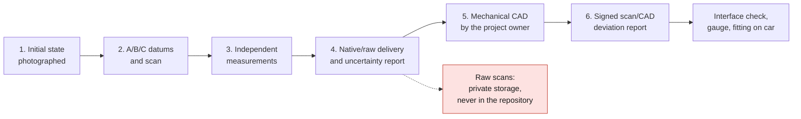

# Mechanics, acquisition and optics

## Scan specification

Scope: original panel **removed**, its fastening accessories, seals,
lamp holders and connectors present on the selected variant; also survey the
car-side interfaces by independent measurements, with authorization. The
service provider must confirm physical access to this exact part, its scan
volume and its command of glossy/translucent plastics. Building-scan
competence is not enough. Do not reconstruct a nominal part from photographs.

1. Initial state photographed: reference, optical markings, cracks, deformations,
   repairs; confidentiality of the vehicle identifiers. Do not polish or
   spray without agreement; propose a reversible matting agent, its cleaning and
   the effect of its thickness on the uncertainty.
2. A/B/C datum system established on the functional interfaces, coordinates in mm,
   car orientation documented; scan the exterior, back, bearing faces, bosses,
   clips and edges. Distinguish directly observed surface from interpolated hole.
3. Independent measurements with suitable instruments: center distances, diameters, planes,
   accessible thicknesses, angles, available depth, seal compressions,
   fits; repeatability over several setups. No invented nominal value.
4. Deliver the **native/raw** acquisition, PLY/XYZ/E57 point cloud depending on the device,
   clean OBJ/STL mesh to scale, transformations, authorized photographs, calibration
   certificate or status, parameters and coverage/uncertainty report. The data
   stay in controlled private storage; the repository only holds evidence
   references and validated rights, never the raw scans.
5. The mechanical CAD is done by the project owner: native parametric and STEP AP242
   if possible, history, surfaces/radii, datums and interface planes. A
   supplier reconstruction is only a separate option, not the base mandate.
   **STL = mesh; STEP = geometric exchange, not proof of parametric modeling.**
6. CAD acceptance: signed scan/CAD deviation report (distribution and maxima per zone,
   not only a global mean), non-acquired details marked unknown; check of the
   interfaces by measurement, then gauge and fitting on the target car.

[measurements.csv](measurements.csv) is the record to complete. Empty columns
mean "unknown". Before acquisition, agree on a measurement uncertainty
substantially lower than the functional tolerance (working target:
≤ one third, to be negotiated). Do not confuse scanner resolution, accuracy,
repeatability, part tolerance and process capability. The tolerances for outlines,
center distances, clips, peripheral clearance, flatness, seal and shrinkage will only be set
after functional analysis; no 993 dimension is committed here.

## LED size, pitch and resolution

A Kingbright 0402 red LED measures 1.0 × 0.5 mm [S01]. Its package does not include
the spacing needed for soldering, routing, drivers and repair. The ≤1 mm
preference is therefore plausible in monochrome; the ≤1 mm RGB package remains **to be sourced and
qualified**, with no validated reference in this study. An RGB pixel has three
channels, even if the component is a single one.

Normalized comparison for an **abstract 100 × 100 mm surface**, unrelated
to the unknown dimensions of the panel. Calculation = floor(100/p)²; indices relative
to the 4 mm pitch. The indices represent pixels/channels, not a price.

| Pitch mm | Pixels on this surface | Pixel index | Mono / RGB channels | Exploratory choice |
|---|---:|---:|---:|---|
| 1 | 10,000 | 16 | 10,000 / 30,000 | Very dense; PCB, placement, yield and heat to be costed, not selected at the start |
| 1.5 | 4,356 | 6.97 | 4,356 / 13,068 | Dense intermediate, supplier quote essential |
| 2 | 2,500 | 4 | 2,500 / 7,500 | Fine detail; off-the-shelf rigid module possible |
| 2.5 | 1,600 | 2.56 | 1,600 / 4,800 | First available RGB comparison |
| 4 | 625 | 1 | 625 / 1,875 | Economical mono starting point to compare |

For the measured usable surface W×H: Nx=floor(W/p), Ny=floor(H/p), then subtract
the masked/functional zones; do not apply directly to a curved bounding
rectangle. 5×7 text with one spacing column: N visible characters
≈floor(Nx/6), height ≥7 pixels plus margins. Validate at real distance, not on a screen.

| Technology | Verified availability | Strengths | Limitations / provisional verdict |
|---|---|---|---|
| Discrete mono red ≤1 mm | LED [S01], custom PCB to be developed | Spectrum suited to red, one channel/pixel, simpler drivers | Many joints; efficiency and multiplexing to be measured; recommended first coupon |
| RGB HUB75 P2.5 64×32 matrix | Waveshare [S02]: 160×80 mm module, 5 V/2.5 A, ≤12 W advertised | Coupon buyable without much development, animation import | Dimensions **of the module**, not of the 993; flat/indoor, curvature and temperature not qualified; ≤1 mm LED package not established |
| RGB P2 64×64 matrix | Reference listed by Waveshare [S03] | Density comparison | Depth, fastening and power; 2 mm pitch ≠ 1 mm LED |
| Custom RGB PCB | to be quoted | Useful geometry and independent zones | Three channels/pixel, consumption, manufacturing yield; red facade destroys color fidelity |
| Mono/RGB OLED | Newhaven 1.5 inch 128×128 [S04], example of a small screen | Fine pixels, black and thickness | Neither panel format nor exterior use validated; joins between screens, burn-in of static images, aging/temperature, humidity and sunlight visibility; custom OLED = separate supplier study |

## Red facade

It is a spectral filter: it transmits certain red wavelengths more
and absorbs part of the green/blue. A white RGB pixel tends toward red;
no software correction recreates a color that the material blocks.
Measure transmission per channel, haze/diffusion, reflections and ambient contrast,
before/after aging. A tinted, thick or highly diffusing facade requires
more flux; increasing the current can degrade heat and service life.
Monochrome red is the initial compromise; a less filtering zone can
favor RGB, at the cost of an off appearance less close to the original.

Compare three coupons: clear polished + red tint/varnish; red translucent;
clear + replaceable red film. Vary the LED/facade air gap on an adjustable support,
measure hotspots, pixel blending and viewing angle. No reproduction of the
Porsche logo, nor microprisms assumed equivalent to a type-approved retroreflector.

## Processes and outdoor durability

| Process | Materials / coloring / finish | Recommended use and required tests |
|---|---|---|
| SLA/DLP/MSLA | Clear resin, e.g. Formlabs Clear V5 [S05]; sanding/polishing and red varnish or film | Good form/optical coupon. Controlled post-cure; "clear" or HDT proves neither UV durability nor automotive resistance. Test yellowing, cracking, washing and creep when hot |
| PolyJet | VeroClear [S06]; support to remove, polishing; color/blend depending on machine | Visual mock-up; photopolymer to be qualified for UV/heat/humidity, not equivalent to solid PMMA |
| FFF | Transparent PETG or PC of documented grade; diffusing layers and voids | Translucent coupon and supports, variable optical quality, sealing not intrinsic. PC requires control of drying/temperature; avoid PLA for a heated exterior part |
| SLS/MJF | Translucent/opaque PA depending on thickness, not clear optics | Back/support only; texture/porosity, sealing treatment and aging to be tested |
| Printed master + vacuum casting | Tinted optical PU, grade datasheet essential | Small series; bubbles, shrinkage, mix variability and UV stability to be characterized |
| Thermoforming / machining then injection molding | Exterior-grade PMMA or PC, mass-tinted and possibly hardcoated | Production alternatives to be costed: PMMA attractive for optics/UV but impact to be examined; PC attractive for impact but scratches/UV depending on grade. Tooling and thicknesses to be defined |

A commercial "transparent" finish is not an optical or
photometric qualification [S05–S07]. Ask for raw cost **and** finishing, scrap and inspection.
Select a replaceable facade and a removable back with screws/inserts, a seal
compatible with the tint and with washing products, controlled compression,
free thermal expansion and a pressure vent if necessary. Avoid potting all
the electronics in resin; compare selective conformal coating and repairable interfaces.
Qualify UV aging, thermal shock, condensation, water, vibration and
cleaning agents on the complete system, with the possibility of changing the seal and facade.
