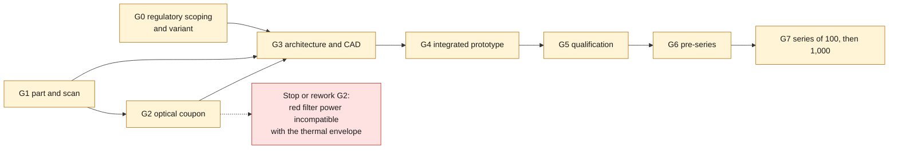

# Roadmap and backlog

Durations are **planning assumptions**, counted from authorization and from the
availability of parts/suppliers, not promised lead times.
Amounts refer to the single line items of [budget.csv](budget.csv): do not add
them up a second time. No step triggers spending automatically.

| Step / priority | Dependencies | Owner | Deliverable | Indicative duration | Budget CHF / line item | Exit criterion |
|---|---|---|---|---|---|---|
| G0 / P0 — regulatory scoping and variant | none | owner + DTC / TÜV lighting laboratory | written opinion on the original functions and possible routes | 1–3 weeks | 500–1,500 / regulatory_review | market and reference defined; route judged feasible, or display-only branch decided |
| G1 / P0 — part and scan | purchase/loan authorization, physical access | owner + scanner | measurement dossier, raw data, uncertainty report | 1–2 weeks | 180 / donor; 500–1,500 / scan | rights established, surfaces/interfaces complete, critical dimensions independently verified |
| G2 / P0 — optical coupon | G1 for a representative sample; flat coupon possible before G1 | owner + electronics engineer | mono/RGB behind three front-face recipes, optical/thermal measurements | 2–3 weeks | 250–700 / coupon | readability and off-state appearance accepted with measured power; pitch/color choice |
| G3 / P0 — architecture and CAD | G0–G2 | owner: all CAD; specialist: electronics | native CAD, interface drawing, reviewed schematic/BOM, comparable quotes | 3–6 weeks | 1,800–3,600 / mechanical; 4,000–10,000 / electronics | removability, thermal path, cost and power supply without modification demonstrable |
| G4 / P1 — integrated prototype | G3 | specialist + owner for assembly | full-width PCBA and housing, traceability, alpha firmware/app | 4–8 weeks | 685–1,450 / historical_prototype; 2,500–7,000 / firmware; 3,000–10,000 / mobile_app | fit and faults validated on the bench; BLE security on real phones |
| G5 / P1 — qualification | G4 and protocol accepted by a laboratory | laboratory + specialist + owner | environmental/EMC/radio/optical reports, regulatory dossier | 6–12 weeks or more | 2,000–6,000 / precompliance; 5,000–20,000 / approval | written results and applicable authorizations, corrections retested |
| G6 / P1 — pre-series | G5 according to the authorized use | owner + EMS/optics | 10 traceable units, inspection bench, packaging | 3–6 weeks | 1,000–3,000 / fixtures; 500–1,500 / packaging_dev; units on quote | actual time, yield, disassembly and shipping validated; target cost confirmed |
| G7 / P2 — series of 100, then 1,000 | G6, real demand and separate authorization | owner; possible student help | assembly routing, quality control, after-sales service, origin dossier per batch | to be quoted | 223–420 / unit at 100; 138–271 at 1,000, historical | no launch before funding, capacity and evidence of compliance |

**Short order:** regulatory scoping and the part search in parallel;
coupon before a large PCB; cost and feasibility before tooling. Stop or rework G2
if the red filter requires a power level incompatible with the thermal envelope.
No software compensation for a fault in the regulatory functions.

*Gate dependencies restated from the table above; the dashed branch is the G2
stop condition. G1 feeds G2 only for a representative sample: a flat coupon is
possible before G1. The diagram does not show any gate as passed.*

## Executable backlog

| ID | Priority | Action / expected evidence | Dependency |
|---|---|---|---|
| RP-01 | P0 | Identify market, model year, body and reference; photograph markings and functions, with no public vehicle identifier | G0 |
| RP-02 | P0 | Have DTC/TÜV confirm the reflector/rear fog light scope and the status of the dynamic display | RP-01 |
| RP-03 | P0 | Confirm availability/purchase or loan of the 180 CHF part; do not send any payment from this dossier | owner agreement |
| RP-04 | P0 | After agreement, send the scan and coupon/electronics RFQs; obtain rights, data and separate pricing | RP-01/03 |
| RP-05 | P0 | Complete measurements.csv; define datums, uncertainties and tolerances with the owner | scan |
| RP-06 | P0 | Compare 2.5/4 mm pitch and mono/RGB, measure transmittance and contrast | coupon |
| RP-06a | P0 | Review the [native E0 schematic](electronics/kicad/README.md): three sheets, ERC and netlist check prepared; professional review, footprints, routing/DRC, assembly and tests remain to be done | electronics engineer review; no order placed |
| RP-07 | P0 | Replace budget assumptions with 1/10/100/1,000 quotes; identify the actual site of each operation | RP-04/06 |
| RP-08 | P1 | Port the state machine to the chosen MCU; BLE authentication and hardware cutoff, iOS/Android tests | MCU choice |
| RP-09 | P1 | Produce the native CAD and the tolerance stack-up analysis; unloaded fit jig, then integrated PCB | RP-05/06 |
| RP-09a | P1 | [Full PicoGK visual concept model](cad/README.md) prepared on October 10, four volumes and provisional parameters; replace the envelope and define the measured interfaces before any functional CAD. Does not validate G3/RP-09 | concept authorized; RP-05 metrology and RP-06 coupon still required |
| RP-10 | P1 | Qualify power supply, RF, EMC, optical aging, fit and packaging | prototype |
| RP-11 | P1 | Document costs of origin and the essential activity; have them reviewed before any Swiss claim | quotes + G6 |
| RP-12 | P2 | Music title POC: iOS AMS, Android MediaSession, exact head unit, each separately | stable BLE |
| RP-13 | P2 | Variants: 964, other 911s with an identified rear panel, RUF and restomods case by case | G6 |

For RP-13: one record **per reference and market**, access to the real part,
approved functions, scan/dimensions/fastenings, depth, power supply,
optics and trademark rights. No compatibility between 964/993, RUF/Porsche or
between restomods is presumed. Protocol and inspection may be shared,
not the mechanical interfaces or the approval dossiers.

As volumes increase: measure assembly hours before recruiting;
students under supervision with ESD training, controlled work instructions and
final inspection by the owner. EPFL is neither a partner nor a guarantor of this
project.
