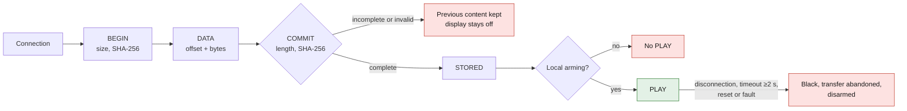

# Software, firmware and BLE protocol v0

**Prototype contract, not validated on hardware.**
[panel_simulator.py](software/panel_simulator.py) is the executable skeleton of
the firmware state machine and of the transfer. It drives no MCU, no LED and no
radio. The `connect(authenticated=True)` context is injected by the test: **no
pairing, encryption, key storage or secure boot is implemented**.
This boolean must never be tied to a command received from the phone.

For the E0 coupon, [coupon_driver.py](software/coupon_driver.py) encodes the mono8
frames into data for six TLC5947, without hardware access. The
[E0 contract](electronics/coupon.md) defines wiring, bit order and the BLANK/XLAT
sequence, to be verified on target. This building block does not provide the
firmware, the real SPI transport or BLE security.

## Software scope

First version: text rasterized on the phone, drawing, simple animations and GIFs
converted off the MCU into bounded frames. No cloud, account, microphone,
telemetry or collection of personal identifiers. Native iOS CoreBluetooth and
Android BLE app to be built after coupon validation; no mobile application
delivered and no OS compatibility tested. Functional wireframes: connect/pair,
edit/import, preview at the negotiated resolution, send/progress, arm in physical
presence, stop. Show the usage limit, the errors and the actual number of
available colors; no "approved" button.

## v0 contract and limits chosen for the simulator

- Virtual coupon: 16×8 pixels mono8 (0–255). General parser limits:
  4,096 pixels/frame, 60 frames, 256 KiB of decoded data; 100–10,000 ms/frame.
  These are test limits, not the capabilities chosen for the product.
- Development JSON document encoding: `version=1`, `width`, `height`,
  `format="mono8"`, `frames=[{"duration_ms":100,"pixels":[…]}]`.
  Rows left to right and top to bottom; integer values, booleans prohibited.
  In the product, carry the pixels in binary without JSON to save RAM/throughput.
- In the v0 transport, BEGIN announces the size and SHA-256 of the concatenated
  pixels (`frame0` then `frame1`), dimensions and durations; DATA provides the
  exact offset and the bytes. Max 128 application bytes per chunk in the model;
  the real transport will have to reduce this to ATT MTU−3−header (MTU 23 must
  remain functional).
- COMMIT checks length, SHA-256 and atomicity before replacing the active content.
  SHA-256 detects corruption; it **does not authenticate a sender**. An incomplete
  or invalid transfer does not replace the previous one; the display stays off.
- A connection is not enough to activate: PLAY requires valid content and local
  arming. Disconnection, timeout ≥2 s, reset or fault: black, transfer abandoned
  and disarmed. An authenticated HEARTBEAT restarts the timer; reconnection
  requires new physical arming. No automatic resumption after a failure.



*v0 transfer and play rules of the simulator, as listed above. Not validated on
hardware; no pairing or encryption is implemented.*

## Proposed GATT for the port

Project service UUID `6d530001-0993-4e50-9b00-2b0a26000001`; characteristic UUIDs
with first group `6d530002` capabilities (read), `6d530003` control (write with
response), `6d530004` data (write with response), `6d530005` status (notify).
Private project UUIDs, not a standard Bluetooth SIG service.

| Command | Payload | Response and rules |
|---|---|---|
| CAPABILITIES | none | version, formats, width/height, max bytes, frame rate, max chunk; limited read without an authenticated link |
| BEGIN | session ID, size, SHA-256, dimensions, durations | READY or error; display stops, one transfer at a time |
| DATA | session ID, offset, bytes | next offset; duplicate/out-of-order rejected in v0, resumption through a new BEGIN |
| COMMIT | session ID | STORED if complete, otherwise error without installation |
| PLAY / STOP | session ID | state; PLAY conditional on local arming |
| HEARTBEAT | session ID | state, fault counter; expiry closes the session |

The GATT/session IDs and the binary serialization are a porting specification,
not implemented in the simulator. The peripheral creates a new random ID for
each session; reject an old ID, an excessive size and unencrypted writes.
No OTA command in this content protocol.

## Security of the port

BLE LE Secure Connections with MITM protection: a local button opening a short
pairing window, a one-time code on the display/local service, or an authenticated
OOB mechanism to be validated with iOS/Android. Refuse a silent fallback to
"Just Works". Initial pairing in the workshop may require a service device as
long as the display is not ready. A single active owner; bonds erased by an
explicit local gesture, documented revocation, back-off against repeated
attempts. Keys generated and kept on the device, never in this repository. Test
interception, replay, unauthorized device and loss of the phone.

Firmware: sensor acquisition, power management and watchdog independent of the
transfer; bounded, non-blocking rendering; double buffer. LED driver behind a
minimal `blank/render` interface, transport behind authentication and limits.
Do not build a framework before the target is selected.

Future DFU: a proven SDK mechanism (MCUboot/secure chain depending on the MCU
[S09]), signed images, provisioned public key, compatible version and
anti-rollback to a vulnerable version, secondary bank then boot confirmation;
power cut at each step, local recovery. Private signing key kept out of the
repository. BLE authentication alone does not replace signing. Black screen
during DFU; never expose here a loader that would accept an arbitrary binary.

## GIF import and demonstration

With Pillow already installed:

```sh
python3 docs/projects/993-programmable-rear-panel/software/panel_simulator.py --gif dessin.gif --output /tmp/panel-frames.json
python3 docs/projects/993-programmable-rear-panel/software/panel_simulator.py --input /tmp/panel-frames.json
```

Local conversion: file cap 5 MiB, source dimensions 1 megapixel maximum,
60 frames maximum; GIF compositing by Pillow then black background, 16×8
letterbox, 8-bit gray, duration bounded to 100–10,000 ms. Oversized images or
overly long animations are rejected, not silently truncated. No GIF decoding on
the MCU. The real red rendering will use a measured LUT/calibration; RGB would
require a distinct versioned format. Third-party GIFs: check the rights before
use and do not commit content received without a license.

## Music title: separate study

| Source | Real lead | Limit / test to run |
|---|---|---|
| iPhone | **Apple Media Service** client accessory [S10]: iOS player information over BLE | Archived documentation; test iOS versions and chosen players, notifications, locked screen and BLE coexistence. An ordinary iOS app does not automatically get the titles of all other apps |
| Android | MediaSessionManager and MediaController [S11] | `MEDIA_CONTENT_CONTROL` or a notification listener authorized by the user; respect for refusal, player/OS variations, background and BLE permissions |
| Car radio | Documented API of the model, or an appropriate AVRCP role if available | Exact reference and Bluetooth roles to be identified; BLE is not Bluetooth Classic AVRCP. An A2DP receiver does not necessarily offer third-party access to metadata; no invented teardown/bus |

Accept the absence of a title and erase the data on disconnection. Do not keep
the music history. RP-12 is an optional POC that blocks neither the coupon nor
the manual messages. No real third-party title, service logo or cover art is
delivered.
